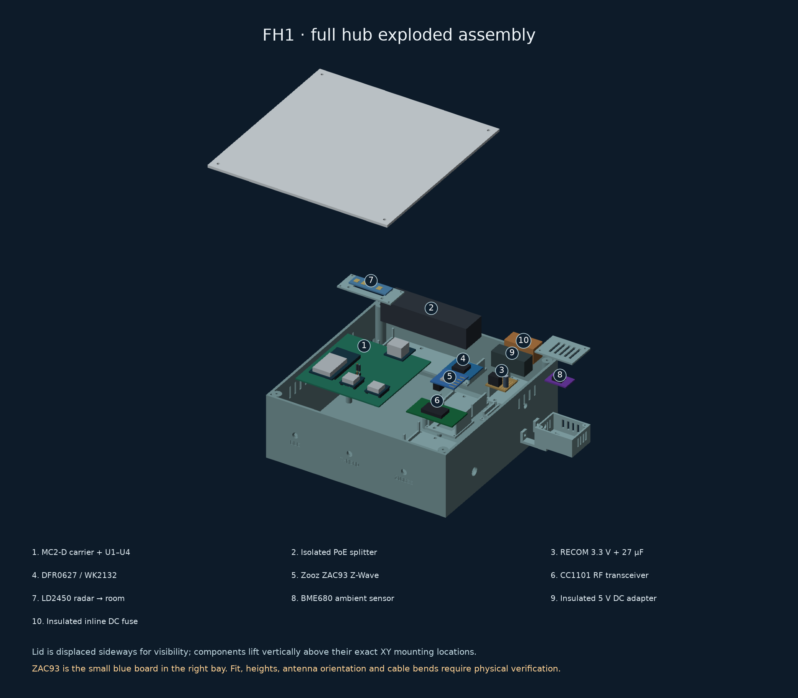
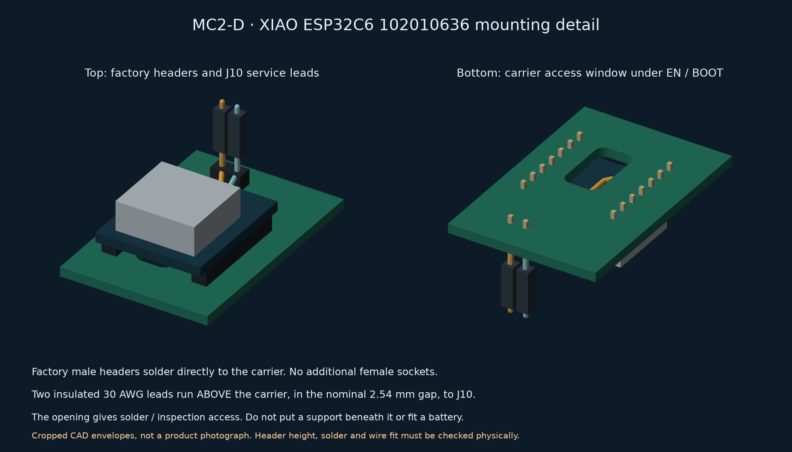
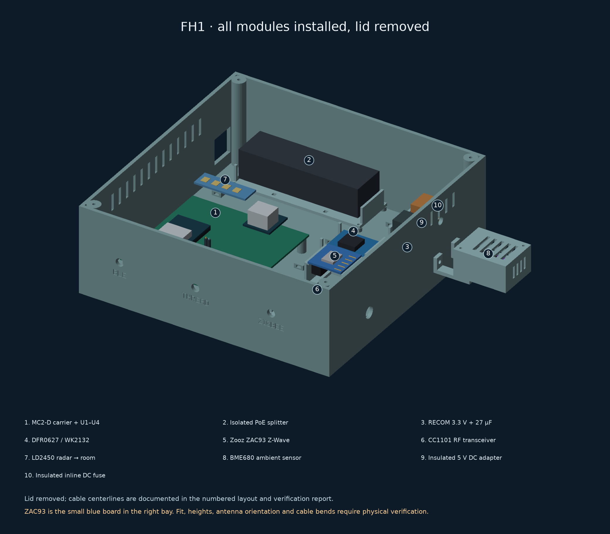
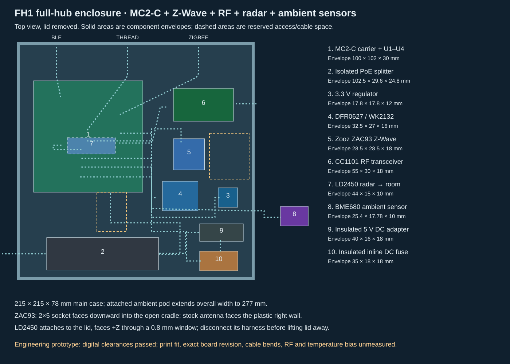
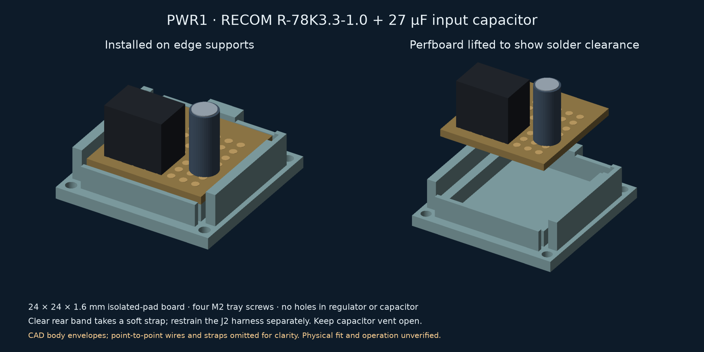

# HA Radio Hub — MC2-D

**Three independent external antennas: Zigbee, Thread and Bluetooth.** MC2 keeps
a local classic-ESP32 Thread Border Router, Ember Zigbee coordinator, active BLE proxy,
Z-Wave, 433 MHz RF, LD2450 and BME680 behind one Ethernet uplink. Its
100 × 100 mm carrier holds finished modules with direct-solder male headers.



*Generated from the current enclosure geometry with simplified electronic
bodies, including the pre-soldered XIAO ESP32C6 and the RECOM power assembly. Use the [full-hub CAD layout](mechanical/full-hub/layout.svg),
[print files](mechanical/full-hub/README.md) and [wiring guide](docs/full-hub-assembly.md)
for construction. Antennas and most cables are omitted for visibility; connect
the required antennas before operation.*

**Engineering prototype.** Source builds and CAD checks are not measurements of
coverage, power consumption, mechanical fit or radio certification. The
1,000 ft² house coverage target still requires testing.

## Start building

Follow [Start here](docs/start-here.md) for the ordered build, success checks,
Home Assistant connections and troubleshooting. Program the loose boards before
permanent assembly. The current hardware is **MC2-D + FH1**; older revisions are
kept as references.

For readable pages, searchable wiring and print downloads, clone or download
this repository and run from its root:

```sh
python3 tools/preview.py
```

This opens the local build guide in a browser; no Python packages are needed.
Alternatively, open [guide/index.html](guide/index.html) from the downloaded
folder. GitHub shows HTML source rather than running this guide. Use
`--port 0` if the default local port is occupied.

[Start here](docs/start-here.md) ·
[Versioned engineering build package](docs/releases.md) ·
[Print package — all STLs and quantities](mechanical/full-hub/FH1-MC2-D-PWR1-print-package.zip) ·
[Pin-to-pin harness CSV](hardware/external-antenna/harness.csv) ·
[Connection audit and I²C correction](docs/connection-audit.md) ·
[Documentation index](docs/README.md)


## Selected hardware

**Buying parts?** The [MC2 shopping guide](docs/mc2-shopping.md) gives quantities,
exact order codes, inspected AliExpress variants and outstanding availability
checks. **MC2-D uses XIAO ESP32C6 pre-soldered SKU 102010636** for Thread.
DigiKey showed 21 in stock at **$6.38** on 20 October 2026. The ESP32-DevKitC-VIE
is already ordered; do not buy another. Use the [PCB ordering record](docs/pcb-order.md)
for the new fabrication package and five-board prototype recommendation.
Buy factory-fitted headers wherever available. Two fine recovery leads on the
XIAO underside remain necessary; see the assembly instructions before soldering.

- **Espressif ESP32-DevKitC-VIE / ESP32-WROVER-IE:** previous-generation host
  with a factory external antenna connector, 8 MB flash and 8 MB physical PSRAM
  (4 MB directly addressable, quad 40 MHz); Ethernet host and active BLE 4.2 proxy.
- **Seeed XIAO ESP32C6 (Pre-Soldered), 102010636:** Thread RCP, 4 MB flash,
  native USB and factory 2×7 male headers. MC2-D firmware drives GPIO3 LOW and
  GPIO14 HIGH to select the external antenna. Two underside EN/BOOT wires to
  J10 preserve automatic recovery; a carrier service window makes them accessible.
- **Seeed XIAO MG24 (Pre-Soldered), 102010690:** Ember NCP with explicit
  external-antenna firmware and factory 2×7 male headers.
- **WIZnet WIZ850io:** shared-SPI Ethernet; retain the isolated PoE splitter and
  regulated low-voltage supply from the battery-fed PoE switch.
- **RECOM R-78K3.3-1.0:** the peripheral 5 V → 3.3 V converter, replacing
  Pololu D24V22F3. It connects to the existing J2 harness, with a local input
  capacitor and a removable mount. The power architecture is retained in MC2-D.
  [Power connections and limits](docs/full-hub-assembly.md#power-and-ethernet).
- **Three TE ANT-2.4-LCW-SMA antennas and three Taoglas CAB.618.E cables:**
  separate 50 Ω paths, standard SMA bulkheads, no combiner. The
  [updated selection](docs/pigtail-selection.md) saves $74.43 on three cables;
  use the **FH1-MC2-D-PWR1** enclosure and fit coupon.

Classic ESP32 retains the configured services and three active BLE connections,
but does not support BLE 5 extended advertising or Coded PHY. Lower power
consumption has not been established. See the [host migration](docs/classic-esp32-migration.md)
for the cost comparison, memory limits and compatibility checks.

The WK2132 bridge, ZAC93, band-matched CC1101/433.92 MHz antenna, radar,
environment sensor and power modules connect to the carrier by harnesses. The
[carrier BOM](hardware/external-antenna/cad/BOM.csv) and
[antenna BOM](hardware/external-antenna/rf-bom.json) accompany the assembly guide;
neither is a complete single-box shopping list on its own. The
[full assembly inventory](mechanical/full-hub/components.json) includes these
modules, the selected finished PoE splitter and the power/cable accessories.


The current carrier above is generated from native CAD. Historical AI surface-finish
concepts are kept in the [image record](hardware/external-antenna/images/README.md)
and are not assembly references for MC2-D.



*The two hand-soldered EN/BOOT leads supplement the factory headers.
[Exact test-pad and J10 diagram](hardware/external-antenna/cad/c6-recovery.svg) ·
[Assembly sequence](docs/full-hub-assembly.md#thread-recovery-leads).*

## Where the Z-Wave board and other parts go

**Zooz ZAC93 sits in its own removable insulated cradle beside the MC2-D
carrier.** Its underside 2×5 socket connects by a wired mating header to carrier
**J4**; the **DFR0627 / WK2132** bridge connects to **J3** and provides its serial
port. The ZAC93 does not plug into the ESP32 or a Raspberry Pi in this build.
Keep its stock antenna clear of straps, cables and metal.



*Current CAD assembly with simplified component bodies. Earlier AI appearance
concepts remain in the [historical image record](hardware/external-antenna/images/README.md);
use the current numbered CAD plan for module and cable placement.*



The **FH1 full-hub enclosure** has a 215 × 215 × 78 mm main shell, dedicated
mounts for the carrier, ZAC93, UART bridge, CC1101, PoE splitter and 3.3 V buck,
and a restrained DC-adapter/fuse tray. LD2450 mounts behind the room-facing lid
window. BME680 has a ventilated pod attached outside the warm shell with an air
gap. Three independent 2.4 GHz bulkheads remain on the fixed base.

[Exploded CAD and print files](mechanical/full-hub/README.md) ·
[Complete assembly and ZAC93 pin mapping](docs/full-hub-assembly.md) ·
[Graphical wiring](hardware/external-antenna/full-hub-wiring.svg)

## The smaller power assembly

The isolated PoE splitter supplies **5 V**. The **RECOM R-78K3.3-1.0** supplies
**3.3 V only to the peripherals**, through J2. Its 27 µF input capacitor and
insulated wire links fit on a 24 × 24 mm perfboard in the new **PWR1** holder.
Print the matching PWR1 base and holder together. No second custom PCB order
is needed. The converter and capacitor total **$4.38**, before shipping and tax,
versus $26.95 for the previous converter; see the dated [shopping record](docs/mc2-shopping.md).



[Power and capacitor wiring](hardware/external-antenna/power-wiring.svg) ·
[Perfboard: component and solder sides](hardware/external-antenna/power-perfboard.svg) ·
[Assembly and power checks](docs/full-hub-assembly.md#power-and-ethernet)

## Build and inspect

- [Native CAD, schematic and connector map](hardware/external-antenna/README.md).
- [Firmware builds and initial programming](firmware/external-antenna/README.md).
- [Verified-target network update workflow](firmware/external-antenna/updates/README.md).
- [Full-hub printable parts, component mounts and connector fit coupon](mechanical/full-hub/README.md).
- [Digital verification and remaining physical checks](hardware/external-antenna/validation.md).
- [RF commissioning procedure](docs/rf-commissioning.md) and
  [results sheet](hardware/external-antenna/coverage-results.csv).

The largest print is 215 × 215 mm, within the selected TRONXY XY-3's nominal
310 × 310 × 330 mm print volume. The 65 mm adjacent antenna pitch and 150 mm
coax routes still require physical fit and coexistence tests. Module heights,
mating plugs, the existing CC1101 variant and printed tolerances must be checked
against the delivered hardware. Digital geometry checks do not establish
physical fit. The earlier [carrier-only enclosure](mechanical/module-carrier/external-antenna-prototype/README.md)
remains a historical option, not the full-hub housing.

MC2-A (S3) is preserved in a Git snapshot, and MC1 remains a regression target;
see the [engineering history](docs/design-history.md). MC1's Nano/H2 firmware,
16 MB partition table and compact enclosure do not fit MC2. The [design registry](hardware/designs.json) identifies the one active
revision. Do not mix images, pin maps or prices between revisions.

## Project information

Repository settings are managed by
[terraform-github-ha-homelab](https://github.com/4alvit/terraform-github-ha-homelab).
No private network keys, learned household RF codes or installation credentials
are distributed. See [infrastructure](docs/infrastructure.md),
[security](SECURITY.md), [license](LICENSE) and
[third-party notices](THIRD_PARTY_NOTICES.md).

Run `python3 tools/check.py` for offline document/source checks. Hardware,
firmware and mechanical guides list their reproducible validation commands.
