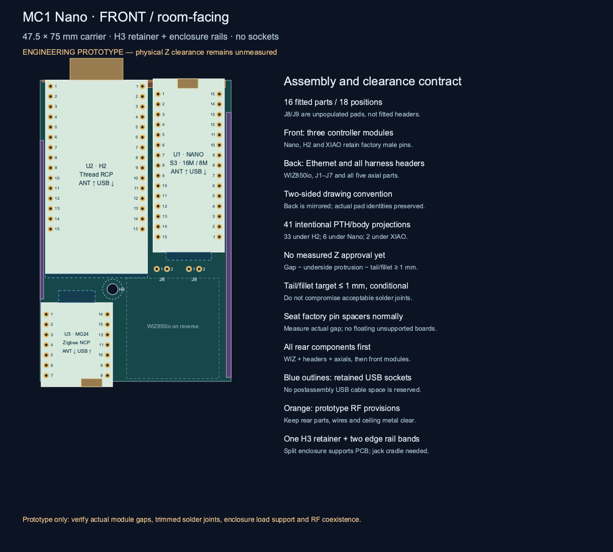

# HA Radio Hub — MC1

**One current design: a carrier for finished modules.** MC1 keeps a local S3
Thread Border Router, an independent Ember Zigbee coordinator, active Bluetooth
proxy, Z-Wave, 433 MHz RF, radar and environmental sensing behind one Ethernet
uplink. It replaces the competing carrier/integrated construction paths.

**Status: engineering prototype.** Software builds, CAD checks and renderings
are evidence for their specific checks, not proof of electrical operation,
RF range, power consumption or mechanical fit.

Start with the [English assembly guide](docs/module-carrier.md), the
[interactive visual guide](hardware/module-carrier/index.html), and the
[current hardware files](hardware/module-carrier/README.md).

## One board to assemble

The carrier is a **47.5 × 75 mm rectangle with two copper layers**.
One H3 retention hole remains; split enclosure rails support both long edges.
The PCB is 6.9% smaller than the preceding four-hole board and 26.9% below the historical
65 × 75 mm single-sided carrier. It uses a factory-header
**S3-Nano-M with 16 MB flash and 8 MB PSRAM**, shared Ethernet/CC1101 SPI and the
same dedicated Thread and Zigbee radios. Initial programming is done before soldering;
USB cable corridors are removed, while physical connector bodies remain accounted for.
Seven male harness headers and the Ethernet module sit on the ceiling-facing
back; the controllers face the room. RJ45 opens outward at the board edge. See the
[same-scale comparison](hardware/module-carrier/layout-comparison.svg)
and [fabrication-cost rationale](docs/module-carrier.md#compact-placement-and-fabrication-cost).

Finished S3, H2, XIAO MG24 and WIZ850io modules mount on the carrier.
**Male pins go directly into plated holes and are soldered on the opposite face.
No female module sockets; no castellated-side soldering.** Solder the entire back first, including WIZ, then fit the front controllers.
Check measured clearance to prevent opposing leads from touching module undersides. The power converter, UART bridge,
existing radios and sensors are finished modules with documented connections.

The H2 DevKitM-1 v1.3 needs one preparation step: remove R7 to isolate its USB-UART
transmitter. Its matched RCP and host updater use RX23/TX24. J8/J9 are unpopulated
recovery pads; no headers are fitted there. See the assembly guide before soldering.

The carrier does not duplicate the modules' regulators, crystals, RF matching
or decoupling arrays. There is no separate M0 radio adapter to manufacture and
no second integrated-radio PCB option to choose.

## Preserve the interfaces

- S3 hosts the local Thread BR and application services; H2 is its dedicated RCP.
  Failed Thread startup is quarantined; terminal faults allow one controlled restart
  rather than a repeating boot loop. Explicit retry and health diagnostics are exposed.
- XIAO MG24 runs board-specific Ember NCP firmware, preserving the ZHA/
  Zigbee2MQTT protocol family and hardware UART flow control.
- Active BLE proxy, RF Airbridge contracts, ZAC93 Z-Wave, LD2450 controls and
  BME680 measurements remain in scope.
- A finished WK2132 UART bridge replaces the loose SC16 circuit. Its transport
  is validated for message length, queueing and I/O error behavior before use.

See [MC1 firmware](firmware/module-carrier/README.md) for exact build evidence
and remaining commissioning work. This is not a claim that old binary images
can be flashed onto different boards unchanged.

## Current visuals and CAD

- [MC1 visual guide and wiring search](hardware/module-carrier/index.html)
- [Native KiCad source and verification](hardware/module-carrier/cad/)
- [Current board gallery](hardware/module-carrier/images/README.md)
- [One-design registry](hardware/designs.json)

Renders are labeled by origin. A generated illustration is not a photograph of
a manufactured assembly and is not a source for pin numbering.

## Earlier work

C0/M0, I0, D0, the original Pi-based assembly and the all-H2 experiment are
retained as [engineering history](docs/design-history.md). Their images,
footprints, pin maps and enclosures must not be mixed into an MC1 build.

The [H2 parity audit](docs/h2-quartet-function-audit.md) explains why identical
H2 controllers were not selected: local BR software and Zigbee integration/
backup behavior would require material changes. Using finished modules delivers
the assembly simplification independently of making all processors identical.

## Project information

Repository settings are managed by
[terraform-github-ha-homelab](https://github.com/4alvit/terraform-github-ha-homelab).
No private network keys, learned household RF codes or installation credentials
are distributed. See [infrastructure](docs/infrastructure.md),
[security](SECURITY.md), [license](LICENSE) and
[third-party notices](THIRD_PARTY_NOTICES.md).

Run `python3 tools/check.py` for offline document/source checks. MC1-specific
generation and validation commands are in its hardware and firmware guides.
