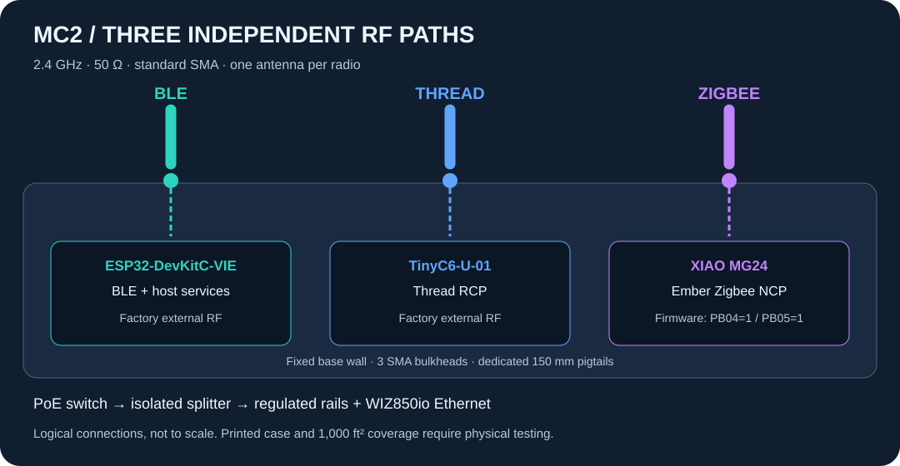
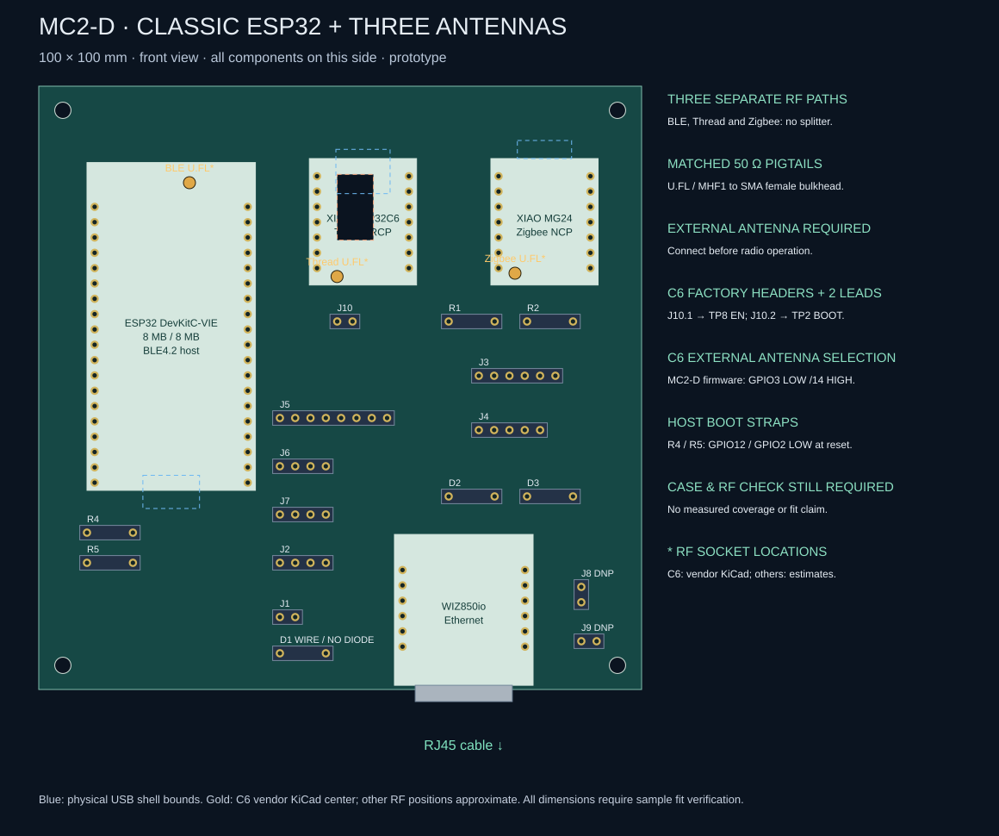
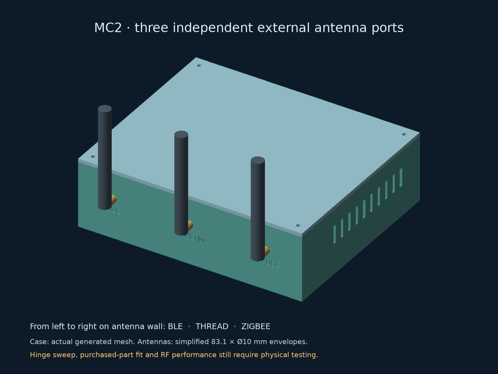

# HA Radio Hub — MC2

**Three independent external antennas: Zigbee, Thread and Bluetooth.** MC2 keeps
a local ESP32-S3 Thread Border Router, Ember Zigbee coordinator, active BLE proxy,
Z-Wave, 433 MHz RF, LD2450 and BME680 behind one Ethernet uplink. Its
100 × 100 mm carrier holds finished modules with direct-solder male headers.

*AI-generated appearance concept, not a photograph. Module shapes, pin counts,
markings and copper are illustrative; use the [actual assembly drawing](hardware/external-antenna/cad/assembly-top.svg)
and [native CAD](hardware/external-antenna/cad/README.md) for construction.
The radios are shown without their required antennas to keep the board visible.*

**Engineering prototype.** Source builds and CAD checks are not measurements of
coverage, power consumption, mechanical fit or radio certification. The
1,000 ft² house coverage target still requires testing.

Start with the [assembly guide](docs/external-antennas.md),
[visual wiring guide](hardware/external-antenna/index.html),
[documentation index](docs/README.md) and
[hardware files](hardware/external-antenna/README.md).

## Selected hardware

**Buying parts?** The [MC2 shopping guide](docs/mc2-shopping.md) gives quantities,
exact order codes, inspected AliExpress variants and outstanding availability
checks. TinyC6 supply is unresolved; secure the original **TC6-U-01** before
ordering a batch of carriers.

- **ESP32-S3-DevKitC-1U-N8R8:** factory external antenna, 8 MB flash and 8 MB
  octal PSRAM; Ethernet host and active BLE proxy.
- **Unexpected Maker TinyC6-U-01:** external U.FL Thread RCP, 8 MB flash,
  native USB and ordinary header-accessible recovery pins. Its two loose headers
  require through-hole soldering. Availability was backorder/on-request when
  checked on 18 October 2026; verify the exact SKU before ordering.
- **Seeed XIAO MG24:** Ember NCP with explicit external-antenna firmware.
- **WIZnet WIZ850io:** shared-SPI Ethernet; retain the isolated PoE splitter and
  regulated low-voltage supply from the battery-fed PoE switch.
- **Three TE ANT-2.4-LCW-SMA antennas and three Amphenol 095-902-545-150 cables:**
  separate 50 Ω paths, standard SMA bulkheads, no combiner.

The existing WK2132 bridge, ZAC93, band-matched CC1101/433.92 MHz antenna, radar,
environment sensor and power modules remain off-board. The
[carrier BOM](hardware/external-antenna/cad/BOM.csv) and
[antenna BOM](hardware/external-antenna/rf-bom.json) accompany the assembly guide;
neither is a complete single-box shopping list on its own.

*Bare-board appearance concept only. AI-generated traces, pads and labels are
not fabrication data. [Image provenance and prompts](hardware/external-antenna/images/README.md).*

## Build and inspect

- [Native CAD, schematic and connector map](hardware/external-antenna/README.md).
- [Firmware builds and initial programming](firmware/external-antenna/README.md).
- [Verified-target network update workflow](firmware/external-antenna/updates/README.md).
- [Five printable parts and connector fit coupon](mechanical/module-carrier/external-antenna-prototype/README.md).
- [Digital verification and remaining physical checks](hardware/external-antenna/validation.md).
- [RF commissioning procedure](docs/rf-commissioning.md) and
  [results sheet](hardware/external-antenna/coverage-results.csv).

The new **carrier-only** enclosure has a nominal 190 × 160 × 58 mm shell plus
4 mm ceiling frame. Three bulkheads stay on its fixed base; the lid can be
removed without moving their coax. The 65 mm adjacent pitch and 150 mm cable
routes require a physical fit and coexistence test. Other modules need separate
accommodation. CAD renderings are not photographs of manufactured hardware.

MC1 is retained as [engineering history](docs/design-history.md) and a regression
target. Its Nano/H2 firmware, 16 MB partition table and compact enclosure do not
fit MC2. The [design registry](hardware/designs.json) identifies the one active
revision. Do not mix images, pin maps or prices between revisions.

## Project information

Repository settings are managed by
[terraform-github-ha-homelab](https://github.com/4alvit/terraform-github-ha-homelab).
No private network keys, learned household RF codes or installation credentials
are distributed. See [infrastructure](docs/infrastructure.md),
[security](SECURITY.md), [license](LICENSE) and
[third-party notices](THIRD_PARTY_NOTICES.md).

Run `python3 tools/check.py` for offline document/source checks. Hardware,
firmware and mechanical guides list their reproducible validation commands.
