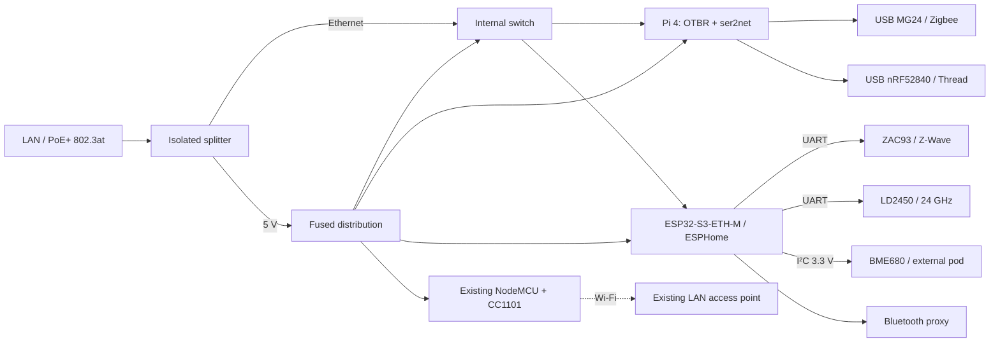
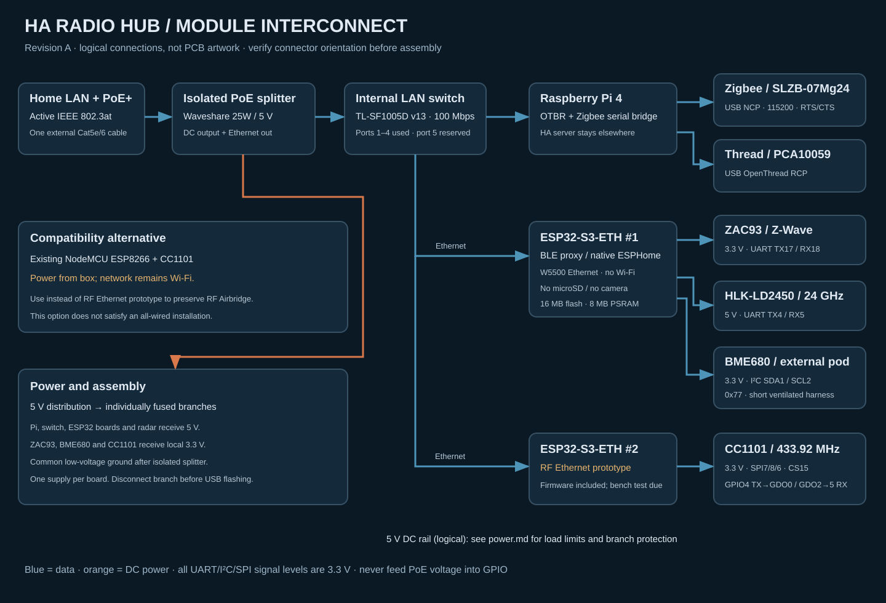

# HA Radio Hub

A modular, single-input PoE appliance for **Zigbee, Thread, Bluetooth, Z-Wave,
433 MHz RF, presence and environmental sensing**. Original public design by
HA Homelab. [Русский обзор](docs/overview.ru.md).

**Status: engineering prototype design, not a physically validated product.**
CAD, firmware configuration and deployment tooling are provided. A successful
software build does not establish RF range, power margin, thermal performance,
sensor accuracy or mechanical fit. See [acceptance](docs/acceptance.md).


## What is inside

- Raspberry Pi 4 runs the OpenThread Border Router locally and exposes a separate
  Zigbee coordinator over TCP to ZHA or Zigbee2MQTT.
- Independent USB radios: an EFR32MG24 Zigbee coordinator and an nRF52840 Thread
  RCP. They never share a multiprotocol firmware or antenna.
- Waveshare ESP32-S3-ETH-M connects by Ethernet and runs ESPHome: active Bluetooth
  proxy, the existing Zooz ZAC93 module, LD2450 radar, and BME680 on I²C.
- The existing NodeMCU/CC1101 RF Airbridge is reused, with its original firmware
  and HA contracts. **This compatibility module still uses Wi-Fi.** One external
  PoE cable supplies the box, but that alone does not make this RF path wired.
- An [experimental Ethernet RF replacement](firmware/rf-ethernet.experimental.yaml)
  uses a second S3-ETH controller. It requires two CC1101 GDO wires and a separate
  HA migration; it is not a drop-in replacement for the installed RF Airbridge.
- A PoE+ splitter, internal Ethernet switch and fused 5 V distribution provide
  power and data. The BME680 sits in a ventilated external sensor pod.



## Build the prototype



1. Read the [Russian overview](docs/overview.ru.md), [hardware design](hardware/README.md)
   and [wiring](hardware/wiring.md); verify the exact board and regional radio variants.
2. Check [enclosure instructions](docs/enclosure.md). Print fit coupons and dry-fit
   the parts before printing the whole enclosure. Parametric source is in `mechanical/`.
3. Follow [firmware and flashing](docs/firmware.md). The initial USB flash uses your
   own local secrets. The ZAC93 keeps its vendor firmware.
4. Follow the Linux deployment in `software/`, then [Home Assistant setup](docs/home-assistant.md).
5. Complete the [acceptance checklist](docs/acceptance.md) before migrating your household.
6. Select accessories from [Matter-over-Thread devices](docs/thread-devices.md).

The Home Assistant host still needs its normal Matter server and Z-Wave JS server.
The box moves OTBR and radio access near the devices; it does not run HA itself.
Bluetooth proxy is for supported BLE integrations, not classic Bluetooth audio.

## Why this differs from the inspiration

The [BitEngine project](https://community.home-assistant.io/t/1028644) describes
MG24 plus ESP32-C5, with source and schematics still forthcoming when inspected
on 2026-10-16. This repository is an independent modular implementation using a
Linux OTBR host and a dedicated Thread RCP. It does not claim to reproduce that
unpublished hardware or firmware.

The [desktop satellite article](https://www.open-electronics.org/a-desktop-satellite-with-the-esp32-c3-21-grams-of-telemetry/)
inspired the I²C expansion. A second ESP32-C3 is unnecessary here: the Ethernet S3
has two free pins for BME680. The reported gas value is **resistance**, not measured
CO₂, VOC concentration or a certified air-quality rating.

## Repository and validation

Repository creation and settings belong to
[terraform-github-ha-homelab](https://github.com/4alvit/terraform-github-ha-homelab),
in the existing HCP Terraform workspace. See [infrastructure](docs/infrastructure.md).
No Terraform state, network keys, learned household RF codes or firmware images
containing credentials are distributed here.

```sh
python3 tools/check.py
python3 -m venv .venv
.venv/bin/pip install -r firmware/requirements.txt -r mechanical/requirements.txt
.venv/bin/python firmware/validate.py --esphome .venv/bin/esphome
.venv/bin/python mechanical/build.py
```

See [validation status](docs/validation.md) for what was actually run. Original
code, CAD and documentation use [MIT](LICENSE); referenced third-party software,
firmware, libraries and trademarks retain their own licenses.
