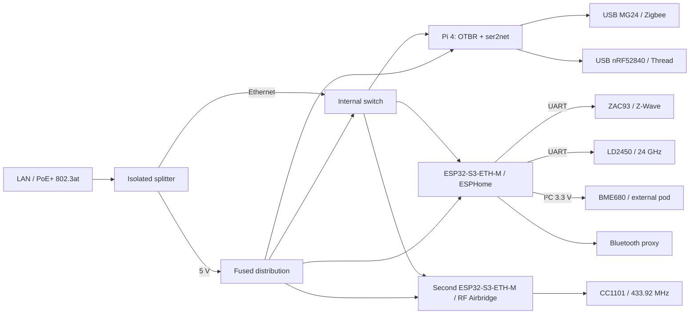

# HA Radio Hub

A modular, single-input PoE appliance for **Zigbee, Thread, Bluetooth, Z-Wave,
433 MHz RF, presence and environmental sensing**. Original public design by
HA Homelab. [Project overview](docs/overview.md).

**Status: engineering prototype design, not a physically validated product.**
CAD, firmware configuration and deployment tooling are provided. A successful
software build does not establish RF range, power margin, thermal performance,
sensor accuracy or mechanical fit. See [acceptance](docs/acceptance.md).

**Minimum-energy variant:** a separate [single-ESP32-S3 design](docs/low-power.md)
combines ESPHome and local OTBR behind one Ethernet interface, with dedicated
radio modules. Its objective is minimum lifetime electricity, independent of
component price. The 3 W AC target is unmeasured; see its firmware, carrier and
enclosure readiness before choosing it over the modular reference below.

**Visual wiring and custom boards:** use the [offline pin-to-pin atlas](hardware/low-power/visual/README.md)
for the low-power design, including actual connector pad maps and part identification.
Two factory-made PCB variants are documented separately: the [ready-module carrier](hardware/low-power/carrier/)
with its MG24 daughterboard, and the [integrated radio board](hardware/low-power/integrated/). The [manufacturing and sales plan](docs/manufacturing.md) covers first
articles, batches of 10/20, bare PCBs, assembled boards and boxed hubs.

## Meet the boards

**C0 module carrier — 160 × 100 mm, two layers.** Connect ready-made radio and
controller boards through labelled harnesses. It uses the separate M0 Zigbee
adapter shown below. [Board files and assembly BOM](hardware/low-power/carrier/).

[](hardware/low-power/carrier/)

**M0 Zigbee adapter — 60 × 40 mm, two layers.** Carries the specified
MGM240PA22VNA3 module and exposes its serial and programming connections.
[Board files and assembly BOM](hardware/low-power/carrier/mg24-adapter/).

[](hardware/low-power/carrier/mg24-adapter/)

**I0 integrated alternative — 160 × 142 mm, four layers.** Places the S3, H2,
MG24, Ethernet and PoE circuits on one board.
[Board files and assembly BOM](hardware/low-power/integrated/).

[](hardware/low-power/integrated/)

These are [KiCad renders of the native PCB sources](hardware/gallery/), showing
unpopulated boards rather than photographs of assembled hardware. All three
still require physical validation. C0 + M0 and I0 are alternative builds;
their shopping lists must not be added together.

**D0 home-etched alternative — 190 × 145 mm, single bottom copper layer.**
Designed for laser toner transfer, with through-hole parts, insulated wire
links and factory-made adapters for fine-pitch chips. It still needs the M0
radio board and external modules. [Print and assembly guide](docs/diy-pcb.md).

[](docs/diy-pcb.md)

The D0 image is a bottom-view CAD preview. Use the guide's 1:1 PDFs for
fabrication; the renderer's soldermask and plated-hole appearance are not
requirements for the manually drilled, unplated board.

Browse [all component pictures directly on GitHub](docs/parts-gallery.md), or use
the [searchable parts catalog and build guide](docs/parts-catalog.md) for component
identification, variant-specific quantities, manufacturer sources and explicitly
labelled AliExpress searches. The [home-etched PCB guide](docs/diy-pcb.md) covers
the separate laser-toner-transfer version and its limitations.

## Enclosure concept


The pictured enclosure belongs to the modular reference below. C0/I0/D0 assemblies
need their own verified enclosure fit; this image is not a fit claim for the new
boards.

## What is inside

- Raspberry Pi 4 runs the OpenThread Border Router locally and exposes a separate
  Zigbee coordinator over TCP to ZHA or Zigbee2MQTT.
- Independent USB radios: an EFR32MG24 Zigbee coordinator and an nRF52840 Thread
  RCP. They never share a multiprotocol firmware or antenna.
- Waveshare ESP32-S3-ETH-M connects by Ethernet and runs ESPHome: active Bluetooth
  proxy, the existing Zooz ZAC93 module, LD2450 radar, and BME680 on I²C.
- A second S3-ETH controller runs [RF Airbridge over Ethernet](firmware/rf-ethernet.yaml)
  with the existing CC1101. It preserves the RF Airbridge MQTT schemas, native
  transmit actions and RM433 button events. Two separate GDO wires are required.
  Follow the [migration and rollback guide](hardware/rf-migration.md) to transfer
  private settings and reconnect Home Assistant to the replacement hardware.
- The original NodeMCU firmware is retained as a Wi-Fi rollback option. The new
  RF firmware has no Wi-Fi dependency; its physical RF acceptance remains pending.
- A PoE+ splitter, internal Ethernet switch and fused 5 V distribution provide
  power and data. The BME680 sits in a ventilated external sensor pod.



## Build the prototype

Download the [versioned build package](docs/releases.md) for printable parts,
matching source, wiring and assembly instructions in one verified archive.


1. Read the [project overview](docs/overview.md), [hardware design](hardware/README.md)
   and [wiring](hardware/wiring.md); verify the exact board and regional radio variants.
2. Check [enclosure instructions](docs/enclosure.md). Print fit coupons and dry-fit
   the parts before printing the whole enclosure. Parametric source is in `mechanical/`.
3. Follow [firmware and flashing](docs/firmware.md). The initial USB flash uses your
   own local secrets. The ZAC93 keeps its vendor firmware.
4. Follow the Linux deployment in `software/`, then [Home Assistant setup](docs/home-assistant.md).
5. Complete the [acceptance checklist](docs/acceptance.md) before migrating your household.
6. Select accessories from [Matter-over-Thread devices](docs/thread-devices.md).

The Home Assistant host still needs its normal Matter server and Z-Wave JS server.
The box moves OTBR and radio access near the devices; it does not run HA itself.
Bluetooth proxy is for supported BLE integrations, not classic Bluetooth audio.

## Why this differs from the inspiration

The [BitEngine project](https://community.home-assistant.io/t/1028644) describes
MG24 plus ESP32-C5, with source and schematics still forthcoming when inspected
on 2026-10-16. This repository is an independent modular implementation using a
Linux OTBR host and a dedicated Thread RCP. It does not claim to reproduce that
unpublished hardware or firmware.

The [desktop satellite article](https://www.open-electronics.org/a-desktop-satellite-with-the-esp32-c3-21-grams-of-telemetry/)
inspired the I²C expansion. A second ESP32-C3 is unnecessary here: the Ethernet S3
has two free pins for BME680. The reported gas value is **resistance**, not measured
CO₂, VOC concentration or a certified air-quality rating.

## Repository and validation

Repository creation and settings belong to
[terraform-github-ha-homelab](https://github.com/4alvit/terraform-github-ha-homelab),
in the existing HCP Terraform workspace. See [infrastructure](docs/infrastructure.md).
No Terraform state, network keys, learned household RF codes or firmware images
containing credentials are distributed here.

```sh
python3 tools/check.py
python3 -m venv .venv
.venv/bin/pip install -r firmware/requirements.txt -r mechanical/requirements.txt
.venv/bin/python -m unittest discover -s tests -p 'test_*.py'
.venv/bin/python firmware/validate.py --esphome .venv/bin/esphome
.venv/bin/python firmware/validate.py --esphome .venv/bin/esphome --config rf-ethernet.yaml --migration-fixture --compile
.venv/bin/python mechanical/build.py
```

See [validation status](docs/validation.md) for what was actually run and
[CI and approval](docs/ci.md) for shared pipelines and reviewer configuration. Original
code, CAD and documentation use [MIT](LICENSE); see [third-party notices](THIRD_PARTY_NOTICES.md)
for the RF Airbridge port and upstream firmware licenses.
