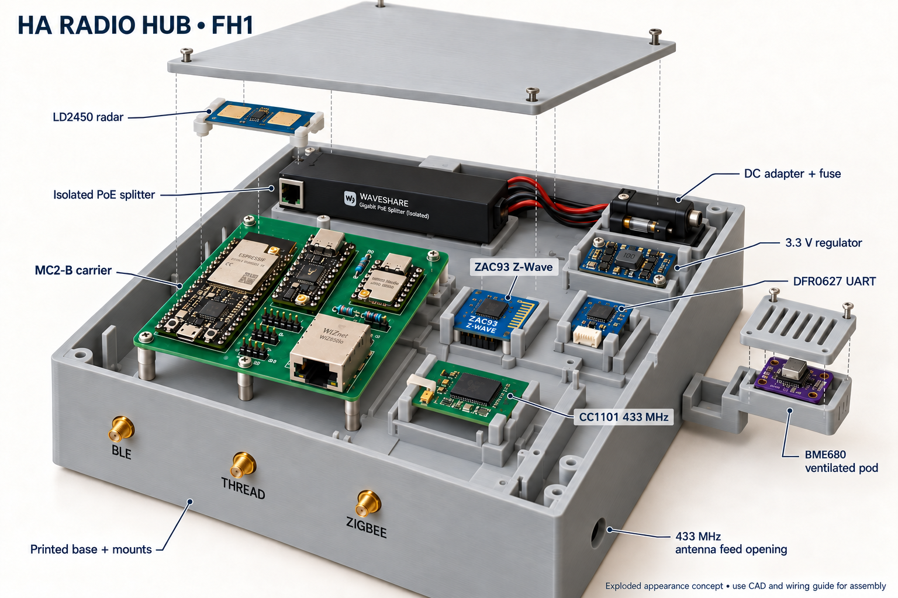
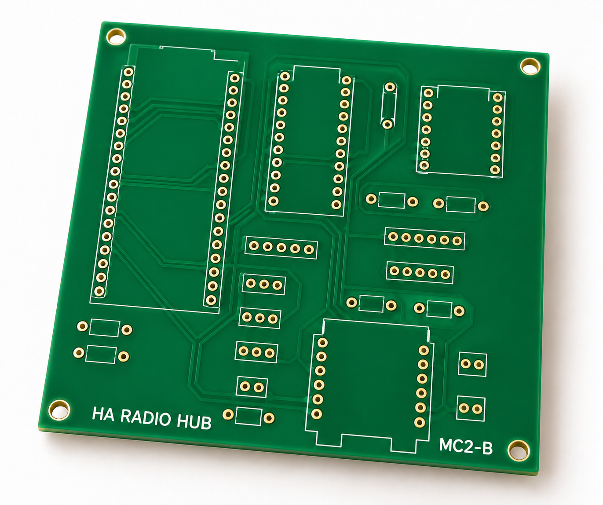

# HA Radio Hub — MC2-B

**Three independent external antennas: Zigbee, Thread and Bluetooth.** MC2 keeps
a local classic-ESP32 Thread Border Router, Ember Zigbee coordinator, active BLE proxy,
Z-Wave, 433 MHz RF, LD2450 and BME680 behind one Ethernet uplink. Its
100 × 100 mm carrier holds finished modules with direct-solder male headers.

*AI-generated appearance concept, not a photograph. Module shapes, mounts,
markings and small details are illustrative. Use the [full-hub CAD layout](mechanical/full-hub/layout.svg),
[print files](mechanical/full-hub/README.md) and [wiring guide](docs/full-hub-assembly.md)
for construction. Antennas and most cables are omitted for visibility; connect
the required antennas before operation.*

**Engineering prototype.** Source builds and CAD checks are not measurements of
coverage, power consumption, mechanical fit or radio certification. The
1,000 ft² house coverage target still requires testing.

Start with the [assembly guide](docs/external-antennas.md),
[visual wiring guide](hardware/external-antenna/index.html),
[documentation index](docs/README.md) and
[hardware files](hardware/external-antenna/README.md).

## Selected hardware

**Buying parts?** The [MC2 shopping guide](docs/mc2-shopping.md) gives quantities,
exact order codes, inspected AliExpress variants and outstanding availability
checks. MC2-B replaces the S3 host; it needs its own carrier and first flash,
not an S3 OTA update. TinyC6 supply is unresolved; secure the original **TC6-U-01** before
ordering a batch of carriers.

- **Espressif ESP32-DevKitC-VIE / ESP32-WROVER-IE:** previous-generation host
  with a factory external antenna connector, 8 MB flash and 8 MB physical PSRAM
  (4 MB directly addressable, quad 40 MHz); Ethernet host and active BLE 4.2 proxy.
- **Unexpected Maker TinyC6-U-01:** external U.FL Thread RCP, 8 MB flash,
  native USB and ordinary header-accessible recovery pins. Its two loose headers
  require through-hole soldering. Availability was backorder/on-request when
  checked on 18 October 2026; verify the exact SKU before ordering.
- **Seeed XIAO MG24:** Ember NCP with explicit external-antenna firmware.
- **WIZnet WIZ850io:** shared-SPI Ethernet; retain the isolated PoE splitter and
  regulated low-voltage supply from the battery-fed PoE switch.
- **Three TE ANT-2.4-LCW-SMA antennas and three Amphenol 095-902-545-150 cables:**
  separate 50 Ω paths, standard SMA bulkheads, no combiner.

Classic ESP32 retains the configured services and three active BLE connections,
but does not support BLE 5 extended advertising or Coded PHY. Lower power
consumption has not been established. See the [host migration](docs/classic-esp32-migration.md)
for the cost comparison, memory limits and compatibility checks.

The WK2132 bridge, ZAC93, band-matched CC1101/433.92 MHz antenna, radar,
environment sensor and power modules connect to the carrier by harnesses. The
[carrier BOM](hardware/external-antenna/cad/BOM.csv) and
[antenna BOM](hardware/external-antenna/rf-bom.json) accompany the assembly guide;
neither is a complete single-box shopping list on its own. The
[full assembly inventory](mechanical/full-hub/components.json) includes these
modules, the selected finished PoE splitter and the power/cable accessories.

*Bare-board appearance concept only. AI-generated traces, pads and labels are
not fabrication data. [Image provenance and prompts](hardware/external-antenna/images/README.md).*

## Where the Z-Wave board and other parts go

**Zooz ZAC93 sits in its own removable insulated cradle beside the MC2-B
carrier.** Its underside 2×5 socket connects by a wired mating header to carrier
**J4**; the **DFR0627 / WK2132** bridge connects to **J3** and provides its serial
port. The ZAC93 does not plug into the ESP32 or a Raspberry Pi in this build.
Keep its stock antenna clear of straps, cables and metal.

*Generated from the printable enclosure geometry with simplified electronic
bodies. The numbered plan below locates all modules and cable reservations.*

The **FH1 full-hub enclosure** has a 215 × 215 × 78 mm main shell, dedicated
mounts for the carrier, ZAC93, UART bridge, CC1101, PoE splitter and 3.3 V buck,
and a restrained DC-adapter/fuse tray. LD2450 mounts behind the room-facing lid
window. BME680 has a ventilated pod attached outside the warm shell with an air
gap. Three independent 2.4 GHz bulkheads remain on the fixed base.

[Exploded CAD and print files](mechanical/full-hub/README.md) ·
[Complete assembly and ZAC93 pin mapping](docs/full-hub-assembly.md) ·
[Graphical wiring](hardware/external-antenna/full-hub-wiring.svg)

## Build and inspect

- [Native CAD, schematic and connector map](hardware/external-antenna/README.md).
- [Firmware builds and initial programming](firmware/external-antenna/README.md).
- [Verified-target network update workflow](firmware/external-antenna/updates/README.md).
- [Full-hub printable parts, component mounts and connector fit coupon](mechanical/full-hub/README.md).
- [Digital verification and remaining physical checks](hardware/external-antenna/validation.md).
- [RF commissioning procedure](docs/rf-commissioning.md) and
  [results sheet](hardware/external-antenna/coverage-results.csv).

The largest print is 215 × 215 mm, within the selected TRONXY XY-3's nominal
310 × 310 × 330 mm print volume. The 65 mm adjacent antenna pitch and 150 mm
coax routes still require physical fit and coexistence tests. Module heights,
mating plugs, the existing CC1101 variant and printed tolerances must be checked
against the delivered hardware. Digital geometry checks do not establish
physical fit. The earlier [carrier-only enclosure](mechanical/module-carrier/external-antenna-prototype/README.md)
remains a historical option, not the full-hub housing.

MC2-A (S3) is preserved in a Git snapshot, and MC1 remains a regression target;
see the [engineering history](docs/design-history.md). MC1's Nano/H2 firmware,
16 MB partition table and compact enclosure do not fit MC2. The [design registry](hardware/designs.json) identifies the one active
revision. Do not mix images, pin maps or prices between revisions.

## Project information

Repository settings are managed by
[terraform-github-ha-homelab](https://github.com/4alvit/terraform-github-ha-homelab).
No private network keys, learned household RF codes or installation credentials
are distributed. See [infrastructure](docs/infrastructure.md),
[security](SECURITY.md), [license](LICENSE) and
[third-party notices](THIRD_PARTY_NOTICES.md).

Run `python3 tools/check.py` for offline document/source checks. Hardware,
firmware and mechanical guides list their reproducible validation commands.
