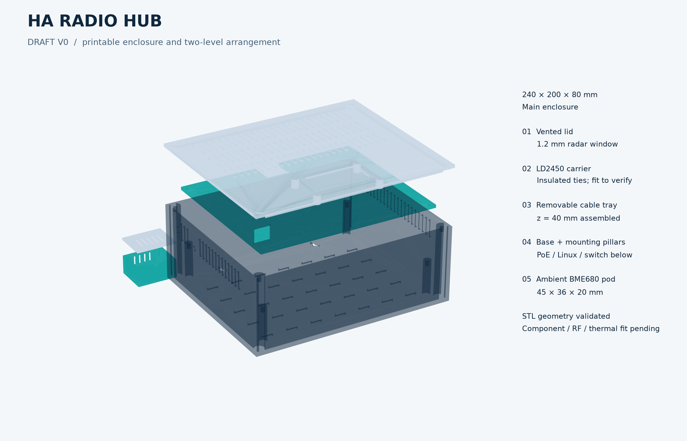
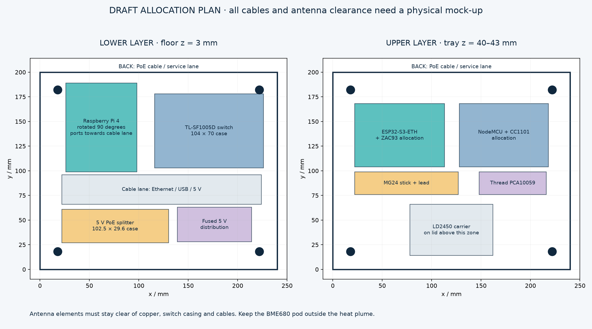

# HA Radio Hub enclosure — DRAFT V0

<!-- MC1-CURRENT-DESIGN -->
> **Current build: [MC1 — one finished-module carrier](module-carrier.md).** This page retains the earlier design or evaluation for reference. Its board images, pin maps, enclosure fit and alternative BOMs are not the current MC1 build.

The current [MC1 carrier enclosure prototype](../mechanical/module-carrier/enclosure-prototype/README.md) and [split-rail fit coupons](../mechanical/module-carrier/rail-mount/README.md) replace this Pi-era geometry. The new housing covers the carrier only; external power, bridge, radios and sensors need separate accommodation.

The model is ready for a test print, but has **not yet been validated by assembling the actual parts**. The STL files are checked for watertight meshes, consistent face winding, and one connected body. These checks do not prove connector clearance, radio performance, cooling, or the accuracy of a particular printer.



## Dimensions and orientation

Main enclosure: **240 × 200 × 80 mm**, excluding protruding screw heads, cables, and antennas. The base is 77 mm high and the lid is 3 mm thick; walls and floor are 3 mm thick. The base and lid need a bed of at least 246 × 206 mm with a 3 mm brim; a 256 × 256 mm class printer is a practical fit. **The base and lid do not fit a 220 × 220 mm bed.** Do not scale down the STL files: this changes screw fits and the actual compartment dimensions. V0 does not include a validated split enclosure for a 220 mm bed.

Coordinates: x is width, y is depth; the floor is at z=0 and the outer lid surface at z=80. The PoE cable enters at the rear, through y=200. The radar sits below the lid near y=40, with its antenna plane facing the lid. For wall mounting, **the lid faces the room**. On a horizontal table, the radar points upward, so stand the enclosure vertically on a stable support or mount it on a wall to track people. Check the radar coordinate directions after installation.

Assembly options:

- Main: printed wall-mounted enclosure with two levels and an external BME680 ambient-sensor pod.
- Debugging: the same enclosure with the lid removed; comparison with the closed enclosure is required to check radar behavior and temperatures.
- Commercial substitute: a purchased ventilated plastic enclosure with at least 240 × 200 × 80 mm of clear internal space and a separate mounting panel. Transfer panel hole locations from measured parts. A metal enclosure requires externally mounted radio modules/antennas and a separate RF-transparent radar window.

## Layout



This is a **space allocation**, not accurate CAD models of the commercial devices. The dimensions and coordinates below refer to the supplied `parameters.json`. Connector dimensions, wire bends, USB radio housings, and standoffs must be checked against the purchased parts.

Lower level: top of the floor at z=3; underside of the removable deck at z=40. The available 37 mm height includes insulating pads and fasteners.

- Raspberry Pi 4: board approximately 85 × 56 mm according to the [Raspberry Pi documentation](https://www.raspberrypi.com/documentation/computers/sbcs.html). The board is rotated 90° and allocated a 72 × 90 mm area, separate from the cable corridor; USB/Ethernet face toward lower y. The cooler/heatsink and USB-C cable must fit below the deck. Exact board mounting holes have deliberately not been transferred to the floor: use nylon standoffs on an adapter plate or insulated retaining straps.
- The selected Pi power connection is a rigid C3 (Adafruit 4536) + C17 (Same Sky PP3-002A) pair. C17 has a specified size of 34 × 8.2 mm and an insertion length of 9.5 mm; the total projection together with C3 is not published. With the Pi rotated as specified, USB-C faces the side wall. The board area **does not establish clearance for this pair**: test its fit before printing, and move the Pi or enlarge the enclosure if necessary. Do not press the adapter against the wall or use it to support the board. Item numbers and sources are in the [BOM](../hardware/bom.csv).
- TP-Link TL-SF1005D v13: housing 104 × 70 × 22 mm, allocated area 110 × 75 mm. Face the ports toward the central cable corridor; long molded plugs may require a layout change. See the [manufacturer's specifications](https://www.tp-link.com/us/home-networking/5-port-switch/tl-sf1005d/v13/).
- Waveshare 25 W PoE splitter: housing 102.5 × 29.6 × 24.8 mm, allocated area 108 × 34 mm in the front row: x=60…168, y=6…40. Face the input RJ45 left and the captive Ethernet/DC output cables right. The gaps from this area's boundaries to the inner side walls are 57 and 69 mm respectively; these are free spaces in the row, **not validated cable bend radii**. The 5 V distribution occupies the next row at y=40…75 and must not obstruct the cable exits. See the [manufacturer's page](https://www.waveshare.com/product/accessories/power-heat-sinks/poe-splitter-25w-type-c.htm).
- A 75 × 35 mm area is allocated to insulated 5 V distribution, fuses, and service loops. Wire height and cross-section are selected in the electrical design.
- A 30 mm deep cable corridor separates the front and rear devices: y=75…105. The Pi occupies x=26…98, y=105…195; the switch occupies x=106…216, y=105…180. Some connectors may need 30–40 mm; use shorter/right-angle cables or enlarge the enclosure if needed. Do not overbend Ethernet/coaxial cables to match the sketch. The incoming PoE cable follows the free perimeter from the rear opening, around the standoffs; determine its required internal length on the mock-up.

Upper level: deck at z=40…43; modules should fit below approximately z=67. Lid and radar standoffs occupy separate areas.

- ESP32-S3-ETH-M, ZAC93, and wiring: allocated space 91 × 64 × 24 mm. This is the area's size, **not a board specification**. The official [Waveshare drawing](https://docs.waveshare.com/ESP32-S3-ETH#dimensions) gives a board outline of 72.80 × 21.00 mm; measure installed plug projection, header height, and insulating supports separately.
- RF area 90 × 64 × 24 mm: **second ESP32-S3-ETH-M + CC1101** for the main wired build. The compatibility option replaces this board with the existing NodeMCU + CC1101 using Wi-Fi. Do not install both RF boards in this area simultaneously. The wired build also needs a short SPI harness and an insulated 4.7 kΩ TX pull-up here; check the height of all connections.
- Ethernet and USB-C on both S3 boards need clearance **beyond the bare board length**. Offset the boards and their connectors along y so opposing plugs do not collide in the gap between the allocated areas. The plan hatches the open cable notch in the deck at x=105…135, y=160…187: a board cannot be fastened over empty space. Two Ethernet cables and S3 power pass between levels through this notch; the USB radios and radar cable also need space. The nominal 30 mm notch width does not prove that all harnesses fit simultaneously: route and secure them with the deck accessible, and check for overbending or pinching by the lid.
- The C4/C9 DFRobot FIT0993 power cables are 300 mm long with a 4 mm outside diameter. Excess length and terminal blocks need separate insulated mountings and service loops; do not tighten them over antennas or the radar, or between the deck and a connector. The cables themselves are not modeled in the plan.
- Zigbee USB radio: 105 × 23 mm in plan, including a short USB lead; measure its height and connector. Thread PCA10059: allocated area 68 × 23 mm. USB cables run to the Pi through the open notch at the deck edge. Stock antennas should face an unobstructed plastic wall, rather than being trapped between boards or shielded by wires.
- LD2450: suspended from the lid, with its carrier at x=78…162, y=14…66, z≈66…68. Do not place tall boards beneath it. The module is 44 × 15 mm and operates at **24 GHz**, not 2.450 GHz, according to [Hi-Link](https://www.hlktech.com/Goods-226.html).

After laying out the actual parts, first check all three dimensions using paper/cardboard templates and connected cables. If an area is too small, increase `width`, `depth`, or `base_height` in the parameters and repeat the visual check. The builder changes the enclosure, mounts, and radar carrier position, but does not automatically rearrange boards or route cables. The deck must not rest on connectors or components.

## Radar window and antennas

The lid leaves a 1.2 mm plastic thickness over a 60 × 28 mm area above the LD2450. This is an **initial experimental value**, not an engineered, impedance-matched radome. Dielectric permittivity, filler composition, air gap, and thickness affect the 24 GHz radar. Do not place foil, magnets, or a metal label over this area, or use carbon-/metal-filled plastic.

`radar_carrier.stl` is a general-purpose platform with a wiring cutout, not a clip based on assumed connector dimensions. Raise the PCB above it on insulating spacers so underside components do not press into the plastic. Support only free board edges using insulating supports/tape; do not press on the printed antennas. The carrier attaches to four lid standoffs. Route the connector and wire to the side, keeping the path to the window clear. Check the specific board holder and air gap against the purchased revision. Compare range and coordinates with the lid removed and installed.

Both side walls have 6.5 mm diameter feedthrough holes at y=174, z=60. The diameter is parametric. Use them only with a compatible antenna connector/adapter after checking the thread, washer, wall thickness, and SMA/RP-SMA type. These two connector types are not interchangeable. Close unused holes with `antenna_blank.stl`, held in place with a small spot of neutral-cure silicone. The plugs and holes do not provide water protection.

PCA10059 uses its stock PCB antenna; the model **does not assume modification for an external antenna**. Separate the Zigbee, Thread, BLE, Wi-Fi, and sub-GHz antennas as far as the enclosure allows; validate placement with a loaded RF test, not just distances on a drawing. Coax must not cross the radar's printed antenna.

## External BME680 pod

`bme680_pod_base.stl` and `bme680_pod_lid.stl`: **45 × 36 × 20 mm**, a ventilated pod for a breakout board within approximately 30 × 23 × 10 mm. The current STEMMA QT board outline in the [Adafruit EagleCAD source](https://github.com/adafruit/Adafruit-BME680-PCB/blob/master/Adafruit%20BME680.brd) is 25.4 × 17.78 mm; this excludes an attached plug and cable bend. This is a general-purpose holder; mounting holes for a specific board have not been guessed. The floor has slots for insulated straps. Two M2 screws retain the lid; mount the sensor separately without touching the screw heads.

Place the pod outside the warm main enclosure, beside or below it, **not above the ventilation exhaust**. The four-wire 3.3 V/GND/SDA/SCL cable exits through the left wall near the ESP32-S3: x=0, y=136, z=55, with a 5 mm hole diameter. A solid wall area around the hole supports a grommet. Fit a suitable split grommet and strain relief. The initial length of the **entire I²C harness is 10–20 cm, including the internal run from the ESP32-S3 to the wall, the external run, and service slack at both connectors**. This is a starting recommendation for the prototype, not a guaranteed reach; check frequency, pull-ups, and stability on the finished cable. Choose the pod's distance from the enclosure using temperature measurements within this cable-length budget; the assembly model shows the pod to the left with a 30 mm gap to the enclosure.

The pod openings are exposed to ambient air: this is an indoor sensor with no protection against water or condensation. Keep it away from adhesive, silicone, fresh plastic, and hot exhaust air, which distort gas-sensor and temperature readings. Sensor self-heating also remains and must be evaluated; a separate enclosure does not automatically eliminate it.

## Fasteners and printing

For the main enclosure:

- 12 brass M3 heat-set inserts, nominally 4.6 mm outside diameter and 5 mm long: 4 for the lid, 4 for the deck, 4 for the radar carrier. The model uses 4.2 mm pilot holes 6 mm deep; **adjust them to the insert specification and a test print**.
- 4 M3×6 low-profile/button-head screws for the lid, with heads no wider than 6.8 mm. Check that each screw has enough engagement and does not bottom out.
- 4 M3×8 screws for the 3 mm thick deck: nominally 5 mm enters the standoff. Check the actual length with the selected washer and insert.
- 4 M3×6 screws for the 2 mm thick radar carrier: nominally 4 mm enters the standoff. M3×8 without a washer is too long here: with a pilot depth of about 5.98 mm, it enters 6 mm and may bottom out against the plastic. Total for the printed parts: 8 M3×6 screws and 4 M3×8 screws; choose board fasteners separately.
- Nylon standoffs, mounting pads, and insulated straps for the boards. Exposed solder joints must not touch other boards, the splitter housing, or metal fasteners.
- 2 M2×6 screws for the pod, into 1.8 mm pilot holes; form the threads carefully without splitting the standoffs.
- 4 self-adhesive rubber feet/spacers approximately 3 mm thick on the rear of the base. For a wall, use two fasteners suitable for that wall, with heads up to 8 mm and shanks up to 4 mm, spaced 120 mm center to center. Fastener selection depends on the wall and assembly mass; no load test has been performed yet.
- A split grommet for the 22 × 16 mm PoE opening, a grommet for the BME680 cable, cable strain reliefs, and 2 antenna feedthrough plugs if needed.

Print `fit_coupon.stl` first (72 × 20 × 8 mm). From left to right, centers x=8,18,28 have 3.2/3.4/3.6 mm through-holes; x=44,54,64 have 4.0/4.2/4.4 mm pilot holes, 6 mm deep. Select the hole fit for your plastic and insert, then adjust `m3_clearance` and `insert_pilot`. Inserts must not split or bulge the standoffs.

Starting prototype settings: PETG without electrically conductive fillers, 0.4 mm nozzle, 0.2 mm layers, 4 perimeters, 5 top/bottom layers, and 25–35% infill. These are test-part recommendations; PETG is not automatically flame-retardant. PLA is acceptable for an unpowered dimensional check; choose the final material after thermal testing.

All files already have their print orientation set:

- `base.stl`: floor on the bed, cavity upward. Internal standoffs print vertically. There is a 22 mm bridge above the rear cable opening; enable local supports from the cavity/bed if the printer cannot bridge it. Horizontal antenna holes may also need local supports.
- `lid.stl`: outer face on the bed, lip and four standoffs upward. The thin radar-transparent area prints in the first layers and does not need overhanging bridges. For assembly, rotate the lid 180° around the y axis: the radar-window side remains at lower y. The assembly model applies this rotation, not a mirror transformation of the STL.
- `deck.stl`, `radar_carrier.stl`, `fit_coupon.stl`: flat.
- `antenna_blank.stl`: wide flange on the bed.
- `bme680_pod_base.stl`: floor on the bed; `bme680_pod_lid.stl`: flat. The upper bridges above the vents have short spans.

Clean the slots and check for sharp edges before installing boards. Install heat-set inserts before the electronics. For service, first disconnect PoE, then remove the lid and disconnect the short radar cable, followed by the four deck screws.

## Reproducible generation and checks

From the repository root, using Python 3.12:

```sh
python3.12 -m venv .venv-mechanical
.venv-mechanical/bin/pip install -r mechanical/requirements.txt
.venv-mechanical/bin/python mechanical/build.py
.venv-mechanical/bin/python mechanical/build.py --check
.venv-mechanical/bin/python -m unittest discover -s mechanical -p 'test_*.py'
```

Parameters: `mechanical/parameters.json`. Source geometry: `mechanical/build.py`. The same CSG model creates both the STL files through Manifold and the text `generated/*.scad` files, avoiding divergence between an independently recreated OpenSCAD source and its export. You can edit the generated SCAD manually, but the next build will overwrite it. `assembly.scad` and `assembly.glb` are for inspection only, not for printing all parts together. GLB geometry is converted to meters following the glTF convention; STL remains in millimeters.

The builder **reads the exported STL files back in** and checks watertightness, face winding, positive volume, and a single connected body. It also checks that printed parts do not overlap in volume in their assembled positions. `generated/mesh-report.json` contains the results, bounding boxes, parameters, generator fingerprint, and SHA-256 hashes of all exports. The exploded preview is generated from the same meshes. Opening SCAD in an installed OpenSCAD application has not been tested in this environment because the application is absent.

`--check` does not overwrite anything in `generated/`: it builds a reference in a temporary directory and checks the saved package. It checks the inventory, source/parameter fingerprints, file checksums against their report, exact CSG text, and STL/GLB geometry. Different triangle ordering is allowed: for differing binary files, it compares the solids rather than only their dimensions. The bounding-box tolerance is 0.0001 mm; the symmetric-difference volume must not exceed the larger of 0.01 mm³ and one millionth of the part volume. These numerical tolerances are not printing tolerances. Images are tied to the generator version and parameters through the report and checksums; byte-identical output across graphics libraries is not required. To check a different directory, use `--check --output PATH`. The `--no-preview` mode is for debugging and does not produce a complete release package.

Complete the following checks before final ordering/assembly:

1. Test-fit every purchased part with connected cables, cooler, insulation, and actual fasteners; confirm that the deck does not touch connectors.
2. Check test holes, heat-set inserts, tightening force, lid fit, and deck removal.
3. Run a closed-lid thermal soak at the maximum expected room temperature, with simultaneous Ethernet/radio load and the radar enabled. Monitor the Pi, splitter, ESP32, plastic, and **local air around the radio modules**; respect each component's limits in the [power budget and thermal criteria](../hardware/power.md). Case or die temperature does not replace measurement of the air surrounding a module.
4. Test Zigbee/Thread/BLE/Z-Wave/RF individually and simultaneously at the actual installation location; test the radar with and without the lid.
5. Check the external BME680 readings after warm-up against a separate room thermometer.
6. Check cable strain relief and wall mounting with a load margin; do not leave the prototype unattended until electrical/thermal testing is complete.
