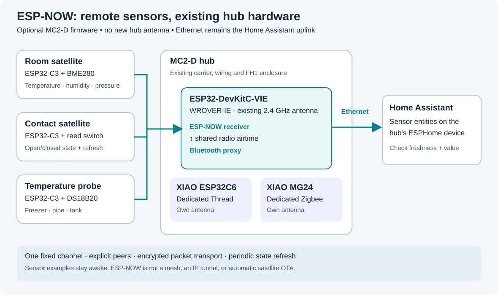

# ESP-NOW sensor satellites

MC2-D can receive nearby sensor readings over **ESP-NOW** and publish them to
Home Assistant through its existing Ethernet connection. This is an optional
firmware profile for the **ESP32-DevKitC-VIE / WROVER-IE** already on the carrier.
It does not require another hub module, a new antenna, or a change to the carrier
or FH1 enclosure.

The implementation and examples live in [firmware/espnow](../firmware/espnow/).
They target the repository's pinned **ESPHome 2026.10.1 / ESP-IDF 5.5.5**.
Compilation checks are not a range test: delivery rate, BLE coexistence,
concurrent hub load and power consumption still need measurements on the
assembled hardware before this becomes a dependable installation.



## What changes, and what stays on its own radio

- **Main WROVER-IE:** receives ESP-NOW on its existing 2.4 GHz antenna while
  retaining the Bluetooth proxy and the hub's other functions. Ethernet remains
  the IP connection for Home Assistant, management and hub OTA updates.
- **XIAO ESP32C6:** remains the dedicated Thread radio. It is not repurposed as
  an ESP-NOW receiver.
- **XIAO MG24:** remains the Zigbee coordinator radio.
- **CC1101 and ZAC93:** keep their RF and Z-Wave roles. An ESP-NOW message does
  not automatically become a compatible RF curtain command.

The optional profile starts the ESP32 Wi-Fi radio in station mode for ESP-NOW,
without joining an access point or adding a Wi-Fi IP connection. It enables
software coexistence with Bluetooth. Both share radio airtime; they are not
two independent receivers. This station-mode choice follows Espressif's
[ESP32 coexistence requirements](https://docs.espressif.com/projects/esp-idf/en/v5.5.5/esp32/api-guides/coexist.html).

## Compatible satellites

Use a separate **ESP32-family board with Wi-Fi** and firmware implementing the
same ESPHome packet transport. The provided examples target the
**Espressif ESP32-C3-DevKitM-1**, powered through USB;
classic ESP32, ESP32-S2/S3 and ESP32-C6 can be alternative satellite platforms
after changing the board, pin assignments and build configuration. This is not
permission to reuse the hub's occupied pins or its dedicated C6.

ESP32-H2 has no Wi-Fi radio and is not an ESP-NOW target. ESP8266 firmware,
vendor ESP-NOW sensors and other projects can use different packet formats;
sharing the name ESP-NOW does not make them compatible with these examples.
Tuya WBR3/RTL8710 modules and RF-only curtain motors are not ESP32 satellites.
See the [ESPHome ESP-NOW component](https://esphome.io/components/espnow/).

Every node needs its own appropriate power supply and antenna. For boards with
an external antenna connector, connect the correct antenna before powering
the radio. Do not buy more hub antennas for this feature: satellites have their
own radio hardware, while the hub reuses its WROVER-IE antenna.

## Build and commission

Start with **one powered satellite next to the hub**, then test it at its final
location. Keep the existing private hub configuration and a known-working
firmware image before changing the hub profile.

1. Use the preparation and validation commands in the
   [ESP-NOW firmware instructions](../firmware/espnow/README.md). They create a
   private build directory; generated test credentials and example addresses
   are not your deployment configuration.
2. Record the hub's **Wi-Fi station MAC** and each satellite's station MAC.
   The hub's WIZ850io Ethernet MAC, Bluetooth address and C6 Thread address are
   different identities and cannot replace these values. Before the first
   flash, use a USB chip-information readout of the factory station MAC. Once
   running, the ESP-NOW `Own address` startup log and the hub's **ESP-NOW
   Station MAC** diagnostic entity provide it; **ESP-NOW Channel** shows the
   channel. The examples do not override the factory station MAC.
3. Set the **same fixed 2.4 GHz channel** on the hub and every satellite. Choose
   the channel using the local Wi-Fi/Thread/Zigbee plan; do not copy a channel
   just because an example uses it. In the US use channels 1–11. The devices
   do not need to associate with the household Wi-Fi access point.
4. Set the hub as each satellite's peer, allow the intended satellite MACs on
   the hub, and set the matching provider name, remote sensor ID and private
   encryption key. A provider name is its exact `esphome.name` value, not its
   friendly display name. Use a different random key for each satellite.
5. Compile with the pinned toolchain. Flash the satellite over USB. Install the
   optional hub profile using the existing
   [MC2-D flashing procedure](../firmware/external-antenna/README.md); preserve
   the correct partition layout, private network credentials and radio pins.
6. Confirm the satellite's connection status and readings in the hub's
   Home Assistant ESPHome device. These readings are hub entities; the satellite
   is not automatically a separate native-API device in Home Assistant.
7. Disconnect the satellite's power. Confirm that its connection/freshness
   indication expires and that any automation treats stale data as unknown.
   Restore power and confirm that state recovers. Repeat with a hub reboot.

The example identities are deliberately explicit:

- `espnow-climate`: `temperature`, `humidity`, `pressure`, `node_uptime`;
  secret `espnow_climate_key` and peer secret `espnow_climate_mac`.
- `espnow-probe`: `temperature`, `node_uptime`; secret `espnow_probe_key` and
  peer secret `espnow_probe_mac`.
- `espnow-contact`: `contact`, `node_uptime`; secret `espnow_contact_key` and
  peer secret `espnow_contact_mac`.

Each satellite uses `espnow_hub_mac` as its destination. Their names must be
unique: a second room sensor needs a new `esphome.name`, key, peer entry and
matching hub entities. Copying a satellite image unchanged to several boards
would make their readings indistinguishable. Sensor state is sent to the hub
by unicast; the hub broadcasts its synchronization challenges.

ESP-NOW is not an IP tunnel. These examples do not provide satellite OTA,
ESPHome native API, web UI, or remote serial logs through the hub. Update and
diagnose satellites over USB. Adding ordinary Wi-Fi and OTA to a satellite is
a separate design: association can move its radio to the access point's channel
and break a fixed-channel link.

## Useful sensors

These are sensors on **remote satellite boards**, not additional wires on the
MC2-D carrier. Wire only to pins specified by the selected satellite example;
board names such as D4 are not universal GPIO numbers. ESP32 GPIOs use 3.3 V
logic. Confirm a breakout's actual supply, output voltage and pull-ups before
connecting it.

### Room temperature, humidity and pressure

Use the [BME280 example](../firmware/espnow/sensor-bme280.yaml) for a room,
greenhouse or shed. A BME280 provides all three readings; a BMP280 does not
measure humidity. Keep the sensor away from the regulator and ESP32 so that
board heating does not dominate room-temperature readings. A ventilated pod
is preferable to placing it inside a warm sealed box.

For the **C3-DevKitM-1 example only**: `3V3 → VCC`, `GND → GND`,
`GPIO4 → SDA`, `GPIO5 → SCL`, using a 3.3 V-compatible breakout. The example
uses address `0x76` and a 30-second measurement interval.

I²C can share the satellite's SDA/SCL wires with other compatible 3.3 V sensors,
provided their addresses do not conflict and the combined pull-ups are
appropriate. Keep that bus local to the sensor assembly; ESP-NOW carries the
readings across the room. Use the actual 0x76/0x77 address reported by a scan.
The [BME280 component reference](https://esphome.io/components/sensor/bme280/)
explains supported configuration.

BME680 can be a later satellite variant, using its own ESPHome sensor component.
The hub's existing BME680 remains connected as before. Its gas heater and sensor
warm-up must be included in the power budget; do not treat gas resistance as a
calibrated CO₂ measurement.

### Door, window, dry contact and motion

Use the [contact example](../firmware/espnow/sensor-contact.yaml) for a reed
switch and magnet. It reports a stable open/closed state, with debounce, and
periodically refreshes that state. Match the physical contact's polarity during
commissioning: closing the door must produce the intended Home Assistant state.

Connect the dry contact between **C3-DevKitM-1 GPIO4 and GND**. The example uses
an internal pull-up and 25 ms debounce: a closed electrical contact reports
`OFF/closed`, and an open circuit reports `ON/open`. Do not apply a voltage to
this input from another controller.

A powered PIR can use the same binary-sensor transport with its own suitable
GPIO configuration. Check its supply and output level, warm-up period and
retrigger behavior. Motion pulses can happen between successful packets; this
transport is not an event recorder. A short-lived event needs a latched state
or counter and a deliberate clearing/acknowledgement scheme.

Possible uses include a shed-door reminder, a cabinet light trigger, a mailbox
flag, or occupancy information alongside the hub's LD2450. They are convenience
signals, not a substitute for a supervised alarm system.

### Freezer, pipe or water-tank temperature

Use the [DS18B20 example](../firmware/espnow/sensor-ds18b20.yaml) with a
three-wire powered probe and the specified data pull-up. Verify the actual
probe wire functions; colours alone do not establish the pinout. Discover and
bind the sensor's 1-Wire address before adding more probes to the bus. See the
[Dallas temperature component](https://esphome.io/components/sensor/dallas_temp/).

For the **C3-DevKitM-1 example only**: `GPIO4 → DQ`, `3V3 → VDD`,
`GND → GND`, and a **4.7 kΩ resistor between DQ and 3V3**. This example is not
configured for parasite power; it samples one probe every 30 seconds.

For a freezer, keep the ESP32 and its antenna outside the metal cabinet and run
only a suitable probe inside without damaging the door seal. For pipe surface
temperature, secure and insulate the probe against the pipe; a loose probe
mainly measures air. Use a probe rated for the intended temperature and liquid
contact. Treat a missing or stale reading as a fault, never as a safe temperature.

### Plant and soil moisture

A capacitive probe is a useful future ADC satellite variant. Prefer a coated,
corrosion-resistant capacitive design over continuously powered exposed
resistive forks. For example, the manufacturer's
[SEN0193 documentation](https://wiki.dfrobot.com/sen0193) specifies its supply
requirements and calibration method. Keep the electronics and connector dry;
“capacitive” does not mean the entire module is waterproof.

Measure the probe's maximum analog output and use an appropriate ADC input
range or divider. Calibrate against the intended soil and installation depth;
a percentage obtained by mapping two voltages is relative moisture, not a
laboratory volumetric-water measurement. First use it for a watering reminder.
Automatic irrigation needs separate valve control, acknowledgement and
fail-safe timeout logic; it is not implemented by the sensor examples.

## Adding another satellite

The three examples are explicit enrollments, not automatic discovery. To add a
second climate node, copy `sensor-bme280.yaml` in the private build directory,
give it a unique `esphome.name` such as `espnow-greenhouse`, and assign a new
private key. Add its station MAC to `hub-radio.yaml`, then add the matching
provider name/key and remote entities to `hub-sensors.yaml`. Reuse the transmitted
IDs (`temperature`, `humidity`, `pressure`, `node_uptime`), but give the hub's
entities, heartbeat globals and lambda references unique names/IDs.

Copy the freshness diagnostics along with the measurements. Rebuild both the
new satellite and hub, then repeat the power-loss test. Keep the existing
satellites' names and keys unchanged. Every extra node consumes peer capacity,
memory and airtime; grow the installation gradually and repeat concurrent-load
checks rather than assuming an unlimited sensor count.

## Freshness, replay protection and reboot behavior

There are two layers to configure:

- ESP-NOW peers and a common channel establish the radio path.
- ESPHome packet transport identifies providers and carries sensor values.
  Its per-provider encryption keys, transmitter rolling codes and receiver
  ping/pong challenge protect that application traffic. MAC allowlisting alone
  is not authentication.

The packet transport encryption is **application-layer XXTEA**, not native
ESP-NOW CCMP with PMK/LMK keys. Sender names and initial challenges remain
visible. Keep keys in the private configuration and rotate both ends together.
It is not an authenticated-encryption construction, and a provider's identity
is not cryptographically bound to its MAC. Keep this extension to ordinary
sensor telemetry, rather than using it as a motor or safety-command protocol.
The upstream [packet transport security description](https://esphome.io/components/packet_transport/#security)
documents its replay protections and limitations.

After a reboot or challenge change, allow the peers to resynchronize. A
temporary rejected old challenge does not justify disabling encryption. The
rolling-code implementation writes its boot counter to flash; frequent wake
and reboot cycles matter for a future battery design.
Preserve the satellite's NVS during routine firmware updates. Intentionally
erasing it can roll the counter back, so an already-running hub can reject the
new stream. After an intentional erase, verify the enrolled identity and key,
restart the receiver, and repeat the online/freshness tests.

A retained last temperature or last `closed` state does **not** prove that the
satellite is alive. Use its connection/freshness indication with the value in
Home Assistant. Loss of contact must not be interpreted as `false`, `closed`,
`dry`, or zero degrees. Connection status also does not prove that a sensor is
healthy: a powered satellite can have a broken probe. Test both radio loss and
sensor failure before relying on an alert.

The supplied receiver makes those distinctions visible:

- **ESP-NOW Climate/Probe/Contact Online** starts `OFF` at hub boot. It becomes
  `ON` only after decoded, challenge-checked telemetry supplies a finite uptime,
  and becomes `OFF` when that heartbeat is at least **90 seconds** old.
- **ESP-NOW Climate/Probe/Contact Last Seen Age** is unknown before the first
  accepted heartbeat, then reports its age in seconds at five-second intervals.
- Numeric readings have a **90-second timeout** and become unknown when their
  updates stop. A recently heard node can still have an unknown temperature.
- **ESP-NOW Contact** may retain its previous state until packet transport
  invalidates it, approximately **120–135 seconds** after the last accepted
  packet. Gate any contact automation on **ESP-NOW Contact Online = ON** as
  well as the desired contact state. Never wait for `closed` as a proxy for
  disconnection.

Use the actual entity IDs shown by your Home Assistant installation; display
names alone do not establish an entity ID. A useful first automation is a
notification when an Online entity remains `OFF`, separate from an alert for
an open door or out-of-range temperature. These timeouts are for the supplied
powered examples, not future multi-minute sleeping nodes.

## Example: remind me when the door stays open

After checking the reed-switch polarity and disconnect test, create a Home
Assistant automation and use its **Edit in YAML** view. Replace the two example
entity IDs below with the IDs of **ESP-NOW Contact** and **ESP-NOW Contact
Online** in your installation. The friendly display names are not the IDs.

```yaml
alias: ESP-NOW door left open
description: Notify after two minutes open, only while the satellite is online.
triggers:
  - trigger: state
    entity_id: binary_sensor.esp_now_contact  # Replace with your contact ID.
    to: "on"
    for: "00:02:00"
conditions:
  - condition: state
    entity_id: binary_sensor.esp_now_contact_online  # Replace with your Online ID.
    state: "on"
  - condition: state
    entity_id: binary_sensor.esp_now_contact  # Same contact ID as above.
    state: "on"
actions:
  - action: persistent_notification.create
    data:
      notification_id: espnow_door_left_open
      title: Door left open
      message: The ESP-NOW contact has reported an open door for two minutes.
mode: single
```

This creates a notification inside Home Assistant; it does not automatically
send a phone push or operate a motor. It reacts to a new two-minute open period,
not every minute while a door stays open. Home Assistant reloads/restarts reset
the `for` timer, and a suppressed notification is not automatically retried
when an offline satellite returns. See
[state triggers](https://www.home-assistant.io/docs/automation/trigger/) and
[persistent notifications](https://www.home-assistant.io/integrations/persistent_notification/).

Make a separate **sensor offline** notification triggered when the corresponding
Online entity remains `off`, for example for two minutes. It reports missing
telemetry, not a closed door. Also consider the hub becoming `unavailable` as a
separate fault; that is not the same state as a reachable hub reporting an
offline satellite. Never substitute a motor-close action for the notification:
the examples do not provide command acknowledgement, travel limits or safe
motor interlocking.

## Powered first; battery sleep is a separate qualification

The supplied satellite examples stay awake. That makes them reachable for the
receiver's challenge and periodic state refresh, and makes initial fault-finding
repeatable. It also means they are not promised to run for years on a battery.

A sleeping satellite cannot receive while asleep. A useful low-power design
must wake, obtain a valid sensor sample, synchronize the transport, transmit,
and only then sleep. A MAC-level send result does not prove that Home Assistant
received a valid application value. A brief fixed delay followed by deep sleep
is not a reliable delivery protocol.

For periodic environmental readings, the receiver's freshness window must
cover the planned sleep interval and reasonable retries. For door or PIR wake,
check the selected ESP32 variant's wake-capable pins and active level; an
already-active input can cause immediate repeated wakeups. See
[ESPHome deep sleep](https://esphome.io/components/deep_sleep/).

Measure the **whole satellite**: regulator, USB-UART bridge, LEDs, sensor and
radio startup can dominate consumption. Verify operation at the battery's
lowest voltage, include battery protection/charging where needed, and keep a
physical USB recovery route. No deep-sleep battery-life claim or battery
charging circuit is part of this release.

## Coverage and concurrent-load check

1. Begin a log with the firmware versions, channel, satellite location and
   antenna orientation. Check timestamps and intervals of received readings.
2. Test ordinary and closed-door locations, including the furthest room. Do
   not infer whole-house coverage from floor area or antenna gain alone.
3. Repeat while the Bluetooth proxy has its expected connections and the
   Zigbee, Thread, RF and Z-Wave paths are active. Watch hub free internal heap,
   largest free block, restarts and delayed or missing updates.
4. Remove satellite power, disconnect its sensor, restart the hub and restore
   Ethernet independently. Verify the intended alert and recovery for each.
5. If the link is unreliable, improve placement, channel planning and report
   intervals before increasing transmit power or adding more sensors.

ESP-NOW does not automatically form a mesh or relay through other satellites.
The current code is for sensor state delivery. Motors, locks, heaters and valves
need a separately reviewed command protocol with sequence numbers,
acknowledgements, bounded retries, local limits and a safe state on link loss.
Do not connect a received boolean directly to a curtain motor relay and assume
transport encryption provides those control guarantees.
