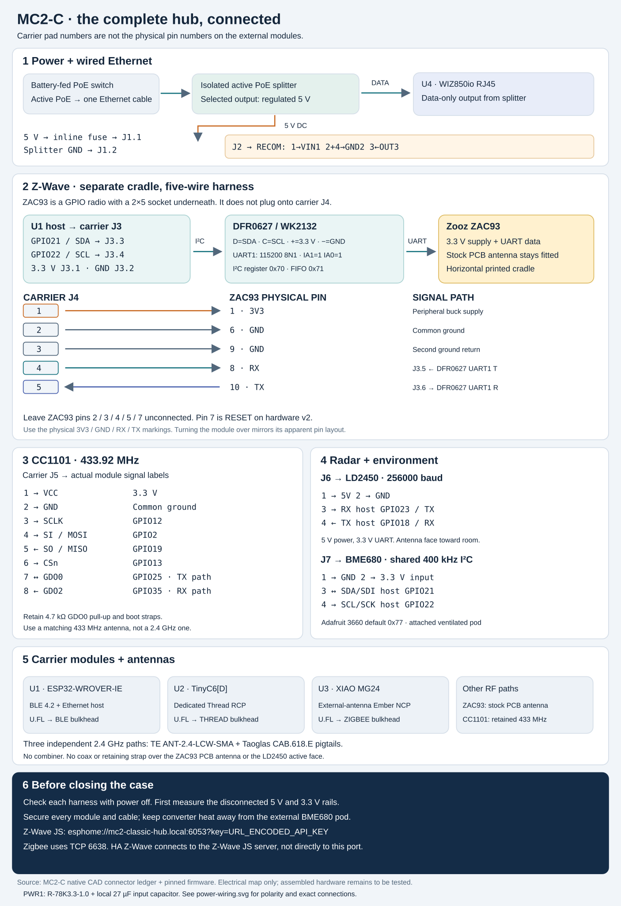
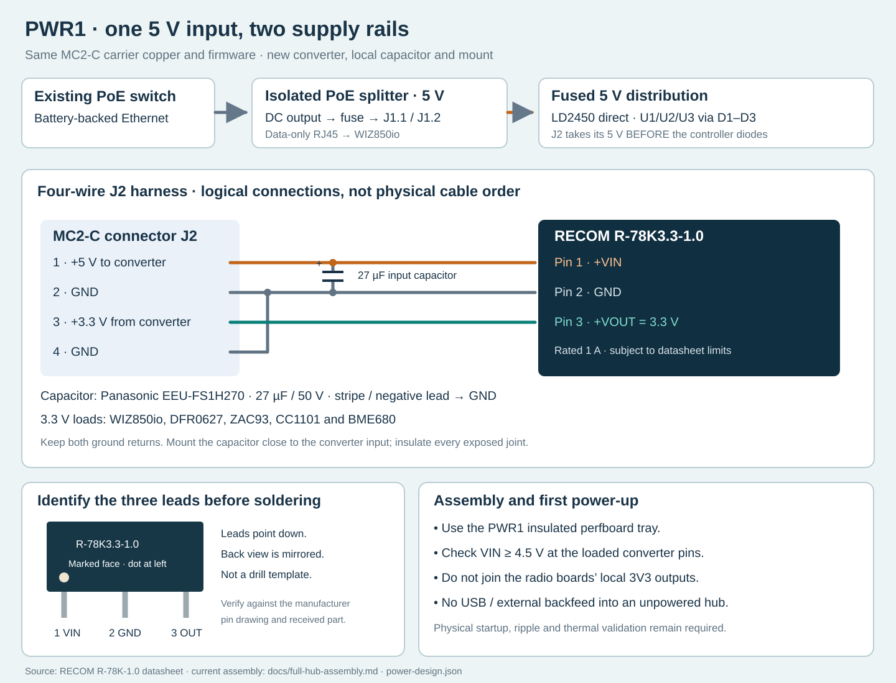
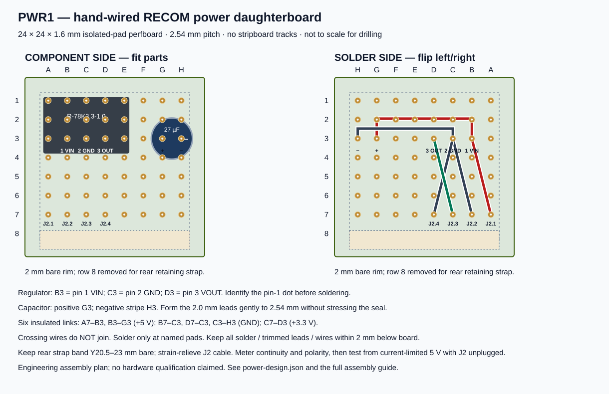
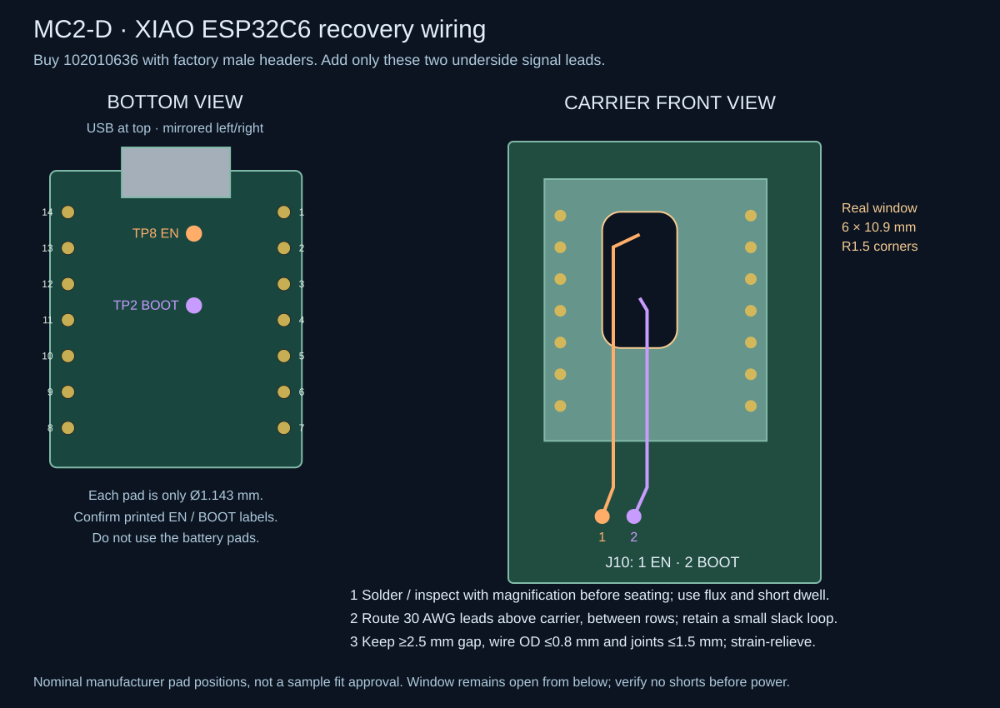

# MC2-D full-hub assembly and Z-Wave installation

The **Zooz ZAC93 sits in its own printed cradle beside the MC2-D carrier**. It
connects by a five-wire harness to **carrier J4**, with serial data passing through
**DFRobot DFR0627 / WK2132 on carrier J3**. It does not plug onto the ESP32, into
USB, or directly onto J4: the ZAC93 has a different **2×5 socket**.

Use the [full-hub enclosure](../mechanical/full-hub/README.md) for this assembly.
The older 190 × 160 mm carrier-only case does not accommodate the complete hub.
The new enclosure provides separate locations and restraints for the carrier,
ZAC93, UART bridge, CC1101, radar, BME680, PoE splitter, buck converter and fuse.
Its models are a fit-check prototype: compare the received modules and connectors
with the documented envelopes before printing or powering the assembly.



[Open the wiring image at full size](../hardware/external-antenna/full-hub-wiring.svg).
The image shows electrical relationships, not cable lengths or a mating-side
connector view. The [mechanical layout](../mechanical/full-hub/README.md) shows
where parts sit. The [native carrier ledger](../hardware/external-antenna/cad/connectors.json)
is authoritative for carrier pad numbers.

## Fit the three 2.4 GHz pigtails

Use **3 × Taoglas CAB.618.E** with **3 × TE/Linx ANT-2.4-LCW-SMA** and the
**FH1-MC2-D-PWR1** print package. Print its connector coupon first: the round
6.8 mm clearance hole passes through the same 3 mm thickness as the case wall.
Check the actual bulkhead, washer, nut and mating antenna before printing the
main shell. Hold the metal shoulder while tightening; the round hole does not
provide an anti-rotation flat, and the coax must not take the tightening torque.

Follow the generated BLE, Thread and Zigbee routes with at least 25 mm service
allowance and bends no tighter than 6.8 mm radius. The routing check uses
144 mm available length (150 mm nominal less a project 6 mm shortfall allowance).
The manufacturer family drawing does not establish the exact 150 mm SKU's
length tolerance, so measure the delivered cables and dry-fit all three with
no tension on the miniature sockets. See the [selection and evidence](pigtail-selection.md).

## Install the ZAC93

Use the regional **ZAC93 GPIO board**, retaining its factory PCB antenna. The
manufacturer specifies a nominal **1.1 × 1.1 inch** board and **3.3 V supply**.
Its socket extends below the board; the cradle reserves space for the mating pins
and cable exit. Keep the antenna end toward the outer plastic wall, with no
metal fastener, foil, converter, cable bundle or retaining strap over the
radiating area. The board remains horizontal in its cradle. These are placement
choices to be checked by RF testing, not a coverage guarantee.
[Zooz product manual](https://www.support.getzooz.com/kb/article/2404-zac93-gpio-module-product-manual/),
[Zooz installation and antenna guidance](https://www.support.getzooz.com/kb/article/1426-zac93-gpio-module-faqs/).

With all power disconnected, locate the actual ZAC93 **3V3, GND, RX and TX**
markings. ZAC93 numbering follows positions 1–10 of the compatible Raspberry Pi
header. Flipping the board mirrors the apparent arrangement; do not infer pin 1
from a render or from wire colour. The [Zooz installation guide](https://www.support.getzooz.com/kb/article/1215-zac93-800-gpio-module-installation-guide/)
and the supplied board's marking must agree.

Connect the **carrier J4** harness as follows:

| Carrier J4 pad | ZAC93 physical pin | Function |
| --- | --- | --- |
| **1** | **1 — 3V3** | Regulated peripheral 3.3 V supply |
| **2** | **6 — GND** | Ground |
| **3** | **9 — GND** | Second ground return |
| **4** | **8 — RX** | DFR0627 TX1 → ZAC93 receive input |
| **5** | **10 — TX** | ZAC93 transmit output → DFR0627 RX1 |

**J4 pad 4 is not ZAC93 pin 4.** This is a remapped cable, not a straight-through
ribbon. For the purchased **Sullins PRPC005DAAN-RC**, insert the **5.84 mm long
mating posts** into ZAC93. **Solder the five harness wires to the 3.05 mm short
solder tails**, then insulate each joint separately with heat shrink. Do not
push female jumper sockets onto the short tails: those are not mating posts.
Cut the male ends off five M–F jumpers, retaining their female ends for carrier
J4. Check continuity and isolation before mating the adapter. Secure the harness
on the printed cable restraint so pulling the cable cannot lift the board. Leave
ZAC93 pins **2, 3, 4, 5 and 7** unconnected. In particular, the Raspberry Pi's
5 V header positions are not the supply used here.

On ZAC93 **hardware 2**, identified by the `Version 2.0` marking, physical pin 7
is connected to the radio's reset input. This design deliberately leaves it
open; it does not provide host-controlled Z-Wave hardware reset. Earlier boards
use that position differently. Do not ground it or connect it to a convenient
ESP32 pin. A software restart of the ESP32 is not a ZAC93 power cycle. For a
radio that does not respond to normal serial commands, stop its driver and cycle
the hub's PoE supply, with no USB power connected. A factory reset erases network
state and is a separate operation.
[Zooz hardware revision record](https://www.support.getzooz.com/kb/article/1389-zac93-gpio-module-change-log/).

Do not load ESPHome, a generic Silicon Labs image or the project's MG24 firmware
onto the ZAC93. It retains Zooz firmware; supported ZAC93 updates are a separate
operation through compatible host software.

## Fit the UART bridge and verify the complete signal path

DFR0627 is a finished **I²C-to-two-UART module** using WK2132. The MC2-D host's
native UARTs already serve Thread, Zigbee and radar, so Z-Wave uses this bridge.
Set **IA1 = 1 and IA0 = 0** (the module's A1/A0 DIP switches). The driver uses
register address **0x50**, FIFO address **0x51**, and **UART1 at 115200,
8 data bits, no parity, 1 stop bit**.
UART2 is unused. Powering this bridge at 3.3 V also keeps its I²C pull-ups and UART
signals at the correct voltage. Do not use a 5 V supply just because the bridge
itself supports one.

**Address correction:** reserve **0x50–0x57** for this bridge, even though only
UART1 is used. WK2132 decodes an eight-address block, not just its register and
FIFO addresses. The previous **A1=1/A0=1** setting selected **0x70–0x77** and
collided with BME680 at **0x77**; changing BME680 to 0x76 would still collide.
Power down before changing A0, then use firmware configured for **0x50**.
No carrier trace or J3 wire needs to change. See the
[manufacturer's address-bit definition](https://wiki.dfrobot.com/dfr0627/docs/20907).

| Carrier J3 pad | DFR0627 marking | Connection |
| --- | --- | --- |
| **1** | **+ / VCC** | Peripheral 3.3 V |
| **2** | **− / GND** | Common ground |
| **3** | **D / SDA** | Host GPIO21 |
| **4** | **C / SCL** | Host GPIO22 |
| **5** | **UART1 T / TX1** | Transmitter; carrier trace continues to J4.4 → ZAC93 pin 8 |
| **6** | **UART1 R / RX1** | Receiver; carrier trace comes from J4.5 ← ZAC93 pin 10 |

These six wires go to the module's I²C and UART1 connectors according to their
labels; they are not a claim that DFR0627 has one six-pin connector in this order.
DFR0627's `RST` and `IRQ` pads are not wired by MC2-D. Its UART channel reset in
the driver is not the ZAC93 reset. The bridge and BME680 share I²C; the ZAC93's
own pins 3/5 are **not** connected to I²C.
[DFRobot pin labels and module specification](https://wiki.dfrobot.com/dfr0627),
[DFRobot schematic](https://dfimg.dfrobot.com/wiki/20531/DFR0627_i2c-to-uart-module_schematics_V1.0.pdf),
[pinned bridge driver](../firmware/module-carrier/components/wk2132_uart/transport.h).

## Allocate the purchased harness parts

The packs of 20 F–F and 20 M–F 150 mm jumpers are sufficient with this allocation:

- **10 F–F:** two DFR0627 UART1 signals and all eight CC1101 connections.
- **Four M–F:** extend the BME680 STEMMA QT breakout cable to J7.
- **Five M–F:** retain the female ends for J4 and solder the cut ends to the ZAC93 adapter above.
- **Up to four M–F:** retain female ends for J6 and splice to the LD2450's matching cable if required. Confirm that the purchased radar includes that cable.
- **Two M–F female ends:** terminate the separate 30 AWG C6 TP8/TP2 leads at J10; insulate the splices and label EN/BOOT at both ends.
- **DFR0627's supplied Gravity four-wire cable:** connect power and I²C to J3 by labels, not colour assumptions. [Manufacturer's included parts](https://www.dfrobot.com/product-2001.html).

Use the separate **22 AWG wire and Harwin housings/contacts for J1/J2**;
the thin jumper packs do not replace the main supply harness. Use a short
insulated 22 AWG offcut for D1. Cut the 40-pin strip into J1=2, J2=4, J3=6,
J4=5, J5=8, J6=4, J7=4 and J10=2 (35 pins); J8/J9 remain unpopulated.

## Power and Ethernet

The power chain remains **battery → existing PoE switch → one Ethernet cable →
isolated active PoE splitter**. Only the isolated low-voltage output enters the
carrier. This case contains no battery, additional network switch or raw PoE
power converter wired directly to the carrier.

1. Fit the selected **Waveshare POE-SPLITTER-25W-5.5-2.1**, the version with the
   regulated **5 V** barrel output, in its restrained bay. Match the actual unit's
   dimensions and captive leads to the enclosure envelope. Its PoE input receives
   the switch cable; its **data-only RJ45 output plugs into WIZ850io U4**.
2. Connect splitter **+5 V through the rated inline fuse** to **carrier J1.1**;
   connect splitter ground to **J1.2**. Verify the barrel polarity and voltage
   with a meter before connecting the electronics. The project carries a
   **1.5 A time-delay fuse** as the starting specification; validate inrush,
   temperature derating, wire gauge and contact rating under the completed load.
   A 25 W splitter rating does not authorize 25 W through this carrier harness.
3. Connect **J2.1 → RECOM R-78K3.3-1.0 pin 1 (+VIN)**,
   **J2.2 → pin 2 (GND)**, **J2.3 ← pin 3 (+VOUT, 3.3 V)** and
   **J2.4 → the same pin-2 ground node**. Add the specified **27 µF input
   electrolytic capacitor** directly between pin 1 (**positive**) and pin 2
   (**negative**). This is part of the assembly for power connection transients;
   do not omit it because the nominal input is only 5 V. Identify pins from the
   manufacturer drawing, not an assumed left-to-right cable order.
4. The peripheral 3.3 V rail powers WIZ850io, DFR0627, ZAC93, CC1101 and BME680.
   The fused 5 V rail powers LD2450 directly. **Fit a 22 AWG insulated wire
   link at D1, not a diode**, to feed U1 without the extra Schottky drop ahead
   of its AMS1117. U2/U3 retain their 1N5819 diodes D2/D3 (banded ends at
   pad 1 toward each module). The third purchased diode is a spare. **Do not join the controller boards'
   local 3V3 outputs to the peripheral buck output.**



RECOM takes its input from **fused 5 V at J2.1, upstream of the controller branches**, not from a controller's
3.3 V pin or a diode-dropped 5 V output. Its specified input range starts at
**4.5 V**: measure the voltage at its actual input pins during simultaneous load
and startup, including losses in the fuse, connector and cable. Verify the
peripheral rail under load before connecting the radios. The 1 A rating is a
component limit subject to the datasheet conditions, not a measured hub current.
See the [current load budget and acceptance criteria](../hardware/external-antenna/power-design.json).

Copy the [power measurement worksheet](../hardware/external-antenna/power-measurements.csv)
and record this assembly's RECOM input/output, ZAC93 supply and each controller's
independent local 3.3 V rail under simultaneous load. Measure U1's regulator
input after the D1 wire link together with its output: required headroom comes from the fitted
regulator's guaranteed dropout at the measured current and temperature, not
RECOM's 4.5 V minimum. Capture GPIO12 and GPIO2 around reset with a scope; a DMM
average cannot verify boot straps. All worksheet entries start unmeasured.

Fit the SIP3 converter and capacitor on the specified small **isolated-pad
perfboard**, in the new removable PWR1 tray. Insulate solder joints, strain-relieve
the harness and keep ventilation around the converter. No screw passes through
the converter or capacitor. The old Pololu two-hole mount is not suitable.
The RECOM is non-isolated; the selected PoE splitter provides isolation.



Cut a **24 × 24 × 1.6 mm** piece with isolated pads on a 2.54 mm grid. Follow
the labeled A–H / 1–8 drawing, leaving a 2 mm copper-free rim and removing
row-8 pads for the rear retaining strap. Fit RECOM pins 1/2/3 at **B3/C3/D3**,
the capacitor positive/negative at **G3/H3**, and J2 wires 1/2/3/4 at
**A7/B7/C7/D7**. Gently form the capacitor's 2 mm leads to the 2.54 mm spacing
without bending at the seal. The solder-side drawing is mirrored deliberately.

Make the six shown connections with insulated wire, keeping solder, trimmed
leads and wire within the 2 mm underside allowance. Crossings are insulated;
only named pads join. Check continuity against [the connection ledger](../hardware/external-antenna/power-design.json),
then test the detached assembly from a current-limited 5 V source before
connecting J2. Use the **PWR1 base and tray together**; the earlier tray's
mounting pattern is different. [Mount and print details](../mechanical/full-hub/README.md).

The RECOM output must not be backfed. Program the radio boards loose as directed
in [Start here](start-here.md); do not attach powered USB or an external supply
to the assembled, unpowered hub. D1 is a wire link: host USB can energize the whole 5 V bus even with PoE off. The remaining controller supply diodes do not prevent
all possible backfeed paths through signal pins.

The MC2-D PCB retains the four-wire J2 interface and RECOM PWR1 power assembly.
The XIAO migration changes its own footprint and recovery connections, not the
regulator wiring. Measure startup, ripple, temperatures and concurrent operation
before deployment.
[RECOM datasheet and pin drawing](https://recom-power.com/pdf/Innoline/R-78K-1.0.pdf).

## Thread recovery leads

Buy **XIAO ESP32C6 (Pre-Soldered), 102010636**. Its factory 2×7 male headers
solder directly to U2; no female stacking headers are used. Before mounting,
program the loose board with the **MC2-D 4 MB XIAO RCP** and attach two short,
flexible, insulated **30 AWG** leads to its underside test pads:

| Carrier | XIAO underside contact | Host signal |
| --- | --- | --- |
| J10.1 — THREAD_EN | TP8 — EN / RESET | GPIO27 |
| J10.2 — THREAD_BOOT | TP2 — BOOT / GPIO9 | GPIO15 |




These two contacts are **not part of the factory headers**. Fine pad soldering
is still required; a pre-soldered board alone does not enable automatic recovery.
Confirm orientation against the [bottom-view drawing](../hardware/external-antenna/cad/c6-recovery.svg) and the [3D service-wire detail](../mechanical/full-hub/thread-assembly-preview.png) before soldering. Do not
mirror the top view or use neighbouring test pads. Neither lead carries 5 V.
Route the leads above the carrier in the gap between the header rows, with
the joints accessible through the dedicated window from below when the carrier
is lifted out of the enclosure. The enclosure floor is not an access hatch. Do not trap them; leave a gentle service loop and strain-relieve each
lead without covering test points or pulling on the pads. Inspect both joints
with magnification, check continuity to J10 and check for adjacent-pad shorts.

The XIAO's own GPIO8 pull-up is used; **carrier R3 is not fitted in MC2-D**.
U2 pad 7 is TX/GPIO16, pad 8 is RX/GPIO17, pad 13 GND and pad 14 VBUS.
U2 pad 12 (local 3V3 output) stays unconnected to the carrier peripheral rail.
Keep the module power sources separated as shown in the schematic.

## Other off-carrier modules

### CC1101: carrier J5

Retain the **433.92 MHz CC1101 module** and its matching antenna. A clone's
physical connector order is not standardized; the following are carrier pad
numbers and the required module **signal names**.

| J5 pad | CC1101 signal | Host / rail |
| --- | --- | --- |
| 1 | VCC | Peripheral 3.3 V |
| 2 | GND | Common ground |
| 3 | SCLK | GPIO12, shared SPI clock |
| 4 | SI / MOSI | GPIO2, shared SPI output |
| 5 | SO / MISO | GPIO19, shared SPI input |
| 6 | CSn | GPIO13, dedicated RF chip select |
| 7 | GDO0 | GPIO25, open-drain transmit path with carrier 4.7 kΩ pull-up |
| 8 | GDO2 | GPIO35, receive path |

Use a current rebuilt host image with the
[RF startup and handoff corrections](connection-audit.md#rf-startup-and-handoff-corrections). The host
must release GDO0 while CC1101 drives it; verify that state through power-up,
reset and transmit/receive transitions with an oscilloscope.

Mount the module in its separate cradle and use a short, direct harness with
ground conductors beside clock/data conductors; avoid a large loop alongside
the buck converter. WIZ850io transactions also put **10 MHz** clock edges on
this shared SPI wiring, even while CC1101 chip select is high. A long loose
Dupont bundle is therefore not an approved final harness; inspect signal
integrity and RF operation with the actual routed cable. Retain the carrier's GPIO12/GPIO2 pull-downs
and chip-select pull-ups. Use the actual RF connector on the retained module and
a band-matched antenna; the three 2.4 GHz antennas are not substitutes. Any panel
adapter must match both connector gender and standard versus reverse-polarity
SMA. Keep the antenna connection accessible without straining the radio PCB.

### LD2450: carrier J6

- **J6.1 → radar 5V**; **J6.2 → radar GND**.
- **J6.3 → radar RX**, driven by host GPIO23/TX.
- **J6.4 ← radar TX**, received by host GPIO18/RX.

The radar uses **5 V power and 3.3 V UART logic**, at the configured **256000 baud**.
Carrier order is not a license to assume the order of the radar's cable colours;
read its 5V/GND/RX/TX markings. Fit the radar to its room-facing bracket, with its
printed antenna face toward the sensing opening. Route its cable behind it.
Keep boards, metal, screw heads and cable loops out of the front field of view.
Check detection with the final printed window/material in place; an attractive
render does not establish radar performance.

### BME680: carrier J7

- **J7.1 → GND**; **J7.2 → 3.3 V input** on the selected Adafruit 3660 breakout.
- **J7.3 → SDA / SDI**, host GPIO21; **J7.4 → SCL / SCK**, host GPIO22.

Use the breakout's power input (`VIN` or the STEMMA QT power contact), not its
regulator-output pin. The default address is **0x77**; if the actual breakout is
configured for **0x76**, change `bme680_address` in the private firmware build.
The shared bus runs at **400 kHz**. Existing breakout pull-ups must go to 3.3 V;
do not add pull-ups or long cable extensions without checking the resulting bus.
Keep BME680 at **0x77** (0x76 is also outside the corrected bridge block) and
DFR0627 at **A1=1/A0=0**. Do not reconnect a bridge left at A1=1/A0=1.
Allow roughly **250–300 mm** for the routed pod harness as a starting estimate,
then cut to the measured service route. That length is not guaranteed at
400 kHz: verify rise times, noise and reliable communication while the other
radios are active. Route ground with SDA/SCL and separate this cable from the
buck and high-current leads.
Keep this module in the ventilated pod on the enclosure's stand-off arms, outside
the warm main cavity and separated from the buck converter, PoE splitter and
controller heat. Do not cover the sensor
opening with foam, glue or a retaining strap. Compare temperature with an
independent room sensor after thermal equilibrium; raw gas resistance is not a
calibrated CO₂/VOC concentration.
[Adafruit BME680 power and I²C pinout](https://learn.adafruit.com/adafruit-bme680-humidity-temperature-barometic-pressure-voc-gas/pinouts).

## Mounting and cable order

Follow the [printable parts and fastener schedule](../mechanical/full-hub/README.md).
All electronic modules need a restraint; connector friction alone is not a mount.

1. Fit the case fasteners, carrier standoffs and peripheral cradles with the base
   empty. Print and check the small fit coupons and new power tray before committing to a full case.
2. Install the PoE splitter and fuse in the power bay, then the RECOM buck
   and its input capacitor on the perfboard support. Restrain their low-voltage leads before fitting the carrier.
3. Fit the MC2-D carrier to its four mounting positions. Use factory-soldered headers on U1–U4 where specified. Complete and inspect the
   two XIAO underside recovery leads before securing the carrier; check solder-tail
   and service-wire clearance against the access window.
4. Fit the DFR0627 and CC1101 to their trays. Place the ZAC93 in its own cradle
   with the antenna area clear and connect the remapped J4 harness from below.
   Support the board while mating the socket, then secure only its non-antenna
   area. Do not drill new holes in a radio PCB.
5. Fit LD2450 to the room-facing bracket and BME680 to the attached ventilated pod.
   Keep removable-panel leads long enough to service, but restrained so they
   cannot cross the radar face or be pinched at the lid.
6. Fit the three independent 2.4 GHz bulkheads and connect U1/BLE, U2/Thread and
   U3/Zigbee with their specified pigtails. Route and restrain these separately
   from the power harness. Preserve the installed CC1101 antenna arrangement and
   the ZAC93 stock antenna. No shared antenna splitter is used.
7. Check with the cover resting in place that no part, plug, antenna connector,
   screw or wire is compressed. A modelled envelope is not a substitute for this
   dry fit. Keep the fasteners and cables needed for future fuse/radio access
   reachable without desoldering the carrier.

## First power and Home Assistant

Program the three loose controllers with their **MC2-D host, 4 MB XIAO ESP32C6 and external-antenna MG24 images** following the [firmware guide](../firmware/external-antenna/README.md)
before assembling; use the exact external-antenna MG24 image. The ZAC93 arrives
with its own radio firmware. Remove USB power before attaching the PoE-fed
assembly. Attach the correct antennas before transmitting.

With power off, continuity-check every cable against the ledger, including
J4.4→ZAC93 pin 8, J4.5→ZAC93 pin 10, J10.1→XIAO TP8 and J10.2→XIAO TP2. Check that 5 V and 3.3 V are not shorted
to ground or to each other. Test the disconnected splitter/buck rails before
connecting expensive modules; then verify voltages again under load and at the
ZAC93 itself. Confirm I²C devices, bridge health, Ethernet link and radio startup
with the lid open before completing the case.

Add `mc2-classic-hub` to the ESPHome integration. In **Z-Wave JS / Z-Wave JS UI**,
use the native ESPHome serial transport:

```text
esphome://mc2-classic-hub.local:6053?key=URL_ENCODED_API_KEY
```

Use the matching private encrypted API key, URL-encoded if it contains reserved
characters. Do not publish that URL with a real key. The HA Z-Wave integration
connects to the **Z-Wave JS server's WebSocket address**, not directly to port
6053. Port 6638 on this hub belongs to **Zigbee**, not Z-Wave.
[Z-Wave JS native ESPHome connection](https://github.com/zwave-js/zwave-js/blob/master/docs/usage/esphome-connection.md).

For a new ZAC93, verify its region and start its new network normally. If moving
a previously used ZAC93, first back up its NVM and network keys, stop the previous
driver, and retain the same radio/network state. Do not factory-reset it or
re-include every device merely to move the UART host. Only one Z-Wave JS driver
should own this radio. This documentation does not itself switch a running Home
Assistant installation.

Finally test a real Z-Wave event alongside Thread, Zigbee, BLE, RF and radar.
Repeat with the lid closed and at the final location, record temperatures and
supply drop, and perform the [RF and stability acceptance](rf-commissioning.md).
Mechanical clearance, firmware compilation and electrical continuity are
separate checks; none proves the completed hub has passed an operating test.
