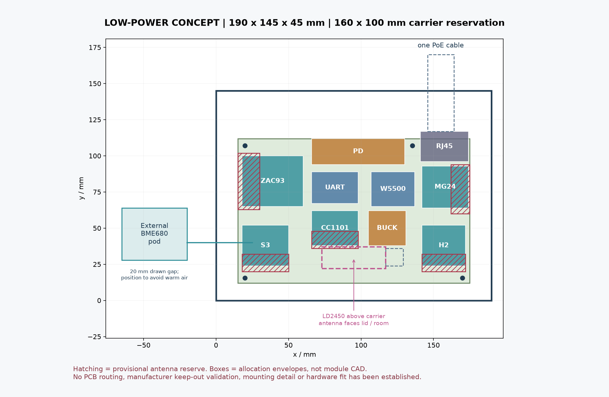
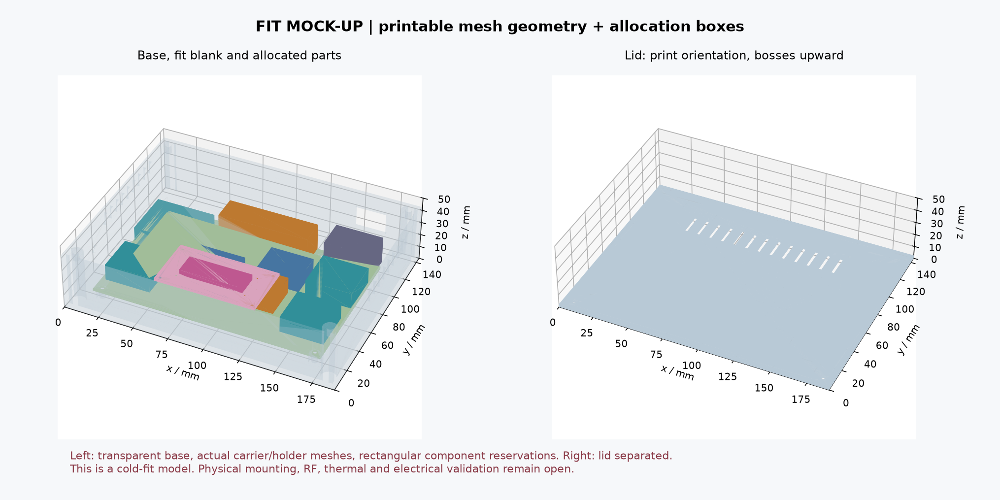

# Low-power enclosure: layout mock-up

<!-- MC2-CURRENT-DESIGN -->
> **Current build: [MC2 — three external antennas](external-antennas.md).** This page retains an earlier design or evaluation for reference. Its board images, pin maps, enclosure fit and alternative BOMs are not the current MC2 build.

For MC1, use the [carrier enclosure prototype](../mechanical/module-carrier/enclosure-prototype/README.md) with its [rail-fit study](../mechanical/module-carrier/rail-mount/README.md). The dimensions and printable parts below are retained for the earlier low-power allocation concept.

**This is a preliminary mock-up for checking dimensions. Printable parts are available, but there is no PCB ready to order or physically validated assembly.** The enclosure dimensions match the hardware concept of one ESP32-S3, one W5500, separate H2/MG24 radios and locally connected radio modules. The original Pi enclosure remains a separate design. The later LP-C0 and LP-I0 PCBs do not fit this mock-up as complete assemblies: see the [CAD-coordinate compatibility review](../hardware/low-power/visual/physical/README.md).





## Printable parts

The main envelope is **190 × 145 × 45 mm**, excluding screw heads, the incoming cable and the external BME680. The base is 42.6 mm high, the lid 2.4 mm thick, and the floor and walls 2.4 mm thick. The lid lip has 0.35 mm clearance per side from the walls. A 3 mm brim requires a 196 × 151 mm bed area; the parts fit a typical 220 × 220 mm bed without scaling.

The [export directory](../mechanical/low-power/generated/assembly.scad) contains:

- `mockup_base.stl`: one base with posts, ventilation and cable openings.
- `mockup_lid.stl`: one lid with four radar-holder posts and an experimental thin window.
- `carrier_fit_blank.stl`: one **plastic board template**, 160 × 100 × 1.6 mm. It checks the envelope and fastener positions; it does not replace FR4, a schematic, PCB routing or an assembly board.
- `radar_holder.stl`: one universal 70 × 38 × 2 mm holder with slots for insulating straps.
- `fit_coupon.stl`: one test coupon for holes and heat-set inserts.

The BME680 uses the separate [base](../mechanical/generated/bme680_pod_base.stl) and [lid](../mechanical/generated/bme680_pod_lid.stl) of the existing 45 × 36 × 20 mm pod. These files are not duplicated in the new directory. The pod enclosure also awaits a physical fit check. The new 3D assembly shows it only as a rectangular envelope.

STL units are millimeters, and the parts are already oriented for printing: base floor down, lid outer face down with posts up, and template and holder flat. Initial settings for an unpowered fit mock-up: 0.4 mm nozzle, 0.2 mm layers, 4 perimeters and PETG without conductive fillers. PLA is suitable only for dimensional checks. The bridge above the cable opening spans 22 mm; local supports may be required. Material selection for a continuously operating device requires thermal testing; no flame-resistance claim is made.

## Board, fasteners and actual dimensions

The enclosure origin is its front-left-bottom corner; x points right, y toward the back and z toward the lid. The board template occupies x=15…175, y=12…112, z=10…11.6 mm. The plan contains no copper layers or electrical connections.

The four 3.4 mm template holes are defined by **this mock-up**, not copied from a commercial board. Their centers relative to the template's front-left corner are (5,3.5), (155,3.5), (5,95), **(120.5,95)** mm. The front holes are moved toward the edge to keep screw heads out of the provisional antenna zones. The last hole is intentionally offset from the corner: the standard position (155,95) would lie under the MagJack envelope. Validation also includes a screw head 6.8 mm in diameter and 3.5 mm high above the template. These four coordinates alone are not sufficient to order a real PCB.

Rectangles in the plan reserve space; they are not accurate part models. The complete dimensions, coordinates, statuses and sources are in [parameters.json](../mechanical/low-power/parameters.json).

- PoE PD: **Silvertel Ag97005-FL**, from the Ag97000 family, is selected for evaluation with a 5 V / 9 W continuous output. Its published body dimensions are 56 × 14 × 13 mm; the mock-up reserves 64 × 18 × 20 mm. Pins, mounting height and isolation clearances have not yet been incorporated. The `-FL` version includes bridge rectifiers; the `-S` version omits them. [Official datasheet](https://silvertel.com/images/datasheets/Ag97000-Datasheet-low-cost-isolated-12W-Power-over-Ethernet-PoE-module-solution.pdf).
- H2: 30 × 28 × 12 mm reserved for the module and supporting circuitry. The published ESP32-H2-MINI-1 body is 13.2 × 16.6 × 2.4 mm. This is not a DevKit board; the bench DevKit is not guaranteed to fit this envelope. [Espressif](https://documentation.espressif.com/esp32-h2-mini-1_mini-1u_datasheet_en.pdf).
- MG24: 32 × 29 × 12 mm reserved for the MGM240P and supporting circuitry. The module itself is 12.9 × 15 × 2.2 mm. Its exact land pattern, antenna orientation and keep-out zones must be transferred from current documentation. [Silicon Labs](https://www.silabs.com/documents/public/data-sheets/mgm240p-datasheet.pdf).
- ZAC93: 42 × 35 × 14 mm reserved; CC1101: 32 × 24 × 12 mm. **These dimensions are assumptions for space allocation**: the owner's existing boards, antennas, connectors and heights must be measured. Their actual dimensions are not claimed to match these rectangles.
- S3, W5500, buck converter and MagJack are represented by reservations for the target circuits/modules. This does not guarantee that complete DevKit, EvalPoE, WIZ850io or bench USB/Ethernet boards will fit. The final carrier PCB will have different outlines and connections.
- LD2450 has a published board outline of 44 × 15 mm; the reserved 4 mm height is still an assumption. Its connector and mounting require separate checks. [Hi-Link](https://www.hlktech.com/Goods-226.html).

A central UART area of 32 × 22 × 14 mm is reserved for the SC16IS752IPW,128, a 3.6864 MHz crystal and a TPS3808G33 reset supervisor. This is preliminary space for circuit layout and servicing, not a second MCU or a validated fit for a complete TSSOP adapter board. The electrical bench adapter is not included in this envelope.

Required fasteners **for this mock-up**, separate from the original enclosure:

- 12 M3 heat-set inserts approximately 5 mm long: 4 for the lid, 4 for the board template and 4 for the radar holder. The pilot is 4.2 mm in diameter and 6 mm deep; select the diameter and installation temperature using the coupon and the specific insert's documentation.
- 12 **M3×6** screws: four each for the lid, template and holder. Nominal engagement without washers is 3.6, 4.4 and 4 mm, respectively. M3×8 screws are too long for the template with a 6 mm pilot; do not reuse the original deck fastener set here. Recheck engagement if washers are used.
- Two M2×6 screws for the BME680 pod; its other assembly details are in the [original instructions](enclosure.md).
- Suitable insulating mounts for actual modules, grommets and strain relief must be selected after fit checks; exact module fasteners are not yet specified. The board template is not intended as a surface for gluing down and powering the complete electronics assembly.

## Cables, antennas and radar

The single PoE cable runs straight to the rear MagJack. The wall opening is 22 × 16 mm at x=144…166, z=14…30 mm. A straight plug has an 18 × 53 × 12 mm reservation extending 25 mm beyond the rear wall. This arrangement requires no cable turn inside the enclosure. **The dimensions of the actual plug, latch, rubber boot and grommet, and the pull-out force, have not been checked.** A thick cable or boot may require changing the opening and connector position. Cable retention must transfer force to the enclosure, not the connector's solder joints.

The BME680 sits outside on the left, with a drawn gap of 20 mm. This is a starting position, not proven thermal isolation. The 5 mm cable exit is at x=0, y=40, z=20 beside the S3 zone. The initial length of the entire I²C harness is 100–200 mm, including the internal segment, connectors and slack. Check the actual frequency, pull-ups, error-free operation and BME temperature; position the pod beside or below the heat source, outside the warm airflow.

Hatching in the plan marks **provisional space reserved for antennas**. The script checks that other modules do not occupy these volumes, but does not check copper, ground planes, actual RF currents, radiation patterns or certification requirements. A solid plastic template under the hatching does not authorize copper or FR4 in that area on the final board. Each module's actual manufacturer restrictions must be applied; PCB edge cut-outs or moving an antenna beyond the edge may be required. No SMA bulkhead connectors have been selected for this mock-up: the stock ZAC93/CC1101 connection types are not yet confirmed, and antenna modification is not assumed.

The radar sits on a separate holder: the holder top is z=35.6 mm, and the assumed module top is z=39.6 mm. Above it, the lid has a 60 × 30 mm area that is 1.2 mm thick; the underside of the thin window is z=43.8 mm. This gives a nominal 4.2 mm air gap **with the assumed 4 mm module thickness**. This is experimental geometry for 24 GHz, not an impedance-matched radome design. Do not place foil, metal-filled plastic, metallic paint or fasteners in front of the antenna. Wires and straps must not cross the radar's printed antennas. If an insulating pad is needed under the module, its thickness reduces the gap; update the parameters after measuring the actual module.

The lid must face the room. When placed horizontally on a table, the radar points upward; a finished wall bracket or load-bearing mount has not been designed for this preliminary enclosure.

## Validation and limits

[build.py](../mechanical/low-power/build.py) generates CSG/OpenSCAD, STL, GLB, PNG and a [report](../mechanical/low-power/generated/mesh-report.json). It uses geometry functions from the original generator; existing STL files are not changed. GLB uses meters as required by glTF; STL/SCAD use millimeters.

Software checks performed:

1. The five exported STL files are read back: each is one closed body with consistent winding and positive volume.
2. Printable parts do not intersect volumetrically in their assembled positions. The eleven rectangular component reservations do not intersect each other or the enclosure parts. Template fastener heads have separate reservations.
3. Antenna reservations are clear of other components and template fastener heads; the straight Ethernet plug corridor and radar cable reservation are not obstructed by printable parts or components.
4. Nine regression tests also exercise deliberately invalid layouts, incorrect mounting, blocked cable exits and stale STL/SCAD. The `--check` mode regenerates a reference in a temporary directory rather than silently correcting old files.

Run these commands from the repository root in an environment with the [CAD dependencies](../mechanical/requirements.txt):

```sh
python mechanical/low-power/build.py
python mechanical/low-power/build.py --check
python -m unittest discover -s mechanical/low-power -p 'test_*.py'
```

Changing the enclosure size **does not rearrange components automatically**: reservation coordinates are defined in JSON. Repeat the geometry checks and inspect the PNG/GLB after any change. A software clearance check does not replace a physical fit check with connectors and cables attached.

Before manufacturing the electrical board or operating it continuously, the following remain: review the selected PCB revision's MagJack/protection choices and grommet; verify actual drawings for all modules; qualify PoE isolation clearances and PCB routing; validate mounting and strain relief; test all radio networks simultaneously; compare radar performance with and without the lid; perform a thermal soak and measure the energy of **the entire device at the PoE input**. The PD's nominal output power or efficiency at a different operating point does not establish this mock-up's consumption. Firmware readiness is checked separately and cannot be inferred from the presence of STL files.
