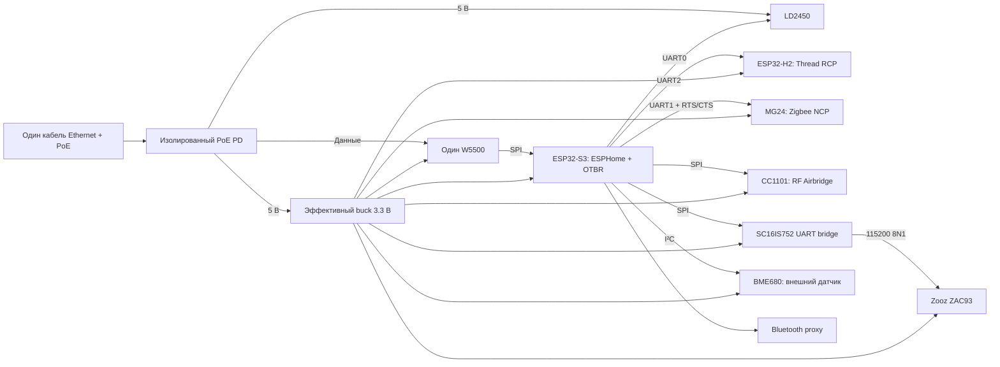

# Компактный хаб с минимальным расходом электроэнергии

Цель этой ветки — **минимум энергии за весь срок эксплуатации**, без расчёта
окупаемости или ограничений на цену компонентов. Для дальнейшей разработки выбран
один ESP32-S3, один Ethernet-интерфейс и общие эффективные линии питания. Linux,
внутренний коммутатор и дополнительные Ethernet-контроллеры в этой версии не нужны.
Home Assistant, Matter Server и Z-Wave JS продолжают работать на существующем сервере.

**Это отдельный инженерный прототип.** Его корпус является макетом компоновки,
а не подтверждением готовности печатной платы к производству. На физическом узле
ещё не проверены запуск, совместная работа радио и энергопотребление. Базовый
[модульный вариант](../README.md#what-is-inside) сохранён для сравнения.

## Выбранная архитектура



Три нативных UART заняты радаром, Zigbee и Thread. ZAC93 подключается через
SC16IS752: отдельная задача обслуживает FIFO по прерыванию, сохраняя стандартный
интерфейс UART для ESPHome Z-Wave proxy. При ошибке линии или переполнении канал
помечается неисправным, чтобы не продолжать передавать повреждённый поток.

BLE, Zigbee и Thread имеют отдельные радиотракты. S3 не делит один радиомодуль
между Zigbee и Thread. Wi-Fi не требуется. BME680 вынесен за пределы тёплого
корпуса; его нагреватель включается кратковременно при опросе раз в минуту.
Deep sleep несовместим с постоянным приёмом RF и маршрутизацией Thread.

Выбор S3 опирается на совместимость с уже имеющимся RF-кодом и ESPHome, а не на
утверждение, что он экономичнее любого другого чипа. P4 с DP83825I остаётся
альтернативой: PHY может потреблять меньше W5500, но P4 требует отдельного
BLE-сопроцессора. Преимущество всей такой сборки не измерено.

## Что входит в комплект

- [Аппаратная часть и подбор компонентов](../hardware/low-power/README.md).
- [Единая прошивка и подготовка сборки](../firmware/low-power/README.md).
- [Корпус, компоновка и печать пробных деталей](low-power-enclosure.md).
- [Машиночитаемые исходные допущения по энергии](../hardware/low-power/energy-comparison.json).
- [Отдельный бюджет новой платы](../hardware/low-power/power-budget.json).
- [Шаблон протокола измерений](../hardware/low-power/measurement-template.json).
- [Общий журнал проверок](validation.md).

Эта распиновка предназначена для новой carrier-платы. У DevKitC выводы 43/44
соединены с USB-UART, а GPIO48 может быть связан с RGB LED. Выбор USB Serial/JTAG
в прошивке не разрывает физические соединения: перед макетированием проверить
схему конкретной ревизии и устранить конфликт. Не подключать этот жгут к старой
плате S3-ETH по совпадению номеров выводов.

## Энергия за срок службы

Проектная цель — **не более 3 Вт среднего добавочного потребления от сети AC**
при работающих функциях. Это соответствует 26.28 кВт·ч за год, 262.8 кВт·ч за
10 лет или 394.2 кВт·ч за 15 лет непрерывной работы. Это пересчёт цели, а не
прогноз или измерение будущей платы. Каждый постоянно потребляемый ватт добавляет
87.6 кВт·ч за 10 лет.

Покомпонентная модель новой платы даёт **2.82 Вт AC** в опорном сценарии и
**2.03–4.92 Вт** по границам допущений. В ней W5500 учтён в режиме 100 Mbps;
потенциальный выигрыш 10 Mbps заранее не вычитается. Диапазон пересекает цель
3 Вт, поэтому объявлять её достигнутой нельзя. В модели отдельно учтены buck,
PoE PD, кабель и PSE; максимальный рекламный КПД не подставляется как постоянный
при малой нагрузке.

Исходные варианты на Pi, Orange Pi и нескольких ESP сравниваются по одной границе:
учитываются коробка, внутренний Ethernet, радио, датчики и потери питания.
Базовый расход уже работающего HA-сервера и общего сетевого оборудования одинаков
и исключён. Если нужен новый выделенный инжектор/PSE, его базовый расход добавляется.
Если новый вариант увеличит нагрузку HA-сервера, этот прирост тоже надо измерить.

```sh
python3 tools/energy.py plan --years 10
python3 tools/energy.py plan --years 15 --extra-ac-w 0.5
```

Вторая команда иллюстрирует добавочные 0.5 Вт отдельного PSE; это не паспортное
значение выбранного устройства. Все сценарные диапазоны обозначают неопределённость
допущений, а не доверительные интервалы. Близкие варианты нельзя достоверно
ранжировать до одинаковых стендовых измерений. Номинал блока питания и пиковый
резерв не являются средним энергопотреблением.

## Как подтвердить экономичность

1. Сначала проверить питание и устойчивость всех функций по аппаратным инструкциям.
   Замерить краткие провалы и пусковой ток отдельно: ваттметр их не заменяет.
2. Для нового выделенного инжектора измерять весь его вход AC. Для существующего
   коммутатора сравнить вход AC с узлом и без него, сохранив остальные порты,
   нагрузку и кабель. Показание PoE-порта или ток на 5 В не включает все потери AC.
3. Записать минимум 24 часа энергии в Wh; лучше 72 часа обычного использования.
   Сохранить версию прошивки, длину кабеля, температуру, режим BLE и активности
   всех радиосетей. Отдельно выполнить нагрузочный тест, не выдавая его среднее
   за обычный суточный профиль.
4. Указать абсолютную погрешность измерителя в Wh. При вычитании базового расхода
   погрешности обоих замеров суммируются. Если разница сопоставима с погрешностью,
   результат не позволяет выбрать победителя.
5. Скопировать шаблон в игнорируемый каталог `private/`, заполнить реальные значения
   и рассчитать результат:

```sh
python3 tools/energy.py measure private/energy-measurement.json --years 15
```

`ac_dedicated` означает полный вход отдельного блока питания; поля baseline должны
отсутствовать или быть `null`. `ac_incremental` вычитает среднюю мощность базового
замера, нормализуя его по собственной длительности. Поле `all_functions_passed`
должно подтверждать весь набор функций; неполный или короткий тест не получает
статус достижения цели. Пересечение диапазона погрешности с 3 Вт даёт
`inconclusive`, а не автоматический успех.

Уменьшать расход следует по измеренному вкладу: преобразователи на малой нагрузке,
Ethernet PHY, частота CPU и режим BLE. Для W5500 возможная экономия от 10 Mbps
требует отдельной проверки режима соединения и стабильности; SPI clock 10 MHz
не означает Ethernet 10 Mbps. Такое правило нельзя переносить на любой PHY.

## До переключения Home Assistant

Нужны собранный и проверенный узел, резервные копии Zigbee/Thread/Z-Wave, перенос
приватных RF-настроек и испытание восстановления после отключения питания.
Компиляция не переносит сетевые ключи и устройства. Thread dataset не должен
создаваться заново вместо существующего, а ZHA и Zigbee2MQTT не должны одновременно
подключаться к одному NCP. Сетевые serial/OTBR порты доступны только доверенным
сервисам локальной сети. До завершения этих испытаний текущий HA не переключается.
