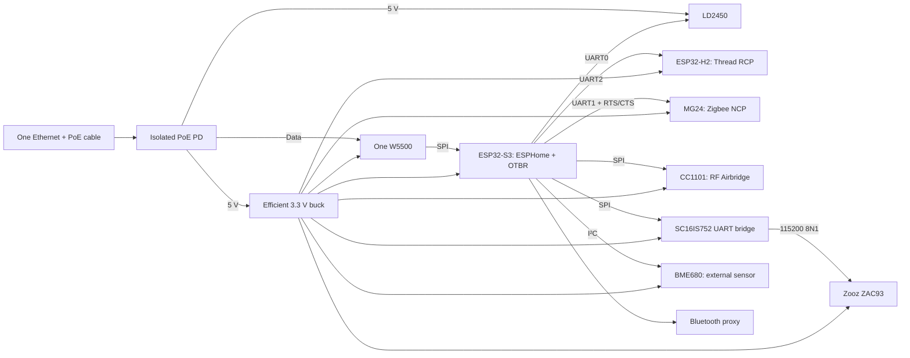

# Compact hub with minimum energy consumption

This branch aims to **minimize energy use over the full service life**, without
using payback calculations or component price limits. Further development uses
one ESP32-S3, one Ethernet interface and shared efficient power rails. This
version does not need Linux, an internal switch or additional Ethernet
controllers. Home Assistant, Matter Server and Z-Wave JS continue to run on the
existing server.

**This is a separate engineering prototype.** Its enclosure is a layout mock-up,
not evidence that the PCB is ready for manufacture. Startup, simultaneous radio
operation and power consumption have not yet been tested on physical hardware.
The baseline [modular version](../README.md#what-is-inside) remains available for
comparison.

## Selected architecture



The three native UARTs serve the radar, Zigbee and Thread. The ZAC93 connects
through an SC16IS752: a dedicated task services its FIFO on interrupts while
preserving the standard UART interface for the ESPHome Z-Wave proxy. A line
error or overflow marks the channel as failed so it does not continue forwarding
a corrupted stream.

BLE, Zigbee and Thread have separate radios. The S3 does not share one radio
between Zigbee and Thread. Wi-Fi is not required. The BME680 sits outside the
warm enclosure; its heater runs briefly when sampled once per minute. Deep sleep
is incompatible with continuous RF reception and Thread routing.

The S3 was selected for compatibility with the existing RF code and ESPHome,
not because it is claimed to use less power than every other chip. A P4 with a
DP83825I remains an alternative: the PHY may consume less than the W5500, but
the P4 requires a separate BLE coprocessor. An advantage for that complete
system has not been measured.

## Included resources

- [Hardware and component selection](../hardware/low-power/README.md).
- [Visual wiring atlas and printable pin-to-pin sheets](../hardware/low-power/visual/README.md).
- [PCB manufacturing, batch sizing and sales formats](manufacturing.md).
- [Unified firmware and build preparation](../firmware/low-power/README.md).
- [Enclosure, layout and trial prints](low-power-enclosure.md).
- [Machine-readable energy assumptions](../hardware/low-power/energy-comparison.json).
- [Separate budget for the new board](../hardware/low-power/power-budget.json).
- [Measurement record template](../hardware/low-power/measurement-template.json).
- [Project validation log](validation.md).

This pin assignment targets a new carrier board. On a DevKitC, pins 43/44 connect
to USB-UART, and GPIO48 may connect to an RGB LED. Selecting USB Serial/JTAG in
firmware does not disconnect physical traces: check the schematic for the exact
board revision and resolve conflicts before prototyping. Do not connect this
harness to the old S3-ETH board just because pin numbers match.

## Lifetime energy

The design target is **no more than 3 W of average incremental AC input power**
with all functions operating. That corresponds to 26.28 kWh per year, 262.8 kWh
over 10 years or 394.2 kWh over 15 years of continuous operation. These figures
convert the target into energy; they are not a forecast or measurement of the
future board. Each continuously consumed watt adds 87.6 kWh over 10 years.

The component model for the new board gives **2.82 W AC** in the reference
scenario and **2.03–4.92 W** across the assumption bounds. It accounts for the
W5500 at 100 Mbps; potential savings at 10 Mbps are not deducted in advance.
The range crosses the 3 W target, so the target cannot be declared achieved.
The model accounts separately for the buck converter, PoE PD, cable and PSE;
advertised peak efficiency is not treated as a constant at low load.

The original Pi, Orange Pi and multiple-ESP variants use the same accounting
boundary: the enclosure contents, internal Ethernet, radios, sensors and power
losses are included. The baseline draw of the existing HA server and shared
network equipment is the same and is excluded. If a new dedicated injector/PSE
is needed, its baseline draw is added. Any increase in HA server load caused by
the new design must also be measured.

```sh
python3 tools/energy.py plan --years 10
python3 tools/energy.py plan --years 15 --extra-ac-w 0.5
```

The second command illustrates an additional 0.5 W for a dedicated PSE; this is
not a specification for a selected device. All scenario ranges express
uncertainty in assumptions, not confidence intervals. Similar variants cannot
be ranked reliably until they have been measured under identical bench
conditions. A power supply rating and peak allowance are not average power
consumption.

## Validating energy consumption

1. First verify power delivery and stable operation of all functions using the
   hardware instructions. Measure brief voltage dips and inrush current
   separately; a power meter does not replace those measurements.
2. For a new dedicated injector, measure its entire AC input. For an existing
   switch, compare AC input with and without the hub while keeping other ports,
   load and cable unchanged. A PoE port reading or 5 V current reading does not
   include all AC power losses.
3. Record energy in Wh for at least 24 hours, preferably 72 hours of normal use.
   Record the firmware version, cable length, temperature, BLE mode and activity
   of all radio networks. Run a separate stress test without presenting its
   average as a normal daily usage profile.
4. State the meter's absolute error in Wh. When subtracting baseline draw, add
   the errors of both measurements. If the difference is comparable to the
   error, the result cannot identify a winner.
5. Copy the template into the ignored `private/` directory, enter the measured
   values and calculate the result:

```sh
python3 tools/energy.py measure private/energy-measurement.json --years 15
```

`ac_dedicated` means the full input of a dedicated power supply; baseline fields
must be absent or `null`. `ac_incremental` subtracts the average power of the
baseline measurement, normalizing it by its own duration. The
`all_functions_passed` field must confirm the complete set of functions; an
incomplete or short test does not receive a target-achieved status. An error
interval that crosses 3 W produces `inconclusive`, not an automatic pass.

Reduce consumption according to measured contributions: converters at low
load, Ethernet PHY, CPU frequency and BLE mode. Any W5500 savings at 10 Mbps
require a separate check of link mode and stability; a 10 MHz SPI clock does
not mean 10 Mbps Ethernet. This behavior must not be assumed for every PHY.

## Before switching Home Assistant

A built and tested unit, Zigbee/Thread/Z-Wave backups, migration of private RF
settings and a power-loss recovery test are required. Compilation does not
migrate network keys or devices. Do not create a new Thread dataset in place of
the existing one, and do not connect ZHA and Zigbee2MQTT to the same NCP at the
same time. Network serial/OTBR ports must be accessible only to trusted services
on the local network. Do not switch the current HA installation until these
tests are complete.
