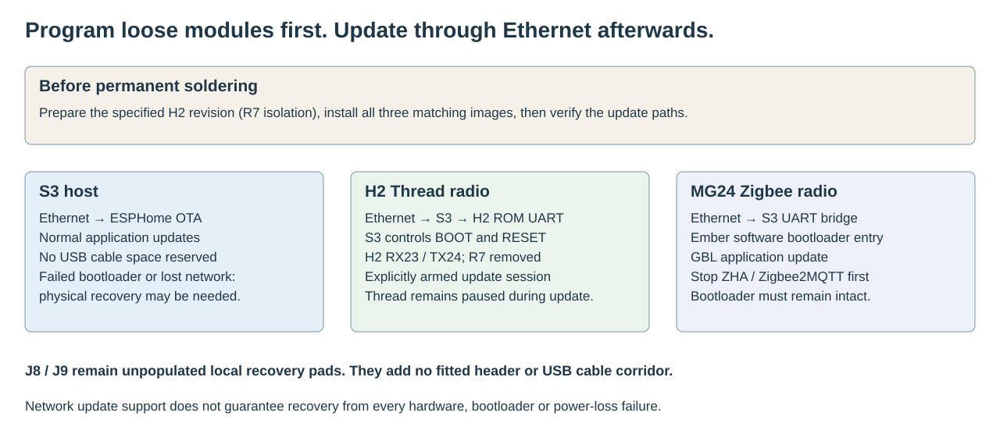
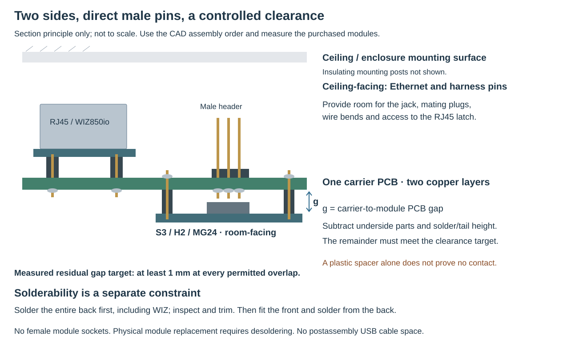

# MC1 — two-sided carrier for ceiling mounting

The current carrier uses **Waveshare ESP32-S3-Nano-M, ESP32-H2-DevKitM-1,
Seeed XIAO MG24 and WIZ850io**. It retains the seven application groups and their
Home Assistant interfaces. The two-sided layout puts controllers toward the room and Ethernet/harness pins
toward the ceiling. Program and verify the loose modules before permanent
soldering, then perform normal updates over Ethernet. No USB cable corridor is reserved.

**Engineering prototype:** native CAD, firmware builds and host tests are separate
from physical qualification. Module fit, power margins, update recovery and radio
coexistence still need testing on the assembled carrier.

## Construction

The carrier is a **47.5 mm horizontal × 75 mm vertical rectangle**, with two copper layers.
H3, between U2 and U3, is the sole PCB retention hole. The other three holes
are removed, S3 moves inward and H2 moves slightly away from the left edge.
Split enclosure rails support the long edges and resist bending; H3 locates
and retains the board. Enclosure-to-ceiling fasteners are separate.
**Front / room-facing:** S3, H2 and MG24. **Back / ceiling-facing:** WIZ850io
and all seven male harness headers, three axial diodes and two resistors. Factory male module pins enter plated holes
and are soldered from the opposite face. There are **no female module sockets**.
Two-sided component placement still uses only two copper layers.

The fitted parts are four complete modules, **seven harness headers**, three axial
diodes and two resistors: **16 fitted references**. J8 and J9 remain as normally
open, unpopulated recovery pads; do not buy or fit headers there. The board still
has 18 electrical footprints and 133 pads. The four modules require **86 header
solder joints**. Factory decoupling, RF matching and regulators remain on the modules.

The selected parts are:

- **Waveshare ESP32-S3-Nano-M:** factory male headers, ESP32-S3R8, 16 MB flash,
  8 MB octal PSRAM, 43.18 × 17.78 mm. The generic ESPHome S3 descriptor identifies
  the toolchain; explicit memory and GPIO settings identify this physical board.
- **ESP32-H2-DevKitM-1, schematic v1.3:** Thread RCP, with **R7 removed before
  assembly**. Both the RCP and ROM updater now use RX23/TX24. See preparation below.
- **Seeed XIAO MG24 Pre-Soldered, SKU 102010690:** Ember NCP, PC06/PC07 UART,
  PC04/PC05 flow control, board-specific antenna setup and UART bootloader.
- **WIZ850io:** finished Ethernet module with magnetics, sharing SPI with CC1101.
  It uses the separate peripheral 3.3 V rail and does not extract PoE.
- External finished **isolated 5 V PoE splitter, D24V22F3 3.3 V supply,
  DFR0627/WK2132 UART bridge**, plus CC1101, ZAC93, LD2450 and BME680.
  These require space outside the carrier outline.

## Compact placement and fabrication cost

See the [current cost review](../hardware/module-carrier/cost-review/README.md)
for the configured five-board estimate, comparison with the historical tariffs,
and the separately priced modules. The displayed JLCPCB website estimate is
$5.20 for five bare boards before delivery and tax; calculator service errors
mean it remains provisional rather than a confirmed checkout quote.

Actual PCB area is **35.625 cm²**, a **6.86% reduction** from the preceding
51 × 75 mm four-hole board and **26.9% below** the historical
65 × 75 mm single-sided arrangement. It is 77.7% smaller than the original
160 × 100 mm carrier. The fitted BOM remains sixteen items; no new electronics,
female module sockets or intermediate boards are added.

This is not a claim of a proportional reduction in the invoice. Both sizes remain
inside the 100 × 100 mm class advertised in [JLCPCB's standard prototype offer](https://jlcpcb.com/ads/pcb-prototype)
and [PCBWay's prototype page](https://www.pcbway.com/pcb_prototype/2_Layer_pcb/100x100mm.html)
(checked 17 October 2026). An offer may charge the same base price for either size;
quantity, finish, shipping and taxes need an actual quote. Two-sided **manual
assembly** adds turning, tail trimming and staged inspection, even though the
bare board still uses the same two copper layers and fabrication rules.

The smaller size is achieved by using both faces and allowing selected bodies to
share an XY projection. Through-holes still pass through both faces, so side changes
do not permit overlapping drill holes or arbitrary crossing of solder tails.
The Ethernet and controller bodies avoid a mutual obstruction of their solder
joints. **Physical USB bodies, antenna exclusions and support clearances remain
part of the checks.** USB cable insertion space remains intentionally absent.

## Reading the stacked-board checks

The unmodified KiCad DRC report contains **41 `pth_inside_courtyard` findings**:
33 rear header pads beneath H2, six rear axial pads beneath S3, and two D3 pads
beneath XIAO. D2 is outside the controller bodies. The new D3/XIAO overlap needs
its own underside-component and trimmed-tail measurement.
These are intentional XY projections beneath raised modules, but their physical
height clearance is **not** established by a 2D drawing. They are retained in the
raw report rather than hidden by smaller courtyards or a global suppression.

A separate strict classifier requires exactly those native pad/body pairs and
rejects additional, missing, duplicate, wrong-side or moved findings, along with
all other violations, unrouted connections and schematic mismatches. A passing
prototype check therefore means **all findings accounted for**, not “zero DRC”
or approval to fabricate an unmeasured assembly. The measured-height acceptance
rule below remains required.

## Functions and interfaces

1. **Thread:** local S3 border router, dedicated H2 RCP, IPv6/multicast and Home
   Assistant REST integration. No additional Linux host is required.
2. **Zigbee:** MG24 Ember/EZSP with hardware flow control for ZHA/Zigbee2MQTT.
3. **Bluetooth:** ESPHome active proxy, advertisements and three connection slots.
4. **433 MHz RF:** existing RF Airbridge MQTT contracts and CC1101 receive/transmit.
5. **Z-Wave:** regional ZAC93 through the checked WK2132 byte-forwarding path.
6. **Presence:** LD2450 native UART, measurements and control actions.
7. **Environment:** BME680 in an external ventilated pod. Gas resistance is not a
   direct CO2 measurement.

W5500 and CC1101 share **SCK13, MOSI11 and MISO12**, with separate chip selects.
Normal transactions use the bus lock. The initial CC1101 setup precedes Ethernet;
unreviewed runtime CC1101 reset/reconfiguration is rejected. Keep its external
harness short and test simultaneous Ethernet/RF activity.

Three native UARTs serve Thread, Zigbee and radar. S3 GPIO43 TX now reaches
**H2 GPIO23 RX**, and H2 GPIO24 TX reaches S3 GPIO44 RX. S3 GPIO47/48 control H2
EN/BOOT with open-drain outputs. S3 boot-time UART chatter is cleared by resetting
H2 before Spinel startup. **The old H2 RX4/TX5 firmware does not match this carrier.**

The Nano's JP2 numbering runs opposite to its visual row order; use the numbered
CAD and wiring ledger. Nano native USB19/20 remain reserved. J9 reaches GPIO0
through JP1.13, and J8 reaches XIAO PC00; both are unpopulated local recovery pads.

## H2 preparation and first programming

The H2 DevKit contains a powered USB-UART bridge even when no USB cable is attached.
Its transmitter reaches H2 GPIO23 through **R7, 470 Ω on schematic v1.3**. Leaving
that path connected would put the bridge and S3 transmitters on the same signal.
Remove R7 with the module unpowered, before soldering it into the carrier.

Check the actual board revision and reference marking first. The official guide
identifies boards of/after **PW-2024-02-0362** with the v1.3 schematic. Do not remove
an assumed component from a different board revision. The [H2 preparation record](../hardware/module-carrier/cad/README.md)
and [official board guide](https://docs.espressif.com/projects/esp-dev-kits/en/latest/esp32h2/esp32-h2-devkitm-1/user_guide.html)
are the source references. Inspect the removal for bridges and confirm isolation
of the bridge TX path. R9 is a separate H2-TX-to-bridge-input path and remains fitted.

First program H2 through its **native USB Serial/JTAG connection J4**, which uses
GPIO26/27, with the newly built RX23/TX24 RCP image. The CP2102 USB-UART connection
is no longer the programming path after R7 removal. Keep it disconnected during
host-controlled operation, since its automatic reset circuitry is still present.

Program the S3 and the XIAO while loose too. XIAO needs the matching initial image
containing both the UART bootloader and NCP application; an application-only GBL
cannot install a missing bootloader. Verify network update behavior on a temporary
wired assembly before permanent soldering.

## Normal updates after assembly

- **S3:** existing authenticated ESPHome OTA over Ethernet.
- **H2:** a deliberately armed S3 maintenance path reaches the standard H2 ROM
  loader through RX23/TX24 and controls EN/BOOT. Thread is paused for the update.
- **XIAO MG24:** stop the Zigbee client, enter the Gecko bootloader through the
  Ember application and upload the matching GBL through the existing serial bridge.

Follow the exact tools, safeguards and acceptance tests in the
[firmware instructions](../firmware/module-carrier/README.md). Network updates are
not a guarantee of recovery from every failure. A damaged S3 bootloader, missing
Ethernet connectivity, damaged MG24 bootloader or application that cannot enter
it can require physical access. J8/J9 retain local boot entry; USB cable space is
not reserved and some physical recovery can require removing a module.

## Antennas, connectors and enclosure

H2 and Nano face their antenna ends toward the top edge; MG24's antenna faces
the bottom edge. H2's nominal antenna projection is outside the carrier FR4. Copper exclusions
remain on both layers. At MG24 only the necessary PC07 signal escape is allowed
in a small, explicitly reviewed trace pocket beside the header; no extra pour or
via is allowed there. It is not a manufacturer-certified carrier clearance.

Keep harnesses, metal, foil and enclosure parts away from antenna ends. Ceiling
mounting does not remove near-field interaction with the carrier or metal lath.
Rotating XIAO places its ceramic antenna roughly 6.1 mm from the WIZ PCB edge
and 9.55 mm from the modeled jack side in plan view. These are distances, not
validated RF clearances. Radio range and simultaneous operation must be tested
in the intended enclosure; unchanged pin assignments do not establish unchanged range.

WIZ850io occupies the lower region on the **ceiling-facing back**, with its
RJ45 opening toward the edge. Backside drawings mirror the horizontal coordinates;
use their physical pad numbers rather than copying a front-view pin order.
Its mouth projects **2 mm beyond the carrier**. The Ethernet plug/latch corridor
is retained because that cable is required in normal operation. Support the board
against insertion loads. Harness assumptions use narrow mating housings and
vertical wire exits; check the purchased plugs and their bend height.

The dimensions describe the PCB, not a 47.5 × 75 mm enclosure. Antenna overhang,
RJ45, wires, solder joints and external modules require additional space. Use the
[front assembly](../hardware/module-carrier/cad/assembly-top.svg),
[back assembly](../hardware/module-carrier/cad/assembly-bottom.svg),
[top copper/silk](../hardware/module-carrier/cad/board-top.svg) and
[bottom copper/silk](../hardware/module-carrier/cad/board-bottom.svg). Native renders
show actual PCB sources; they are not photographs of manufactured hardware.

## Power

The fused isolated 5 V bus reaches each controller through its own Schottky diode.
**Nano D1 branch → VIN JP1.15**. Nano **VBUS JP1.12 and 3V3 JP1.2 remain unconnected**
to carrier rails. The separate buck powers Ethernet and external 3.3 V peripherals.
Do not parallel local regulator outputs.

Waveshare documents external VIN at **6–21 V**. This design uses 5 V minus the
branch diode, below that range, based on the onboard converter and USB power
circuit. Loaded VIN/3V3 operation remains a bench requirement, including cold
start, brownout and radio bursts. Moving components does not resolve this existing
power qualification item. Supply diodes also do not isolate logic signal pins.

## Thread failure containment

A bounded H2 preflight precedes the real OpenThread stack. Missing/incompatible
RCP firmware can enter persistent quarantine while other services continue.
A terminal failure after startup permits **one whole-S3 restart**, then leaves
Thread stopped until an explicit retry. All S3 services briefly disconnect during
that restart. An unrelated host crash while the Thread guard is armed can also
conservatively quarantine Thread; the recorded fault/reset state makes this visible.

The guard does not erase the Thread dataset. If a fault-time NVS write fails,
RTC retention protects a warm restart but not complete power loss. Elective
maintenance requires confirmed durable guard storage. See the
[recovery contract](../firmware/module-carrier/thread-recovery.md).

The 16 MB Nano factory partition layout differs from the historical 8 MB image.
Export datasets before first installation or partition migration. Application-only
OTA normally retains the installed partition table; it does not migrate old NVS.

## Free-angle component placement and routed measurements

D1 uses 250° and R1 uses 10° in native CAD coordinates; D2, D3 and R2 use 0°, 180°
and 90°. Useful orientation follows connectivity and physical clearance rather
than a requirement to align every component horizontally or vertically. The
back-side assembly drawing mirrors these orientations as actually viewed.

Relative to the immediately preceding four-hole 51 × 75 mm layout, native track
centerline length changes from **1,736.71 to 1,612.10 mm (-7.17%)**,
with **18 → 24 vias**. The more compact board has shorter total copper but more
layer transitions; this is not an across-the-board signal-integrity improvement.

- Post-diode H2 supply: 17.12 → 17.37 mm; 0 → 0 vias.
- Post-diode XIAO supply: 8.46 → 8.46 mm; 0 → 0 vias.
- Shared 5 V: 105.04 → 93.67 mm; 1 → 1 vias.
- Peripheral 3.3 V: 115.44 → 101.08 mm; 1 → 0 vias.
- SPI MOSI: 103.36 → 117.88 mm; 1 → 3 vias.
- SPI MISO: 102.91 → 85.83 mm; 3 → 0 vias.
- SPI clock: 107.94 → 95.05 mm; 0 → 2 vias.

These are complete named-net lengths, including branches, not complete supply
loops or individual source-to-receiver distances. Original trace-width and
clearance rules remain in force; the flat rail lands add copper exclusions.

See the [full native measurements](../hardware/module-carrier/cad/routing-metrics.json)
and [comparison](../hardware/module-carrier/routing-comparison.svg). Totals exclude
filled pours, plated barrels, module internals and external harnesses. A shorter
route does not replace loaded-voltage, return-path or signal-integrity validation.

## Ethernet insertion load and mounting

Only **H3 (18, 52.03) mm**, in the gap between U2 and U3, remains in the PCB.
Use nylon M2.5 retention hardware with **at most 5 mm** body/head diameter.
The RJ45 mouth remains centered at **(33, 77) mm**, opening 2 mm beyond the
bottom edge. These are front-view coordinates; the back drawing is mirrored.

The split enclosure captures **both PCB faces at selected edge lands**. The
left contact is x = 0–0.85 mm, y = 15–54.5 mm; the right contact is
x = 46.3–47.5 mm, y = 8–74 mm. Wider no-copper strips keep tracks, pads, vias
and pours away from these contacts. Rail ends avoid the controller antenna
regions. The PCB is loaded normal to its plane into the open lower frame;
the upper lips close over it afterwards. A closed sliding groove is not assumed
safe for projecting antennas, pins or the H3 boss.

The rails distribute bending load; **H3 is not a cantilever supporting the
whole board**. A separate enclosure end-stop/cradle at the WIZ jack body and
nearby cable strain relief must take repeated mating load off the WIZ header
joints. Establish those contacts from the purchased module, leaving its small
components and latch clear. The enclosure's own ceiling fasteners are separate
from the PCB retention screw and need suitable structural anchorage.

A close fit needs clearance, not a press fit. Print the provided **1.8 / 2.0 /
2.2 mm groove coupons** and measure the actual PCB. These are trial dimensions,
not a selected production fit. JLCPCB specifies ±10% thickness tolerance for
boards at least 1 mm thick; nominal 1.6 mm can therefore span 1.44–1.76 mm before
considering printer accuracy. Prusa likewise advises clearance for mating parts.
[PCB thickness capability](https://jlcpcb.com/capabilities/pcb-capabilities/),
[printing guidance](https://help.prusa3d.com/article/modeling-with-3d-printing-in-mind_164135).

The narrow rail lands have been checked in XY, including a modeled 0.5 mm
solder-fillet expansion outside the pad. Actual fillets, header heights,
printed fit, insertion loads and thermal creep remain physical checks. The
study defines the board-to-enclosure interface, **not a finished enclosure**;
rear height and external-module/cable space remain unmeasured. No force rating
or RF performance equivalence is claimed. Espressif recommends a 15 mm housing
clearance around the H2 PCB antenna and end-product RF testing; the entire
housing, not merely its rail contact patch, must be assessed against that
recommendation. [H2 antenna guidance](https://docs.espressif.com/projects/esp-hardware-design-guidelines/en/latest/esp32h2/pcb-layout-design.html#general-principles-of-pcb-layout-for-modules-positioning-a-module-on-a-base-board).

See the [rail mounting study and fit coupons](../mechanical/module-carrier/rail-mount/README.md).
The [former four-hole comparison](../hardware/module-carrier/studies/mounting-routing/mounting.svg)
is retained as history.

## Two-sided assembly and clearance

A factory plastic spacer provides a gap; it does not establish that a protruding
pin cannot reach the opposite module. For any overlapping area, measure:

- **g:** carrier surface to the opposing module PCB underside.
- **h:** the greatest component or factory solder protrusion below that module.
- **p:** the greatest carrier-side pin tail or solder protrusion beneath it.

The remaining separation is **g − h − p**. The acceptance target is **at least
1.0 mm**, including assembly tolerance and connector load. A tail plus solder
height of at most 1.0 mm is an initial trimming target, not a substitute for
measuring the complete stack; retain a sound through-hole solder joint.
Do not count solder mask as a mechanical spacer. Any illustrative pin/spacer
numbers in the study are assumptions until the actual modules are measured.

The [assembly study](../hardware/module-carrier/studies/two-sided/assembly-review.md)
explains tail trimming, access to the second soldering face and ceiling height.
The required order is **the complete back first, then the front**. Fit and solder
WIZ850io, J1–J7 and all five axial parts from the front before fitting U1–U3.
Inspect and electrically test those joints before they become covered. Then
solder the front-module pins from the accessible rear side. Neither the
factory headers nor the change of side makes short-circuit probability zero.

Ceiling-side hardware needs insulating supports. Set the stand-off from the
**measured** tallest assembled rear part, mating plugs and cable bends, with the
**5 mm additional clearance** to the ceiling or enclosure. The RJ45 must remain accessible
for insertion and latch release; do not press the jack against plaster or metal.

## Assembly acceptance

1. Identify module revisions, remove the specified H2 R7 and inspect isolation.
   Program all three controllers while loose using the matching images.
2. Temporarily connect and verify Ethernet, every function and each network update
   path. Confirm module shells, male headers, mating plugs and antenna clearance.
3. Measure both-sided overlap clearances and dry-run rear-first solder access.
   Complete, trim and inspect the entire back, then fit and solder front U1–U3; leave J8/J9 unpopulated. Read the
   back drawing as a mirrored physical view, not a new pin-number assignment.
4. Measure the isolated 5 V, peripheral 3.3 V and controller rails under load.
5. Commission each service, then test Thread, three BLE connections, Zigbee,
   Z-Wave, RF and radar together. Record heap, errors, power and temperature.
6. Test interrupted updates, absent/stalled H2, explicit retry, power cycling,
   unplugged Ethernet and network backup/restore before permanent deployment.

The [verification summary](../hardware/module-carrier/verification-summary.json),
[independent review](../hardware/module-carrier/independent-review.md) and
[firmware evidence](../firmware/module-carrier/build-evidence.json) distinguish
completed checks from hardware acceptance. No device is flashed by this redesign.
