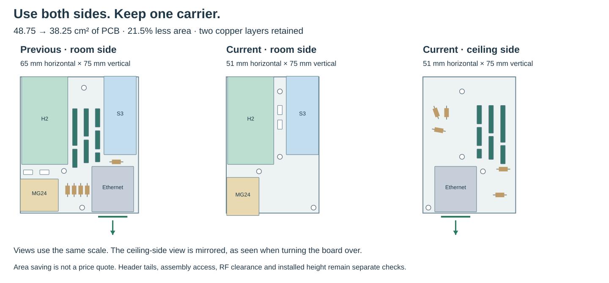

# MC1 — one carrier, finished modules, preserved protocols

**Decision: 17 October 2026.** Use one custom carrier PCB with finished controller,
radio, Ethernet and power modules. Preserve the S3 local Thread-border-router
architecture and Ember Zigbee integration. Do not maintain separate module-carrier
and integrated-radio products for this build.

**Engineering prototype:** this document distinguishes a retained protocol contract
from a successful software build and from physical qualification. It is not a claim
that the assembly has been fabricated or tested.

## Construction

Factory male module pins enter plated through-holes and are soldered from the
underside. **No female module sockets and no castellated-side soldering.** A board
sold with loose male headers only requires ordinary through-hole header soldering;
it must not be substituted with a bare radio module requiring fine-pitch assembly.

The carrier distributes power and signals. Regulators, crystals, RF matching,
Ethernet magnetics and module decoupling stay on their factory-assembled boards.
The 100 × 90 mm, two-layer carrier has **two resistors and three diodes**
as separate circuit parts, plus four mounted modules and eight harness/service
headers. It has no builder-installed capacitor array. This reduces builder-installed small parts without pretending those
circuits no longer exist.

The selected architecture uses:

- An **ESP32-S3-DevKitC-1 v1.1, N8R8** host with 8 MB flash and 8 MB PSRAM.
- An **ESP32-H2-DevKitM-1** Thread RCP on remapped UART pins, retaining service
  controls and avoiding the onboard USB-UART transmitter.
- A **Seeed XIAO MG24 Pre-Soldered, SKU 102010690**, with a board-specific Ember
  NCP image using exposed UART and RTS/CTS pins. The old M0 firmware is not a
  drop-in image for this board.
- **WIZ850io** Ethernet and a finished **DFRobot DFR0627 / WK2132** UART bridge
  for the existing ZAC93. The WK bridge requires checked transport behavior;
  stock driver availability alone does not establish lossless forwarding.
- Finished isolated 5 V PoE power and a **D24V22F3** 3.3 V supply. An isolated
  secondary input does not accept raw 48 V PoE.
- The existing **CC1101, ZAC93, LD2450 and BME680** modules and appropriate
  antenna/sensor placement.

## Functions that must remain

1. One Ethernet uplink and local S3 Thread BR, including IPv6/multicast and the HA
   REST integration. No added Linux host or internal Ethernet switch.
2. Separate Thread and Zigbee radios. Zigbee remains Ember/EZSP with hardware
   flow control and the normal ZHA/Zigbee2MQTT ecosystem, subject to firmware-version
   compatibility and commissioning tests.
3. Active ESPHome Bluetooth proxy, including connections rather than advertisements
   alone.
4. RF Airbridge MQTT contracts, native transmit actions and received button events.
5. Z-Wave forwarding with the existing regional ZAC93, not a change of radio or region.
6. LD2450 measurements **and controls**, and BME680 temperature, humidity, pressure
   and gas resistance. Gas resistance is not a direct CO2 measurement.
7. Service access, recoverable firmware updates and independent network backups.

## Compact placement and fabrication cost

The earlier 160 × 100 mm outline was a conservative placement envelope, not an
electrical requirement. Widely spaced modules and a separate bottom row of
harness headers left unnecessary board area. The compact layout uses the gaps
between the mounted modules for those connections and turns H2 around so its
antenna and USB access use opposite ends from S3. The same four modules, eight
harness/service headers, five axial parts and electrical pin assignments remain.

PCB area falls from **160 cm² to 90 cm²**, a **43.75% reduction**. Both board dimensions
now fit within 100 mm. This matters independently of the area: a 110 × 80 mm board
would still miss the size threshold advertised for low-cost prototype offers.
As checked on 17 October 2026, [JLCPCB lists $2 for five two-layer boards no larger
than 100 × 100 mm](https://jlcpcb.com/help/article/how-do-i-place-an-order), and
[PCBWay advertises $5 for ten one/two-layer boards within the same dimensions](https://m.pcbway.com/activitypcb.aspx).
These are advertised fabrication offers, **not quotes for delivered MC1 boards**.
Thickness, copper weight, surface finish, quantity, options, taxes and shipping
must be held constant for a price comparison. The area reduction is not a quote
for the percentage saved on a delivered order. No manufacturing order has been placed.

A 100 × 80 mm packing study required the five axial parts on the underside and
more restrictive mounting. The selected 90 mm height preserves a single
component side and ordinary through-hole assembly while remaining in the same
advertised size class. Minimizing board area past that point was not worth the
additional assembly and service restrictions.

This reduces the carrier footprint, not the entire system to a 100 × 90 mm box.
The finished PoE splitter, buck, UART bridge and peripheral modules still need
space. Cable boots, harness bends, service plugs and the enclosure wall remain
outside the quoted PCB dimensions. The assembly drawing identifies reserved
access corridors; they must not be filled with wires or components merely
because no permanent module occupies them.

The compact arrangement reserves **5.5 mm-wide mating housings** on the harness
headers and **30 mm-long USB service envelopes**. Use narrow 2.54 mm harness
connectors with wires leaving upward; bulky shrouded housings are not covered
by this layout. In particular, the actual XIAO board has about 0.97 mm clearance
to the nearest reserved housing corner. Verify the chosen plugs during the dry
fit. Three nylon M2.5 supports, with bodies no larger than 5 mm in diameter,
fit outside the service envelopes; the right support is beside WIZ850io.

## Ethernet access

U4 is rotated 270° at the lower-right edge. Its RJ45 opening faces outward to the
right and projects 2 mm beyond the carrier edge. Keep the connector/plug/latch
corridor clear and provide a matching enclosure cutout. The module remains
soldered directly to the carrier; this change does not add an extension cable
or alter the Ethernet pinout. Use the dimensioned assembly view for orientation,
not the generated illustration.

## What changes in software

The S3 host and existing application protocols remain. GPIO assignments must match
the finished boards, the H2 RCP UART is remapped, the XIAO needs its own Ember board
configuration, and the WK2132 bridge needs bounded error-aware forwarding.

These are real adaptations and must be built and tested. The goal is to avoid new
high-level protocols and a new H2 border-router port, not to claim zero engineering
work. A single PCB simplifies the purchasing and assembly path; it does not make
the first prototype automatically reliable.

## Assemble and commission

1. Check complete board model/revision markings, pin pitch, row spacing, antenna
   keepouts and connector access against the MC1 drawings. Program the matching
   firmware before permanent assembly, then dry-fit every module.
2. Fit the carrier's listed through-hole parts and male module pins. Solder from
   below, then inspect orientation, bridges and the continuity of every power rail.
3. Check the isolated 5 V input and separate 3.3 V peripheral rail unloaded. Do not
   parallel outputs from different modules' onboard regulators.
4. For later USB service, keep the complete assembly powered normally and use a
   **verified USB VBUS-blocking data cable**. Verify the blocker before use. Simply
   disconnecting PoE and USB-powering one controller can backfeed the others through
   signal pins; the three supply diodes do not isolate these signal paths.
5. Verify Ethernet and service access first, then each radio and sensor separately.
   Follow the board-specific firmware recovery procedure; old M0 images do not
   match the XIAO pinout.
6. Test simultaneous BLE, Thread, Zigbee, Z-Wave, RF and radar activity; exercise
   resets, a lost uplink, power loss, updates and backup/restore. Compare the retained
   application contracts with the LP-P0 regression suite.
7. Only after these checks choose a permanent enclosure and migrate existing
   household networks. Earlier enclosure images are not MC1 fit evidence.

## Why one version is sufficient

The former carrier and integrated layouts differed in construction, not in a
required user function. MC1 retains the local host and dedicated radio roles,
while moving small circuitry onto finished vendor boards. This removes the
second custom PCB choice and the separate M0 radio adapter. It does **not**
require a Linux machine, a new network hop, or a custom inter-H2 application
protocol.

The remaining software changes are bounded: new board pin assignments, a XIAO
Ember build, and a checked WK2132 transport with its own worker task. The price
of this assembly simplification is more height, permanent soldered modules,
and a firmware adaptation to maintain. Neither lower total price nor lower
power consumption has been measured for MC1. There are still 100 module-header
pins to solder, in addition to the harness headers and five discrete parts.

The [verification summary](../hardware/module-carrier/verification-summary.json),
[independent review](../hardware/module-carrier/independent-review.md), and
[firmware build evidence](../firmware/module-carrier/README.md) separate completed
software/CAD checks from commissioning on the real assembly.

## Sources

- [Official S3-DevKitC-1 v1.1 documentation](https://documentation.espressif.com/esp-dev-kits/en/latest/esp32s3/esp32-s3-devkitc-1/user_guide_v1.1.html)
- [Official H2-DevKitM-1 documentation](https://docs.espressif.com/projects/esp-dev-kits/en/latest/esp32h2/esp32-h2-devkitm-1/user_guide.html)
- [XIAO MG24 hardware documentation](https://wiki.seeedstudio.com/xiao_mg24_getting_started/)
- [Pre-soldered XIAO MG24](https://www.seeedstudio.com/Seeed-Studio-XIAO-MG24-Pre-Soldered-p-6381.html)
- [WIZ850io](https://docs.wiznet.io/Product/ioModule/WIZ850io)
- [DFR0627 hardware](https://wiki.dfrobot.com/dfr0627)
- [ESPHome WeiKai component](https://esphome.io/components/weikai/)

The [design history](design-history.md) identifies all retired alternatives.
