# Assembly parts gallery

Pictures, exact model identification and every canonical BOM row. [Build selection and sourcing notes](parts-catalog.md) · [Filterable HTML catalog](../hardware/parts/index.html) (download/open locally) · [Pin-to-pin atlas](../hardware/low-power/visual/README.md).

**Choose one build.** Quantities below are per source; never add alternative builds together. LP-P0 is a bench reference, not an extra purchase list. All AliExpress links are **unverified searches**, not approved offers. Images are labeled photos, renders, source-derived diagrams or generic illustrations; appearance does not establish compatibility.

Manufacturer images remain remotely hosted and copyrighted by the credited owner. No redistribution license is asserted. If GitHub cannot load one, use its source link or the local family-illustration link. Local original illustrations are MIT; physical contact diagrams retain their linked source notices.

## Main modules and sensors

### Adafruit BME680 STEMMA QT / item 3660

**Manufacturer photo** — Adafruit 3660 BME680 STEMMA QT board; a bare BME680 IC is not the same item.

Image: Adafruit. [Source](https://www.adafruit.com/product/3660) · [Local family illustration](../hardware/parts/illustrations/module.svg).

Package / dimensions: `25.4 × 17.78 mm; height unspecified`.

- **LP-P0 bench reference (not additive):** quantity 1; references `U8`.

[AliExpress search — unverified results](https://www.aliexpress.com/wholesale?SearchText=Adafruit+BME680+STEMMA+QT+%2F+item+3660)

Exact BOM row conditions, notes and sources

- **lp-reference:U8:** Reference only; both. External ventilated pod; 3.3 V VIN; I2C address 0x77; onboard pull-ups. [Official / original source](https://www.adafruit.com/product/3660).

### Adafruit BME680 STEMMA QT product3660

**Manufacturer photo** — Adafruit 3660 BME680 STEMMA QT board; a bare BME680 IC is not the same item.

Image: Adafruit. [Source](https://www.adafruit.com/product/3660) · [Local family illustration](../hardware/parts/illustrations/module.svg).

Package / dimensions: `25.4x17.78 PCB_only_QT_revision`.

- **Original Pi modular hub:** quantity 1; references `U7`.

[AliExpress search — unverified results](https://www.aliexpress.com/wholesale?SearchText=Adafruit+BME680+STEMMA+QT+product3660)

Exact BOM row conditions, notes and sources

- **modular:U7:** common. Environment sensor · 3.3V I2C0x77 · External vented pod;gas resistance is not CO2 [Official / original source](https://www.adafruit.com/product/3660).

### Adafruit1208 TSSOP28/SOIC28 breakout

**Manufacturer photo** — Adafruit 1208 unpopulated SOIC/TSSOP-28 breakout PCBs. Use the TSSOP side for SC16IS752IPW; the IC and headers are separate parts.

Image: Adafruit. [Source](https://www.adafruit.com/product/1208) · [Local family illustration](../hardware/parts/illustrations/module.svg).

- **D0 DIY • adapters / harness / jumper wire:** quantity 1; references `SC16 adapter`.

[AliExpress search — unverified results](https://www.aliexpress.com/wholesale?SearchText=Adafruit1208+TSSOP28%2FSOIC28+breakout)

Exact BOM row conditions, notes and sources

- **d0-harness:SC16 adapter:** Harness / external / service; read row notes. Factory PCB under U1 · Sold in3pack; fit SC16 to TSSOP side; not prepopulated. Row15.24mm, pitch2.54mm

### Adafruit1230 SOT23-6 breakout

**Manufacturer photo** — Adafruit 1230 mixed-package unpopulated breakout set. Use the SOT-23-6 board for TPS3808; the supervisor IC and headers are separate parts.

Image: Adafruit. [Source](https://www.adafruit.com/product/1230) · [Local family illustration](../hardware/parts/illustrations/module.svg).

- **D0 DIY • adapters / harness / jumper wire:** quantity 1; references `Supervisor adapter`.

[AliExpress search — unverified results](https://www.aliexpress.com/wholesale?SearchText=Adafruit1230+SOT23-6+breakout)

Exact BOM row conditions, notes and sources

- **d0-harness:Supervisor adapter:** Harness / external / service; read row notes. Factory PCB under U2 · Set contains5SOT23boards; stock fluctuates; same published CAD can be factory made. Not prepopulated

### Adafruit3660 BME680 STEMMA QT breakout

**Manufacturer photo** — Adafruit 3660 BME680 STEMMA QT board; a bare BME680 IC is not the same item.

Image: Adafruit. [Source](https://www.adafruit.com/product/3660) · [Local family illustration](../hardware/parts/illustrations/module.svg).

- **D0 DIY • adapters / harness / jumper wire:** quantity 1; references `Environmental sensor`.

[AliExpress search — unverified results](https://www.aliexpress.com/wholesale?SearchText=Adafruit3660+BME680+STEMMA+QT+breakout)

Exact BOM row conditions, notes and sources

- **d0-harness:Environmental sensor:** Harness / external / service; read row notes. I2C sensor at J10 · External ventilated pod; reuse if available; QT cable counted separately

### Ag97005-FL

**Manufacturer photo** — Ag97000-FL family image; order specifically Ag97005-FL (5 V), not the 12 V or 24 V variant.

Image: Silvertel. [Source](https://silvertel.com/ag97000/) · [Local family illustration](../hardware/parts/illustrations/module.svg).

Package / dimensions: `Hub:Ag97000_FL`.

- **I0 integrated • fitted parts:** quantity 1; references `U7`.

[AliExpress search — unverified results](https://www.aliexpress.com/wholesale?SearchText=Ag97005-FL)

Exact BOM row conditions, notes and sources

- **i0:U7:** Fitted to board. Bare isolated PoE module installed on this PCB; not the separate EvalPoE bench board. [Official / original source](https://silvertel.com/images/datasheets/Ag97000-Datasheet-low-cost-isolated-12W-Power-over-Ethernet-PoE-module-solution.pdf).

### D24V22F3

**Manufacturer photo** — D24V22F3 side view. Verify the 3.3 V version; the output-current headline at 24 V input does not establish our 5 V thermal capability.

Image: Pololu. [Source](https://www.pololu.com/product/2857) · [Local family illustration](../hardware/parts/illustrations/module.svg).

Package / dimensions: `Hub:D24V22F3`.

- **I0 integrated • fitted parts:** quantity 1; references `U8`.

[AliExpress search — unverified results](https://www.aliexpress.com/wholesale?SearchText=D24V22F3)

Exact BOM row conditions, notes and sources

- **i0:U8:** Fitted to board. Only regulator feeding 3V3. 1.5A at 5V input bench gate; soldered headers. [Official / original source](https://www.pololu.com/file/0J1031/d24v22fx-step-down-voltage-regulator-dimension-diagram.pdf).

### ESP32-H2-DevKitM-1

**Manufacturer photo** — H2 DevKitM-1 family photo. Check the installed module and isolate conflicting USB-UART signals before low-power harness use.

Image: Espressif. [Source](https://docs.espressif.com/projects/esp-dev-kits/en/latest/esp32h2/esp32-h2-devkitm-1/user_guide.html) · [Local family illustration](../hardware/parts/illustrations/module.svg).

- **Additional / reusable / conditional:** quantity 1 alternative bench RCP; references `bench-h2`.

[AliExpress search — unverified results](https://www.aliexpress.com/wholesale?SearchText=ESP32-H2-DevKitM-1)

Exact BOM row conditions, notes and sources

- **accessory:bench-h2:** LP-P0 bench only. Alternative to the bare H2-MINI on I0. Verify module marking and flash size; onboard USB-UART can conflict with the host TX connection. [Official / original source](https://docs.espressif.com/projects/esp-dev-kits/en/latest/esp32h2/esp32-h2-devkitm-1/user_guide.html).

### ESP32-H2-DevKitM-1 with4MB flash

**Manufacturer photo** — H2 DevKitM-1 family photo. Check the installed module and isolate conflicting USB-UART signals before low-power harness use.

Image: Espressif. [Source](https://docs.espressif.com/projects/esp-dev-kits/en/latest/esp32h2/esp32-h2-devkitm-1/user_guide.html) · [Local family illustration](../hardware/parts/illustrations/module.svg).

- **D0 DIY • adapters / harness / jumper wire:** quantity 1; references `H2 RCP assembly`.

[AliExpress search — unverified results](https://www.aliexpress.com/wholesale?SearchText=ESP32-H2-DevKitM-1+with4MB+flash)

Exact BOM row conditions, notes and sources

- **d0-harness:H2 RCP assembly:** Harness / external / service; read row notes. Thread radio at J5 · Verify flash and isolate USB-UART TX from GPIO23; board-specific service/power wiring required

### ESP32-H2-MINI-1-H4S

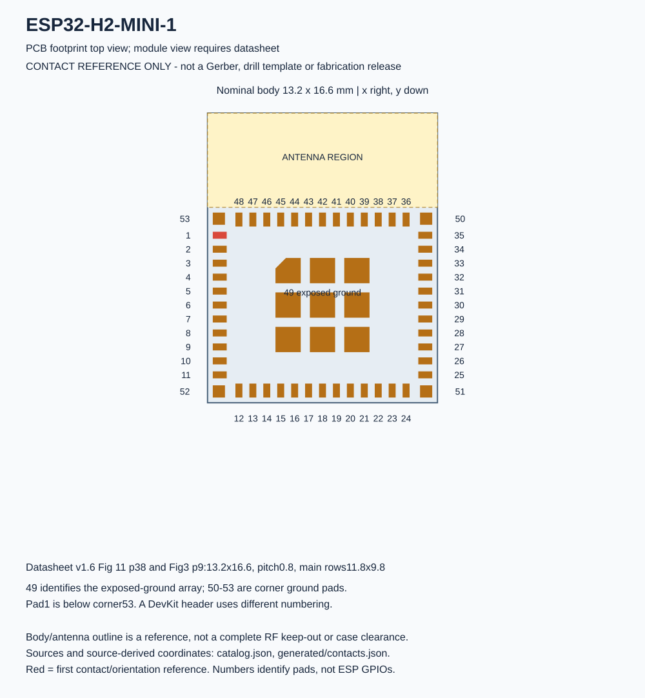

**Dimensioned diagram** — Source-derived top-view contact drawing. Not a photograph; distinguish bare module pads from development-board headers.

Image: HA Radio Hub project. [Source](../hardware/low-power/visual/physical/README.md) · [Local family illustration](../hardware/parts/illustrations/module.svg).

Package / dimensions: `13.2 × 16.6 × 2.4 mm`.

- **LP-P0 bench reference (not additive):** quantity 1; references `U2`.

[AliExpress search — unverified results](https://www.aliexpress.com/wholesale?SearchText=ESP32-H2-MINI-1-H4S)

Exact BOM row conditions, notes and sources

- **lp-reference:U2:** Reference only; carrier. 4 MB flash, separate Thread RCP. Verify the bench DevKitM-1 flash size and isolate its USB-UART TX from GPIO23. [Official / original source](https://www.espressif.com/sites/default/files/documentation/esp32-h2-mini-1_mini-1u_datasheet_en.pdf).

### ESP32-H2-MINI-1-H4S

**Dimensioned diagram** — Source-derived top-view contact drawing. Not a photograph; distinguish bare module pads from development-board headers.

Image: HA Radio Hub project. [Source](../hardware/low-power/visual/physical/README.md) · [Local family illustration](../hardware/parts/illustrations/module.svg).

Package / dimensions: `Hub:ESP32-H2-MINI-1`.

- **I0 integrated • fitted parts:** quantity 1; references `U2`.

[AliExpress search — unverified results](https://www.aliexpress.com/wholesale?SearchText=ESP32-H2-MINI-1-H4S)

Exact BOM row conditions, notes and sources

- **i0:U2:** Fitted to board. Module pad numbers, not development-board header positions. [Official / original source](https://www.espressif.com/sites/default/files/documentation/esp32-h2-mini-1_mini-1u_datasheet_en.pdf).

### ESP32-S3-DevKitC-1 N16R8

**Manufacturer photo** — DevKitC-1 v1.1 family photo; check N16R8 marking. Low-power wiring requires the documented USB-UART/LED isolation checks.

Image: Espressif. [Source](https://docs.espressif.com/projects/esp-dev-kits/en/latest/esp32s3/esp32-s3-devkitc-1/user_guide_v1.1.html) · [Local family illustration](../hardware/parts/illustrations/module.svg).

- **Additional / reusable / conditional:** quantity 1 alternative bench host; references `bench-s3`.

[AliExpress search — unverified results](https://www.aliexpress.com/wholesale?SearchText=ESP32-S3-DevKitC-1+N16R8)

Exact BOM row conditions, notes and sources

- **accessory:bench-s3:** LP-P0 bench only. Development-board alternative to the bare WROOM module; not an extra fitted part on I0. USB-UART GPIO44 and revision-dependent LED GPIO48 require physical isolation where documented. [Official / original source](https://docs.espressif.com/projects/esp-dev-kits/en/latest/esp32s3/esp32-s3-devkitc-1/user_guide_v1.1.html).

### ESP32-S3-DevKitC-1 N16R8 or verified equivalent

**Manufacturer photo** — DevKitC-1 v1.1 family photo; check N16R8 marking. Low-power wiring requires the documented USB-UART/LED isolation checks.

Image: Espressif. [Source](https://docs.espressif.com/projects/esp-dev-kits/en/latest/esp32s3/esp32-s3-devkitc-1/user_guide_v1.1.html) · [Local family illustration](../hardware/parts/illustrations/module.svg).

- **D0 DIY • adapters / harness / jumper wire:** quantity 1; references `S3 host assembly`.

[AliExpress search — unverified results](https://www.aliexpress.com/wholesale?SearchText=ESP32-S3-DevKitC-1+N16R8+or+verified+equivalent)

Exact BOM row conditions, notes and sources

- **d0-harness:S3 host assembly:** Harness / external / service; read row notes. LP-P0 host at J3 · Reuse existing only after USB-UART/LED/power isolation and GPIO48 checks; actual header locations verified before wiring

### ESP32-S3-WROOM-1-N16R8

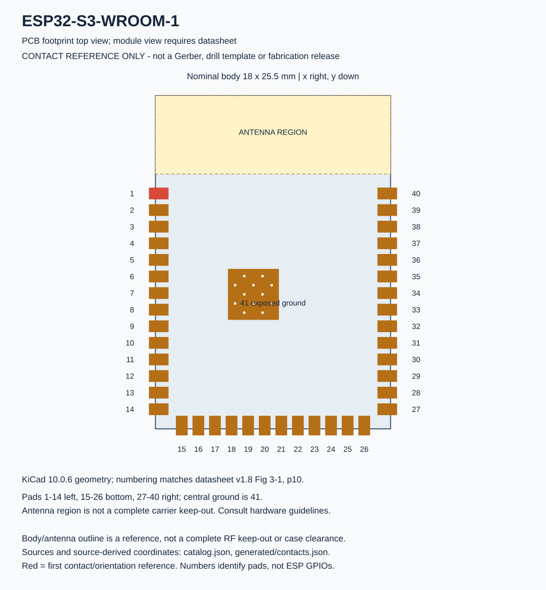

**Dimensioned diagram** — Source-derived top-view contact drawing. Not a photograph; distinguish bare module pads from development-board headers.

Image: HA Radio Hub project. [Source](../hardware/low-power/visual/physical/README.md) · [Local family illustration](../hardware/parts/illustrations/module.svg).

Package / dimensions: `18 × 25.5 × 3.1 mm`.

- **LP-P0 bench reference (not additive):** quantity 1; references `U1`.

[AliExpress search — unverified results](https://www.aliexpress.com/wholesale?SearchText=ESP32-S3-WROOM-1-N16R8)

Exact BOM row conditions, notes and sources

- **lp-reference:U1:** Reference only; carrier. Bare module, 16 MB flash, 8 MB PSRAM. Bench: existing N16R8 DevKit only after USB-UART, LED and power isolation checks. [Official / original source](https://www.espressif.com/sites/default/files/documentation/esp32-s3-wroom-1_wroom-1u_datasheet_en.pdf).

### ESP32-S3-WROOM-1-N16R8

**Dimensioned diagram** — Source-derived top-view contact drawing. Not a photograph; distinguish bare module pads from development-board headers.

Image: HA Radio Hub project. [Source](../hardware/low-power/visual/physical/README.md) · [Local family illustration](../hardware/parts/illustrations/module.svg).

Package / dimensions: `Hub:ESP32-S3-WROOM-1`.

- **I0 integrated • fitted parts:** quantity 1; references `U1`.

[AliExpress search — unverified results](https://www.aliexpress.com/wholesale?SearchText=ESP32-S3-WROOM-1-N16R8)

Exact BOM row conditions, notes and sources

- **i0:U1:** Fitted to board. Module pad numbers, not development-board header positions. [Official / original source](https://www.espressif.com/sites/default/files/documentation/esp32-s3-wroom-1_wroom-1u_datasheet_en.pdf).

### Existing regional Zooz ZAC93 module

**Manufacturer photo** — ZAC93 product appearance. Keep the correct regional radio version and verify the physical revision before wiring.

Image: Zooz. [Source](https://www.getzooz.com/zac93-gpio-module/) · [Local family illustration](../hardware/parts/illustrations/module.svg).

- **LP-P0 bench reference (not additive):** quantity 1; references `U5`.

[AliExpress search — unverified results](https://www.aliexpress.com/wholesale?SearchText=Existing+regional+Zooz+ZAC93+module)

Exact BOM row conditions, notes and sources

- **lp-reference:U5:** Reference only; both. 3.3 V only; retain the regional antenna. Inspect board revision, pin 7 reset function and physical dimensions before mounting. [Official / original source](https://www.getzooz.com/downloads/zooz-z-wave-800-series-long-range-gpio-module-zac93-LR-manual.pdf).

### Hi-Link HLK-LD2450

**Manufacturer photo** — HLK-LD2450 24 GHz tracking radar. LD2410 / LD2420 are not substitutions.

Image: Hi-Link. [Source](https://www.hlktech.com/Goods-352.html) · [Local family illustration](../hardware/parts/illustrations/module.svg).

Package / dimensions: `44x15 nominal_verify`.

- **Original Pi modular hub:** quantity 1; references `U6`.

[AliExpress search — unverified results](https://www.aliexpress.com/wholesale?SearchText=Hi-Link+HLK-LD2450)

Exact BOM row conditions, notes and sources

- **modular:U6:** common. Radar · 5V UART3.3V256000 · 24GHz;include matching4wire cable;front radome [Official / original source](https://esphome.io/components/sensor/ld2450/).

### Hi-Link HLK-LD2450

**Manufacturer photo** — HLK-LD2450 24 GHz tracking radar. LD2410 / LD2420 are not substitutions.

Image: Hi-Link. [Source](https://www.hlktech.com/Goods-352.html) · [Local family illustration](../hardware/parts/illustrations/module.svg).

Package / dimensions: `44 × 15 mm; height unspecified`.

- **LP-P0 bench reference (not additive):** quantity 1; references `U7`.

[AliExpress search — unverified results](https://www.aliexpress.com/wholesale?SearchText=Hi-Link+HLK-LD2450)

Exact BOM row conditions, notes and sources

- **lp-reference:U7:** Reference only; both. 5 V supply, 3.3 V UART. Reuse a matching cable; never infer wire order from color. [Official / original source](https://r0.hlktech.com/download/HLK-LD2450-24G/1/HLK%20LD2450%201T2R%E8%BF%90%E5%8A%A8%E7%9B%AE%E6%A0%87%E6%A3%80%E6%B5%8B%E8%BF%BD%E8%B8%AA%E6%A8%A1%E7%BB%84%E8%AF%B4%E6%98%8E%E4%B9%A6%20V1.01.pdf).

### MGM240PA22VNA3

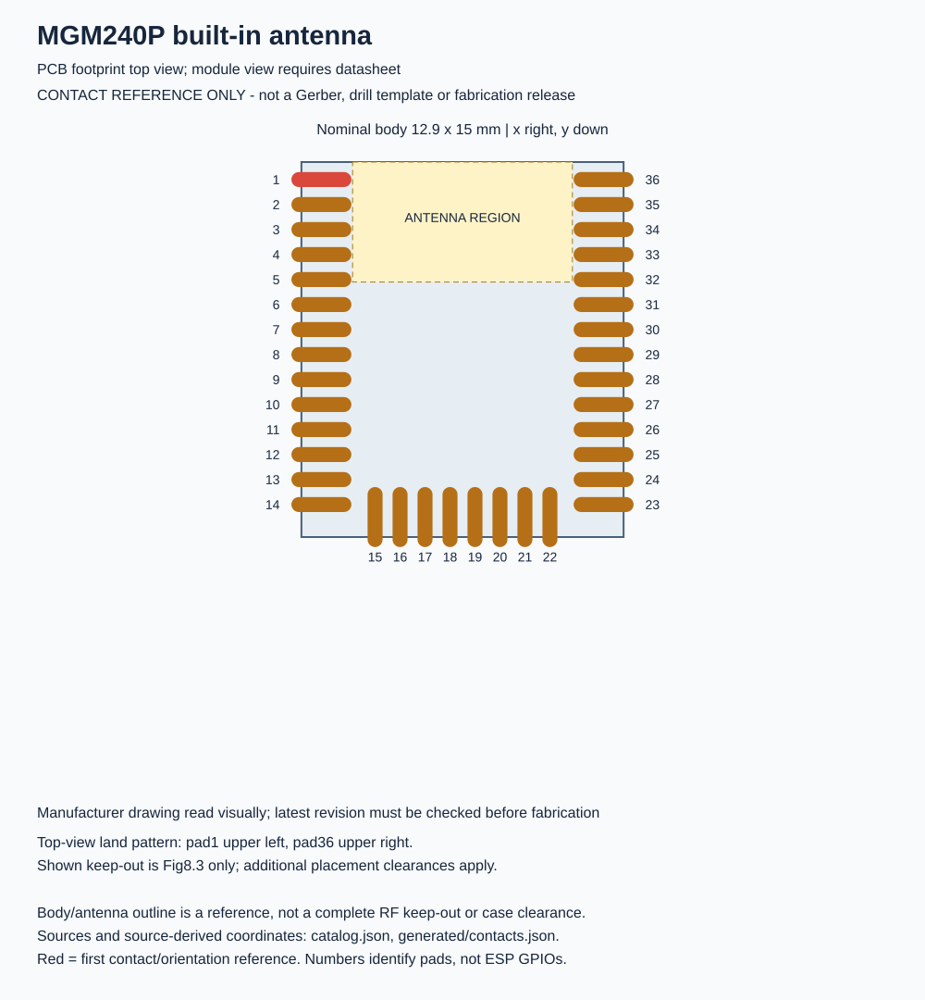

**Dimensioned diagram** — Source-derived top-view contact drawing. Not a photograph; distinguish bare module pads from development-board headers.

Image: HA Radio Hub project. [Source](../hardware/low-power/visual/physical/README.md) · [Local family illustration](../hardware/parts/illustrations/module.svg).

Package / dimensions: `12.9 × 15 × 2.2 mm`.

- **LP-P0 bench reference (not additive):** quantity 1; references `U3`.

[AliExpress search — unverified results](https://www.aliexpress.com/wholesale?SearchText=MGM240PA22VNA3)

Exact BOM row conditions, notes and sources

- **lp-reference:U3:** Reference only; carrier. 10 dBm, internal antenna. Exact-pin Ember NCP and UART bootloader build recipe in firmware/low-power/mg24 passes offline checks; SWD programming and hardware validation remain required. [Official / original source](https://www.silabs.com/documents/public/data-sheets/mgm240p-datasheet.pdf).

### MGM240PA22VNA3

**Dimensioned diagram** — Source-derived top-view contact drawing. Not a photograph; distinguish bare module pads from development-board headers.

Image: HA Radio Hub project. [Source](../hardware/low-power/visual/physical/README.md) · [Local family illustration](../hardware/parts/illustrations/module.svg).

Package / dimensions: `Carrier:MGM240P`.

- **M0 MG24 adapter • fitted parts:** quantity 1; references `U1`.

[AliExpress search — unverified results](https://www.aliexpress.com/wholesale?SearchText=MGM240PA22VNA3)

Exact BOM row conditions, notes and sources

- **m0:U1:** Fitted to board. Exact PA22VNA3 firmware target; all GND pads direct to plane; RFOUT33 intentionally NC [Official / original source](https://www.silabs.com/documents/public/data-sheets/mgm240p-datasheet.pdf).

### MGM240PA22VNA3

**Dimensioned diagram** — Source-derived top-view contact drawing. Not a photograph; distinguish bare module pads from development-board headers.

Image: HA Radio Hub project. [Source](../hardware/low-power/visual/physical/README.md) · [Local family illustration](../hardware/parts/illustrations/module.svg).

Package / dimensions: `Hub:MGM240P`.

- **I0 integrated • fitted parts:** quantity 1; references `U3`.

[AliExpress search — unverified results](https://www.aliexpress.com/wholesale?SearchText=MGM240PA22VNA3)

Exact BOM row conditions, notes and sources

- **i0:U3:** Fitted to board. Module pad numbers, not development-board header positions. [Official / original source](https://www.silabs.com/documents/public/data-sheets/mgm240p-datasheet.pdf).

### Pololu D24V22F3 / item 2857

**Manufacturer photo** — D24V22F3 side view. Verify the 3.3 V version; the output-current headline at 24 V input does not establish our 5 V thermal capability.

Image: Pololu. [Source](https://www.pololu.com/product/2857) · [Local family illustration](../hardware/parts/illustrations/module.svg).

Package / dimensions: `17.8 × 17.8 mm; height unspecified`.

- **LP-P0 bench reference (not additive):** quantity 1; references `P3`.

[AliExpress search — unverified results](https://www.aliexpress.com/wholesale?SearchText=Pololu+D24V22F3+%2F+item+2857)

Exact BOM row conditions, notes and sources

- **lp-reference:P3:** Reference only; both. Synchronous 5 V to 3.3 V buck. Advertised 2.6 A is typical at 24 V input; validate 1.5 A at 5 V input. Do not substitute an LDO. [Official / original source](https://www.pololu.com/product/2857).

### Pololu D24V22F3 / item2857

**Manufacturer photo** — D24V22F3 side view. Verify the 3.3 V version; the output-current headline at 24 V input does not establish our 5 V thermal capability.

Image: Pololu. [Source](https://www.pololu.com/product/2857) · [Local family illustration](../hardware/parts/illustrations/module.svg).

- **D0 DIY • adapters / harness / jumper wire:** quantity 1; references `3V3 buck`.

[AliExpress search — unverified results](https://www.aliexpress.com/wholesale?SearchText=Pololu+D24V22F3+%2F+item2857)

Exact BOM row conditions, notes and sources

- **d0-harness:3V3 buck:** Harness / external / service; read row notes. External 5V-to-3V3 regulator at J2 · No second 3V3 source; test 1.5A at5V input and cooling

### Pololu D24V22F3 item 2857

**Manufacturer photo** — D24V22F3 side view. Verify the 3.3 V version; the output-current headline at 24 V input does not establish our 5 V thermal capability.

Image: Pololu. [Source](https://www.pololu.com/product/2857) · [Local family illustration](../hardware/parts/illustrations/module.svg).

- **C0 carrier • harness / external:** quantity 1; references `3V3 buck`.

[AliExpress search — unverified results](https://www.aliexpress.com/wholesale?SearchText=Pololu+D24V22F3+item+2857)

Exact BOM row conditions, notes and sources

- **c0-harness:3V3 buck:** Harness / external / service; read row notes. J2 · External module, no second 3.3 V source; test load and cooling

### SMLIGHT SLZB-07Mg24 EFR32MG24

**Manufacturer render** — Manufacturer SLZB-07 family render. Read the Mg24 model marking; the shared enclosure does not identify the radio.

Image: SMLIGHT. [Source](https://smlight.tech/products/slzb-07mg24) · [Local family illustration](../hardware/parts/illustrations/module.svg).

Package / dimensions: `18x54x10 excluding_antenna`.

- **Original Pi modular hub:** quantity 1; references `U2`.

[AliExpress search — unverified results](https://www.aliexpress.com/wholesale?SearchText=SMLIGHT+SLZB-07Mg24+EFR32MG24)

Exact BOM row conditions, notes and sources

- **modular:U2:** common. Zigbee coordinator · USB 5V Zigbee NCP · Order Mg24 explicitly;retain supplied antenna;not generic SLZB-07 MG21;vendor operating ambient +5 to +35C [Official / original source](https://smlight.tech/products/slzb-07mg24).

### Second Waveshare ESP32-S3-ETH-M

**Manufacturer photo** — ESP32-S3-ETH-M with headers. The baseline excludes the optional PoE board, camera and microSD.

Image: Waveshare. [Source](https://www.waveshare.com/product/esp32-s3-eth.htm) · [Local family illustration](../hardware/parts/illustrations/module.svg).

Package / dimensions: `72.8x21 planar_outline;height_with_headers_verify`.

- **Original Pi modular hub:** quantity 1; references `U10`.

[AliExpress search — unverified results](https://www.aliexpress.com/wholesale?SearchText=Second+Waveshare+ESP32-S3-ETH-M)

Exact BOM row conditions, notes and sources

- **modular:U10:** wired_rf_only. RF Ethernet replacement · USB5V W5500 CC1101_SPI · SKU34882;pre-soldered male headers;replaces U8;add C8 C9 R1;no camera SD or PoE module;recheck20W budget [Official / original source](https://www.waveshare.com/product/iot-communication/wired-comm-converter/esp32-s3-eth.htm).

### Silvertel Ag97005-FL

**Manufacturer photo** — Ag97000-FL family image; order specifically Ag97005-FL (5 V), not the 12 V or 24 V variant.

Image: Silvertel. [Source](https://silvertel.com/ag97000/) · [Local family illustration](../hardware/parts/illustrations/module.svg).

Package / dimensions: `56.01 × 14.02 × 13 mm`.

- **LP-P0 bench reference (not additive):** quantity 1; references `P1`.

[AliExpress search — unverified results](https://www.aliexpress.com/wholesale?SearchText=Silvertel+Ag97005-FL)

Exact BOM row conditions, notes and sources

- **lp-reference:P1:** Reference only; both. 5 V, 1.8 A nominal, 9 W; integrated bridge, class 0. Do not substitute the 12 V variant. [Official / original source](https://silvertel.com/images/datasheets/Ag97000-Datasheet-low-cost-isolated-12W-Power-over-Ethernet-PoE-module-solution.pdf).

### Silvertel Ag97005-FL 5V

**Manufacturer photo** — Ag97000-FL family image; order specifically Ag97005-FL (5 V), not the 12 V or 24 V variant.

Image: Silvertel. [Source](https://silvertel.com/ag97000/) · [Local family illustration](../hardware/parts/illustrations/module.svg).

- **D0 DIY • adapters / harness / jumper wire:** quantity 1; references `PoE PD module`.

[AliExpress search — unverified results](https://www.aliexpress.com/wholesale?SearchText=Silvertel+Ag97005-FL+5V)

Exact BOM row conditions, notes and sources

- **d0-harness:PoE PD module:** Harness / external / service; read row notes. External isolated 5V source · Fit to compatible Silvertel EvalPoE; verify output before J1. Not raw 48V, not a second source; see low-power/bom.json

### Silvertel EvalPoE

**Manufacturer photo** — Evaluation-board family image. Online EvalPoE orders may omit the PD module; inspect package contents.

Image: Silvertel. [Source](https://silvertel.com/ag97000/) · [Local family illustration](../hardware/parts/illustrations/module.svg).

- **LP-P0 bench reference (not additive):** quantity 1; references `P2`.
- **D0 DIY • adapters / harness / jumper wire:** quantity 1; references `PoE evaluation carrier`.

[AliExpress search — unverified results](https://www.aliexpress.com/wholesale?SearchText=Silvertel+EvalPoE)

Exact BOM row conditions, notes and sources

- **lp-reference:P2:** Reference only; bench. Order Ag97005-FL separately; compatibility is explicit on the manufacturer page. DATA OUT connects to WIZ850io. The evaluation board is excluded from the compact CAD. [Official / original source](https://silvertel.com/ag97000/).
- **d0-harness:PoE evaluation carrier:** Harness / external / service; read row notes. Factory PoE front end for bench build · Ag97005-FL ordered separately; DATA OUT to WIZ850io; excluded from D0 copper and enclosure

### WIZnet WIZ850io

**Manufacturer photo** — WIZ850io module with magnetics and RJ45. It is not a bare W5500 or an arbitrary W5500 breakout.

Image: WIZnet. [Source](https://docs.wiznet.io/Product/ioModule/WIZ850io) · [Local family illustration](../hardware/parts/illustrations/module.svg).

Package / dimensions: `25 × 23 mm; height unspecified`.

- **LP-P0 bench reference (not additive):** quantity 1; references `U4`.

[AliExpress search — unverified results](https://www.aliexpress.com/wholesale?SearchText=WIZnet+WIZ850io)

Exact BOM row conditions, notes and sources

- **lp-reference:U4:** Reference only; bench. SPI Ethernet module with RJ45. No PoE center-tap headers. Mechanical section says 25 by 23 mm; feature section says 20 by 25 mm. Verify the drawing. [Official / original source](https://docs.wiznet.io/Product/ioModule/WIZ850io).

### WIZnet WIZ850io

**Manufacturer photo** — WIZ850io module with magnetics and RJ45. It is not a bare W5500 or an arbitrary W5500 breakout.

Image: WIZnet. [Source](https://docs.wiznet.io/Product/ioModule/WIZ850io) · [Local family illustration](../hardware/parts/illustrations/module.svg).

- **D0 DIY • adapters / harness / jumper wire:** quantity 1; references `Ethernet module`.

[AliExpress search — unverified results](https://www.aliexpress.com/wholesale?SearchText=WIZnet+WIZ850io)

Exact BOM row conditions, notes and sources

- **d0-harness:Ethernet module:** Harness / external / service; read row notes. SPI Ethernet at J4 · Verify J1/J2 module numbering; included magnetics; not a PoE PD

### Waveshare ESP32-S3-ETH-M

**Manufacturer photo** — ESP32-S3-ETH-M with headers. The baseline excludes the optional PoE board, camera and microSD.

Image: Waveshare. [Source](https://www.waveshare.com/product/esp32-s3-eth.htm) · [Local family illustration](../hardware/parts/illustrations/module.svg).

Package / dimensions: `72.8x21 planar_outline;height_with_headers_verify`.

- **Original Pi modular hub:** quantity 1; references `U4`.

[AliExpress search — unverified results](https://www.aliexpress.com/wholesale?SearchText=Waveshare+ESP32-S3-ETH-M)

Exact BOM row conditions, notes and sources

- **modular:U4:** common. ESPHome Ethernet node · USB5V;16MB flash8MB PSRAM · SKU34882;pre-soldered male headers;without PoE module camera or microSD [Official / original source](https://www.waveshare.com/product/iot-communication/wired-comm-converter/esp32-s3-eth.htm).

### Zooz ZAC93 existing regional module

**Manufacturer photo** — ZAC93 product appearance. Keep the correct regional radio version and verify the physical revision before wiring.

Image: Zooz. [Source](https://www.getzooz.com/zac93-gpio-module/) · [Local family illustration](../hardware/parts/illustrations/module.svg).

Package / dimensions: `measure_revision`.

- **Original Pi modular hub:** quantity 1; references `U5`.

[AliExpress search — unverified results](https://www.aliexpress.com/wholesale?SearchText=Zooz+ZAC93+existing+regional+module)

Exact BOM row conditions, notes and sources

- **modular:U5:** common. Z-Wave module · 3.3V UART115200 · Onboard antenna;check region;do not feed5V;vendor operating ambient0 to40C;co-location conditions see antennas.md [Official / original source](https://www.getzooz.com/downloads/zooz-z-wave-800-series-long-range-gpio-module-zac93-LR-manual.pdf).

### Zooz ZAC93 of the correct regional frequency

**Manufacturer photo** — ZAC93 product appearance. Keep the correct regional radio version and verify the physical revision before wiring.

Image: Zooz. [Source](https://www.getzooz.com/zac93-gpio-module/) · [Local family illustration](../hardware/parts/illustrations/module.svg).

- **D0 DIY • adapters / harness / jumper wire:** quantity 1; references `Z-Wave module`.

[AliExpress search — unverified results](https://www.aliexpress.com/wholesale?SearchText=Zooz+ZAC93+of+the+correct+regional+frequency)

Exact BOM row conditions, notes and sources

- **d0-harness:Z-Wave module:** Harness / external / service; read row notes. Z-Wave at J8 · Reuse existing only after physical pin identification; antenna is module-specific

<strong>Antenna: 6 identification cards</strong>

### 2.4GHz50ohm IPEXGen1 external antenna

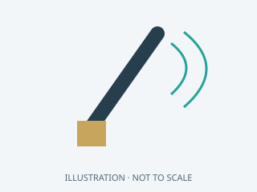

**Original illustration** — Original family illustration, not a photo or a footprint. Package dimensions and terminal layout must be checked against the exact row and datasheet.

Image: HA Radio Hub project · MIT. [Local family illustration](../hardware/parts/illustrations/antenna.svg).

Package / dimensions: `measure`.

- **Original Pi modular hub:** quantity 1; references `A3`.

[AliExpress search — unverified results](https://www.aliexpress.com/wholesale?SearchText=2.4GHz50ohm+IPEXGen1+external+antenna)

Exact BOM row conditions, notes and sources

- **modular:A3:** optional. Optional BLE antenna · requires_R0_selection_rework · Onboard ceramic is default;plugging antenna alone does not select it [Official / original source](https://www.waveshare.com/wiki/ESP32-S3-ETH).

### 433.92 MHz 50 Ω antenna matched to the existing CC1101 module

**Original illustration** — Original family illustration, not a photo or a footprint. Package dimensions and terminal layout must be checked against the exact row and datasheet.

Image: HA Radio Hub project · MIT. [Local family illustration](../hardware/parts/illustrations/antenna.svg).

- **Additional / reusable / conditional:** quantity 1 if not already supplied; references `antennas`.

[AliExpress search — unverified results](https://www.aliexpress.com/wholesale?SearchText=433.92+MHz+50+%CE%A9+antenna+matched+to+the+existing+CC1101+module)

Exact BOM row conditions, notes and sources

- **accessory:antennas:** C0 / I0 / LP-P0 RF. Confirm SMA versus RP-SMA and gender from the real module. S3-WROOM-1, H2-MINI-1 and MGM240PA22VNA3 have integrated antennas; do not add pigtails to their unconnected RF pads. Keep all antenna clearance regions free. [Official / original source](https://www.ti.com/product/CC1101).

### Existing CC1101 433.92 MHz module with SMA antenna

**Original illustration** — Original family illustration, not a photo or a footprint. Package dimensions and terminal layout must be checked against the exact row and datasheet.

Image: HA Radio Hub project · MIT. [Local family illustration](../hardware/parts/illustrations/antenna.svg).

- **LP-P0 bench reference (not additive):** quantity 1; references `U6`.

[AliExpress search — unverified results](https://www.aliexpress.com/wholesale?SearchText=Existing+CC1101+433.92+MHz+module+with+SMA+antenna)

Exact BOM row conditions, notes and sources

- **lp-reference:U6:** Reference only; both. Must expose GDO2. The chip datasheet does not define the existing module header or dimensions. Retain the 433 MHz antenna. [Official / original source](https://www.ti.com/lit/ds/symlink/cc1101.pdf).

### Existing CC1101 433MHz module and matching antenna

**Original illustration** — Original family illustration, not a photo or a footprint. Package dimensions and terminal layout must be checked against the exact row and datasheet.

Image: HA Radio Hub project · MIT. [Local family illustration](../hardware/parts/illustrations/antenna.svg).

- **D0 DIY • adapters / harness / jumper wire:** quantity 1; references `RF module`.

[AliExpress search — unverified results](https://www.aliexpress.com/wholesale?SearchText=Existing+CC1101+433MHz+module+and+matching+antenna)

Exact BOM row conditions, notes and sources

- **d0-harness:RF module:** Harness / external / service; read row notes. RF at J7 · Verify module revision and physical pad map; do not buy duplicate if reusing

### Existing matched433.92MHz antenna

**Original illustration** — Original family illustration, not a photo or a footprint. Package dimensions and terminal layout must be checked against the exact row and datasheet.

Image: HA Radio Hub project · MIT. [Local family illustration](../hardware/parts/illustrations/antenna.svg).

Package / dimensions: `measure`.

- **Original Pi modular hub:** quantity 1; references `A2`.

[AliExpress search — unverified results](https://www.aliexpress.com/wholesale?SearchText=Existing+matched433.92MHz+antenna)

Exact BOM row conditions, notes and sources

- **modular:A2:** common. RF antenna · 50ohm_as_module_requires · Separate from ZWave PCB radiator;verify connector SMA vs RP-SMA [Official / original source](https://github.com/ha-homelab/rf-airbridge).

### Original supplied with SLZB-07Mg24

**Original illustration** — Original family illustration, not a photo or a footprint. Package dimensions and terminal layout must be checked against the exact row and datasheet.

Image: HA Radio Hub project · MIT. [Local family illustration](../hardware/parts/illustrations/antenna.svg).

Package / dimensions: `measure`.

- **Original Pi modular hub:** quantity 1; references `A1`.

[AliExpress search — unverified results](https://www.aliexpress.com/wholesale?SearchText=Original+supplied+with+SLZB-07Mg24)

Exact BOM row conditions, notes and sources

- **modular:A1:** common. Zigbee antenna · 2.4GHz50ohm · Keep vendor antenna and TX power;do not substitute high gain blindly [Official / original source](https://smlight.tech/products/slzb-07mg24).

<strong>Cable: 20 identification cards</strong>

### 18-20AWG trunk;20AWG Pi lead;22-24AWG other branches

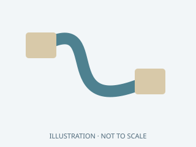

**Original illustration** — Original family illustration, not a photo or a footprint. Package dimensions and terminal layout must be checked against the exact row and datasheet.

Image: HA Radio Hub project · MIT. [Local family illustration](../hardware/parts/illustrations/cable.svg).

Package / dimensions: `layout_dependent`.

- **Original Pi modular hub:** quantity 1; references `C7`.

[AliExpress search — unverified results](https://www.aliexpress.com/wholesale?SearchText=18-20AWG+trunk%3B20AWG+Pi+lead%3B22-24AWG+other+branches)

Exact BOM row conditions, notes and sources

- **modular:C7:** common. Low voltage wire kit · 5V and3V3 separate · Color coding alone is not pin verification

### 2x5 mating header and4signal wires to S3 female sockets

**Original illustration** — Original family illustration, not a photo or a footprint. Package dimensions and terminal layout must be checked against the exact row and datasheet.

Image: HA Radio Hub project · MIT. [Local family illustration](../hardware/parts/illustrations/cable.svg).

Package / dimensions: `shortest_practical`.

- **Original Pi modular hub:** quantity 1; references `C12`.

[AliExpress search — unverified results](https://www.aliexpress.com/wholesale?SearchText=2x5+mating+header+and4signal+wires+to+S3+female+sockets)

Exact BOM row conditions, notes and sources

- **modular:C12:** common. ZAC93 adapter harness · 3V3 GND UART TX RX · Match existingZAC93 header pitch and sex;route only pins1 6 8 10;mechanically keyed or clearly mark pin1;leave pin7 unused

### 3.3 V USB UART adapter plus USB data cable

**Original illustration** — Original family illustration, not a photo or a footprint. Package dimensions and terminal layout must be checked against the exact row and datasheet.

Image: HA Radio Hub project · MIT. [Local family illustration](../hardware/parts/illustrations/cable.svg).

- **Additional / reusable / conditional:** quantity 1 reusable tool; references `uart`.

[AliExpress search — unverified results](https://www.aliexpress.com/wholesale?SearchText=3.3+V+USB+UART+adapter+plus+USB+data+cable)

Exact BOM row conditions, notes and sources

- **accessory:uart:** Flashing / diagnostics. Verify signal voltage, not just the power jumper. Use the documented boot/reset sequence; avoid two powered outputs driving the same UART signal. [Official / original source](https://docs.espressif.com/projects/esptool/en/latest/esp32s3/esptool/entering-bootloader.html).

### 5.5x2.1mm female mating pigtail for PS1 male DC tail

**Original illustration** — Original family illustration, not a photo or a footprint. Package dimensions and terminal layout must be checked against the exact row and datasheet.

Image: HA Radio Hub project · MIT. [Local family illustration](../hardware/parts/illustrations/cable.svg).

Package / dimensions: `shortest_practical`.

- **Original Pi modular hub:** quantity 1; references `C10`.

[AliExpress search — unverified results](https://www.aliexpress.com/wholesale?SearchText=5.5x2.1mm+female+mating+pigtail+for+PS1+male+DC+tail)

Exact BOM row conditions, notes and sources

- **modular:C10:** common. Splitter DC mating lead · 5V5A complete cable and connector rating · Input to J1 via main F1;18-20AWG;verify center polarity and5A rating;not unrated CCTV screw-terminal adapter

### 5V distribution to microUSB

**Original illustration** — Original family illustration, not a photo or a footprint. Package dimensions and terminal layout must be checked against the exact row and datasheet.

Image: HA Radio Hub project · MIT. [Local family illustration](../hardware/parts/illustrations/cable.svg).

Package / dimensions: `150-250 length`.

- **Original Pi modular hub:** quantity 1; references `C5`.

[AliExpress search — unverified results](https://www.aliexpress.com/wholesale?SearchText=5V+distribution+to+microUSB)

Exact BOM row conditions, notes and sources

- **modular:C5:** compatibility_wifi_only. NodeMCU power cable · 5V1A rated · Compatibility branch only

### 8signal wires or matched8pin connector

**Original illustration** — Original family illustration, not a photo or a footprint. Package dimensions and terminal layout must be checked against the exact row and datasheet.

Image: HA Radio Hub project · MIT. [Local family illustration](../hardware/parts/illustrations/cable.svg).

Package / dimensions: `shortest_practical`.

- **Original Pi modular hub:** quantity 1; references `C14`.

[AliExpress search — unverified results](https://www.aliexpress.com/wholesale?SearchText=8signal+wires+or+matched8pin+connector)

Exact BOM row conditions, notes and sources

- **modular:C14:** wired_rf_only. CC1101 adapter harness · 3V3 GND SCLK MOSI MISO CS GDO0 GDO2 · WiredRF uses8signals;reuse connector only after pinout inspection;GDO2 must be accessible;R1 connects to local3V3

### Adafruit 4210 100 mm JST SH 4-pin

**Original illustration** — Original family illustration, not a photo or a footprint. Package dimensions and terminal layout must be checked against the exact row and datasheet.

Image: HA Radio Hub project · MIT. [Local family illustration](../hardware/parts/illustrations/cable.svg).

- **C0 carrier • harness / external:** quantity 1; references `QT cable`.

[AliExpress search — unverified results](https://www.aliexpress.com/wholesale?SearchText=Adafruit+4210+100+mm+JST+SH+4-pin)

Exact BOM row conditions, notes and sources

- **c0-harness:QT cable:** Harness / external / service; read row notes. J10 to BME680 · Premade cable replaces loose SH crimps; verify wire order

### Adafruit 4536 DC barrel jack to USB-C adapter

**Original illustration** — Original family illustration, not a photo or a footprint. Package dimensions and terminal layout must be checked against the exact row and datasheet.

Image: HA Radio Hub project · MIT. [Local family illustration](../hardware/parts/illustrations/cable.svg).

Package / dimensions: `adapter_envelope_measure`.

- **Original Pi modular hub:** quantity 1; references `C3`.

[AliExpress search — unverified results](https://www.aliexpress.com/wholesale?SearchText=Adafruit+4536+DC+barrel+jack+to+USB-C+adapter)

Exact BOM row conditions, notes and sources

- **modular:C3:** common. Pi USB-C power adapter · 5V only;3A assembly load test required · Vendor explicitly supports Pi4;no published standalone3A rating;requires C17 source plug lead;no PD or protection;never dual-power [Official / original source](https://www.adafruit.com/product/4536).

### Adafruit4397 JST-SH4pin to female sockets150mm

**Original illustration** — Original family illustration, not a photo or a footprint. Package dimensions and terminal layout must be checked against the exact row and datasheet.

Image: HA Radio Hub project · MIT. [Local family illustration](../hardware/parts/illustrations/cable.svg).

Package / dimensions: `150 length`.

- **Original Pi modular hub:** quantity 1; references `C6`.

[AliExpress search — unverified results](https://www.aliexpress.com/wholesale?SearchText=Adafruit4397+JST-SH4pin+to+female+sockets150mm)

Exact BOM row conditions, notes and sources

- **modular:C6:** common. BME680 harness · 3V3 GND SDA SCL · QT cable not supplied with3660;mates maleS3 headers;3V3 GND SDA SCL;secure female contacts;totalI2C harness<=200mm [Official / original source](https://www.adafruit.com/product/4397).

### Cat5e/Cat6 RJ45 data cable

**Original illustration** — Original family illustration, not a photo or a footprint. Package dimensions and terminal layout must be checked against the exact row and datasheet.

Image: HA Radio Hub project · MIT. [Local family illustration](../hardware/parts/illustrations/cable.svg).

Package / dimensions: `site_length`.

- **Original Pi modular hub:** quantity 1; references `C16`.

[AliExpress search — unverified results](https://www.aliexpress.com/wholesale?SearchText=Cat5e%2FCat6+RJ45+data+cable)

Exact BOM row conditions, notes and sources

- **modular:C16:** injector_only. Injector LAN input patch · Ethernet · Only for separatePOE160S;connect LAN switch to injector DATA IN;omit when existingPoE switch is PSE

### DC plug matched to actual TL-SF1005D v13 jack

**Original illustration** — Original family illustration, not a photo or a footprint. Package dimensions and terminal layout must be checked against the exact row and datasheet.

Image: HA Radio Hub project · MIT. [Local family illustration](../hardware/parts/illustrations/cable.svg).

Package / dimensions: `150-250 length`.

- **Original Pi modular hub:** quantity 1; references `C11`.

[AliExpress search — unverified results](https://www.aliexpress.com/wholesale?SearchText=DC+plug+matched+to+actual+TL-SF1005D+v13+jack)

Exact BOM row conditions, notes and sources

- **modular:C11:** common. Switch power lead · 5V1A branch · Measure outer inner and insertion dimensions;verify polarity from label;do not assume5.5x2.1 or reuse mains PSU output in parallel

### DFRobot FIT0993 terminal-input USB-C output cable

**Original illustration** — Original family illustration, not a photo or a footprint. Package dimensions and terminal layout must be checked against the exact row and datasheet.

Image: HA Radio Hub project · MIT. [Local family illustration](../hardware/parts/illustrations/cable.svg).

Package / dimensions: `300 length;4 cable_OD`.

- **Original Pi modular hub:** quantity 2; references `C4, C9`.

[AliExpress search — unverified results](https://www.aliexpress.com/wholesale?SearchText=DFRobot+FIT0993+terminal-input+USB-C+output+cable)

Exact BOM row conditions, notes and sources

- **modular:C4:** common. S3 power cable · 5V2A manufacturer rating;1A fused branch · Fused5V to +;GND to -;D+/D-/S unused and insulated;disconnect before programmerUSB;strain-relieve terminal block [Official / original source](https://www.dfrobot.com/product-2831.html).
- **modular:C9:** wired_rf_only. Extra RF USB-C power lead · 5V2A manufacturer rating;1A fused branch · Fused5V to +;GND to -;D+/D-/S unused and insulated;disconnect before programmerUSB;strain-relieve terminal block [Official / original source](https://www.dfrobot.com/product-2831.html).

### Flux,solder,heatshrink,cable ties,insulating sheet

**Original illustration** — Original family illustration, not a photo or a footprint. Package dimensions and terminal layout must be checked against the exact row and datasheet.

Image: HA Radio Hub project · MIT. [Local family illustration](../hardware/parts/illustrations/cable.svg).

- **D0 DIY • adapters / harness / jumper wire:** quantity 1; references `Assembly consumables`.

[AliExpress search — unverified results](https://www.aliexpress.com/wholesale?SearchText=Flux%2Csolder%2Cheatshrink%2Ccable+ties%2Cinsulating+sheet)

Exact BOM row conditions, notes and sources

- **d0-harness:Assembly consumables:** Harness / external / service; read row notes. Build and protect exposed copper · All jumpers insulated; wash flux suitable for cleaning; no loose copper strands

### JST XH / SH compatible crimp tooling and wire stripper

**Original illustration** — Original family illustration, not a photo or a footprint. Package dimensions and terminal layout must be checked against the exact row and datasheet.

Image: HA Radio Hub project · MIT. [Local family illustration](../hardware/parts/illustrations/cable.svg).

- **Additional / reusable / conditional:** quantity 1 reusable tool set; references `crimp`.

[AliExpress search — unverified results](https://www.aliexpress.com/wholesale?SearchText=JST+XH+%2F+SH+compatible+crimp+tooling+and+wire+stripper)

Exact BOM row conditions, notes and sources

- **accessory:crimp:** Harness assembly. Use tooling appropriate for the exact contact and wire gauge; precrimped QT leads avoid attempting SH crimps with an XH die. Pull-test crimps and continuity-test both ends before power. [Official / original source](https://www.jst-mfg.com/product/pdf/eng/eXH.pdf).

### Matching4pin cable supplied with radar or separately sourced

**Original illustration** — Original family illustration, not a photo or a footprint. Package dimensions and terminal layout must be checked against the exact row and datasheet.

Image: HA Radio Hub project · MIT. [Local family illustration](../hardware/parts/illustrations/cable.svg).

Package / dimensions: `route_to_lid`.

- **Original Pi modular hub:** quantity 1; references `C13`.

[AliExpress search — unverified results](https://www.aliexpress.com/wholesale?SearchText=Matching4pin+cable+supplied+with+radar+or+separately+sourced)

Exact BOM row conditions, notes and sources

- **modular:C13:** common. LD2450 adapter harness · 5V GND TX RX · Order separately only if absent fromU6 kit;no LD2410 cable substitution;verify pin labels before power

### Pure copper Cat5e/Cat6 RJ45;installation appropriate

**Original illustration** — Original family illustration, not a photo or a footprint. Package dimensions and terminal layout must be checked against the exact row and datasheet.

Image: HA Radio Hub project · MIT. [Local family illustration](../hardware/parts/illustrations/cable.svg).

Package / dimensions: `site_length`.

- **Original Pi modular hub:** quantity 1; references `C15`.

[AliExpress search — unverified results](https://www.aliexpress.com/wholesale?SearchText=Pure+copper+Cat5e%2FCat6+RJ45%3Binstallation+appropriate)

Exact BOM row conditions, notes and sources

- **modular:C15:** common. External PoE Ethernet cable · 802.3at power plus data · From PSE power+data output toPS1;choose site length and bend radius;allowance excludes building cabling

### Shielded USB2 TypeA male-female

**Original illustration** — Original family illustration, not a photo or a footprint. Package dimensions and terminal layout must be checked against the exact row and datasheet.

Image: HA Radio Hub project · MIT. [Local family illustration](../hardware/parts/illustrations/cable.svg).

Package / dimensions: `150-300 length`.

- **Original Pi modular hub:** quantity 2; references `C2`.

[AliExpress search — unverified results](https://www.aliexpress.com/wholesale?SearchText=Shielded+USB2+TypeA+male-female)

Exact BOM row conditions, notes and sources

- **modular:C2:** common. USB radio extension · Data_and_power · Place radiators away from Pi/switch and each other

### Short Cat5e four-pair RJ45 patch lead

**Original illustration** — Original family illustration, not a photo or a footprint. Package dimensions and terminal layout must be checked against the exact row and datasheet.

Image: HA Radio Hub project · MIT. [Local family illustration](../hardware/parts/illustrations/cable.svg).

- **LP-P0 bench reference (not additive):** quantity 1; references `J2`.

[AliExpress search — unverified results](https://www.aliexpress.com/wholesale?SearchText=Short+Cat5e+four-pair+RJ45+patch+lead)

Exact BOM row conditions, notes and sources

- **lp-reference:J2:** Reference only; bench. EvalPoE DATA OUT to WIZ850io. One external PoE cable; no internal switch. [Official / original source](https://silvertel.com/images/Eval-Board-User-Guides/POE-Eval-Board-User-Manual.pdf).

### Short Cat5e or Cat6 stranded RJ45

**Original illustration** — Original family illustration, not a photo or a footprint. Package dimensions and terminal layout must be checked against the exact row and datasheet.

Image: HA Radio Hub project · MIT. [Local family illustration](../hardware/parts/illustrations/cable.svg).

Package / dimensions: `150-300 length`.

- **Original Pi modular hub:** quantity 2; references `C1`.

[AliExpress search — unverified results](https://www.aliexpress.com/wholesale?SearchText=Short+Cat5e+or+Cat6+stranded+RJ45)

Exact BOM row conditions, notes and sources

- **modular:C1:** common. Internal Ethernet patch · 100BASE-TX in this assembly · Switch-to-Pi;switch-to-main-S3;PS1 captive maleRJ45 plugs directly into switch;allow bend radius

### Short Cat5e/Cat6 RJ45

**Original illustration** — Original family illustration, not a photo or a footprint. Package dimensions and terminal layout must be checked against the exact row and datasheet.

Image: HA Radio Hub project · MIT. [Local family illustration](../hardware/parts/illustrations/cable.svg).

Package / dimensions: `150-300 length`.

- **Original Pi modular hub:** quantity 1; references `C8`.

[AliExpress search — unverified results](https://www.aliexpress.com/wholesale?SearchText=Short+Cat5e%2FCat6+RJ45)

Exact BOM row conditions, notes and sources

- **modular:C8:** wired_rf_only. Extra RF Ethernet patch · 100BASE-T · Connect port4 to second S3 only

<strong>Capacitor: 36 identification cards</strong>

### 100nF

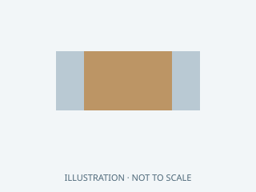

**Original illustration** — Original family illustration, not a photo or a footprint. Package dimensions and terminal layout must be checked against the exact row and datasheet.

Image: HA Radio Hub project · MIT. [Local family illustration](../hardware/parts/illustrations/capacitor.svg).

Package / dimensions: `Carrier:C_0805_2012Metric`.

- **C0 carrier • fitted parts:** quantity 10; references `C3, C5, C10, C11, C12, C13, C14, C15, C16, C17`.
- **M0 MG24 adapter • fitted parts:** quantity 1; references `C1`.

[AliExpress search — unverified results](https://www.aliexpress.com/wholesale?SearchText=100nF+capacitor+0805)

Exact BOM row conditions, notes and sources

- **c0:C3:** Fitted to board. 10V minimum; C0G crystal caps, X7R bypass/bulk
- **c0:C5:** Fitted to board. 10V minimum; C0G crystal caps, X7R bypass/bulk
- **c0:C10:** Fitted to board. 10V minimum; C0G crystal caps, X7R bypass/bulk
- **c0:C11:** Fitted to board. 10V minimum; C0G crystal caps, X7R bypass/bulk
- **c0:C12:** Fitted to board. 10V minimum; C0G crystal caps, X7R bypass/bulk
- **c0:C13:** Fitted to board. 10V minimum; C0G crystal caps, X7R bypass/bulk
- **c0:C14:** Fitted to board. 10V minimum; C0G crystal caps, X7R bypass/bulk
- **c0:C15:** Fitted to board. 10V minimum; C0G crystal caps, X7R bypass/bulk
- **c0:C16:** Fitted to board. 10V minimum; C0G crystal caps, X7R bypass/bulk
- **c0:C17:** Fitted to board. 10V minimum; C0G crystal caps, X7R bypass/bulk
- **m0:C1:** Fitted to board. 10V X7R, 0805, close to VDD15

### 100nF

**Original illustration** — Original family illustration, not a photo or a footprint. Package dimensions and terminal layout must be checked against the exact row and datasheet.

Image: HA Radio Hub project · MIT. [Local family illustration](../hardware/parts/illustrations/capacitor.svg).

Package / dimensions: `Hub:C_0805_2012Metric`.

- **I0 integrated • fitted parts:** quantity 16; references `C3, C6, C9, C13, C15, C17, C18, C19, C20, C21, C22, C23, C24, C25, C27, C42`.

[AliExpress search — unverified results](https://www.aliexpress.com/wholesale?SearchText=100nF+capacitor+0805)

Exact BOM row conditions, notes and sources

- **i0:C3:** Fitted to board. X7R,16V; evaluate DC-bias effective capacitance
- **i0:C6:** Fitted to board. X7R,16V; evaluate DC-bias effective capacitance
- **i0:C9:** Fitted to board. X7R,16V; evaluate DC-bias effective capacitance
- **i0:C13:** Fitted to board. X7R,16V; evaluate DC-bias effective capacitance
- **i0:C15:** Fitted to board. X7R,16V; evaluate DC-bias effective capacitance
- **i0:C17:** Fitted to board. X7R,16V; evaluate DC-bias effective capacitance
- **i0:C18:** Fitted to board. X7R,16V; evaluate DC-bias effective capacitance
- **i0:C19:** Fitted to board. X7R,16V; evaluate DC-bias effective capacitance
- **i0:C20:** Fitted to board. X7R,16V; evaluate DC-bias effective capacitance
- **i0:C21:** Fitted to board. X7R,16V; evaluate DC-bias effective capacitance
- **i0:C22:** Fitted to board. X7R,16V; evaluate DC-bias effective capacitance
- **i0:C23:** Fitted to board. X7R,16V; evaluate DC-bias effective capacitance
- **i0:C24:** Fitted to board. X7R,16V; evaluate DC-bias effective capacitance
- **i0:C25:** Fitted to board. X7R,16V; evaluate DC-bias effective capacitance
- **i0:C27:** Fitted to board. X7R,16V; evaluate DC-bias effective capacitance
- **i0:C42:** Fitted to board. X7R,16V; evaluate DC-bias effective capacitance

### 100nF

**Original illustration** — Original family illustration, not a photo or a footprint. Package dimensions and terminal layout must be checked against the exact row and datasheet.

Image: HA Radio Hub project · MIT. [Local family illustration](../hardware/parts/illustrations/capacitor.svg).

Package / dimensions: `Hub:C_0603_1608Metric`.

- **I0 integrated • fitted parts:** quantity 1; references `C11`.

[AliExpress search — unverified results](https://www.aliexpress.com/wholesale?SearchText=100nF+capacitor+0603)

Exact BOM row conditions, notes and sources

- **i0:C11:** Fitted to board. X7R,16V; evaluate DC-bias effective capacitance

### 100nF

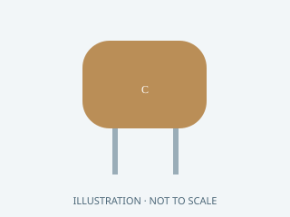

**Original illustration** — Original family illustration, not a photo or a footprint. Package dimensions and terminal layout must be checked against the exact row and datasheet.

Image: HA Radio Hub project · MIT. [Local family illustration](../hardware/parts/illustrations/capacitor.svg).

Package / dimensions: `DIY:Radial_C_P2.54`.

- **D0 DIY • fitted parts:** quantity 10; references `C3, C5, C10, C11, C12, C13, C14, C15, C16, C17`.

[AliExpress search — unverified results](https://www.aliexpress.com/wholesale?SearchText=100nF+capacitor)

Exact BOM row conditions, notes and sources

- **d0:C3:** Fitted to board. Radial ceramic >=10V, body<=5x3mm, C0G for crystal loads; X7R otherwise. Form leads to2.54mm pitch; no adjacent lead shorts.
- **d0:C5:** Fitted to board. Radial ceramic >=10V, body<=5x3mm, C0G for crystal loads; X7R otherwise. Form leads to2.54mm pitch; no adjacent lead shorts.
- **d0:C10:** Fitted to board. Radial ceramic >=10V, body<=5x3mm, C0G for crystal loads; X7R otherwise. Form leads to2.54mm pitch; no adjacent lead shorts.
- **d0:C11:** Fitted to board. Radial ceramic >=10V, body<=5x3mm, C0G for crystal loads; X7R otherwise. Form leads to2.54mm pitch; no adjacent lead shorts.
- **d0:C12:** Fitted to board. Radial ceramic >=10V, body<=5x3mm, C0G for crystal loads; X7R otherwise. Form leads to2.54mm pitch; no adjacent lead shorts.
- **d0:C13:** Fitted to board. Radial ceramic >=10V, body<=5x3mm, C0G for crystal loads; X7R otherwise. Form leads to2.54mm pitch; no adjacent lead shorts.
- **d0:C14:** Fitted to board. Radial ceramic >=10V, body<=5x3mm, C0G for crystal loads; X7R otherwise. Form leads to2.54mm pitch; no adjacent lead shorts.
- **d0:C15:** Fitted to board. Radial ceramic >=10V, body<=5x3mm, C0G for crystal loads; X7R otherwise. Form leads to2.54mm pitch; no adjacent lead shorts.
- **d0:C16:** Fitted to board. Radial ceramic >=10V, body<=5x3mm, C0G for crystal loads; X7R otherwise. Form leads to2.54mm pitch; no adjacent lead shorts.
- **d0:C17:** Fitted to board. Radial ceramic >=10V, body<=5x3mm, C0G for crystal loads; X7R otherwise. Form leads to2.54mm pitch; no adjacent lead shorts.

### 100nF 16V X7R ceramic

**Original illustration** — Original family illustration, not a photo or a footprint. Package dimensions and terminal layout must be checked against the exact row and datasheet.

Image: HA Radio Hub project · MIT. [Local family illustration](../hardware/parts/illustrations/capacitor.svg).

- **LP-P0 bench reference (not additive):** quantity 12; references `C3`.

[AliExpress search — unverified results](https://www.aliexpress.com/wholesale?SearchText=100nF+16V+X7R+ceramic+capacitor)

Exact BOM row conditions, notes and sources

- **lp-reference:C3:** Reference only; both. Assembly allowance for local IC/module power entry bypassing. Do not duplicate installed module capacitors automatically; count after layout. [Official / original source](https://www.nxp.com/docs/en/data-sheet/SC16IS752_SC16IS762.pdf).

### 100uF 25V low-ESR electrolytic

**Original illustration** — Original family illustration, not a photo or a footprint. Package dimensions and terminal layout must be checked against the exact row and datasheet.

Image: HA Radio Hub project · MIT. [Local family illustration](../hardware/parts/illustrations/capacitor.svg).

- **LP-P0 bench reference (not additive):** quantity 1; references `C1`.

[AliExpress search — unverified results](https://www.aliexpress.com/wholesale?SearchText=100uF+25V+low-ESR+electrolytic+capacitor)

Exact BOM row conditions, notes and sources

- **lp-reference:C1:** Reference only; both. Across the PD 5 V output. Include the installed EvalPoE capacitor in the 47 to 470 uF allowance; do not blindly double it. [Official / original source](https://silvertel.com/images/datasheets/Ag97000-Datasheet-low-cost-isolated-12W-Power-over-Ethernet-PoE-module-solution.pdf).

### 10nF

**Original illustration** — Original family illustration, not a photo or a footprint. Package dimensions and terminal layout must be checked against the exact row and datasheet.

Image: HA Radio Hub project · MIT. [Local family illustration](../hardware/parts/illustrations/capacitor.svg).

Package / dimensions: `Hub:C_0805_2012Metric`.

- **I0 integrated • fitted parts:** quantity 2; references `C29, C36`.

[AliExpress search — unverified results](https://www.aliexpress.com/wholesale?SearchText=10nF+capacitor+0805)

Exact BOM row conditions, notes and sources

- **i0:C29:** Fitted to board. X7R,16V; evaluate DC-bias effective capacitance
- **i0:C36:** Fitted to board. X7R,16V; evaluate DC-bias effective capacitance

### 10nF 100V

**Original illustration** — Original family illustration, not a photo or a footprint. Package dimensions and terminal layout must be checked against the exact row and datasheet.

Image: HA Radio Hub project · MIT. [Local family illustration](../hardware/parts/illustrations/capacitor.svg).

Package / dimensions: `Hub:C_1206_3216Metric`.

- **I0 integrated • fitted parts:** quantity 2; references `C37, C38`.

[AliExpress search — unverified results](https://www.aliexpress.com/wholesale?SearchText=10nF+100V+capacitor+1206)

Exact BOM row conditions, notes and sources

- **i0:C37:** Fitted to board. X7R100V minimum, PoE primary only
- **i0:C38:** Fitted to board. X7R100V minimum, PoE primary only

### 10uF

**Original illustration** — Original family illustration, not a photo or a footprint. Package dimensions and terminal layout must be checked against the exact row and datasheet.

Image: HA Radio Hub project · MIT. [Local family illustration](../hardware/parts/illustrations/capacitor.svg).

Package / dimensions: `Carrier:C_1206_3216Metric`.

- **M0 MG24 adapter • fitted parts:** quantity 1; references `C3`.

[AliExpress search — unverified results](https://www.aliexpress.com/wholesale?SearchText=10uF+capacitor+1206)

Exact BOM row conditions, notes and sources

- **m0:C3:** Fitted to board. 10V X7R, 1206; account for DC bias

### 10uF

**Original illustration** — Original family illustration, not a photo or a footprint. Package dimensions and terminal layout must be checked against the exact row and datasheet.

Image: HA Radio Hub project · MIT. [Local family illustration](../hardware/parts/illustrations/capacitor.svg).

Package / dimensions: `Hub:C_1206_3216Metric`.

- **I0 integrated • fitted parts:** quantity 6; references `C4, C7, C10, C26, C28, C43`.

[AliExpress search — unverified results](https://www.aliexpress.com/wholesale?SearchText=10uF+capacitor+1206)

Exact BOM row conditions, notes and sources

- **i0:C4:** Fitted to board. X7R,16V; evaluate DC-bias effective capacitance
- **i0:C7:** Fitted to board. X7R,16V; evaluate DC-bias effective capacitance
- **i0:C10:** Fitted to board. X7R,16V; evaluate DC-bias effective capacitance
- **i0:C26:** Fitted to board. X7R,16V; evaluate DC-bias effective capacitance
- **i0:C28:** Fitted to board. X7R,16V; evaluate DC-bias effective capacitance
- **i0:C43:** Fitted to board. X7R,16V; evaluate DC-bias effective capacitance

### 10uF 25V X7R ceramic

**Original illustration** — Original family illustration, not a photo or a footprint. Package dimensions and terminal layout must be checked against the exact row and datasheet.

Image: HA Radio Hub project · MIT. [Local family illustration](../hardware/parts/illustrations/capacitor.svg).

- **LP-P0 bench reference (not additive):** quantity 1; references `C2`.

[AliExpress search — unverified results](https://www.aliexpress.com/wholesale?SearchText=10uF+25V+X7R+ceramic+capacitor)

Exact BOM row conditions, notes and sources

- **lp-reference:C2:** Reference only; both. PD output local filter; inspect EvalPoE population. [Official / original source](https://silvertel.com/images/datasheets/Ag97000-Datasheet-low-cost-isolated-12W-Power-over-Ethernet-PoE-module-solution.pdf).

### 18pF

**Original illustration** — Original family illustration, not a photo or a footprint. Package dimensions and terminal layout must be checked against the exact row and datasheet.

Image: HA Radio Hub project · MIT. [Local family illustration](../hardware/parts/illustrations/capacitor.svg).

Package / dimensions: `Hub:C_0805_2012Metric`.

- **I0 integrated • fitted parts:** quantity 2; references `C31, C32`.

[AliExpress search — unverified results](https://www.aliexpress.com/wholesale?SearchText=18pF+capacitor+0805)

Exact BOM row conditions, notes and sources

- **i0:C31:** Fitted to board. C0G,50V
- **i0:C32:** Fitted to board. C0G,50V

### 1nF

**Original illustration** — Original family illustration, not a photo or a footprint. Package dimensions and terminal layout must be checked against the exact row and datasheet.

Image: HA Radio Hub project · MIT. [Local family illustration](../hardware/parts/illustrations/capacitor.svg).

Package / dimensions: `Carrier:C_0805_2012Metric`.

- **C0 carrier • fitted parts:** quantity 1; references `C6`.

[AliExpress search — unverified results](https://www.aliexpress.com/wholesale?SearchText=1nF+capacitor+0805)

Exact BOM row conditions, notes and sources

- **c0:C6:** Fitted to board. 10V minimum; C0G crystal caps, X7R bypass/bulk

### 1nF

**Original illustration** — Original family illustration, not a photo or a footprint. Package dimensions and terminal layout must be checked against the exact row and datasheet.

Image: HA Radio Hub project · MIT. [Local family illustration](../hardware/parts/illustrations/capacitor.svg).

Package / dimensions: `Hub:C_0805_2012Metric`.

- **I0 integrated • fitted parts:** quantity 1; references `C14`.

[AliExpress search — unverified results](https://www.aliexpress.com/wholesale?SearchText=1nF+capacitor+0805)

Exact BOM row conditions, notes and sources

- **i0:C14:** Fitted to board. X7R,16V; evaluate DC-bias effective capacitance

### 1nF

**Original illustration** — Original family illustration, not a photo or a footprint. Package dimensions and terminal layout must be checked against the exact row and datasheet.

Image: HA Radio Hub project · MIT. [Local family illustration](../hardware/parts/illustrations/capacitor.svg).

Package / dimensions: `DIY:Radial_C_P2.54`.

- **D0 DIY • fitted parts:** quantity 1; references `C6`.

[AliExpress search — unverified results](https://www.aliexpress.com/wholesale?SearchText=1nF+capacitor)

Exact BOM row conditions, notes and sources

- **d0:C6:** Fitted to board. Radial ceramic >=10V, body<=5x3mm, C0G for crystal loads; X7R otherwise. Form leads to2.54mm pitch; no adjacent lead shorts.

### 1nF 16V C0G ceramic

**Original illustration** — Original family illustration, not a photo or a footprint. Package dimensions and terminal layout must be checked against the exact row and datasheet.

Image: HA Radio Hub project · MIT. [Local family illustration](../hardware/parts/illustrations/capacitor.svg).

- **LP-P0 bench reference (not additive):** quantity 1; references `C8`.

[AliExpress search — unverified results](https://www.aliexpress.com/wholesale?SearchText=1nF+16V+C0G+ceramic+capacitor)

Exact BOM row conditions, notes and sources

- **lp-reference:C8:** Reference only; both. Supervisor SENSE to GND. [Official / original source](https://www.ti.com/lit/ds/symlink/tps3808.pdf).

### 1nF 2kV

**Original illustration** — Original family illustration, not a photo or a footprint. Package dimensions and terminal layout must be checked against the exact row and datasheet.

Image: HA Radio Hub project · MIT. [Local family illustration](../hardware/parts/illustrations/capacitor.svg).

Package / dimensions: `Hub:C_Disc_D7.5mm_W5.0mm_P7.50mm`.

- **I0 integrated • fitted parts:** quantity 1; references `C50`.

[AliExpress search — unverified results](https://www.aliexpress.com/wholesale?SearchText=1nF+2kV+capacitor)

Exact BOM row conditions, notes and sources

- **i0:C50:** Fitted to board. Safety/ESD rated capacitor; qualification and touch-current review required.

### 1uF

**Original illustration** — Original family illustration, not a photo or a footprint. Package dimensions and terminal layout must be checked against the exact row and datasheet.

Image: HA Radio Hub project · MIT. [Local family illustration](../hardware/parts/illustrations/capacitor.svg).

Package / dimensions: `Carrier:C_0805_2012Metric`.

- **C0 carrier • fitted parts:** quantity 2; references `C4, C7`.
- **M0 MG24 adapter • fitted parts:** quantity 1; references `C2`.

[AliExpress search — unverified results](https://www.aliexpress.com/wholesale?SearchText=1uF+capacitor+0805)

Exact BOM row conditions, notes and sources

- **c0:C4:** Fitted to board. 10V minimum; C0G crystal caps, X7R bypass/bulk
- **c0:C7:** Fitted to board. 10V minimum; C0G crystal caps, X7R bypass/bulk
- **m0:C2:** Fitted to board. 10V X7R, 0805

### 1uF

**Original illustration** — Original family illustration, not a photo or a footprint. Package dimensions and terminal layout must be checked against the exact row and datasheet.

Image: HA Radio Hub project · MIT. [Local family illustration](../hardware/parts/illustrations/capacitor.svg).

Package / dimensions: `Hub:C_0805_2012Metric`.

- **I0 integrated • fitted parts:** quantity 3; references `C5, C8, C12`.

[AliExpress search — unverified results](https://www.aliexpress.com/wholesale?SearchText=1uF+capacitor+0805)

Exact BOM row conditions, notes and sources

- **i0:C5:** Fitted to board. X7R,16V; evaluate DC-bias effective capacitance
- **i0:C8:** Fitted to board. X7R,16V; evaluate DC-bias effective capacitance
- **i0:C12:** Fitted to board. X7R,16V; evaluate DC-bias effective capacitance

### 1uF

**Original illustration** — Original family illustration, not a photo or a footprint. Package dimensions and terminal layout must be checked against the exact row and datasheet.

Image: HA Radio Hub project · MIT. [Local family illustration](../hardware/parts/illustrations/capacitor.svg).

Package / dimensions: `DIY:Radial_C_P2.54`.

- **D0 DIY • fitted parts:** quantity 2; references `C4, C7`.

[AliExpress search — unverified results](https://www.aliexpress.com/wholesale?SearchText=1uF+capacitor)

Exact BOM row conditions, notes and sources

- **d0:C4:** Fitted to board. Radial ceramic >=10V, body<=5x3mm, C0G for crystal loads; X7R otherwise. Form leads to2.54mm pitch; no adjacent lead shorts.
- **d0:C7:** Fitted to board. Radial ceramic >=10V, body<=5x3mm, C0G for crystal loads; X7R otherwise. Form leads to2.54mm pitch; no adjacent lead shorts.

### 1uF 16V X7R ceramic

**Original illustration** — Original family illustration, not a photo or a footprint. Package dimensions and terminal layout must be checked against the exact row and datasheet.

Image: HA Radio Hub project · MIT. [Local family illustration](../hardware/parts/illustrations/capacitor.svg).

- **LP-P0 bench reference (not additive):** quantity 2; references `C7`.

[AliExpress search — unverified results](https://www.aliexpress.com/wholesale?SearchText=1uF+16V+X7R+ceramic+capacitor)

Exact BOM row conditions, notes and sources

- **lp-reference:C7:** Reference only; carrier. S3 EN and H2 EN startup RC networks; confirm rise time and reset sequencing. [Official / original source](https://www.espressif.com/sites/default/files/documentation/esp32-h2-mini-1_mini-1u_datasheet_en.pdf).

### 22nF

**Original illustration** — Original family illustration, not a photo or a footprint. Package dimensions and terminal layout must be checked against the exact row and datasheet.

Image: HA Radio Hub project · MIT. [Local family illustration](../hardware/parts/illustrations/capacitor.svg).

Package / dimensions: `Hub:C_0805_2012Metric`.

- **I0 integrated • fitted parts:** quantity 1; references `C33`.

[AliExpress search — unverified results](https://www.aliexpress.com/wholesale?SearchText=22nF+capacitor+0805)

Exact BOM row conditions, notes and sources

- **i0:C33:** Fitted to board. X7R,16V; evaluate DC-bias effective capacitance

### 22pF

**Original illustration** — Original family illustration, not a photo or a footprint. Package dimensions and terminal layout must be checked against the exact row and datasheet.

Image: HA Radio Hub project · MIT. [Local family illustration](../hardware/parts/illustrations/capacitor.svg).

Package / dimensions: `Carrier:C_0805_2012Metric`.

- **C0 carrier • fitted parts:** quantity 1; references `C1`.

[AliExpress search — unverified results](https://www.aliexpress.com/wholesale?SearchText=22pF+capacitor+0805)

Exact BOM row conditions, notes and sources

- **c0:C1:** Fitted to board. 10V minimum; C0G crystal caps, X7R bypass/bulk

### 22pF

**Original illustration** — Original family illustration, not a photo or a footprint. Package dimensions and terminal layout must be checked against the exact row and datasheet.

Image: HA Radio Hub project · MIT. [Local family illustration](../hardware/parts/illustrations/capacitor.svg).

Package / dimensions: `Hub:C_0805_2012Metric`.

- **I0 integrated • fitted parts:** quantity 1; references `C1`.

[AliExpress search — unverified results](https://www.aliexpress.com/wholesale?SearchText=22pF+capacitor+0805)

Exact BOM row conditions, notes and sources

- **i0:C1:** Fitted to board. C0G,50V

### 22pF

**Original illustration** — Original family illustration, not a photo or a footprint. Package dimensions and terminal layout must be checked against the exact row and datasheet.

Image: HA Radio Hub project · MIT. [Local family illustration](../hardware/parts/illustrations/capacitor.svg).

Package / dimensions: `DIY:Radial_C_P2.54`.

- **D0 DIY • fitted parts:** quantity 1; references `C1`.

[AliExpress search — unverified results](https://www.aliexpress.com/wholesale?SearchText=22pF+capacitor)

Exact BOM row conditions, notes and sources

- **d0:C1:** Fitted to board. Radial ceramic >=10V, body<=5x3mm, C0G for crystal loads; X7R otherwise. Form leads to2.54mm pitch; no adjacent lead shorts.

### 22pF 50V C0G ceramic

**Original illustration** — Original family illustration, not a photo or a footprint. Package dimensions and terminal layout must be checked against the exact row and datasheet.

Image: HA Radio Hub project · MIT. [Local family illustration](../hardware/parts/illustrations/capacitor.svg).

- **LP-P0 bench reference (not additive):** quantity 1; references `C5`.

[AliExpress search — unverified results](https://www.aliexpress.com/wholesale?SearchText=22pF+50V+C0G+ceramic+capacitor)

Exact BOM row conditions, notes and sources

- **lp-reference:C5:** Reference only; both. XTAL1 to GND; initial NXP example value. Tune for the selected 18 pF crystal and stray capacitance. [Official / original source](https://www.nxp.com/docs/en/data-sheet/SC16IS752_SC16IS762.pdf).

### 22uF

**Original illustration** — Original family illustration, not a photo or a footprint. Package dimensions and terminal layout must be checked against the exact row and datasheet.

Image: HA Radio Hub project · MIT. [Local family illustration](../hardware/parts/illustrations/capacitor.svg).

Package / dimensions: `Carrier:C_1206_3216Metric`.

- **C0 carrier • fitted parts:** quantity 2; references `C8, C9`.

[AliExpress search — unverified results](https://www.aliexpress.com/wholesale?SearchText=22uF+capacitor+1206)

Exact BOM row conditions, notes and sources

- **c0:C8:** Fitted to board. 10V minimum; C0G crystal caps, X7R bypass/bulk
- **c0:C9:** Fitted to board. 10V minimum; C0G crystal caps, X7R bypass/bulk

### 22uF

**Original illustration** — Original family illustration, not a photo or a footprint. Package dimensions and terminal layout must be checked against the exact row and datasheet.

Image: HA Radio Hub project · MIT. [Local family illustration](../hardware/parts/illustrations/capacitor.svg).

Package / dimensions: `Hub:C_1206_3216Metric`.

- **I0 integrated • fitted parts:** quantity 4; references `C16, C39, C40, C41`.

[AliExpress search — unverified results](https://www.aliexpress.com/wholesale?SearchText=22uF+capacitor+1206)

Exact BOM row conditions, notes and sources

- **i0:C16:** Fitted to board. X7R,16V; evaluate DC-bias effective capacitance
- **i0:C39:** Fitted to board. X7R16V1206;3x22uF; measure effective aggregate under5V bias and startup
- **i0:C40:** Fitted to board. X7R16V1206;3x22uF; measure effective aggregate under5V bias and startup
- **i0:C41:** Fitted to board. X7R16V1206;3x22uF; measure effective aggregate under5V bias and startup

### 22uF

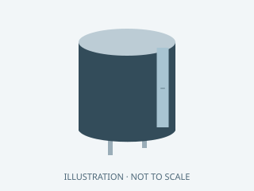

**Original illustration** — Original family illustration, not a photo or a footprint. Package dimensions and terminal layout must be checked against the exact row and datasheet.

Image: HA Radio Hub project · MIT. [Local family illustration](../hardware/parts/illustrations/capacitor.svg).

Package / dimensions: `DIY:Radial_C_P2.54`.

- **D0 DIY • fitted parts:** quantity 2; references `C8, C9`.

[AliExpress search — unverified results](https://www.aliexpress.com/wholesale?SearchText=22uF+capacitor)

Exact BOM row conditions, notes and sources

- **d0:C8:** Fitted to board. 22uF >=10V radial electrolytic, body<=5mm, pin1 positive. Form leads to2.54mm pitch; no adjacent lead shorts.
- **d0:C9:** Fitted to board. 22uF >=10V radial electrolytic, body<=5mm, pin1 positive. Form leads to2.54mm pitch; no adjacent lead shorts.

### 33pF

**Original illustration** — Original family illustration, not a photo or a footprint. Package dimensions and terminal layout must be checked against the exact row and datasheet.

Image: HA Radio Hub project · MIT. [Local family illustration](../hardware/parts/illustrations/capacitor.svg).

Package / dimensions: `Carrier:C_0805_2012Metric`.

- **C0 carrier • fitted parts:** quantity 1; references `C2`.

[AliExpress search — unverified results](https://www.aliexpress.com/wholesale?SearchText=33pF+capacitor+0805)

Exact BOM row conditions, notes and sources

- **c0:C2:** Fitted to board. 10V minimum; C0G crystal caps, X7R bypass/bulk

### 33pF

**Original illustration** — Original family illustration, not a photo or a footprint. Package dimensions and terminal layout must be checked against the exact row and datasheet.

Image: HA Radio Hub project · MIT. [Local family illustration](../hardware/parts/illustrations/capacitor.svg).

Package / dimensions: `Hub:C_0805_2012Metric`.

- **I0 integrated • fitted parts:** quantity 1; references `C2`.

[AliExpress search — unverified results](https://www.aliexpress.com/wholesale?SearchText=33pF+capacitor+0805)

Exact BOM row conditions, notes and sources

- **i0:C2:** Fitted to board. C0G,50V

### 33pF

**Original illustration** — Original family illustration, not a photo or a footprint. Package dimensions and terminal layout must be checked against the exact row and datasheet.

Image: HA Radio Hub project · MIT. [Local family illustration](../hardware/parts/illustrations/capacitor.svg).

Package / dimensions: `DIY:Radial_C_P2.54`.

- **D0 DIY • fitted parts:** quantity 1; references `C2`.

[AliExpress search — unverified results](https://www.aliexpress.com/wholesale?SearchText=33pF+capacitor)

Exact BOM row conditions, notes and sources

- **d0:C2:** Fitted to board. Radial ceramic >=10V, body<=5x3mm, C0G for crystal loads; X7R otherwise. Form leads to2.54mm pitch; no adjacent lead shorts.

### 33pF 50V C0G ceramic

**Original illustration** — Original family illustration, not a photo or a footprint. Package dimensions and terminal layout must be checked against the exact row and datasheet.

Image: HA Radio Hub project · MIT. [Local family illustration](../hardware/parts/illustrations/capacitor.svg).

- **LP-P0 bench reference (not additive):** quantity 1; references `C6`.

[AliExpress search — unverified results](https://www.aliexpress.com/wholesale?SearchText=33pF+50V+C0G+ceramic+capacitor)

Exact BOM row conditions, notes and sources

- **lp-reference:C6:** Reference only; both. XTAL2 to GND; initial NXP example value, not validated for the final PCB. [Official / original source](https://www.nxp.com/docs/en/data-sheet/SC16IS752_SC16IS762.pdf).

### 4.7uF

**Original illustration** — Original family illustration, not a photo or a footprint. Package dimensions and terminal layout must be checked against the exact row and datasheet.

Image: HA Radio Hub project · MIT. [Local family illustration](../hardware/parts/illustrations/capacitor.svg).

Package / dimensions: `Hub:C_0805_2012Metric`.

- **I0 integrated • fitted parts:** quantity 1; references `C30`.

[AliExpress search — unverified results](https://www.aliexpress.com/wholesale?SearchText=4.7uF+capacitor+0805)

Exact BOM row conditions, notes and sources

- **i0:C30:** Fitted to board. X7R,16V; evaluate DC-bias effective capacitance

### 47uF 10V low-ESR bulk capacitor

**Original illustration** — Original family illustration, not a photo or a footprint. Package dimensions and terminal layout must be checked against the exact row and datasheet.

Image: HA Radio Hub project · MIT. [Local family illustration](../hardware/parts/illustrations/capacitor.svg).

- **LP-P0 bench reference (not additive):** quantity 1; references `C4`.

[AliExpress search — unverified results](https://www.aliexpress.com/wholesale?SearchText=47uF+10V+low-ESR+bulk+capacitor+capacitor)

Exact BOM row conditions, notes and sources

- **lp-reference:C4:** Reference only; both. 3.3 V rail bulk capacitor; validate buck startup, stability and transient response. [Official / original source](https://www.pololu.com/product/2857).

### 6.8nF

**Original illustration** — Original family illustration, not a photo or a footprint. Package dimensions and terminal layout must be checked against the exact row and datasheet.

Image: HA Radio Hub project · MIT. [Local family illustration](../hardware/parts/illustrations/capacitor.svg).

Package / dimensions: `Hub:C_0805_2012Metric`.

- **I0 integrated • fitted parts:** quantity 2; references `C34, C35`.

[AliExpress search — unverified results](https://www.aliexpress.com/wholesale?SearchText=6.8nF+capacitor+0805)

Exact BOM row conditions, notes and sources

- **i0:C34:** Fitted to board. X7R,16V; evaluate DC-bias effective capacitance
- **i0:C35:** Fitted to board. X7R,16V; evaluate DC-bias effective capacitance

<strong>Connector: 45 identification cards</strong>

### 0813-1X1T-57-F

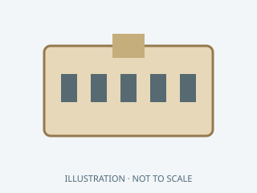

**Original illustration** — Original family illustration, not a photo or a footprint. Package dimensions and terminal layout must be checked against the exact row and datasheet.

Image: HA Radio Hub project · MIT. [Local family illustration](../hardware/parts/illustrations/connector.svg).

Package / dimensions: `Hub:Bel_0813_1X1T_57_F`.

- **I0 integrated • fitted parts:** quantity 1; references `J1`.

[AliExpress search — unverified results](https://www.aliexpress.com/wholesale?SearchText=0813-1X1T-57-F)

Exact BOM row conditions, notes and sources

- **i0:J1:** Fitted to board. PoE-capable magjack. PHY-side common CT. Four cable-side power taps, internal bridge in U7. [Official / original source](https://www.belfuse.com/media/drawings/products/magjack%20ICMs/dr-mag-0813-1x1t-57-f.pdf).

### 40 conductor, 1.27 mm pitch; wire gauge per 61204023021

**Original illustration** — Original family illustration, not a photo or a footprint. Package dimensions and terminal layout must be checked against the exact row and datasheet.

Image: HA Radio Hub project · MIT. [Local family illustration](../hardware/parts/illustrations/connector.svg).

- **C0 carrier • harness / external:** quantity 1; references `IDC ribbon`.

[AliExpress search — unverified results](https://www.aliexpress.com/wholesale?SearchText=40+conductor%2C+1.27+mm+pitch%3B+wire+gauge+per+61204023021)

Exact BOM row conditions, notes and sources

- **c0-harness:IDC ribbon:** Harness / external / service; read row notes. J3 host harness · Start <=100 mm; mate one end IDC, remote end fanout to verified GPIO; strain relief mandatory

### 40conductor1.27mm pitch per61204023021

**Original illustration** — Original family illustration, not a photo or a footprint. Package dimensions and terminal layout must be checked against the exact row and datasheet.

Image: HA Radio Hub project · MIT. [Local family illustration](../hardware/parts/illustrations/connector.svg).

- **D0 DIY • adapters / harness / jumper wire:** quantity 1; references `IDC ribbon`.

[AliExpress search — unverified results](https://www.aliexpress.com/wholesale?SearchText=40conductor1.27mm+pitch+per61204023021)

Exact BOM row conditions, notes and sources

- **d0-harness:IDC ribbon:** Harness / external / service; read row notes. J3 S3 harness · Keep<=50mm initially; follow all interleaved returns; NOT Pi pinout

### 61204021621

**Original illustration** — Original family illustration, not a photo or a footprint. Package dimensions and terminal layout must be checked against the exact row and datasheet.

Image: HA Radio Hub project · MIT. [Local family illustration](../hardware/parts/illustrations/connector.svg).

Package / dimensions: `Carrier:Wurth_61204021621`.

- **C0 carrier • fitted parts:** quantity 1; references `J3`.

[AliExpress search — unverified results](https://www.aliexpress.com/wholesale?SearchText=61204021621)

Exact BOM row conditions, notes and sources

- **c0:J3:** Fitted to board. S3 keyed 40-position IDC harness; NOT Raspberry Pi compatible [Official / original source](https://www.we-online.com/components/products/datasheet/61204021621.pdf).

### 61204021621

**Original illustration** — Original family illustration, not a photo or a footprint. Package dimensions and terminal layout must be checked against the exact row and datasheet.

Image: HA Radio Hub project · MIT. [Local family illustration](../hardware/parts/illustrations/connector.svg).

Package / dimensions: `DIY:Wurth_61204021621`.

- **D0 DIY • fitted parts:** quantity 1; references `J3`.

[AliExpress search — unverified results](https://www.aliexpress.com/wholesale?SearchText=61204021621)

Exact BOM row conditions, notes and sources

- **d0:J3:** Fitted to board. S3 keyed 40-position IDC harness; NOT Raspberry Pi compatible [Official / original source](https://www.we-online.com/components/products/datasheet/61204021621.pdf).

### 61204023021

**Original illustration** — Original family illustration, not a photo or a footprint. Package dimensions and terminal layout must be checked against the exact row and datasheet.

Image: HA Radio Hub project · MIT. [Local family illustration](../hardware/parts/illustrations/connector.svg).

- **C0 carrier • harness / external:** quantity 1; references `J3 mate`.
- **D0 DIY • adapters / harness / jumper wire:** quantity 1; references `J3 mate`.

[AliExpress search — unverified results](https://www.aliexpress.com/wholesale?SearchText=61204023021)

Exact BOM row conditions, notes and sources

- **c0-harness:J3 mate:** Harness / external / service; read row notes. S3 host harness, NOT Raspberry Pi pinout · IDC 40-conductor ribbon; AWG and insulation per mating connector datasheet
- **d0-harness:J3 mate:** Harness / external / service; read row notes. S3 host harness, NOT Raspberry Pi pinout · IDC 40-conductor ribbon; AWG and insulation per mating connector datasheet

### Adafruit 400 extra-long header cut to 1x14, 0.64mm square pins

**Original illustration** — Original family illustration, not a photo or a footprint. Package dimensions and terminal layout must be checked against the exact row and datasheet.

Image: HA Radio Hub project · MIT. [Local family illustration](../hardware/parts/illustrations/connector.svg).

- **D0 DIY • adapters / harness / jumper wire:** quantity 2; references `U1 adapter pins`.

[AliExpress search — unverified results](https://www.aliexpress.com/wholesale?SearchText=Adafruit+400+extra-long+header+cut+to+1x14%2C+0.64mm+square+pins)

Exact BOM row conditions, notes and sources

- **d0-harness:U1 adapter pins:** Harness / external / service; read row notes. Soldered interposer to D0 · Use 2 strips of the 5-pack; 7.73mm pins each side of 2.54mm insulator. Insulator rests on D0; set adapter underside 6mm above D0 and trim tails. Confirm TSSOP pin1

### Adafruit 400 extra-long header cut to 1x3, 0.64mm square pins

**Original illustration** — Original family illustration, not a photo or a footprint. Package dimensions and terminal layout must be checked against the exact row and datasheet.

Image: HA Radio Hub project · MIT. [Local family illustration](../hardware/parts/illustrations/connector.svg).

- **D0 DIY • adapters / harness / jumper wire:** quantity 2; references `U2 adapter pins`.

[AliExpress search — unverified results](https://www.aliexpress.com/wholesale?SearchText=Adafruit+400+extra-long+header+cut+to+1x3%2C+0.64mm+square+pins)

Exact BOM row conditions, notes and sources

- **d0-harness:U2 adapter pins:** Harness / external / service; read row notes. Soldered interposer to D0 · Cut both 3-pin lengths from a third strip of same Adafruit400 5-pack; set adapter underside 6mm above D0. SOT23-6 side up; no reverse-side parts

### B10B-XH-A

**Original illustration** — Original family illustration, not a photo or a footprint. Package dimensions and terminal layout must be checked against the exact row and datasheet.

Image: HA Radio Hub project · MIT. [Local family illustration](../hardware/parts/illustrations/connector.svg).

Package / dimensions: `Carrier:JST_XH_B10B-XH-A_1x10_P2.50mm_Vertical`.

- **C0 carrier • fitted parts:** quantity 1; references `J4`.

[AliExpress search — unverified results](https://www.aliexpress.com/wholesale?SearchText=B10B-XH-A)

Exact BOM row conditions, notes and sources

- **c0:J4:** Fitted to board. WIZ850io Ethernet module [Official / original source](https://www.jst-mfg.com/product/pdf/eng/eXH.pdf).

### B10B-XH-A

**Original illustration** — Original family illustration, not a photo or a footprint. Package dimensions and terminal layout must be checked against the exact row and datasheet.

Image: HA Radio Hub project · MIT. [Local family illustration](../hardware/parts/illustrations/connector.svg).

Package / dimensions: `Connector_JST:JST_XH_B10B-XH-A_1x10_P2.50mm_Vertical`.

- **D0 DIY • fitted parts:** quantity 1; references `J4`.

[AliExpress search — unverified results](https://www.aliexpress.com/wholesale?SearchText=B10B-XH-A)

Exact BOM row conditions, notes and sources

- **d0:J4:** Fitted to board. WIZ850io Ethernet module [Official / original source](https://www.jst-mfg.com/product/pdf/eng/eXH.pdf).

### B2B-XH-A

**Original illustration** — Original family illustration, not a photo or a footprint. Package dimensions and terminal layout must be checked against the exact row and datasheet.

Image: HA Radio Hub project · MIT. [Local family illustration](../hardware/parts/illustrations/connector.svg).

Package / dimensions: `Carrier:JST_XH_B2B-XH-A_1x02_P2.50mm_Vertical`.

- **C0 carrier • fitted parts:** quantity 1; references `J1`.

[AliExpress search — unverified results](https://www.aliexpress.com/wholesale?SearchText=B2B-XH-A)

Exact BOM row conditions, notes and sources

- **c0:J1:** Fitted to board. Isolated regulated 5V input [Official / original source](https://www.jst-mfg.com/product/pdf/eng/eXH.pdf).

### B2B-XH-A

**Original illustration** — Original family illustration, not a photo or a footprint. Package dimensions and terminal layout must be checked against the exact row and datasheet.

Image: HA Radio Hub project · MIT. [Local family illustration](../hardware/parts/illustrations/connector.svg).

Package / dimensions: `Connector_JST:JST_XH_B2B-XH-A_1x02_P2.50mm_Vertical`.

- **D0 DIY • fitted parts:** quantity 1; references `J1`.

[AliExpress search — unverified results](https://www.aliexpress.com/wholesale?SearchText=B2B-XH-A)

Exact BOM row conditions, notes and sources

- **d0:J1:** Fitted to board. Isolated regulated 5V input [Official / original source](https://www.jst-mfg.com/product/pdf/eng/eXH.pdf).

### B3B-XH-A

**Original illustration** — Original family illustration, not a photo or a footprint. Package dimensions and terminal layout must be checked against the exact row and datasheet.

Image: HA Radio Hub project · MIT. [Local family illustration](../hardware/parts/illustrations/connector.svg).

Package / dimensions: `Carrier:JST_XH_B3B-XH-A_1x03_P2.50mm_Vertical`.

- **C0 carrier • fitted parts:** quantity 1; references `J2`.

[AliExpress search — unverified results](https://www.aliexpress.com/wholesale?SearchText=B3B-XH-A)

Exact BOM row conditions, notes and sources

- **c0:J2:** Fitted to board. External D24V22F3 buck [Official / original source](https://www.jst-mfg.com/product/pdf/eng/eXH.pdf).

### B3B-XH-A

**Original illustration** — Original family illustration, not a photo or a footprint. Package dimensions and terminal layout must be checked against the exact row and datasheet.

Image: HA Radio Hub project · MIT. [Local family illustration](../hardware/parts/illustrations/connector.svg).

Package / dimensions: `Connector_JST:JST_XH_B3B-XH-A_1x03_P2.50mm_Vertical`.

- **D0 DIY • fitted parts:** quantity 1; references `J2`.

[AliExpress search — unverified results](https://www.aliexpress.com/wholesale?SearchText=B3B-XH-A)

Exact BOM row conditions, notes and sources

- **d0:J2:** Fitted to board. External D24V22F3 buck [Official / original source](https://www.jst-mfg.com/product/pdf/eng/eXH.pdf).

### B4B-XH-A

**Original illustration** — Original family illustration, not a photo or a footprint. Package dimensions and terminal layout must be checked against the exact row and datasheet.

Image: HA Radio Hub project · MIT. [Local family illustration](../hardware/parts/illustrations/connector.svg).

Package / dimensions: `Carrier:JST_XH_B4B-XH-A_1x04_P2.50mm_Vertical`.

- **C0 carrier • fitted parts:** quantity 1; references `J9`.

[AliExpress search — unverified results](https://www.aliexpress.com/wholesale?SearchText=B4B-XH-A)

Exact BOM row conditions, notes and sources

- **c0:J9:** Fitted to board. LD2450 radar [Official / original source](https://www.jst-mfg.com/product/pdf/eng/eXH.pdf).

### B4B-XH-A

**Original illustration** — Original family illustration, not a photo or a footprint. Package dimensions and terminal layout must be checked against the exact row and datasheet.

Image: HA Radio Hub project · MIT. [Local family illustration](../hardware/parts/illustrations/connector.svg).

Package / dimensions: `Hub:JST_XH_B4B-XH-A_1x04_P2.50mm_Vertical`.

- **I0 integrated • fitted parts:** quantity 1; references `J5`.

[AliExpress search — unverified results](https://www.aliexpress.com/wholesale?SearchText=B4B-XH-A)

Exact BOM row conditions, notes and sources

- **i0:J5:** Fitted to board. LD2450 remote radar [Official / original source](https://www.jst-mfg.com/product/pdf/eng/eXH.pdf).

### B4B-XH-A

**Original illustration** — Original family illustration, not a photo or a footprint. Package dimensions and terminal layout must be checked against the exact row and datasheet.

Image: HA Radio Hub project · MIT. [Local family illustration](../hardware/parts/illustrations/connector.svg).

Package / dimensions: `Connector_JST:JST_XH_B4B-XH-A_1x04_P2.50mm_Vertical`.

- **D0 DIY • fitted parts:** quantity 2; references `J9, J10`.

[AliExpress search — unverified results](https://www.aliexpress.com/wholesale?SearchText=B4B-XH-A)

Exact BOM row conditions, notes and sources

- **d0:J9:** Fitted to board. LD2450 radar [Official / original source](https://www.jst-mfg.com/product/pdf/eng/eXH.pdf).
- **d0:J10:** Fitted to board. TH XH to factory STEMMA QT cable; same logical order as C0, mechanically NOT a QT socket. [Official / original source](https://www.jst-mfg.com/product/pdf/eng/eXH.pdf).

### B5B-XH-A

**Original illustration** — Original family illustration, not a photo or a footprint. Package dimensions and terminal layout must be checked against the exact row and datasheet.

Image: HA Radio Hub project · MIT. [Local family illustration](../hardware/parts/illustrations/connector.svg).

Package / dimensions: `Carrier:JST_XH_B5B-XH-A_1x05_P2.50mm_Vertical`.

- **C0 carrier • fitted parts:** quantity 1; references `J8`.

[AliExpress search — unverified results](https://www.aliexpress.com/wholesale?SearchText=B5B-XH-A)

Exact BOM row conditions, notes and sources

- **c0:J8:** Fitted to board. ZAC93 Z-Wave module [Official / original source](https://www.jst-mfg.com/product/pdf/eng/eXH.pdf).

### B5B-XH-A

**Original illustration** — Original family illustration, not a photo or a footprint. Package dimensions and terminal layout must be checked against the exact row and datasheet.

Image: HA Radio Hub project · MIT. [Local family illustration](../hardware/parts/illustrations/connector.svg).

Package / dimensions: `Hub:JST_XH_B5B-XH-A_1x05_P2.50mm_Vertical`.

- **I0 integrated • fitted parts:** quantity 1; references `J4`.

[AliExpress search — unverified results](https://www.aliexpress.com/wholesale?SearchText=B5B-XH-A)

Exact BOM row conditions, notes and sources

- **i0:J4:** Fitted to board. ZAC93 remote module [Official / original source](https://www.jst-mfg.com/product/pdf/eng/eXH.pdf).

### B5B-XH-A

**Original illustration** — Original family illustration, not a photo or a footprint. Package dimensions and terminal layout must be checked against the exact row and datasheet.

Image: HA Radio Hub project · MIT. [Local family illustration](../hardware/parts/illustrations/connector.svg).

Package / dimensions: `Connector_JST:JST_XH_B5B-XH-A_1x05_P2.50mm_Vertical`.

- **D0 DIY • fitted parts:** quantity 1; references `J8`.

[AliExpress search — unverified results](https://www.aliexpress.com/wholesale?SearchText=B5B-XH-A)

Exact BOM row conditions, notes and sources

- **d0:J8:** Fitted to board. ZAC93 Z-Wave module [Official / original source](https://www.jst-mfg.com/product/pdf/eng/eXH.pdf).

### B6B-XH-A

**Original illustration** — Original family illustration, not a photo or a footprint. Package dimensions and terminal layout must be checked against the exact row and datasheet.

Image: HA Radio Hub project · MIT. [Local family illustration](../hardware/parts/illustrations/connector.svg).

Package / dimensions: `Carrier:JST_XH_B6B-XH-A_1x06_P2.50mm_Vertical`.

- **C0 carrier • fitted parts:** quantity 1; references `J6`.
- **M0 MG24 adapter • fitted parts:** quantity 1; references `J1`.

[AliExpress search — unverified results](https://www.aliexpress.com/wholesale?SearchText=B6B-XH-A)

Exact BOM row conditions, notes and sources

- **c0:J6:** Fitted to board. MG24 Zigbee NCP [Official / original source](https://www.jst-mfg.com/product/pdf/eng/eXH.pdf).
- **m0:J1:** Fitted to board. To carrier J6 [Official / original source](https://www.jst-mfg.com/product/pdf/eng/eXH.pdf).

### B6B-XH-A

**Original illustration** — Original family illustration, not a photo or a footprint. Package dimensions and terminal layout must be checked against the exact row and datasheet.

Image: HA Radio Hub project · MIT. [Local family illustration](../hardware/parts/illustrations/connector.svg).

Package / dimensions: `Hub:JST_XH_B6B-XH-A_1x06_P2.50mm_Vertical`.

- **I0 integrated • fitted parts:** quantity 2; references `J7, J8`.

[AliExpress search — unverified results](https://www.aliexpress.com/wholesale?SearchText=B6B-XH-A)

Exact BOM row conditions, notes and sources

- **i0:J7:** Fitted to board. MG24 service SWD/boot [Official / original source](https://www.jst-mfg.com/product/pdf/eng/eXH.pdf).
- **i0:J8:** Fitted to board. H2 service UART/boot [Official / original source](https://www.jst-mfg.com/product/pdf/eng/eXH.pdf).

### B6B-XH-A

**Original illustration** — Original family illustration, not a photo or a footprint. Package dimensions and terminal layout must be checked against the exact row and datasheet.

Image: HA Radio Hub project · MIT. [Local family illustration](../hardware/parts/illustrations/connector.svg).

Package / dimensions: `Connector_JST:JST_XH_B6B-XH-A_1x06_P2.50mm_Vertical`.

- **D0 DIY • fitted parts:** quantity 1; references `J6`.

[AliExpress search — unverified results](https://www.aliexpress.com/wholesale?SearchText=B6B-XH-A)

Exact BOM row conditions, notes and sources

- **d0:J6:** Fitted to board. MG24 Zigbee NCP [Official / original source](https://www.jst-mfg.com/product/pdf/eng/eXH.pdf).

### B7B-XH-A

**Original illustration** — Original family illustration, not a photo or a footprint. Package dimensions and terminal layout must be checked against the exact row and datasheet.

Image: HA Radio Hub project · MIT. [Local family illustration](../hardware/parts/illustrations/connector.svg).

Package / dimensions: `Carrier:JST_XH_B7B-XH-A_1x07_P2.50mm_Vertical`.

- **C0 carrier • fitted parts:** quantity 1; references `J5`.
- **M0 MG24 adapter • fitted parts:** quantity 1; references `J2`.

[AliExpress search — unverified results](https://www.aliexpress.com/wholesale?SearchText=B7B-XH-A)

Exact BOM row conditions, notes and sources

- **c0:J5:** Fitted to board. H2 Thread RCP [Official / original source](https://www.jst-mfg.com/product/pdf/eng/eXH.pdf).
- **m0:J2:** Fitted to board. SWD / reset / boot service [Official / original source](https://www.jst-mfg.com/product/pdf/eng/eXH.pdf).

### B7B-XH-A

**Original illustration** — Original family illustration, not a photo or a footprint. Package dimensions and terminal layout must be checked against the exact row and datasheet.

Image: HA Radio Hub project · MIT. [Local family illustration](../hardware/parts/illustrations/connector.svg).

Package / dimensions: `Connector_JST:JST_XH_B7B-XH-A_1x07_P2.50mm_Vertical`.

- **D0 DIY • fitted parts:** quantity 1; references `J5`.

[AliExpress search — unverified results](https://www.aliexpress.com/wholesale?SearchText=B7B-XH-A)

Exact BOM row conditions, notes and sources

- **d0:J5:** Fitted to board. H2 Thread RCP [Official / original source](https://www.jst-mfg.com/product/pdf/eng/eXH.pdf).

### B8B-XH-A

**Original illustration** — Original family illustration, not a photo or a footprint. Package dimensions and terminal layout must be checked against the exact row and datasheet.

Image: HA Radio Hub project · MIT. [Local family illustration](../hardware/parts/illustrations/connector.svg).

Package / dimensions: `Carrier:JST_XH_B8B-XH-A_1x08_P2.50mm_Vertical`.

- **C0 carrier • fitted parts:** quantity 1; references `J7`.

[AliExpress search — unverified results](https://www.aliexpress.com/wholesale?SearchText=B8B-XH-A)

Exact BOM row conditions, notes and sources

- **c0:J7:** Fitted to board. CC1101 RF module [Official / original source](https://www.jst-mfg.com/product/pdf/eng/eXH.pdf).

### B8B-XH-A

**Original illustration** — Original family illustration, not a photo or a footprint. Package dimensions and terminal layout must be checked against the exact row and datasheet.

Image: HA Radio Hub project · MIT. [Local family illustration](../hardware/parts/illustrations/connector.svg).

Package / dimensions: `Hub:JST_XH_B8B-XH-A_1x08_P2.50mm_Vertical`.

- **I0 integrated • fitted parts:** quantity 1; references `J3`.

[AliExpress search — unverified results](https://www.aliexpress.com/wholesale?SearchText=B8B-XH-A)

Exact BOM row conditions, notes and sources

- **i0:J3:** Fitted to board. CC1101 remote RF module [Official / original source](https://www.jst-mfg.com/product/pdf/eng/eXH.pdf).

### B8B-XH-A

**Original illustration** — Original family illustration, not a photo or a footprint. Package dimensions and terminal layout must be checked against the exact row and datasheet.

Image: HA Radio Hub project · MIT. [Local family illustration](../hardware/parts/illustrations/connector.svg).

Package / dimensions: `Connector_JST:JST_XH_B8B-XH-A_1x08_P2.50mm_Vertical`.

- **D0 DIY • fitted parts:** quantity 1; references `J7`.

[AliExpress search — unverified results](https://www.aliexpress.com/wholesale?SearchText=B8B-XH-A)

Exact BOM row conditions, notes and sources

- **d0:J7:** Fitted to board. CC1101 RF module [Official / original source](https://www.jst-mfg.com/product/pdf/eng/eXH.pdf).

### BM04B-SRSS-TB

**Original illustration** — Original family illustration, not a photo or a footprint. Package dimensions and terminal layout must be checked against the exact row and datasheet.

Image: HA Radio Hub project · MIT. [Local family illustration](../hardware/parts/illustrations/connector.svg).

Package / dimensions: `Carrier:JST_SH_BM04B-SRSS-TB_1x04-1MP_P1.00mm_Vertical`.

- **C0 carrier • fitted parts:** quantity 1; references `J10`.

[AliExpress search — unverified results](https://www.aliexpress.com/wholesale?SearchText=BM04B-SRSS-TB)

Exact BOM row conditions, notes and sources

- **c0:J10:** Fitted to board. STEMMA QT: 3.3V only; BME680 external ventilated pod [Official / original source](https://www.jst-mfg.com/product/pdf/eng/eSH.pdf).

### BM04B-SRSS-TB

**Original illustration** — Original family illustration, not a photo or a footprint. Package dimensions and terminal layout must be checked against the exact row and datasheet.

Image: HA Radio Hub project · MIT. [Local family illustration](../hardware/parts/illustrations/connector.svg).

Package / dimensions: `Hub:JST_SH_BM04B-SRSS-TB_1x04-1MP_P1.00mm_Vertical`.

- **I0 integrated • fitted parts:** quantity 1; references `J6`.

[AliExpress search — unverified results](https://www.aliexpress.com/wholesale?SearchText=BM04B-SRSS-TB)

Exact BOM row conditions, notes and sources

- **i0:J6:** Fitted to board. Standard QT order; breakout pullups only; short external ambient sensor cable. [Official / original source](https://www.jst-mfg.com/product/pdf/eng/eSH.pdf).

### I0 JST XH harness housings: XHP-8, XHP-5, XHP-4, 2 × XHP-6

**Original illustration** — Original family illustration, not a photo or a footprint. Package dimensions and terminal layout must be checked against the exact row and datasheet.

Image: HA Radio Hub project · MIT. [Local family illustration](../hardware/parts/illustrations/connector.svg).

- **Additional / reusable / conditional:** quantity 1 set; references `i0-harness`.

[AliExpress search — unverified results](https://www.aliexpress.com/wholesale?SearchText=I0+JST+XH+harness+housings%3A+XHP-8%2C+XHP-5%2C+XHP-4%2C+2+%C3%97+XHP-6)

Exact BOM row conditions, notes and sources

- **accessory:i0-harness:** I0 external harness / service. Matches J3–J5 and service J7/J8: 29 SXH-001T-P0.6 contacts total when all are populated; service harnesses can be shared. J6 uses a separate precrimped 4-pin QT cable. Use connector pin atlas, not wire colors. [Official / original source](https://www.jst-mfg.com/product/pdf/eng/eXH.pdf).

### JST SXH-001T-P0.6

**Original illustration** — Original family illustration, not a photo or a footprint. Package dimensions and terminal layout must be checked against the exact row and datasheet.

Image: HA Radio Hub project · MIT. [Local family illustration](../hardware/parts/illustrations/connector.svg).

- **C0 carrier • harness / external:** quantity 45; references `XH crimp contacts`.
- **M0 MG24 adapter • harness:** quantity 13; references `J1 contacts, J2 contacts`.
- **D0 DIY • adapters / harness / jumper wire:** quantity 49; references `XH crimp contacts`.

[AliExpress search — unverified results](https://www.aliexpress.com/wholesale?SearchText=JST+SXH-001T-P0.6)

Exact BOM row conditions, notes and sources

- **c0-harness:XH crimp contacts:** Harness / external / service; read row notes. All eight JST XH cable housings · Buy spare contacts; AWG 28-22, use 22 AWG for J1/J2; manufacturer crimp tooling or verified precrimp leads
- **m0-harness:J1 contacts:** Harness / external / service; read row notes. Adapter end only · AWG28-22; verify crimp and continuity before power
- **m0-harness:J2 contacts:** Harness / external / service; read row notes. Service end only · VTref is sense only; RESET sink only
- **d0-harness:XH crimp contacts:** Harness / external / service; read row notes. Nine XH cable housings · Buy spare contacts; 22AWG power,26AWG logic; factory precrimp leads acceptable

### JST XHP-6

**Original illustration** — Original family illustration, not a photo or a footprint. Package dimensions and terminal layout must be checked against the exact row and datasheet.

Image: HA Radio Hub project · MIT. [Local family illustration](../hardware/parts/illustrations/connector.svg).

- **M0 MG24 adapter • harness:** quantity 1; references `J1 adapter cable end`.

[AliExpress search — unverified results](https://www.aliexpress.com/wholesale?SearchText=JST+XHP-6)

Exact BOM row conditions, notes and sources

- **m0-harness:J1 adapter cable end:** Harness / external / service; read row notes. Straight cable to C0 J6 · The other XHP-6 is counted in C0 harness BOM

### JST XHP-7

**Original illustration** — Original family illustration, not a photo or a footprint. Package dimensions and terminal layout must be checked against the exact row and datasheet.

Image: HA Radio Hub project · MIT. [Local family illustration](../hardware/parts/illustrations/connector.svg).

- **M0 MG24 adapter • harness:** quantity 1; references `J2 service cable end`.

[AliExpress search — unverified results](https://www.aliexpress.com/wholesale?SearchText=JST+XHP-7)

Exact BOM row conditions, notes and sources

- **m0-harness:J2 service cable end:** Harness / external / service; read row notes. SWD and boot service · Optional if shared production fixture connects directly

### SHR-04V-S

**Original illustration** — Original family illustration, not a photo or a footprint. Package dimensions and terminal layout must be checked against the exact row and datasheet.

Image: HA Radio Hub project · MIT. [Local family illustration](../hardware/parts/illustrations/connector.svg).

- **C0 carrier • harness / external:** quantity 1; references `J10 mate`.

[AliExpress search — unverified results](https://www.aliexpress.com/wholesale?SearchText=SHR-04V-S)

Exact BOM row conditions, notes and sources

- **c0-harness:J10 mate:** Harness / external / service; read row notes. BME680 STEMMA QT · SSH-003T-P0.2-H; prefer precrimped 100mm Adafruit 4210 cable

### Same Sky PP3-002A plus20AWG pair from C7

**Original illustration** — Original family illustration, not a photo or a footprint. Package dimensions and terminal layout must be checked against the exact row and datasheet.

Image: HA Radio Hub project · MIT. [Local family illustration](../hardware/parts/illustrations/connector.svg).

Package / dimensions: `plug34x8.2;insertion9.5;wire150-250`.

- **Original Pi modular hub:** quantity 1; references `C17`.

[AliExpress search — unverified results](https://www.aliexpress.com/wholesale?SearchText=Same+Sky+PP3-002A+plus20AWG+pair+from+C7)

Exact BOM row conditions, notes and sources

- **modular:C17:** common. Pi source plug and short wire pair · Plug6A20V rating;used at5V;centerpositive · 5.5OD2.1ID mates C3;fused5V to center andGND outer;solder and insulate;plug rating does not rate Adafruit4536 or completeharness;not switchplug C11 [Official / original source](https://www.sameskydevices.com/product/resource/pp3-002a.pdf).

### TYPE-C-31-M-12

**Original illustration** — Original family illustration, not a photo or a footprint. Package dimensions and terminal layout must be checked against the exact row and datasheet.

Image: HA Radio Hub project · MIT. [Local family illustration](../hardware/parts/illustrations/connector.svg).

Package / dimensions: `Hub:USB_C_Receptacle_HRO_TYPE-C-31-M-12`.

- **I0 integrated • fitted parts:** quantity 1; references `J2`.

[AliExpress search — unverified results](https://www.aliexpress.com/wholesale?SearchText=TYPE-C-31-M-12)

Exact BOM row conditions, notes and sources

- **i0:J2:** Fitted to board. Self-powered USB service only. VBUS feeds ESD reference; never tied to PoE5V. [Official / original source](https://www.hroelec.com/UploadFiles/2017/04/TYPE-C-31-M-12.pdf).

### XHP-10

**Original illustration** — Original family illustration, not a photo or a footprint. Package dimensions and terminal layout must be checked against the exact row and datasheet.

Image: HA Radio Hub project · MIT. [Local family illustration](../hardware/parts/illustrations/connector.svg).

- **C0 carrier • harness / external:** quantity 1; references `J4 mate`.
- **D0 DIY • adapters / harness / jumper wire:** quantity 1; references `J4 mate`.

[AliExpress search — unverified results](https://www.aliexpress.com/wholesale?SearchText=XHP-10)

Exact BOM row conditions, notes and sources

- **c0-harness:J4 mate:** Harness / external / service; read row notes. WIZ850io Ethernet module · SXH-001T-P0.6
- **d0-harness:J4 mate:** Harness / external / service; read row notes. WIZ850io Ethernet module · SXH-001T-P0.6

### XHP-2

**Original illustration** — Original family illustration, not a photo or a footprint. Package dimensions and terminal layout must be checked against the exact row and datasheet.

Image: HA Radio Hub project · MIT. [Local family illustration](../hardware/parts/illustrations/connector.svg).

- **C0 carrier • harness / external:** quantity 1; references `J1 mate`.
- **D0 DIY • adapters / harness / jumper wire:** quantity 1; references `J1 mate`.

[AliExpress search — unverified results](https://www.aliexpress.com/wholesale?SearchText=XHP-2)

Exact BOM row conditions, notes and sources

- **c0-harness:J1 mate:** Harness / external / service; read row notes. Isolated regulated 5V input · SXH-001T-P0.6
- **d0-harness:J1 mate:** Harness / external / service; read row notes. Isolated regulated 5V input · SXH-001T-P0.6

### XHP-3

**Original illustration** — Original family illustration, not a photo or a footprint. Package dimensions and terminal layout must be checked against the exact row and datasheet.

Image: HA Radio Hub project · MIT. [Local family illustration](../hardware/parts/illustrations/connector.svg).

- **C0 carrier • harness / external:** quantity 1; references `J2 mate`.
- **D0 DIY • adapters / harness / jumper wire:** quantity 1; references `J2 mate`.

[AliExpress search — unverified results](https://www.aliexpress.com/wholesale?SearchText=XHP-3)

Exact BOM row conditions, notes and sources

- **c0-harness:J2 mate:** Harness / external / service; read row notes. External D24V22F3 buck · SXH-001T-P0.6
- **d0-harness:J2 mate:** Harness / external / service; read row notes. External D24V22F3 buck · SXH-001T-P0.6

### XHP-4

**Original illustration** — Original family illustration, not a photo or a footprint. Package dimensions and terminal layout must be checked against the exact row and datasheet.

Image: HA Radio Hub project · MIT. [Local family illustration](../hardware/parts/illustrations/connector.svg).

- **C0 carrier • harness / external:** quantity 1; references `J9 mate`.
- **D0 DIY • adapters / harness / jumper wire:** quantity 2; references `J9 mate, J10 mate`.

[AliExpress search — unverified results](https://www.aliexpress.com/wholesale?SearchText=XHP-4)

Exact BOM row conditions, notes and sources

- **c0-harness:J9 mate:** Harness / external / service; read row notes. LD2450 radar · SXH-001T-P0.6
- **d0-harness:J9 mate:** Harness / external / service; read row notes. LD2450 radar · SXH-001T-P0.6
- **d0-harness:J10 mate:** Harness / external / service; read row notes. BME680 via XH-to-factory-QT cable; NOT direct QT · SXH-001T-P0.6

### XHP-5

**Original illustration** — Original family illustration, not a photo or a footprint. Package dimensions and terminal layout must be checked against the exact row and datasheet.

Image: HA Radio Hub project · MIT. [Local family illustration](../hardware/parts/illustrations/connector.svg).

- **C0 carrier • harness / external:** quantity 1; references `J8 mate`.
- **D0 DIY • adapters / harness / jumper wire:** quantity 1; references `J8 mate`.

[AliExpress search — unverified results](https://www.aliexpress.com/wholesale?SearchText=XHP-5)

Exact BOM row conditions, notes and sources

- **c0-harness:J8 mate:** Harness / external / service; read row notes. ZAC93 Z-Wave module · SXH-001T-P0.6
- **d0-harness:J8 mate:** Harness / external / service; read row notes. ZAC93 Z-Wave module · SXH-001T-P0.6

### XHP-6

**Original illustration** — Original family illustration, not a photo or a footprint. Package dimensions and terminal layout must be checked against the exact row and datasheet.

Image: HA Radio Hub project · MIT. [Local family illustration](../hardware/parts/illustrations/connector.svg).

- **C0 carrier • harness / external:** quantity 1; references `J6 mate`.
- **D0 DIY • adapters / harness / jumper wire:** quantity 1; references `J6 mate`.

[AliExpress search — unverified results](https://www.aliexpress.com/wholesale?SearchText=XHP-6)

Exact BOM row conditions, notes and sources

- **c0-harness:J6 mate:** Harness / external / service; read row notes. MG24 Zigbee NCP to M0 J1 · SXH-001T-P0.6; second cable end counted in M0 harness BOM
- **d0-harness:J6 mate:** Harness / external / service; read row notes. MG24 Zigbee NCP · SXH-001T-P0.6

### XHP-7

**Original illustration** — Original family illustration, not a photo or a footprint. Package dimensions and terminal layout must be checked against the exact row and datasheet.

Image: HA Radio Hub project · MIT. [Local family illustration](../hardware/parts/illustrations/connector.svg).

- **C0 carrier • harness / external:** quantity 1; references `J5 mate`.
- **D0 DIY • adapters / harness / jumper wire:** quantity 1; references `J5 mate`.

[AliExpress search — unverified results](https://www.aliexpress.com/wholesale?SearchText=XHP-7)

Exact BOM row conditions, notes and sources

- **c0-harness:J5 mate:** Harness / external / service; read row notes. H2 Thread RCP · SXH-001T-P0.6
- **d0-harness:J5 mate:** Harness / external / service; read row notes. H2 Thread RCP · SXH-001T-P0.6

### XHP-8

**Original illustration** — Original family illustration, not a photo or a footprint. Package dimensions and terminal layout must be checked against the exact row and datasheet.

Image: HA Radio Hub project · MIT. [Local family illustration](../hardware/parts/illustrations/connector.svg).

- **C0 carrier • harness / external:** quantity 1; references `J7 mate`.
- **D0 DIY • adapters / harness / jumper wire:** quantity 1; references `J7 mate`.

[AliExpress search — unverified results](https://www.aliexpress.com/wholesale?SearchText=XHP-8)

Exact BOM row conditions, notes and sources

- **c0-harness:J7 mate:** Harness / external / service; read row notes. CC1101 RF module · SXH-001T-P0.6
- **d0-harness:J7 mate:** Harness / external / service; read row notes. CC1101 RF module · SXH-001T-P0.6

<strong>Crystal: 5 identification cards</strong>

### AB-3.6864MHZ-B2

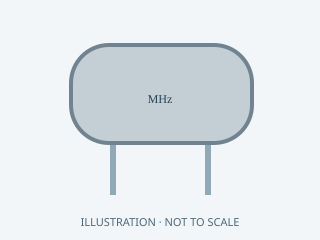

**Original illustration** — Original family illustration, not a photo or a footprint. Package dimensions and terminal layout must be checked against the exact row and datasheet.

Image: HA Radio Hub project · MIT. [Local family illustration](../hardware/parts/illustrations/crystal.svg).

Package / dimensions: `DIY:HC49U`.

- **D0 DIY • fitted parts:** quantity 1; references `Y1`.

[AliExpress search — unverified results](https://www.aliexpress.com/wholesale?SearchText=AB-3.6864MHZ-B2)

Exact BOM row conditions, notes and sources

- **d0:Y1:** Fitted to board. Through-hole HC49/U 3.6864MHz18pF; 4.88mm lead pitch; initial22/33pF loads, validate oscillation/frequency on hardware. [Official / original source](https://abracon.com/Resonators/ab.pdf).

### ABLS-3.6864MHZ-B2-T

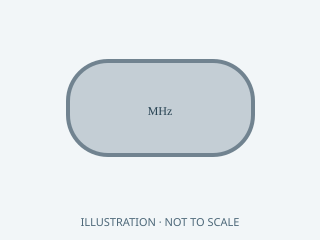

**Original illustration** — Original family illustration, not a photo or a footprint. Package dimensions and terminal layout must be checked against the exact row and datasheet.

Image: HA Radio Hub project · MIT. [Local family illustration](../hardware/parts/illustrations/crystal.svg).

Package / dimensions: `Carrier:Crystal_SMD_HC49-SD`.

- **C0 carrier • fitted parts:** quantity 1; references `Y1`.

[AliExpress search — unverified results](https://www.aliexpress.com/wholesale?SearchText=ABLS-3.6864MHZ-B2-T)

Exact BOM row conditions, notes and sources

- **c0:Y1:** Fitted to board. 18pF CL, initial load caps22pF/33pF; verify frequency/drive on bench [Official / original source](https://abracon.com/Resonators/abls.pdf).

### ABLS-3.6864MHZ-B2-T

**Original illustration** — Original family illustration, not a photo or a footprint. Package dimensions and terminal layout must be checked against the exact row and datasheet.

Image: HA Radio Hub project · MIT. [Local family illustration](../hardware/parts/illustrations/crystal.svg).

Package / dimensions: `Hub:Crystal_SMD_HC49-SD`.

- **I0 integrated • fitted parts:** quantity 1; references `Y1`.

[AliExpress search — unverified results](https://www.aliexpress.com/wholesale?SearchText=ABLS-3.6864MHZ-B2-T)

Exact BOM row conditions, notes and sources

- **i0:Y1:** Fitted to board. 18pF load; verify measured frequency and drive. [Official / original source](https://www.nxp.com/docs/en/data-sheet/SC16IS752_SC16IS762.pdf).

### ABM8-25.000MHZ-B2-T

**Original illustration** — Original family illustration, not a photo or a footprint. Package dimensions and terminal layout must be checked against the exact row and datasheet.

Image: HA Radio Hub project · MIT. [Local family illustration](../hardware/parts/illustrations/crystal.svg).

Package / dimensions: `Hub:Crystal_SMD_3225-4Pin_3.2x2.5mm`.

- **I0 integrated • fitted parts:** quantity 1; references `Y2`.

[AliExpress search — unverified results](https://www.aliexpress.com/wholesale?SearchText=ABM8-25.000MHZ-B2-T)

Exact BOM row conditions, notes and sources

- **i0:Y2:** Fitted to board. 25MHz,18pF load,<=50ppm total; verify crystal ordering specification.

### Abracon ABLS-3.6864MHZ-B2-T

**Original illustration** — Original family illustration, not a photo or a footprint. Package dimensions and terminal layout must be checked against the exact row and datasheet.

Image: HA Radio Hub project · MIT. [Local family illustration](../hardware/parts/illustrations/crystal.svg).

Package / dimensions: `11.4 × 4.7 × 4.2 mm`.

- **LP-P0 bench reference (not additive):** quantity 1; references `Y1`.

[AliExpress search — unverified results](https://www.aliexpress.com/wholesale?SearchText=Abracon+ABLS-3.6864MHZ-B2-T)

Exact BOM row conditions, notes and sources

- **lp-reference:Y1:** Reference only; both. 18 pF load, 180 ohm ESR. Clock prescaler 1 and divisor 2. Measure oscillation, startup and baud rate. [Official / original source](https://abracon.com/parametric/crystals/ABLS-3.6864MHZ-B2-T).

<strong>Diode: 2 identification cards</strong>

### SMBJ58CA

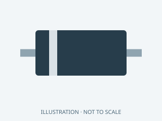

**Original illustration** — Original family illustration, not a photo or a footprint. Package dimensions and terminal layout must be checked against the exact row and datasheet.

Image: HA Radio Hub project · MIT. [Local family illustration](../hardware/parts/illustrations/diode.svg).

Package / dimensions: `Hub:D_SMB`.

- **I0 integrated • fitted parts:** quantity 2; references `D1, D2`.

[AliExpress search — unverified results](https://www.aliexpress.com/wholesale?SearchText=SMBJ58CA)

Exact BOM row conditions, notes and sources

- **i0:D1:** Fitted to board. Bidirectional58V TVS across input bridge pair; select surge rating during qualification.
- **i0:D2:** Fitted to board. Bidirectional58V TVS across input bridge pair; select surge rating during qualification.

### USBLC6-2SC6

**Original illustration** — Original family illustration, not a photo or a footprint. Package dimensions and terminal layout must be checked against the exact row and datasheet.

Image: HA Radio Hub project · MIT. [Local family illustration](../hardware/parts/illustrations/diode.svg).

Package / dimensions: `Hub:SOT-23-6`.

- **I0 integrated • fitted parts:** quantity 1; references `U9`.

[AliExpress search — unverified results](https://www.aliexpress.com/wholesale?SearchText=USBLC6-2SC6)

Exact BOM row conditions, notes and sources

- **i0:U9:** Fitted to board. Low-capacitance ESD near USB; VBUS not board supply. [Official / original source](https://www.st.com/resource/en/datasheet/usblc6-2.pdf).

<strong>Enclosure: 2 identification cards</strong>

### PETG or ASA shell plus removable deck

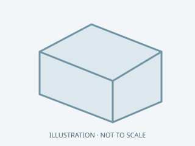

**Original illustration** — Original family illustration, not a photo or a footprint. Package dimensions and terminal layout must be checked against the exact row and datasheet.

Image: HA Radio Hub project · MIT. [Local family illustration](../hardware/parts/illustrations/enclosure.svg).

Package / dimensions: `240x200x80`.

- **Original Pi modular hub:** quantity 1; references `M1`.

[Project enclosure files — print / fabricate](../mechanical/README.md)

Exact BOM row conditions, notes and sources

- **modular:M1:** common. Printed enclosure · not_fire_certified · Measure all connectors before final print;filament estimate only

### Vented removable BME680 pod

**Original illustration** — Original family illustration, not a photo or a footprint. Package dimensions and terminal layout must be checked against the exact row and datasheet.

Image: HA Radio Hub project · MIT. [Local family illustration](../hardware/parts/illustrations/enclosure.svg).

Package / dimensions: `approximately45x36x20`.

- **Original Pi modular hub:** quantity 1; references `M2`.

[Project enclosure files — print / fabricate](../mechanical/README.md)

Exact BOM row conditions, notes and sources

- **modular:M2:** common. Sensor pod · Install away from warm exhaust;no sealed pocket

<strong>Fuse: 6 identification cards</strong>

### 044901.5MR

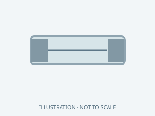

**Original illustration** — Original family illustration, not a photo or a footprint. Package dimensions and terminal layout must be checked against the exact row and datasheet.

Image: HA Radio Hub project · MIT. [Local family illustration](../hardware/parts/illustrations/fuse.svg).

Package / dimensions: `Carrier:Littelfuse_449`.

- **C0 carrier • fitted parts:** quantity 1; references `F1`.

[AliExpress search — unverified results](https://www.aliexpress.com/wholesale?SearchText=044901.5MR)

Exact BOM row conditions, notes and sources

- **c0:F1:** Fitted to board. 1.5A time-delay; design <=1.0A continuous at 5V, temperature derating applies [Official / original source](https://www.littelfuse.com/assetdocs/fuses-449-datasheet?assetguid=7aef6e93-9808-456e-9bee-fba54271285f).

### 044901.5MR

**Original illustration** — Original family illustration, not a photo or a footprint. Package dimensions and terminal layout must be checked against the exact row and datasheet.

Image: HA Radio Hub project · MIT. [Local family illustration](../hardware/parts/illustrations/fuse.svg).

Package / dimensions: `Hub:Littelfuse_449`.

- **I0 integrated • fitted parts:** quantity 1; references `F1`.

[AliExpress search — unverified results](https://www.aliexpress.com/wholesale?SearchText=044901.5MR)

Exact BOM row conditions, notes and sources

- **i0:F1:** Fitted to board. 1.5A time-delay secondary fuse,<=1A continuous5V load; verify derating.

### 1.5 A time-delay fuse and rated holder

**Original illustration** — Original family illustration, not a photo or a footprint. Package dimensions and terminal layout must be checked against the exact row and datasheet.

Image: HA Radio Hub project · MIT. [Local family illustration](../hardware/parts/illustrations/fuse.svg).

- **LP-P0 bench reference (not additive):** quantity 1; references `F1`.

[AliExpress search — unverified results](https://www.aliexpress.com/wholesale?SearchText=1.5+A+time-delay+fuse+and+rated+holder)

Exact BOM row conditions, notes and sources

- **lp-reference:F1:** Reference only; both. Candidate for the 5 V secondary distribution. Validate cold start, I-squared-t and wire gauge. PD short-circuit protection does not validate branch wiring. [Official / original source](https://silvertel.com/images/datasheets/Ag97000-Datasheet-low-cost-isolated-12W-Power-over-Ethernet-PoE-module-solution.pdf).

### 6 insulated holders:fused input plus5branches

**Original illustration** — Original family illustration, not a photo or a footprint. Package dimensions and terminal layout must be checked against the exact row and datasheet.

Image: HA Radio Hub project · MIT. [Local family illustration](../hardware/parts/illustrations/fuse.svg).

Package / dimensions: `layout_dependent`.

- **Original Pi modular hub:** quantity 1; references `F1`.

[AliExpress search — unverified results](https://www.aliexpress.com/wholesale?SearchText=6+insulated+holders%3Afused+input+plus5branches)

Exact BOM row conditions, notes and sources

- **modular:F1:** common. Fuse and holder set · DC rated;verify_inrush · Pi3A;switch1A;mainS3 1A;RF S3 1A or NodeMCU0.75A;radar0.25-0.5A;input fuse<=5A;final DC rating I2t and inrush selection pending

### Littelfuse 022901.5MXP

**Original illustration** — Original family illustration, not a photo or a footprint. Package dimensions and terminal layout must be checked against the exact row and datasheet.

Image: HA Radio Hub project · MIT. [Local family illustration](../hardware/parts/illustrations/fuse.svg).

Package / dimensions: `DIY:FuseHarness`.

- **D0 DIY • fitted parts:** quantity 1; references `F1`.

[AliExpress search — unverified results](https://www.aliexpress.com/wholesale?SearchText=Littelfuse+022901.5MXP)

Exact BOM row conditions, notes and sources

- **d0:F1:** Fitted to board. 1.5A slow-blow 2AG cartridge in external01500274Z holder. Holder leads adapt to22AWG at F1 holes; insulate splices. <=1A continuous design. Do not bridge. [Official / original source](https://www.littelfuse.com/assetdocs/powr-gard-catalog?assetguid=85d36235-a32b-4608-bfed-f9878aa43af0).

### Littelfuse01500274Z in-line2AG/5x20 holder

**Original illustration** — Original family illustration, not a photo or a footprint. Package dimensions and terminal layout must be checked against the exact row and datasheet.

Image: HA Radio Hub project · MIT. [Local family illustration](../hardware/parts/illustrations/fuse.svg).

- **D0 DIY • adapters / harness / jumper wire:** quantity 1; references `F1 fuseholder`.

[AliExpress search — unverified results](https://www.aliexpress.com/wholesale?SearchText=Littelfuse01500274Z+in-line2AG%2F5x20+holder)

Exact BOM row conditions, notes and sources

- **d0-harness:F1 fuseholder:** Harness / external / service; read row notes. External insulated holder for F1 · 16AWG factory leads; splice to22AWG tails for1.1mm F1 holes; insulate and strain-relieve. Do not omit fuse

<strong>Hardware: 4 identification cards</strong>

### M2 nonconductive standoff and fastener sets

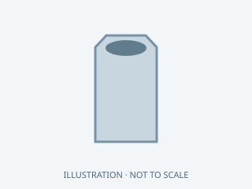

**Original illustration** — Original family illustration, not a photo or a footprint. Package dimensions and terminal layout must be checked against the exact row and datasheet.

Image: HA Radio Hub project · MIT. [Local family illustration](../hardware/parts/illustrations/hardware.svg).

- **M0 MG24 adapter • harness:** quantity 4; references `Mounting hardware`.

[AliExpress search — unverified results](https://www.aliexpress.com/wholesale?SearchText=M2+nonconductive+standoff+and+fastener+sets)

Exact BOM row conditions, notes and sources

- **m0-harness:Mounting hardware:** Harness / external / service; read row notes. 2.2mm NPTH · Choose length after enclosure and antenna clearance review

### M3 insulating standoff + fastener sets

**Original illustration** — Original family illustration, not a photo or a footprint. Package dimensions and terminal layout must be checked against the exact row and datasheet.

Image: HA Radio Hub project · MIT. [Local family illustration](../hardware/parts/illustrations/hardware.svg).

- **C0 carrier • harness / external:** quantity 4; references `Mounting hardware`.

[AliExpress search — unverified results](https://www.aliexpress.com/wholesale?SearchText=M3+insulating+standoff+%2B+fastener+sets)

Exact BOM row conditions, notes and sources

- **c0-harness:Mounting hardware:** Harness / external / service; read row notes. Carrier NPTH holes · Choose height for actual enclosure; board does not fit old case pattern

### M3 insulating standoff and fastener set

**Original illustration** — Original family illustration, not a photo or a footprint. Package dimensions and terminal layout must be checked against the exact row and datasheet.

Image: HA Radio Hub project · MIT. [Local family illustration](../hardware/parts/illustrations/hardware.svg).

- **D0 DIY • adapters / harness / jumper wire:** quantity 4; references `Mounting hardware`.

[AliExpress search — unverified results](https://www.aliexpress.com/wholesale?SearchText=M3+insulating+standoff+and+fastener+set)

Exact BOM row conditions, notes and sources

- **d0-harness:Mounting hardware:** Harness / external / service; read row notes. D0 holes3.2mm at5/185x5/140 · Existing C0/LP enclosure is incompatible

### Nylon standoffs screws ties inserts

**Original illustration** — Original family illustration, not a photo or a footprint. Package dimensions and terminal layout must be checked against the exact row and datasheet.

Image: HA Radio Hub project · MIT. [Local family illustration](../hardware/parts/illustrations/hardware.svg).

Package / dimensions: `layout_dependent`.

- **Original Pi modular hub:** quantity 1; references `M3`.

[AliExpress search — unverified results](https://www.aliexpress.com/wholesale?SearchText=Nylon+standoffs+screws+ties+inserts)

Exact BOM row conditions, notes and sources

- **modular:M3:** common. Mounting kit · board_holes_checked · Do not drill unknown PCB areas;retain supplier enclosures where possible

<strong>Ic: 9 identification cards</strong>

### NXP SC16IS752IPW,128

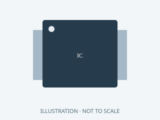

**Original illustration** — Original family illustration, not a photo or a footprint. Package dimensions and terminal layout must be checked against the exact row and datasheet.

Image: HA Radio Hub project · MIT. [Local family illustration](../hardware/parts/illustrations/ic.svg).

- **LP-P0 bench reference (not additive):** quantity 1; references `U9`.

[AliExpress search — unverified results](https://www.aliexpress.com/wholesale?SearchText=NXP+SC16IS752IPW%2C128)

Exact BOM row conditions, notes and sources

- **lp-reference:U9:** Reference only; both. TSSOP28 UART expander. SPI mode 0, maximum 4 MHz; the current driver uses 4 MHz. Channel A runs at 115200 baud. Bare IC requires a bench adapter. [Official / original source](https://www.nxp.com/docs/en/data-sheet/SC16IS752_SC16IS762.pdf).

### NXP SC16IS752IPW,128 / TSSOP28

**Original illustration** — Original family illustration, not a photo or a footprint. Package dimensions and terminal layout must be checked against the exact row and datasheet.

Image: HA Radio Hub project · MIT. [Local family illustration](../hardware/parts/illustrations/ic.svg).

Package / dimensions: `Hub:TSSOP-28_4.4x9.7mm_P0.65mm`.

- **I0 integrated • fitted parts:** quantity 1; references `U5`.

[AliExpress search — unverified results](https://www.aliexpress.com/wholesale?SearchText=NXP+SC16IS752IPW%2C128+%2F+TSSOP28)

Exact BOM row conditions, notes and sources

- **i0:U5:** Fitted to board. Module pad numbers, not development-board header positions. [Official / original source](https://www.nxp.com/docs/en/data-sheet/SC16IS752_SC16IS762.pdf).

### SC16IS752IPW,128

**Original illustration** — Original family illustration, not a photo or a footprint. Package dimensions and terminal layout must be checked against the exact row and datasheet.

Image: HA Radio Hub project · MIT. [Local family illustration](../hardware/parts/illustrations/ic.svg).

Package / dimensions: `Carrier:TSSOP-28_4.4x9.7mm_P0.65mm`.

- **C0 carrier • fitted parts:** quantity 1; references `U1`.

[AliExpress search — unverified results](https://www.aliexpress.com/wholesale?SearchText=SC16IS752IPW%2C128)

Exact BOM row conditions, notes and sources

- **c0:U1:** Fitted to board. SPI mode; channel A 115200 8N1, crystal3.6864MHz [Official / original source](https://www.nxp.com/docs/en/data-sheet/SC16IS752_SC16IS762.pdf).

### SC16IS752IPW,128

**Original illustration** — Original family illustration, not a photo or a footprint. Package dimensions and terminal layout must be checked against the exact row and datasheet.

Image: HA Radio Hub project · MIT. [Local family illustration](../hardware/parts/illustrations/ic.svg).

Package / dimensions: `DIY:Adafruit1208_TSSOP28`.

- **D0 DIY • fitted parts:** quantity 1; references `U1`.

[AliExpress search — unverified results](https://www.aliexpress.com/wholesale?SearchText=SC16IS752IPW%2C128)

Exact BOM row conditions, notes and sources

- **d0:U1:** Fitted to board. SC16IS752IPW,128 soldered to factory Adafruit1208 TSSOP side; pin1 adapter orientation verified from published CAD; no SOIC chip. Solder 2x14 male headers to adapter. [Official / original source](https://www.adafruit.com/product/1208).

### TI TPS3808G33DBVR

**Original illustration** — Original family illustration, not a photo or a footprint. Package dimensions and terminal layout must be checked against the exact row and datasheet.

Image: HA Radio Hub project · MIT. [Local family illustration](../hardware/parts/illustrations/ic.svg).

- **LP-P0 bench reference (not additive):** quantity 1; references `U10`.

[AliExpress search — unverified results](https://www.aliexpress.com/wholesale?SearchText=TI+TPS3808G33DBVR)

Exact BOM row conditions, notes and sources

- **lp-reference:U10:** Reference only; both. SC16 reset supervisor, 3.07 V threshold; CT open gives 20 ms; MR has an internal pull-up; add local 100 nF bypass. [Official / original source](https://www.ti.com/lit/ds/symlink/tps3808.pdf).

### TI TPS3808G33DBVR / SOT-23-6

**Original illustration** — Original family illustration, not a photo or a footprint. Package dimensions and terminal layout must be checked against the exact row and datasheet.

Image: HA Radio Hub project · MIT. [Local family illustration](../hardware/parts/illustrations/ic.svg).

Package / dimensions: `Hub:SOT-23-6`.

- **I0 integrated • fitted parts:** quantity 1; references `U6`.

[AliExpress search — unverified results](https://www.aliexpress.com/wholesale?SearchText=TI+TPS3808G33DBVR+%2F+SOT-23-6)

Exact BOM row conditions, notes and sources

- **i0:U6:** Fitted to board. Module pad numbers, not development-board header positions.

### TPS3808G33DBVR

**Original illustration** — Original family illustration, not a photo or a footprint. Package dimensions and terminal layout must be checked against the exact row and datasheet.

Image: HA Radio Hub project · MIT. [Local family illustration](../hardware/parts/illustrations/ic.svg).

Package / dimensions: `Carrier:SOT-23-6`.

- **C0 carrier • fitted parts:** quantity 1; references `U2`.

[AliExpress search — unverified results](https://www.aliexpress.com/wholesale?SearchText=TPS3808G33DBVR)

Exact BOM row conditions, notes and sources

- **c0:U2:** Fitted to board. G33 supervisor; CT open=20ms; MR internal pullup [Official / original source](https://www.ti.com/lit/ds/symlink/tps3808.pdf).

### TPS3808G33DBVR

**Original illustration** — Original family illustration, not a photo or a footprint. Package dimensions and terminal layout must be checked against the exact row and datasheet.

Image: HA Radio Hub project · MIT. [Local family illustration](../hardware/parts/illustrations/ic.svg).

Package / dimensions: `DIY:Adafruit1230_SOT23_6`.

- **D0 DIY • fitted parts:** quantity 1; references `U2`.

[AliExpress search — unverified results](https://www.aliexpress.com/wholesale?SearchText=TPS3808G33DBVR)

Exact BOM row conditions, notes and sources

- **d0:U2:** Fitted to board. TPS3808G33DBVR soldered to factory Adafruit1230 SOT23-6 adapter, two 1x3 male headers. Do not populate reverse-side transistor footprints. [Official / original source](https://www.adafruit.com/product/1230).

### W5500

**Original illustration** — Original family illustration, not a photo or a footprint. Package dimensions and terminal layout must be checked against the exact row and datasheet.

Image: HA Radio Hub project · MIT. [Local family illustration](../hardware/parts/illustrations/ic.svg).

Package / dimensions: `Hub:LQFP-48_7x7mm_P0.5mm`.

- **I0 integrated • fitted parts:** quantity 1; references `U4`.

[AliExpress search — unverified results](https://www.aliexpress.com/wholesale?SearchText=W5500)

Exact BOM row conditions, notes and sources

- **i0:U4:** Fitted to board. 25MHz crystal; common-CT magnetics with RX AC coupling; hardware PMODE111; firmware selects10M. [Official / original source](https://docs.wiznet.io/img/products/w5500/w5500_sch_v110_use_mag_.pdf).

<strong>Inductor: 1 identification cards</strong>

### BLM21PG121SN1D

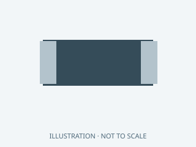

**Original illustration** — Original family illustration, not a photo or a footprint. Package dimensions and terminal layout must be checked against the exact row and datasheet.

Image: HA Radio Hub project · MIT. [Local family illustration](../hardware/parts/illustrations/inductor.svg).

Package / dimensions: `Hub:L_0805_2012Metric`.

- **I0 integrated • fitted parts:** quantity 1; references `FB1`.

[AliExpress search — unverified results](https://www.aliexpress.com/wholesale?SearchText=BLM21PG121SN1D+inductor+0805)

Exact BOM row conditions, notes and sources

- **i0:FB1:** Fitted to board. 120ohm at100MHz, low DCR ferrite; local analog supply filter.

<strong>Module: 24 identification cards</strong>

### 28-pin TSSOP 0.65 mm pitch breakout adapter

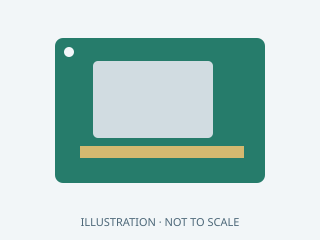

**Original illustration** — Original family illustration, not a photo or a footprint. Package dimensions and terminal layout must be checked against the exact row and datasheet.

Image: HA Radio Hub project · MIT. [Local family illustration](../hardware/parts/illustrations/module.svg).

- **LP-P0 bench reference (not additive):** quantity 1; references `J3`.

[AliExpress search — unverified results](https://www.aliexpress.com/wholesale?SearchText=28-pin+TSSOP+0.65+mm+pitch+breakout+adapter)

Exact BOM row conditions, notes and sources

- **lp-reference:J3:** Reference only; bench. Select the footprint before ordering. Place crystal and supervisor locally; avoid long breadboard clock wires. [Official / original source](https://www.nxp.com/docs/en/data-sheet/SC16IS752_SC16IS762.pdf).

### 32GB high-endurance microSD

**Original illustration** — Original family illustration, not a photo or a footprint. Package dimensions and terminal layout must be checked against the exact row and datasheet.

Image: HA Radio Hub project · MIT. [Local family illustration](../hardware/parts/illustrations/module.svg).

Package / dimensions: `microSD`.

- **Original Pi modular hub:** quantity 1; references `SD1`.

[AliExpress search — unverified results](https://www.aliexpress.com/wholesale?SearchText=32GB+high-endurance+microSD)

Exact BOM row conditions, notes and sources

- **modular:SD1:** common. Storage · Buy traceable media;backup OTBR state privately [Official / original source](https://www.raspberrypi.com/documentation/computers/getting-started.html).

### Adafruit 4397 QT 4-pin to female sockets, 150 mm

**Original illustration** — Original family illustration, not a photo or a footprint. Package dimensions and terminal layout must be checked against the exact row and datasheet.

Image: HA Radio Hub project · MIT. [Local family illustration](../hardware/parts/illustrations/module.svg).

- **LP-P0 bench reference (not additive):** quantity 1; references `J1`.

[AliExpress search — unverified results](https://www.aliexpress.com/wholesale?SearchText=Adafruit+4397+QT+4-pin+to+female+sockets%2C+150+mm)

Exact BOM row conditions, notes and sources

- **lp-reference:J1:** Reference only; bench. BME cable: 150 mm is its total length, not its reach outside the case. [Official / original source](https://www.adafruit.com/product/4397).

### Adafruit4210 100mm4pinJSTSH

**Original illustration** — Original family illustration, not a photo or a footprint. Package dimensions and terminal layout must be checked against the exact row and datasheet.

Image: HA Radio Hub project · MIT. [Local family illustration](../hardware/parts/illustrations/module.svg).

- **D0 DIY • adapters / harness / jumper wire:** quantity 1; references `QT cable`.

[AliExpress search — unverified results](https://www.aliexpress.com/wholesale?SearchText=Adafruit4210+100mm4pinJSTSH)

Exact BOM row conditions, notes and sources

- **d0-harness:QT cable:** Harness / external / service; read row notes. J10 XH to BME680 QT · Cut one end and terminate XHP-4 using continuity-verified order

### Copper-clad FR4 >=190x145mm,1.6mm,35um copper

**Original illustration** — Original family illustration, not a photo or a footprint. Package dimensions and terminal layout must be checked against the exact row and datasheet.

Image: HA Radio Hub project · MIT. [Local family illustration](../hardware/parts/illustrations/module.svg).

- **D0 DIY • adapters / harness / jumper wire:** quantity 1; references `Single-sided blank`.

[AliExpress search — unverified results](https://www.aliexpress.com/wholesale?SearchText=Copper-clad+FR4+%3E%3D190x145mm%2C1.6mm%2C35um+copper)

Exact BOM row conditions, notes and sources

- **d0-harness:Single-sided blank:** Harness / external / service; read row notes. D0 bottom copper only · Blank margin for handling; no plated-through holes or solder mask required

### Enclosed5V/GND distribution;one input and five branch pairs

**Original illustration** — Original family illustration, not a photo or a footprint. Package dimensions and terminal layout must be checked against the exact row and datasheet.

Image: HA Radio Hub project · MIT. [Local family illustration](../hardware/parts/illustrations/module.svg).

Package / dimensions: `layout_dependent`.

- **Original Pi modular hub:** quantity 1; references `J1`.

[AliExpress search — unverified results](https://www.aliexpress.com/wholesale?SearchText=Enclosed5V%2FGND+distribution%3Bone+input+and+five+branch+pairs)

Exact BOM row conditions, notes and sources

- **modular:J1:** common. DC distribution · 5A minimum assembly rating · 5A rating includes every terminal and trunk joint;no breadboard;fuses are separate F1;do not parallel3V3 regulators

### Existing 433.92MHz CC1101 module

**Original illustration** — Original family illustration, not a photo or a footprint. Package dimensions and terminal layout must be checked against the exact row and datasheet.

Image: HA Radio Hub project · MIT. [Local family illustration](../hardware/parts/illustrations/module.svg).

Package / dimensions: `measure_module`.

- **Original Pi modular hub:** quantity 1; references `U9`.

[AliExpress search — unverified results](https://www.aliexpress.com/wholesale?SearchText=Existing+433.92MHz+CC1101+module)

Exact BOM row conditions, notes and sources

- **modular:U9:** common. RF transceiver · 3.3V SPI+GDO0+GDO2 for wired RF · Existing433MHz matching network and antenna;wired migration requires accessible GDO2;verify actual module pinout [Official / original source](https://www.ti.com/product/CC1101).

### Existing ESP8266 NodeMCU v2

**Original illustration** — Original family illustration, not a photo or a footprint. Package dimensions and terminal layout must be checked against the exact row and datasheet.

Image: HA Radio Hub project · MIT. [Local family illustration](../hardware/parts/illustrations/module.svg).

Package / dimensions: `measure_clone`.

- **Original Pi modular hub:** quantity 1; references `U8`.

[AliExpress search — unverified results](https://www.aliexpress.com/wholesale?SearchText=Existing+ESP8266+NodeMCU+v2)

Exact BOM row conditions, notes and sources

- **modular:U8:** compatibility_wifi_only. RF host · 5V microUSB · Compatibility option only;omit when using U10 wired RF;do not upgrade its pinned firmware blindly [Official / original source](https://github.com/ha-homelab/rf-airbridge).

### Existing active IEEE 802.3at port or TP-Link Omada POE160S injector

**Original illustration** — Original family illustration, not a photo or a footprint. Package dimensions and terminal layout must be checked against the exact row and datasheet.

Image: HA Radio Hub project · MIT. [Local family illustration](../hardware/parts/illustrations/module.svg).

- **Original Pi modular hub:** quantity 1; references `PSE`.

[AliExpress search — unverified results](https://www.aliexpress.com/wholesale?SearchText=Existing+active+IEEE+802.3at+port+or+TP-Link+Omada+POE160S+injector)

Exact BOM row conditions, notes and sources

- **modular:PSE:** common. PoE source · 30W PSE class · External to hub;30W port budget;injector includes mains cord;not a PoE HAT or passive adapter [Official / original source](https://www.omadanetworks.com/us/business-networking/omada-accessory-poe-adapter/poe160s/).

### Hi-Link LD2450

**Original illustration** — Original family illustration, not a photo or a footprint. Package dimensions and terminal layout must be checked against the exact row and datasheet.

Image: HA Radio Hub project · MIT. [Local family illustration](../hardware/parts/illustrations/module.svg).

- **D0 DIY • adapters / harness / jumper wire:** quantity 1; references `Radar`.

[AliExpress search — unverified results](https://www.aliexpress.com/wholesale?SearchText=Hi-Link+LD2450)

Exact BOM row conditions, notes and sources

- **d0-harness:Radar:** Harness / external / service; read row notes. 5V radar with3V3 UART at J9 · Reuse existing if available; confirm harness pin order

### I0 external modules: ZAC93, CC1101, HLK-LD2450, Adafruit 3660

**Original illustration** — Original family illustration, not a photo or a footprint. Package dimensions and terminal layout must be checked against the exact row and datasheet.

Image: HA Radio Hub project · MIT. [Local family illustration](../hardware/parts/illustrations/module.svg).

- **Additional / reusable / conditional:** quantity 1 of each; references `i0-peripherals`.

[Select constituent parts from project BOM](../docs/parts-catalog.md)

Exact BOM row conditions, notes and sources

- **accessory:i0-peripherals:** I0 external modules. These modules are not fitted to I0 and are not included in its 106 assembly rows. Their individual identification cards appear in the LP-P0 reference. Add the matched 433.92 MHz antenna and 4-pin QT cable; verify any cable already included in a module kit. [Official / original source](https://www.adafruit.com/product/3660).

### Insulated tinned solid copper AWG24

**Original illustration** — Original family illustration, not a photo or a footprint. Package dimensions and terminal layout must be checked against the exact row and datasheet.

Image: HA Radio Hub project · MIT. [Local family illustration](../hardware/parts/illustrations/module.svg).

- **D0 DIY • adapters / harness / jumper wire:** quantity 0.724m; references `Jumper wire AWG24`.

[AliExpress search — unverified results](https://www.aliexpress.com/wholesale?SearchText=Insulated+tinned+solid+copper+AWG24)

Exact BOM row conditions, notes and sources

- **d0-harness:Jumper wire AWG24:** Harness / external / service; read row notes. Numbered W links; not fabricated copper · Cut lengths in jumpers.csv; includes25percent working allowance; maximum2ends/1.1mm hole; trial-fit first

### Insulated tinned solid copper AWG26

**Original illustration** — Original family illustration, not a photo or a footprint. Package dimensions and terminal layout must be checked against the exact row and datasheet.

Image: HA Radio Hub project · MIT. [Local family illustration](../hardware/parts/illustrations/module.svg).

- **D0 DIY • adapters / harness / jumper wire:** quantity 3.525m; references `Jumper wire AWG26`.

[AliExpress search — unverified results](https://www.aliexpress.com/wholesale?SearchText=Insulated+tinned+solid+copper+AWG26)

Exact BOM row conditions, notes and sources

- **d0-harness:Jumper wire AWG26:** Harness / external / service; read row notes. Numbered W links; not fabricated copper · Cut lengths in jumpers.csv; includes25percent working allowance; maximum2ends/1.1mm hole; trial-fit first

### Isolated regulated 5 V PoE front end

**Original illustration** — Original family illustration, not a photo or a footprint. Package dimensions and terminal layout must be checked against the exact row and datasheet.

Image: HA Radio Hub project · MIT. [Local family illustration](../hardware/parts/illustrations/module.svg).

- **C0 carrier • harness / external:** quantity 1; references `5V source`.

[AliExpress search — unverified results](https://www.aliexpress.com/wholesale?SearchText=Isolated+regulated+5+V+PoE+front+end)

Exact BOM row conditions, notes and sources

- **c0-harness:5V source:** Harness / external / service; read row notes. J1 · Must be independently verified; not raw PoE 48 V

### LP-M0 factory fabricated and populated MGM240PA22VNA3 adapter

**Original illustration** — Original family illustration, not a photo or a footprint. Package dimensions and terminal layout must be checked against the exact row and datasheet.

Image: HA Radio Hub project · MIT. [Local family illustration](../hardware/parts/illustrations/module.svg).

- **D0 DIY • adapters / harness / jumper wire:** quantity 1; references `M0 radio assembly`.

[M0 project files — fabricate / assemble](../hardware/low-power/carrier/mg24-adapter/README.md)

Exact BOM row conditions, notes and sources

- **d0-harness:M0 radio assembly:** Harness / external / service; read row notes. Required Zigbee NCP · See carrier/mg24-adapter; not home etched; mate cable second end counted in M0 BOM

### LP-M0 populated with MGM240PA22VNA3

**Original illustration** — Original family illustration, not a photo or a footprint. Package dimensions and terminal layout must be checked against the exact row and datasheet.

Image: HA Radio Hub project · MIT. [Local family illustration](../hardware/parts/illustrations/module.svg).

- **C0 carrier • harness / external:** quantity 1; references `MG24 adapter`.

[M0 project files — fabricate / assemble](../hardware/low-power/carrier/mg24-adapter/README.md)

Exact BOM row conditions, notes and sources

- **c0-harness:MG24 adapter:** Harness / external / service; read row notes. C0 J6 · See mg24-adapter assembly and harness BOMs; required per modular hub

### LP-P0 module set and revision-verified breakouts

**Original illustration** — Original family illustration, not a photo or a footprint. Package dimensions and terminal layout must be checked against the exact row and datasheet.

Image: HA Radio Hub project · MIT. [Local family illustration](../hardware/parts/illustrations/module.svg).

- **C0 carrier • harness / external:** quantity 1; references `Remote modules/adapters`.

[Select constituent parts from project BOM](../docs/parts-catalog.md)

Exact BOM row conditions, notes and sources

- **c0-harness:Remote modules/adapters:** Harness / external / service; read row notes. J3-J9 · Not included in PCB population; Use included populated M0 for MGM240P; S3/H2 still require verified board-specific power/service/strap circuits

### Locking 5 V/GND power distribution, >=2 A per contact, <=0.05 ohm whole loop

**Original illustration** — Original family illustration, not a photo or a footprint. Package dimensions and terminal layout must be checked against the exact row and datasheet.

Image: HA Radio Hub project · MIT. [Local family illustration](../hardware/parts/illustrations/module.svg).

- **LP-P0 bench reference (not additive):** quantity 1; references `J5`.

[AliExpress search — unverified results](https://www.aliexpress.com/wholesale?SearchText=Locking+5+V%2FGND+power+distribution%2C+%3E%3D2+A+per+contact%2C+%3C%3D0.05+ohm+whole+loop)

Exact BOM row conditions, notes and sources

- **lp-reference:J5:** Reference only; both. Exact housing and wire length depend on bench or PCB assembly. Mark polarity and coordinate the fuse with wire gauge; no Dupont lead for the distribution trunk. [Official / original source](https://www.pololu.com/product/2857).

### Low-profile passive heatsink;optional quiet5V fan

**Original illustration** — Original family illustration, not a photo or a footprint. Package dimensions and terminal layout must be checked against the exact row and datasheet.

Image: HA Radio Hub project · MIT. [Local family illustration](../hardware/parts/illustrations/module.svg).

Package / dimensions: `fit_under_deck`.

- **Original Pi modular hub:** quantity 1; references `M4`.

[AliExpress search — unverified results](https://www.aliexpress.com/wholesale?SearchText=Low-profile+passive+heatsink%3Boptional+quiet5V+fan)

Exact BOM row conditions, notes and sources

- **modular:M4:** common. Pi cooling · fan_if_used_within0.5Wbudget · Establish actual enclosed temperatures

### Nordic nRF52840 Dongle PCA10059

**Original illustration** — Original family illustration, not a photo or a footprint. Package dimensions and terminal layout must be checked against the exact row and datasheet.

Image: HA Radio Hub project · MIT. [Local family illustration](../hardware/parts/illustrations/module.svg).

Package / dimensions: `59x18 nominal`.

- **Original Pi modular hub:** quantity 1; references `U3`.

[AliExpress search — unverified results](https://www.aliexpress.com/wholesale?SearchText=Nordic+nRF52840+Dongle+PCA10059)

Exact BOM row conditions, notes and sources

- **modular:U3:** common. Thread radio · USB 5V OpenThread RCP · Onboard antenna;build USB bootloader-aware RCP;not DK board [Official / original source](https://www.nordicsemi.com/Products/Development-hardware/nRF52840-Dongle).

### Raspberry Pi 4 Model B 2GB or greater

**Original illustration** — Original family illustration, not a photo or a footprint. Package dimensions and terminal layout must be checked against the exact row and datasheet.

Image: HA Radio Hub project · MIT. [Local family illustration](../hardware/parts/illustrations/module.svg).

Package / dimensions: `85x56 PCB`.

- **Original Pi modular hub:** quantity 1; references `U1`.

[AliExpress search — unverified results](https://www.aliexpress.com/wholesale?SearchText=Raspberry+Pi+4+Model+B+2GB+or+greater)

Exact BOM row conditions, notes and sources

- **modular:U1:** common. Linux SBC · 5V USB-C;reserve8W normal · 64-bit OS;no SSD or heavy additional workloads in power budget [Official / original source](https://www.raspberrypi.com/products/raspberry-pi-4-model-b/).

### Single-host PCB option: LP-C0 backplane or LP-I0 integrated board

**Original illustration** — Original family illustration, not a photo or a footprint. Package dimensions and terminal layout must be checked against the exact row and datasheet.

Image: HA Radio Hub project · MIT. [Local family illustration](../hardware/parts/illustrations/module.svg).

- **LP-P0 bench reference (not additive):** quantity 1; references `PCB1`.

[Select constituent parts from project BOM](../docs/parts-catalog.md)

Exact BOM row conditions, notes and sources

- **lp-reference:PCB1:** Reference only; carrier. Original 160x100 mm reservation is superseded by the selected board revision. LP-C0 is 160x100 mm, 2 layers; LP-I0 is 160x142 mm, 4 layers. Use native CAD, verification reports and per-board BOMs; neither board is physically validated.

### TP-Link TL-SF1005D v13

**Original illustration** — Original family illustration, not a photo or a footprint. Package dimensions and terminal layout must be checked against the exact row and datasheet.

Image: HA Radio Hub project · MIT. [Local family illustration](../hardware/parts/illustrations/module.svg).

Package / dimensions: `104x70x22`.

- **Original Pi modular hub:** quantity 1; references `SW1`.

[AliExpress search — unverified results](https://www.aliexpress.com/wholesale?SearchText=TP-Link+TL-SF1005D+v13)

Exact BOM row conditions, notes and sources

- **modular:SW1:** common. Ethernet switch · 5V;reserve2W;100Mbps · Check actual revision5V label and DC connector;1.9W vendor max;no PoE output;vendor operating ambient0 to40C [Official / original source](https://www.tp-link.com/us/home-networking/5-port-switch/tl-sf1005d/v13/).

### Waveshare POE-SPLITTER-25W-5.5-2.1

**Original illustration** — Original family illustration, not a photo or a footprint. Package dimensions and terminal layout must be checked against the exact row and datasheet.

Image: HA Radio Hub project · MIT. [Local family illustration](../hardware/parts/illustrations/module.svg).

Package / dimensions: `102.5x29.6x24.8`.

- **Original Pi modular hub:** quantity 1; references `PS1`.

[AliExpress search — unverified results](https://www.aliexpress.com/wholesale?SearchText=Waveshare+POE-SPLITTER-25W-5.5-2.1)

Exact BOM row conditions, notes and sources

- **modular:PS1:** common. Isolated PoE splitter · 5V 5A maximum · DC output version;captive maleRJ45 and male5.5x2.1DC tails;20W design cap pending thermal/load test [Official / original source](https://www.waveshare.com/product/accessories/power-heat-sinks/poe-splitter-25w-type-c.htm).

<strong>Resistor: 23 identification cards</strong>

### 10 Ω

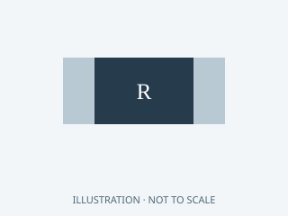

**Original illustration** — Original family illustration, not a photo or a footprint. Package dimensions and terminal layout must be checked against the exact row and datasheet.

Image: HA Radio Hub project · MIT. [Local family illustration](../hardware/parts/illustrations/resistor.svg).

Package / dimensions: `Hub:R_0805_2012Metric`.

- **I0 integrated • fitted parts:** quantity 1; references `R33`.

[AliExpress search — unverified results](https://www.aliexpress.com/wholesale?SearchText=10+ohm+resistor+0805)

Exact BOM row conditions, notes and sources

- **i0:R33:** Fitted to board. 1%,0805,0.125W

### 100k

**Original illustration** — Original family illustration, not a photo or a footprint. Package dimensions and terminal layout must be checked against the exact row and datasheet.

Image: HA Radio Hub project · MIT. [Local family illustration](../hardware/parts/illustrations/resistor.svg).

Package / dimensions: `Carrier:R_0805_2012Metric`.

- **C0 carrier • fitted parts:** quantity 8; references `R5, R6, R7, R8, R9, R10, R11, R12`.

[AliExpress search — unverified results](https://www.aliexpress.com/wholesale?SearchText=100k+resistor+0805)

Exact BOM row conditions, notes and sources

- **c0:R5:** Fitted to board. 1%, 0.125W, 0805; select a stocked part meeting these specifications
- **c0:R6:** Fitted to board. 1%, 0.125W, 0805; select a stocked part meeting these specifications
- **c0:R7:** Fitted to board. 1%, 0.125W, 0805; select a stocked part meeting these specifications
- **c0:R8:** Fitted to board. 1%, 0.125W, 0805; select a stocked part meeting these specifications
- **c0:R9:** Fitted to board. 1%, 0.125W, 0805; select a stocked part meeting these specifications
- **c0:R10:** Fitted to board. 1%, 0.125W, 0805; select a stocked part meeting these specifications
- **c0:R11:** Fitted to board. 1%, 0.125W, 0805; select a stocked part meeting these specifications
- **c0:R12:** Fitted to board. 1%, 0.125W, 0805; select a stocked part meeting these specifications

### 100k

**Original illustration** — Original family illustration, not a photo or a footprint. Package dimensions and terminal layout must be checked against the exact row and datasheet.

Image: HA Radio Hub project · MIT. [Local family illustration](../hardware/parts/illustrations/resistor.svg).

Package / dimensions: `Hub:R_0805_2012Metric`.

- **I0 integrated • fitted parts:** quantity 8; references `R21, R22, R23, R24, R25, R26, R27, R28`.

[AliExpress search — unverified results](https://www.aliexpress.com/wholesale?SearchText=100k+resistor+0805)

Exact BOM row conditions, notes and sources

- **i0:R21:** Fitted to board. 1%,0805,0.125W
- **i0:R22:** Fitted to board. 1%,0805,0.125W
- **i0:R23:** Fitted to board. 1%,0805,0.125W
- **i0:R24:** Fitted to board. 1%,0805,0.125W
- **i0:R25:** Fitted to board. 1%,0805,0.125W
- **i0:R26:** Fitted to board. 1%,0805,0.125W
- **i0:R27:** Fitted to board. 1%,0805,0.125W
- **i0:R28:** Fitted to board. 1%,0805,0.125W

### 100k

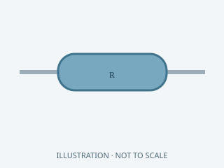

**Original illustration** — Original family illustration, not a photo or a footprint. Package dimensions and terminal layout must be checked against the exact row and datasheet.

Image: HA Radio Hub project · MIT. [Local family illustration](../hardware/parts/illustrations/resistor.svg).

Package / dimensions: `DIY:Axial_R_P10.16`.

- **D0 DIY • fitted parts:** quantity 8; references `R5, R6, R7, R8, R9, R10, R11, R12`.

[AliExpress search — unverified results](https://www.aliexpress.com/wholesale?SearchText=100k+resistor)

Exact BOM row conditions, notes and sources

- **d0:R5:** Fitted to board. Axial 1%0.25W resistor, body<=6.8x2.5mm, leads formed to10.16mm pitch.
- **d0:R6:** Fitted to board. Axial 1%0.25W resistor, body<=6.8x2.5mm, leads formed to10.16mm pitch.
- **d0:R7:** Fitted to board. Axial 1%0.25W resistor, body<=6.8x2.5mm, leads formed to10.16mm pitch.
- **d0:R8:** Fitted to board. Axial 1%0.25W resistor, body<=6.8x2.5mm, leads formed to10.16mm pitch.
- **d0:R9:** Fitted to board. Axial 1%0.25W resistor, body<=6.8x2.5mm, leads formed to10.16mm pitch.
- **d0:R10:** Fitted to board. Axial 1%0.25W resistor, body<=6.8x2.5mm, leads formed to10.16mm pitch.
- **d0:R11:** Fitted to board. Axial 1%0.25W resistor, body<=6.8x2.5mm, leads formed to10.16mm pitch.
- **d0:R12:** Fitted to board. Axial 1%0.25W resistor, body<=6.8x2.5mm, leads formed to10.16mm pitch.

### 100kΩ 1% 0.1W resistor

**Original illustration** — Original family illustration, not a photo or a footprint. Package dimensions and terminal layout must be checked against the exact row and datasheet.

Image: HA Radio Hub project · MIT. [Local family illustration](../hardware/parts/illustrations/resistor.svg).

- **LP-P0 bench reference (not additive):** quantity 8; references `R4`.

[AliExpress search — unverified results](https://www.aliexpress.com/wholesale?SearchText=100k%CE%A9+1%25+0.1W+resistor+resistor)

Exact BOM row conditions, notes and sources

- **lp-reference:R4:** Reference only; both. Unused SC16 GPIO0 through GPIO7 to GND. Avoid a hard short if a pin is later configured as an output. [Official / original source](https://www.nxp.com/docs/en/data-sheet/SC16IS752_SC16IS762.pdf).

### 10k

**Original illustration** — Original family illustration, not a photo or a footprint. Package dimensions and terminal layout must be checked against the exact row and datasheet.

Image: HA Radio Hub project · MIT. [Local family illustration](../hardware/parts/illustrations/resistor.svg).

Package / dimensions: `Carrier:R_0805_2012Metric`.

- **C0 carrier • fitted parts:** quantity 7; references `R2, R3, R4, R14, R15, R16, R17`.
- **M0 MG24 adapter • fitted parts:** quantity 1; references `R1`.

[AliExpress search — unverified results](https://www.aliexpress.com/wholesale?SearchText=10k+resistor+0805)

Exact BOM row conditions, notes and sources

- **c0:R2:** Fitted to board. 1%, 0.125W, 0805; select a stocked part meeting these specifications
- **c0:R3:** Fitted to board. 1%, 0.125W, 0805; select a stocked part meeting these specifications
- **c0:R4:** Fitted to board. 1%, 0.125W, 0805; select a stocked part meeting these specifications
- **c0:R14:** Fitted to board. 1%, 0.125W, 0805; select a stocked part meeting these specifications
- **c0:R15:** Fitted to board. 1%, 0.125W, 0805; select a stocked part meeting these specifications
- **c0:R16:** Fitted to board. 1%, 0.125W, 0805; select a stocked part meeting these specifications
- **c0:R17:** Fitted to board. 1%, 0.125W, 0805; select a stocked part meeting these specifications
- **m0:R1:** Fitted to board. 1%, 0.125W, 0805

### 10k

**Original illustration** — Original family illustration, not a photo or a footprint. Package dimensions and terminal layout must be checked against the exact row and datasheet.

Image: HA Radio Hub project · MIT. [Local family illustration](../hardware/parts/illustrations/resistor.svg).

Package / dimensions: `Hub:R_0805_2012Metric`.

- **I0 integrated • fitted parts:** quantity 14; references `R2, R3, R4, R6, R7, R8, R9, R10, R11, R12, R13, R14, R15, R16`.

[AliExpress search — unverified results](https://www.aliexpress.com/wholesale?SearchText=10k+resistor+0805)

Exact BOM row conditions, notes and sources

- **i0:R2:** Fitted to board. 1%,0805,0.125W
- **i0:R3:** Fitted to board. 1%,0805,0.125W
- **i0:R4:** Fitted to board. 1%,0805,0.125W
- **i0:R6:** Fitted to board. 1%,0805,0.125W
- **i0:R7:** Fitted to board. 1%,0805,0.125W
- **i0:R8:** Fitted to board. 1%,0805,0.125W
- **i0:R9:** Fitted to board. 1%,0805,0.125W
- **i0:R10:** Fitted to board. 1%,0805,0.125W
- **i0:R11:** Fitted to board. 1%,0805,0.125W
- **i0:R12:** Fitted to board. 1%,0805,0.125W
- **i0:R13:** Fitted to board. 1%,0805,0.125W
- **i0:R14:** Fitted to board. 1%,0805,0.125W
- **i0:R15:** Fitted to board. 1%,0805,0.125W
- **i0:R16:** Fitted to board. 1%,0805,0.125W

### 10k

**Original illustration** — Original family illustration, not a photo or a footprint. Package dimensions and terminal layout must be checked against the exact row and datasheet.

Image: HA Radio Hub project · MIT. [Local family illustration](../hardware/parts/illustrations/resistor.svg).

Package / dimensions: `DIY:Axial_R_P10.16`.

- **D0 DIY • fitted parts:** quantity 7; references `R2, R3, R4, R14, R15, R16, R17`.

[AliExpress search — unverified results](https://www.aliexpress.com/wholesale?SearchText=10k+resistor)

Exact BOM row conditions, notes and sources

- **d0:R2:** Fitted to board. Axial 1%0.25W resistor, body<=6.8x2.5mm, leads formed to10.16mm pitch.
- **d0:R3:** Fitted to board. Axial 1%0.25W resistor, body<=6.8x2.5mm, leads formed to10.16mm pitch.
- **d0:R4:** Fitted to board. Axial 1%0.25W resistor, body<=6.8x2.5mm, leads formed to10.16mm pitch.
- **d0:R14:** Fitted to board. Axial 1%0.25W resistor, body<=6.8x2.5mm, leads formed to10.16mm pitch.
- **d0:R15:** Fitted to board. Axial 1%0.25W resistor, body<=6.8x2.5mm, leads formed to10.16mm pitch.
- **d0:R16:** Fitted to board. Axial 1%0.25W resistor, body<=6.8x2.5mm, leads formed to10.16mm pitch.
- **d0:R17:** Fitted to board. Axial 1%0.25W resistor, body<=6.8x2.5mm, leads formed to10.16mm pitch.

### 10kΩ 1% 0.1W resistor

**Original illustration** — Original family illustration, not a photo or a footprint. Package dimensions and terminal layout must be checked against the exact row and datasheet.

Image: HA Radio Hub project · MIT. [Local family illustration](../hardware/parts/illustrations/resistor.svg).

- **LP-P0 bench reference (not additive):** quantity 12; references `R3`.

[AliExpress search — unverified results](https://www.aliexpress.com/wholesale?SearchText=10k%CE%A9+1%25+0.1W+resistor+resistor)

Exact BOM row conditions, notes and sources

- **lp-reference:R3:** Reference only; both. Pull-ups: three SPI CS signals, H2 EN, H2 BOOT, H2 GPIO8, SC16 RESET, unused RXB, S3 EN and S3 BOOT. Pull-down: H2 GPIO25. MG24 PA00 BOOT pull-up uses the twelfth resistor; no spare. Omit duplicates already installed on boards. [Official / original source](https://www.espressif.com/sites/default/files/documentation/esp32-h2-mini-1_mini-1u_datasheet_en.pdf).

### 12.4k

**Original illustration** — Original family illustration, not a photo or a footprint. Package dimensions and terminal layout must be checked against the exact row and datasheet.

Image: HA Radio Hub project · MIT. [Local family illustration](../hardware/parts/illustrations/resistor.svg).

Package / dimensions: `Hub:R_0805_2012Metric`.

- **I0 integrated • fitted parts:** quantity 1; references `R29`.

[AliExpress search — unverified results](https://www.aliexpress.com/wholesale?SearchText=12.4k+resistor+0805)

Exact BOM row conditions, notes and sources

- **i0:R29:** Fitted to board. 1%,0805,0.125W

### 1M

**Original illustration** — Original family illustration, not a photo or a footprint. Package dimensions and terminal layout must be checked against the exact row and datasheet.

Image: HA Radio Hub project · MIT. [Local family illustration](../hardware/parts/illustrations/resistor.svg).

Package / dimensions: `Hub:R_0805_2012Metric`.

- **I0 integrated • fitted parts:** quantity 1; references `R30`.

[AliExpress search — unverified results](https://www.aliexpress.com/wholesale?SearchText=1M+resistor+0805)

Exact BOM row conditions, notes and sources

- **i0:R30:** Fitted to board. 1%,0805,0.125W

### 1k

**Original illustration** — Original family illustration, not a photo or a footprint. Package dimensions and terminal layout must be checked against the exact row and datasheet.

Image: HA Radio Hub project · MIT. [Local family illustration](../hardware/parts/illustrations/resistor.svg).

Package / dimensions: `Carrier:R_0805_2012Metric`.

- **C0 carrier • fitted parts:** quantity 1; references `R1`.

[AliExpress search — unverified results](https://www.aliexpress.com/wholesale?SearchText=1k+resistor+0805)

Exact BOM row conditions, notes and sources

- **c0:R1:** Fitted to board. 1%, 0.125W, 0805; select a stocked part meeting these specifications

### 1k

**Original illustration** — Original family illustration, not a photo or a footprint. Package dimensions and terminal layout must be checked against the exact row and datasheet.

Image: HA Radio Hub project · MIT. [Local family illustration](../hardware/parts/illustrations/resistor.svg).

Package / dimensions: `Hub:R_0805_2012Metric`.

- **I0 integrated • fitted parts:** quantity 1; references `R1`.

[AliExpress search — unverified results](https://www.aliexpress.com/wholesale?SearchText=1k+resistor+0805)

Exact BOM row conditions, notes and sources

- **i0:R1:** Fitted to board. 1%,0805,0.125W

### 1k

**Original illustration** — Original family illustration, not a photo or a footprint. Package dimensions and terminal layout must be checked against the exact row and datasheet.

Image: HA Radio Hub project · MIT. [Local family illustration](../hardware/parts/illustrations/resistor.svg).

Package / dimensions: `DIY:Axial_R_P10.16`.

- **D0 DIY • fitted parts:** quantity 1; references `R1`.

[AliExpress search — unverified results](https://www.aliexpress.com/wholesale?SearchText=1k+resistor)

Exact BOM row conditions, notes and sources

- **d0:R1:** Fitted to board. Axial 1%0.25W resistor, body<=6.8x2.5mm, leads formed to10.16mm pitch.

### 1kΩ 1% 0.1W resistor

**Original illustration** — Original family illustration, not a photo or a footprint. Package dimensions and terminal layout must be checked against the exact row and datasheet.

Image: HA Radio Hub project · MIT. [Local family illustration](../hardware/parts/illustrations/resistor.svg).

- **LP-P0 bench reference (not additive):** quantity 1; references `R2`.

[AliExpress search — unverified results](https://www.aliexpress.com/wholesale?SearchText=1k%CE%A9+1%25+0.1W+resistor+resistor)

Exact BOM row conditions, notes and sources

- **lp-reference:R2:** Reference only; both. IRQ to 3.3 V; value specified by NXP, not 10 kohm. [Official / original source](https://www.nxp.com/docs/en/data-sheet/SC16IS752_SC16IS762.pdf).

### 22 Ω

**Original illustration** — Original family illustration, not a photo or a footprint. Package dimensions and terminal layout must be checked against the exact row and datasheet.

Image: HA Radio Hub project · MIT. [Local family illustration](../hardware/parts/illustrations/resistor.svg).

Package / dimensions: `Hub:R_0805_2012Metric`.

- **I0 integrated • fitted parts:** quantity 2; references `R19, R20`.

[AliExpress search — unverified results](https://www.aliexpress.com/wholesale?SearchText=22+ohm+resistor+0805)

Exact BOM row conditions, notes and sources

- **i0:R19:** Fitted to board. 1%,0805,0.125W
- **i0:R20:** Fitted to board. 1%,0805,0.125W

### 4.7 kohm resistor 1/8W or greater

**Original illustration** — Original family illustration, not a photo or a footprint. Package dimensions and terminal layout must be checked against the exact row and datasheet.

Image: HA Radio Hub project · MIT. [Local family illustration](../hardware/parts/illustrations/resistor.svg).

Package / dimensions: `insulate_leads`.

- **Original Pi modular hub:** quantity 1; references `R1`.

[AliExpress search — unverified results](https://www.aliexpress.com/wholesale?SearchText=4.7+kohm+resistor+1%2F8W+or+greater+resistor)

Exact BOM row conditions, notes and sources

- **modular:R1:** wired_rf_only. RF TX pull-up · GPIO4/GDO0 to local 3.3V · Open-drain TX is released during RX;never pull up to5V;short wiring [Official / original source](https://www.ti.com/lit/ds/symlink/cc1101.pdf).

### 4.7k

**Original illustration** — Original family illustration, not a photo or a footprint. Package dimensions and terminal layout must be checked against the exact row and datasheet.

Image: HA Radio Hub project · MIT. [Local family illustration](../hardware/parts/illustrations/resistor.svg).

Package / dimensions: `Carrier:R_0805_2012Metric`.

- **C0 carrier • fitted parts:** quantity 1; references `R13`.

[AliExpress search — unverified results](https://www.aliexpress.com/wholesale?SearchText=4.7k+resistor+0805)

Exact BOM row conditions, notes and sources

- **c0:R13:** Fitted to board. 1%, 0.125W, 0805; select a stocked part meeting these specifications

### 4.7k

**Original illustration** — Original family illustration, not a photo or a footprint. Package dimensions and terminal layout must be checked against the exact row and datasheet.

Image: HA Radio Hub project · MIT. [Local family illustration](../hardware/parts/illustrations/resistor.svg).

Package / dimensions: `Hub:R_0805_2012Metric`.

- **I0 integrated • fitted parts:** quantity 1; references `R5`.

[AliExpress search — unverified results](https://www.aliexpress.com/wholesale?SearchText=4.7k+resistor+0805)

Exact BOM row conditions, notes and sources

- **i0:R5:** Fitted to board. 1%,0805,0.125W

### 4.7k

**Original illustration** — Original family illustration, not a photo or a footprint. Package dimensions and terminal layout must be checked against the exact row and datasheet.

Image: HA Radio Hub project · MIT. [Local family illustration](../hardware/parts/illustrations/resistor.svg).

Package / dimensions: `DIY:Axial_R_P10.16`.

- **D0 DIY • fitted parts:** quantity 1; references `R13`.

[AliExpress search — unverified results](https://www.aliexpress.com/wholesale?SearchText=4.7k+resistor)

Exact BOM row conditions, notes and sources

- **d0:R13:** Fitted to board. Axial 1%0.25W resistor, body<=6.8x2.5mm, leads formed to10.16mm pitch.

### 4.7kΩ 1% 0.1W resistor

**Original illustration** — Original family illustration, not a photo or a footprint. Package dimensions and terminal layout must be checked against the exact row and datasheet.

Image: HA Radio Hub project · MIT. [Local family illustration](../hardware/parts/illustrations/resistor.svg).

- **LP-P0 bench reference (not additive):** quantity 1; references `R1`.

[AliExpress search — unverified results](https://www.aliexpress.com/wholesale?SearchText=4.7k%CE%A9+1%25+0.1W+resistor+resistor)

Exact BOM row conditions, notes and sources

- **lp-reference:R1:** Reference only; both. GDO0 to 3.3 V; required for open-drain TX and release during receive. [Official / original source](https://www.ti.com/lit/ds/symlink/cc1101.pdf).

### 49.9 Ω

**Original illustration** — Original family illustration, not a photo or a footprint. Package dimensions and terminal layout must be checked against the exact row and datasheet.

Image: HA Radio Hub project · MIT. [Local family illustration](../hardware/parts/illustrations/resistor.svg).

Package / dimensions: `Hub:R_0805_2012Metric`.

- **I0 integrated • fitted parts:** quantity 4; references `R31, R32, R34, R35`.

[AliExpress search — unverified results](https://www.aliexpress.com/wholesale?SearchText=49.9+ohm+resistor+0805)

Exact BOM row conditions, notes and sources

- **i0:R31:** Fitted to board. 1%,0805,0.125W
- **i0:R32:** Fitted to board. 1%,0805,0.125W
- **i0:R34:** Fitted to board. 1%,0805,0.125W
- **i0:R35:** Fitted to board. 1%,0805,0.125W

### 5.1k

**Original illustration** — Original family illustration, not a photo or a footprint. Package dimensions and terminal layout must be checked against the exact row and datasheet.

Image: HA Radio Hub project · MIT. [Local family illustration](../hardware/parts/illustrations/resistor.svg).

Package / dimensions: `Hub:R_0805_2012Metric`.

- **I0 integrated • fitted parts:** quantity 2; references `R17, R18`.

[AliExpress search — unverified results](https://www.aliexpress.com/wholesale?SearchText=5.1k+resistor+0805)

Exact BOM row conditions, notes and sources

- **i0:R17:** Fitted to board. 1%,0805,0.125W
- **i0:R18:** Fitted to board. 1%,0805,0.125W

<strong>Switch: 2 identification cards</strong>

### Normally open momentary service button

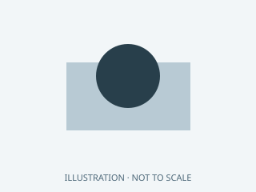

**Original illustration** — Original family illustration, not a photo or a footprint. Package dimensions and terminal layout must be checked against the exact row and datasheet.

Image: HA Radio Hub project · MIT. [Local family illustration](../hardware/parts/illustrations/switch.svg).

- **LP-P0 bench reference (not additive):** quantity 3; references `SW1`.

[AliExpress search — unverified results](https://www.aliexpress.com/wholesale?SearchText=Normally+open+momentary+service+button)

Exact BOM row conditions, notes and sources

- **lp-reference:SW1:** Reference only; carrier. S3 BOOT, S3 RESET and MG24 RESET. MG24 RESET only sinks to GND; no external 3.3 V pull-up. [Official / original source](https://www.espressif.com/sites/default/files/documentation/esp32-s3-wroom-1_wroom-1u_datasheet_en.pdf).

### SW_PUSH

**Original illustration** — Original family illustration, not a photo or a footprint. Package dimensions and terminal layout must be checked against the exact row and datasheet.

Image: HA Radio Hub project · MIT. [Local family illustration](../hardware/parts/illustrations/switch.svg).

Package / dimensions: `Hub:SW_SPST_TL3342`.

- **I0 integrated • fitted parts:** quantity 4; references `SW1, SW2, SW3, SW4`.

[AliExpress search — unverified results](https://www.aliexpress.com/wholesale?SearchText=SW_PUSH)

Exact BOM row conditions, notes and sources

- **i0:SW1:** Fitted to board. Momentary normally open; pulls low, never drives voltage.
- **i0:SW2:** Fitted to board. Momentary normally open; pulls low, never drives voltage.
- **i0:SW3:** Fitted to board. Momentary normally open; pulls low, never drives voltage.
- **i0:SW4:** Fitted to board. Momentary normally open; pulls low, never drives voltage.

<strong>Tool: 4 identification cards</strong>

### 2x5 SWD service header, 1.27 mm pitch, and compatible 3.3 V probe

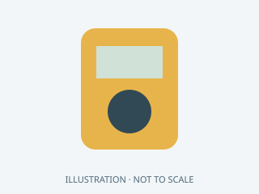

**Original illustration** — Original family illustration, not a photo or a footprint. Package dimensions and terminal layout must be checked against the exact row and datasheet.

Image: HA Radio Hub project · MIT. [Local family illustration](../hardware/parts/illustrations/tool.svg).

- **LP-P0 bench reference (not additive):** quantity 1; references `J4`.

[AliExpress search — unverified results](https://www.aliexpress.com/wholesale?SearchText=2x5+SWD+service+header%2C+1.27+mm+pitch%2C+and+compatible+3.3+V+probe)

Exact BOM row conditions, notes and sources

- **lp-reference:J4:** Reference only; both. Expose MG24 SWCLK, SWDIO, RESETn, GND and VTref. Assign the header pinout and verify it against the probe before connecting. Also expose PA00/pad7 BOOT and GND as a separate service jumper; hold low through reset to enter XMODEM bootloader. [Official / original source](https://www.silabs.com/documents/public/data-sheets/mgm240p-datasheet.pdf).

### 3.3 V SWD debug probe supporting Silicon Labs MGM240P

**Original illustration** — Original family illustration, not a photo or a footprint. Package dimensions and terminal layout must be checked against the exact row and datasheet.

Image: HA Radio Hub project · MIT. [Local family illustration](../hardware/parts/illustrations/tool.svg).

- **Additional / reusable / conditional:** quantity 1 reusable tool; references `probe`.

[AliExpress search — unverified results](https://www.aliexpress.com/wholesale?SearchText=3.3+V+SWD+debug+probe+supporting+Silicon+Labs+MGM240P)

Exact BOM row conditions, notes and sources

- **accessory:probe:** M0 / I0 commissioning. Use a compatible J-Link / Silicon Labs debug adapter, target-voltage sense and ground. The service harness is not a standard ARM connector: map each signal using the pin atlas. Do not connect 5 V UART signals. [Official / original source](https://www.silabs.com/development-tools/wireless/wireless-pro-kit-debug-adapter).

### DMM, current-limited bench supply, DC load and power meter

**Original illustration** — Original family illustration, not a photo or a footprint. Package dimensions and terminal layout must be checked against the exact row and datasheet.

Image: HA Radio Hub project · MIT. [Local family illustration](../hardware/parts/illustrations/tool.svg).

- **Additional / reusable / conditional:** quantity 1 reusable test set; references `test`.

[AliExpress search — unverified results](https://www.aliexpress.com/wholesale?SearchText=DMM%2C+current-limited+bench+supply%2C+DC+load+and+power+meter)

Exact BOM row conditions, notes and sources

- **accessory:test:** First article / power qualification. Required to verify polarity, shorts, supply droop, regulator heat and actual always-on energy. This gallery does not remove open prototype qualification gates.

### Temperature-controlled soldering station, flux, tweezers and magnification

**Original illustration** — Original family illustration, not a photo or a footprint. Package dimensions and terminal layout must be checked against the exact row and datasheet.

Image: HA Radio Hub project · MIT. [Local family illustration](../hardware/parts/illustrations/tool.svg).

- **Additional / reusable / conditional:** quantity 1 reusable tool set; references `solder`.

[AliExpress search — unverified results](https://www.aliexpress.com/wholesale?SearchText=Temperature-controlled+soldering+station%2C+flux%2C+tweezers+and+magnification)

Exact BOM row conditions, notes and sources

- **accessory:solder:** DIY / rework. I0 and M0 require suitable SMT/reflow capability, inspection and continuity testing. Bare PCBs are not plug-in kits. Match soldering equipment to the selected board assembly route.

---

Generated from 9 canonical inventories plus explicitly marked accessories. Do not edit this gallery manually; run `python3 hardware/parts/build.py`. See [catalog documentation](parts-catalog.md) for validation and image provenance.
