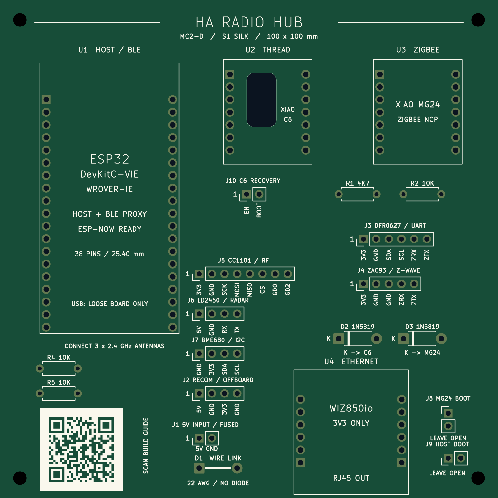
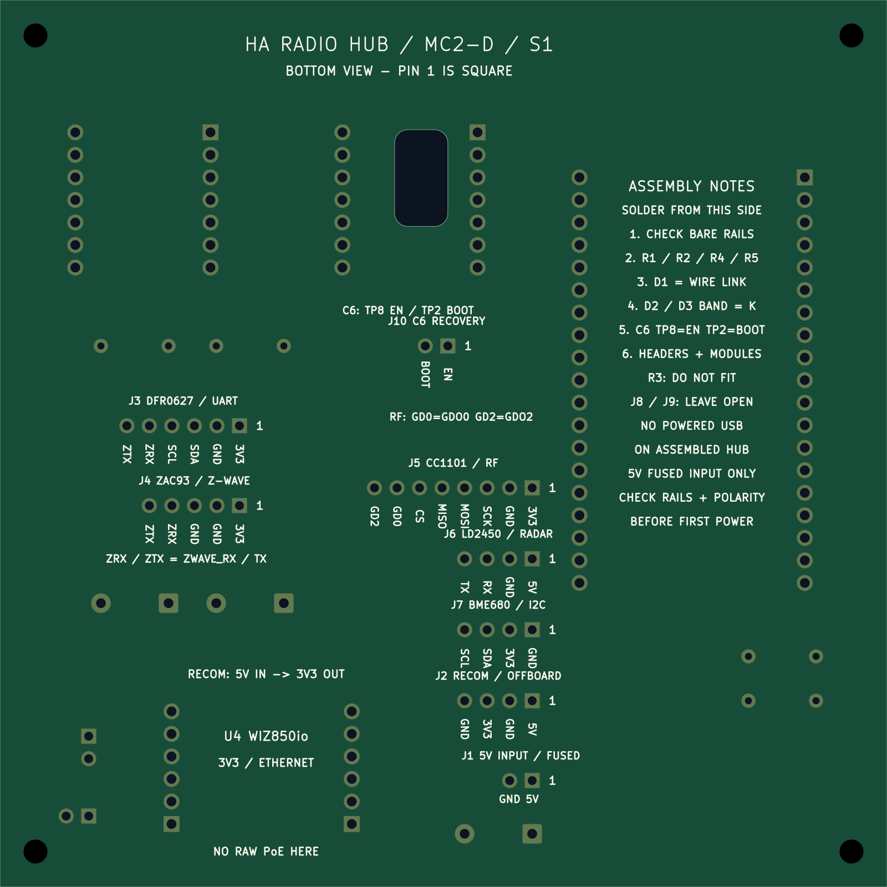

# MC2-D S1: an assembly guide printed on the PCB

**S1 changes the white silkscreen on both sides of MC2-D.** The circuit,
module positions, copper, solder mask, holes, C6 access opening and 100 × 100 mm
outline are unchanged. The purchased modules and FH1 enclosure remain the same.
Already manufactured MC2-D boards remain usable; this artwork is for the next batch.



The front identifies all four module positions and their roles: the
ESP32-DevKitC-VIE host/BLE/ESP-NOW, XIAO ESP32C6 Thread radio, XIAO MG24 Zigbee
radio and WIZ850io Ethernet module. Complete body outlines help placement;
role labels outside the outlines remain visible after fitting modules.

Harness labels identify the **external** RECOM supply, DFR0627 UART expander,
ZAC93 Z-Wave board, CC1101 RF board, LD2450 radar and BME680 sensor. These
peripherals retain their separate enclosure mounts; their names on the carrier
identify connectors, not new module footprints. The C6 EN/BOOT lead header is
also marked. Each harness has a pin-1 indicator and individual supply/signal labels.

The same layout explicitly marks resistor values, diode cathodes and destinations,
**D1 WIRE LINK / NO DIODE**, and the normally open service connections.



The bottom repeats the connector legends in the correct orientation for soldering
and carries an assembly checklist, C6 TP8/TP2 reminder, R3 omission and
**NO POWERED USB ON ASSEMBLED HUB** warning. The drawings are native CAD exports
with illustrative substrate/pad colours, not photographs of a manufactured S1 board.

## Reading the compact labels

- **3V3** is the peripheral 3.3 V rail; it is not a controller's local 3.3 V output.
- **ZRX/ZTX** abbreviate the existing `ZWAVE_RX` / `ZWAVE_TX` net names.
- **GD0/GD2** mean CC1101 GDO0/GDO2. MOSI, MISO, SCK and CS retain their normal names.
- **RX/TX at J6** mean the existing `RADAR_RX` / `RADAR_TX` nets. Follow the
  [connector lookup](../hardware/external-antenna/index.html#harness) for the
  opposite end of each cable; do not infer direction from which side you view.
- **K** means the diode cathode: put the banded end at pad 1.
- Pin 1 is the square pad. The silkscreen does not change the pin numbering.

## QR and public website

The front QR points to **[the public build guide](https://ha-homelab.github.io/ha-radio-hub/)**.
It is a normal QR with error correction M, 0.45 mm modules and an uninterrupted
four-module light quiet zone on every side. Its outer size is **16.65 × 16.65 mm**.
White ink prints the light cells; the dark cells are unprinted green solder mask.
No copper QR, exposed-metal QR or full-colour printing is involved.

The URL stays independent of release names. The current guide retains the
MC2-D/S1 identity and links to source and historical packages. The generated
front image was decoded independently at 1600 px and 800 px board width;
[the receipt](../hardware/external-antenna/cad/silkscreen-preview-verification.json)
records the URL and exact image/source hashes. A scan test on an actual S1 board
remains part of first-batch acceptance. Keep supplier production markings away
from the QR and its quiet zone.

## Ordering and cost

Use **[MC2-D-S1-prototype-gerbers.zip](../hardware/external-antenna/fabrication/MC2-D-S1-prototype-gerbers.zip)**
with ordinary **white silkscreen on both sides**, green mask, two copper layers,
1.6 mm FR-4, 1 oz copper and lead-free HASL. Do not select UV/full-colour printing,
special artwork processing, extra layers or a new board outline.

**Expected additional charge for this artwork: $0.** PCBWay lists white and
black silkscreen as having no extra charge in its
[standard capabilities](https://www.pcbway.com/capabilities.html), checked
11 November 2026. Its minimum legend stroke is 0.15 mm and minimum character
height is 0.8 mm; S1 uses at least those dimensions. This is an incremental
artwork estimate, not a supplier quote or a promise that shipping, tax, coupons
or the total repeat-order price stay unchanged. No new order has been placed.
Keep the normal production identifier rather than paying for its removal.

The [native comparison](../hardware/external-antenna/cad/silkscreen-baseline.json)
guards every non-silkscreen object. The
[fabrication comparison](../hardware/external-antenna/fabrication/silkscreen-comparison.json)
compares the new Gerbers/drills with the original package: only the two
silkscreen members may differ after creation timestamps are removed.
The [original package](../hardware/external-antenna/fabrication/history/README.md)
is preserved separately and is not silently relabelled S1.

## Reproduce or edit the artwork

Edit [silkscreen.py](../hardware/external-antenna/cad/silkscreen.py), not the
exported PNG. It is applied during the normal native CAD regeneration.
[The QR matrix](../hardware/external-antenna/cad/silkscreen-qr.json) is checked in
so native generation needs no network or QR library. It was generated with
python-qrcode 8.2; do not edit matrix cells by hand.

Follow the [native regeneration instructions](../hardware/external-antenna/cad/README.md#checks-and-reproduction),
then run `silkscreen_check.py` and regenerate the mechanical evidence and
fabrication package. `reproduce_check.py` compares the regenerated artwork as
well as copper topology. Native ERC, DRC, unconnected items and schematic parity
must all be zero; artwork gets no clearance waivers.

For the previews, install `hardware/external-antenna/cad/artwork-requirements.txt`
in a separate environment with Cairo available, then run:

```sh
python hardware/external-antenna/cad/render_silkscreen.py --cli /path/to/kicad-cli
```

Use the native **KiCad 10.0.6** exporter. Do not mirror or modify Gerbers manually;
the back preview is mirrored only to show the physical bottom view.
