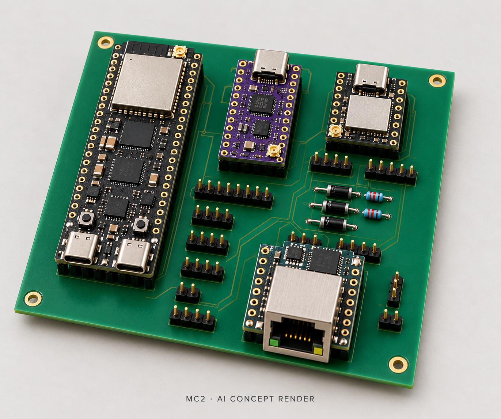
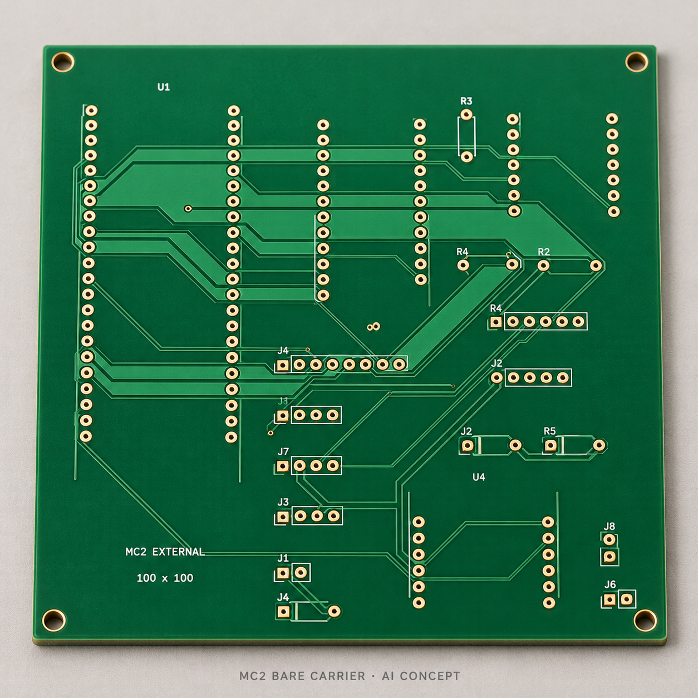

# MC2 appearance concepts

These two images were made on 18 October 2026 with the built-in `image_gen`
tool for the project README. They are **AI-generated concept illustrations**,
not photographs, deterministic CAD renders, fabrication artwork or evidence of
physical assembly. Green solder mask and gold pad finish are presentation choices.

The assembled image shows the intended general arrangement: S3 at left,
TinyC6 at upper center, XIAO at upper right and Ethernet at lower right.
Small component positions, module internals, connector shapes, pin counts and
traces are approximate. In particular, apparent chip/shield/antenna features
must not be used to identify a purchasable module. Cables and antennas are
omitted for visibility; all three radios require their selected antennas during use.

The bare image illustrates the finish and general hole groups. Its generated
silkscreen labels, pad counts and routing are not electrically authoritative.
Use the [native PCB](../cad/mc2.kicad_pcb),
[actual front copper](../cad/board-top.svg),
[assembly drawing](../cad/assembly-top.svg) and
[shopping list](../../../docs/mc2-shopping.md) for the build.

The reference inputs were rasterizations of `cad/assembly-top.svg` and
`cad/board-top.svg`. The initial assembled attempt had ambiguous coax routing
and was rejected for publication. The corrective image removes the coax and
antennas rather than presenting that routing as correct.

- [Initial prompt](initial-prompt.txt)
- [Assembled-image corrective prompt](assembled-prompt.txt)
- [Bare-carrier prompt](bare-prompt.txt)
- [Source and output hashes](provenance.json)

The original CAD and firmware are unchanged by these illustrations.
