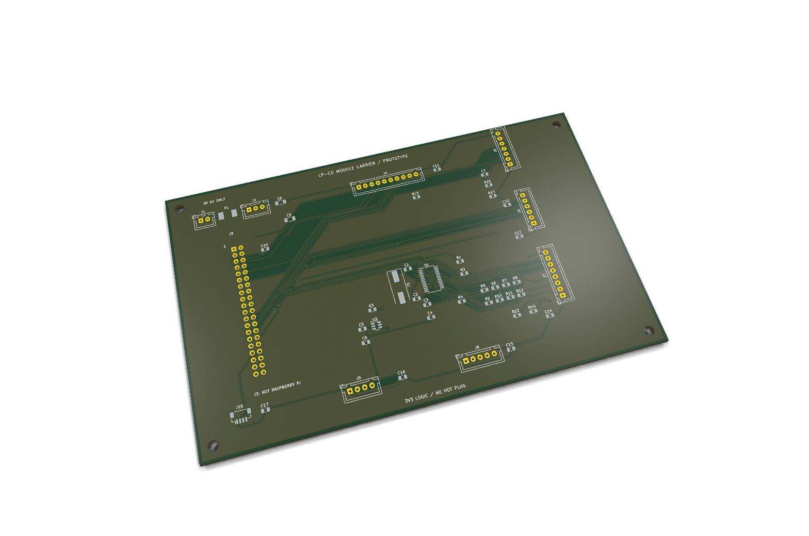
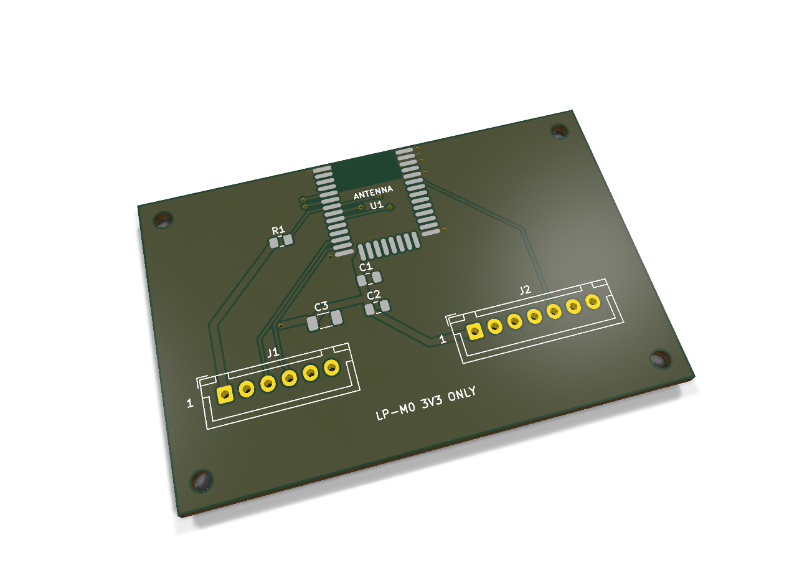
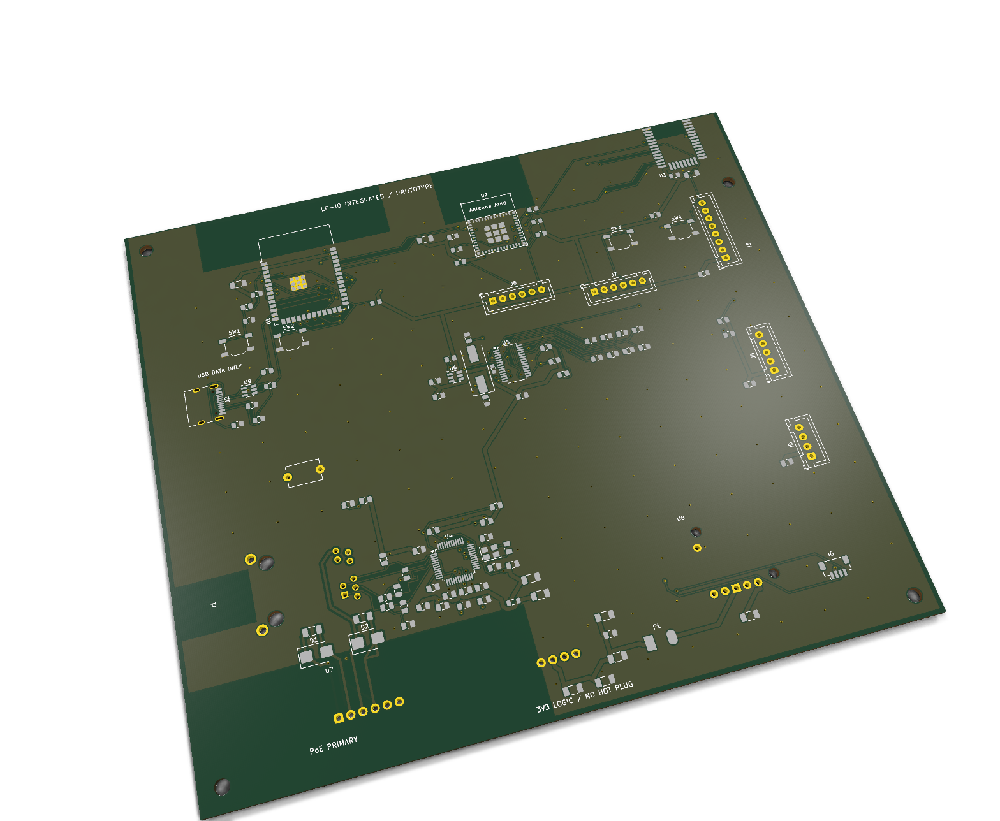
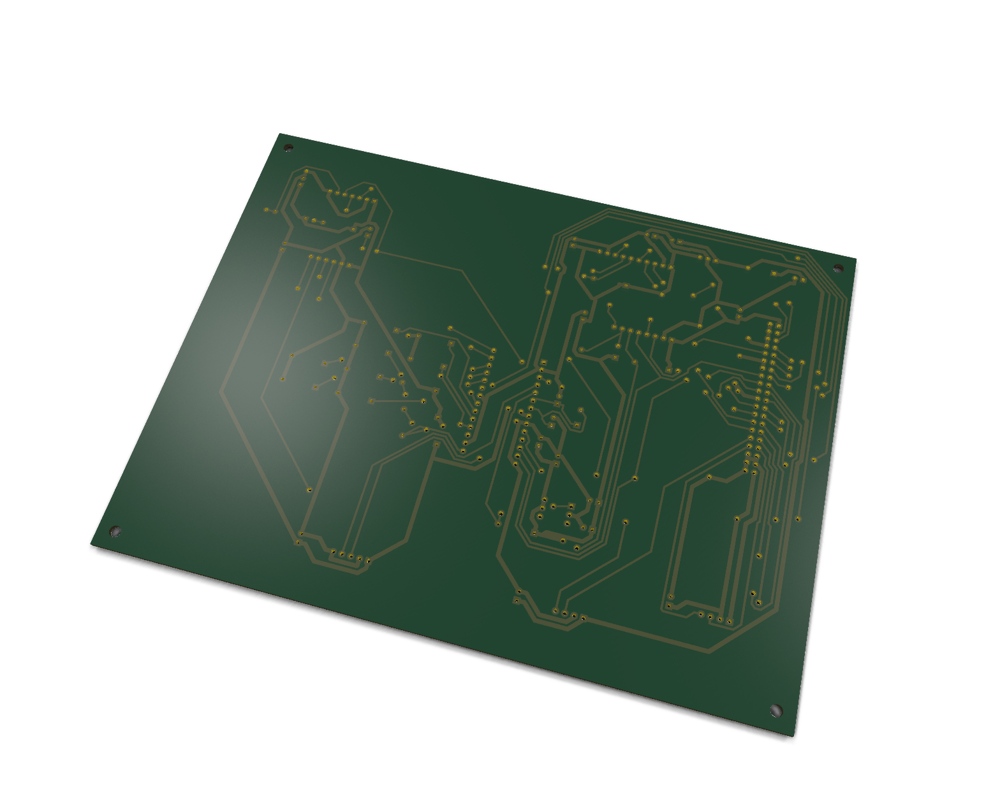

# Native PCB gallery

<!-- MC2-CURRENT-DESIGN -->
> **Current build: [MC2 — three external antennas](../../docs/external-antennas.md).** This page retains an earlier design or evaluation for reference. Its board images, pin maps, enclosure fit and alternative BOMs are not the current MC2 build.

These PNGs are ray-traced by **KiCad from the committed PCB files**. They show
unpopulated boards: module bodies, connectors, cables and other fitted parts are
not modelled. The displayed soldermask and finish are renderer defaults, not an
order specification. The boards remain engineering prototypes awaiting physical
assembly and acceptance.

- [C0 module carrier](../low-power/carrier/): 160 × 100 mm, two layers.
- [M0 MG24 adapter](../low-power/carrier/mg24-adapter/): 60 × 40 mm, two layers;
  required with C0 or D0.
- [I0 integrated alternative](../low-power/integrated/): 160 × 142 mm, four layers.
- [D0 home-etched alternative](../../docs/diy-pcb.md): 190 × 145 mm, bottom
  copper only, with separately installed insulated wire links. Its render is
  viewed from below. Top pad annuli shown by KiCad's generic through-hole model,
  soldermask and plated-hole appearance are not part of the home process.






The original project geometry is covered by the repository license. Upstream
footprint notices remain in the corresponding board directories. No vendor
photography or fictitious populated-board imagery is used in these renders.

Regenerate with KiCad 10 (its renderer needs a working graphics environment):

```sh
python3 hardware/gallery/render.py --kicad-cli kicad-cli
python3 hardware/gallery/render.py --check
```

The [provenance manifest](provenance.json) binds each image to its native PCB
SHA-256, image SHA-256, tool version and rendering options. Rendering is not a
substitute for ERC/DRC, manufacturing review or hardware testing.
