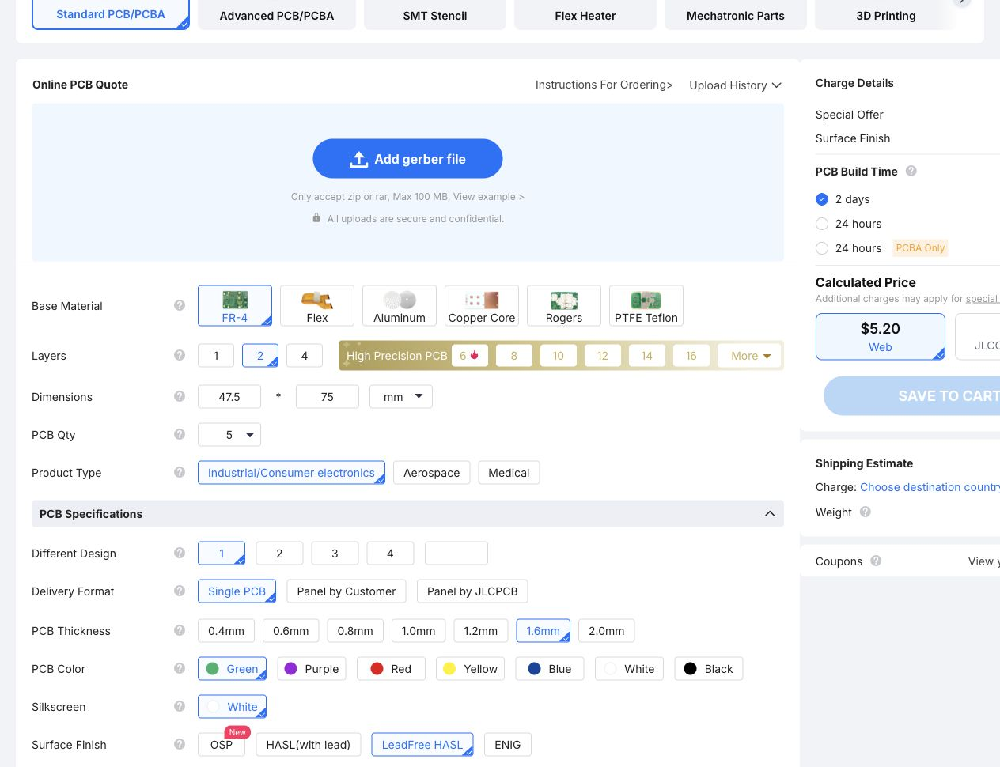

# MC1 fabrication and populated-carrier cost

Checked 17 October 2026. Currency: USD. This review applies to the current
**47.5 × 75 mm, two-layer MC1 carrier**, not the historical LP-C0/LP-I0 designs.
Source revision: `6f187f75b3e6c08df4dcd8d8c4e7f5958d1bc23c`.
PCB SHA-256: `c02f47112b37f0869d86eb1529d490935f7038851a0849897253628d1e5cfedd`.

## Bare PCB

| Service | Quantity | Fabrication total | Per board | Evidence |
| --- | ---: | ---: | ---: | --- |
| JLCPCB website calculator | 5 | **$5.20** | **$1.04** | Displayed preliminary estimate; no Gerbers uploaded |
| OSH Park two-layer prototype | 3 | $27.61 | $9.20 | Calculated from published area tariff |
| OSH Park two-layer prototype | 6 | $55.22 | $9.20 | Calculated from published area tariff |
| OSH Park two-layer Medium Run | 20 | $110.44 | $5.52 | Calculated from published tariff and minimum quantity |

All totals exclude unverified shipping, taxes, duties and surcharges. They are
not paid orders or accepted manufacturing quotes.

### JLCPCB evidence and limitations

The [live calculator](https://cart.jlcpcb.com/quote) displayed $4.00 base plus
$1.20 surface finish for five boards. Settings: FR-4, two layers, one design,
individual boards, 1.6 mm, green mask, white silkscreen, **lead-free HASL**,
1 oz copper, regular outline tolerance, standard via option, electrical test,
normal two-day fabrication, no assembly or stencil. The $3.20 JLCONE desktop
offer also shown is **not** the website price used here.

[Full calculator screenshot](jlc-5.jpg). The quote form had service errors:
quantity changes were rejected with “Maximum supported quantity: 0 pieces,”
and destination selection did not populate. Therefore **$5.20 is a provisional
displayed estimate**, not an independently confirmed checkout total. No prices
for 10 or 20 JLCPCB boards, or delivery to the US, were successfully established.
The [advertised $2 prototype offer](https://jlcpcb.com/ads/pcb-prototype) is not
substituted for the configured website estimate.

### Reconcile the earlier expensive estimate

The [historical manufacturing review](../../../docs/manufacturing.md) priced a
**160 × 100 mm** LP-C0 board using OSH Park Medium Run: about **$248 for ten**
or **$496 for twenty**. That review excluded its separate M0 adapter, parts,
assembly and shipping. Those totals do not describe MC1.

MC1 area is `47.5 × 75 / 25.4² = 5.521886 in²`.
[OSH Park prototype pricing](https://docs.oshpark.com/services/two-layer/) is
$5/in² for three copies; [Medium Run pricing](https://docs.oshpark.com/services/two-layer-medium-run/)
is $1/in² per board, with a 100 in² order minimum and multiples of ten per design.
Ten MC1 boards occupy only 55.22 in² and do **not** meet that minimum alone;
twenty occupy 110.44 in². At the same twenty-board tariff, the new outline saves
**$385.56, or 77.7%**, relative to LP-C0. OSH Park includes ENIG and US manufacture,
so this is a different service specification from the JLCPCB HASL estimate.

The latest reduction from 51 × 75 mm to 47.5 × 75 mm is only 6.86% in area.
Both fit the advertised 100 × 100 mm prototype class. An additional JLCPCB
price reduction from that last change was **not verified**. Do not trade away
assembly clearance, antenna clearance or enclosure support for an assumed
proportional fabrication discount.

## Parts mounted on the carrier

These are retail reference prices, not a consolidated in-stock shopping cart.
The [current BOM](../cad/BOM.csv) defines the exact parts.

| Item | Quantity | Budget | Source / qualification |
| --- | ---: | ---: | --- |
| Waveshare ESP32-S3-Nano-M | 1 | $9.99 | Upper end of the manufacturer's $8.99–9.99 family range; exact M option checkout not confirmed |
| Espressif ESP32-H2-DevKitM-1-N4S | 1 | $9.68 | DigiKey listed unit price; availability must be checked when ordering |
| Seeed XIAO MG24 Pre-Soldered, 102010690 | 1 | $8.90 | Seeed listed unit price |
| WIZnet WIZ850io | 1 | $24.52 | DigiKey listed unit price |
| **Four-module subtotal** | | **$53.09** | |
| Seven male headers, three 1N5819 diodes, two resistors | 1 set | $1–3 | Planning allowance, not a supplier quote; excludes mating harnesses |
| One bare PCB allocated from the five-board estimate | 1 | $1.04 | $5.20 / 5 |
| **Populated-carrier material allocation** | | **$55.13–57.13** | Before freight, tax, duties and labor |

Price sources: [Waveshare](https://www.waveshare.com/product/esp32-s3-nano.htm),
[H2 at DigiKey](https://www.digikey.com/en/products/detail/espressif-systems/ESP32-H2-DEVKITM-1-N4S/26282483),
[Seeed MG24](https://www.seeedstudio.com/Seeed-Studio-XIAO-MG24-Pre-Soldered-p-6381.html),
[WIZ850io at DigiKey](https://www.digikey.com/en/products/detail/wiznet/WIZ850IO/8789619).

If assembling only one unit while purchasing the five-PCB lot, the corresponding
cash budget is **$59.29–61.29**, with four spare bare boards. The component
allowance is still approximate and small-part pack minimums may change checkout.
If the exact compatible H2 can actually be obtained for the user's earlier
**$5 assumption**, subtract **$4.68** from either populated-carrier figure.
At ten WIZ850io modules, the published $19.681 unit tier saves $4.839 per module;
this is not a reason to buy ten for one prototype.

## What this does not buy

The populated carrier is **not the complete seven-function hub**. It still needs
the external isolated 5 V PoE splitter, D24V22F3 regulator, DFR0627 UART bridge,
ZAC93, CC1101, LD2450, BME680, appropriate antennas, harnesses and enclosure.
Already-owned parts reduce new cash outlay but not replacement cost. They have
not been priced again in this carrier-only review.

The assembly plan remains manual: finish and inspect the back, then fit the
front modules. Two-sided placement does not make this a four-layer PCB. No
female module sockets or M0 adapter are purchased. Old SMT setup/stencil/per-joint
tariffs do not represent a quote to hand-solder finished development boards.
Physical fit and commissioning remain prototype acceptance tasks; this cost
review does not change the engineering release status.
