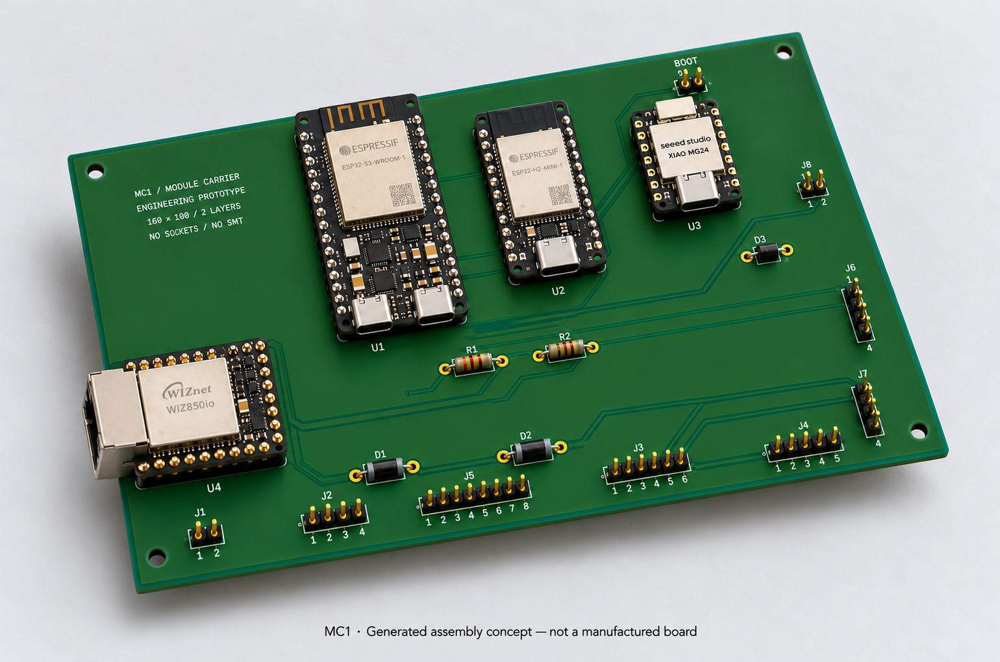

# MC1 image provenance

This is the gallery for the project's single current module carrier. It must not
be confused with the [historical board gallery](../../gallery/README.md).

## Native CAD views

The top and bottom board renders are produced by KiCad from `../cad/mc1.kicad_pcb`.
They represent the actual native carrier layout. Any absent module body or
connector model is not evidence that the physical part can be omitted.

The native render manifest records the PCB and image hashes, KiCad version,
viewpoint and pixel dimensions. Renderer colors are presentation choices, not a
fabrication finish specification.

## Generated assembly illustration

The generated assembly concept is labeled separately. It helps show
finished modules mounted by male pins without female sockets. It is **not** a
photograph of a manufactured board, a dimensioned assembly drawing or evidence of
physical fit. Pin counts, copper, small markings and component details in the
illustration are not engineering data. Use the native CAD and connector manifest.

The [initial prompt](assembly-prompt.txt), [mechanical correction prompt](assembly-edit-prompt.txt), [RJ45 edge correction](ethernet-edge-prompt.txt), and [generation provenance](generated-image-provenance.json) accompany the illustration. It was made with the built-in image_gen tool. No
manufacturer photography is redistributed as project artwork.

## Screenshots

Browser screenshots show the rendered current MC1 visual guide. They are UI
verification artifacts and must be refreshed when the visible guide changes.
They do not replace the source SVGs or native PCB files.

Captured views: [current PCB](ui-pcb.jpg), [assembly illustration](ui-assembly.jpg),
[net search](ui-wiring.jpg). The [screenshot record](screenshot-provenance.json)
records the source hash, native 319 px viewport and successful search check.
The [migration manifest](../visual-migration.json) accounts for current and
historical visual assets.
