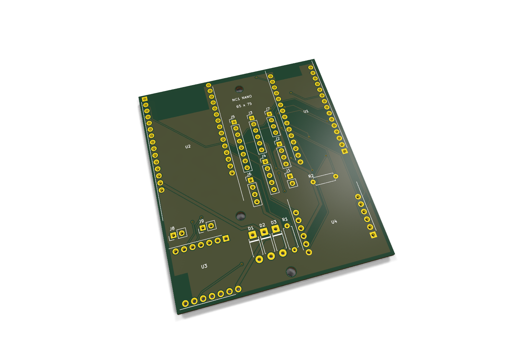
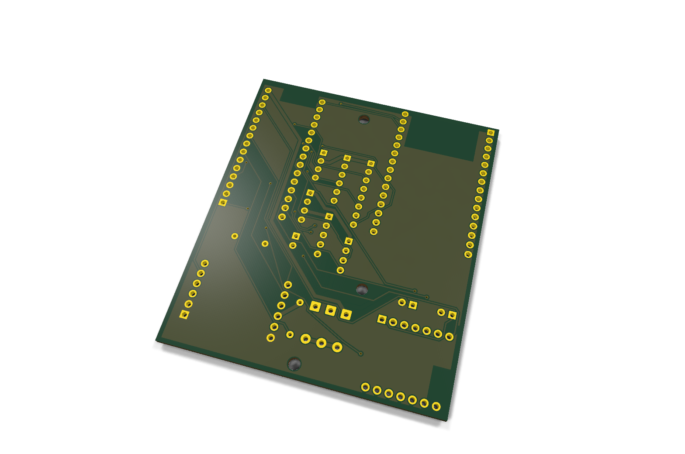

# MC1 image provenance

This is the gallery for the project's single current module carrier. It must not
be confused with the [historical board gallery](../../gallery/README.md).

## Native CAD views

The top and bottom board renders are produced by KiCad from `../cad/mc1.kicad_pcb`.
They represent the actual native carrier layout. Any absent module body or
connector model is not evidence that the physical part can be omitted.

The native render manifest records the PCB and image hashes, KiCad version,
viewpoint and pixel dimensions. Renderer colors are presentation choices, not a
fabrication finish specification.

## Current assembly view

The current version uses the S3-Nano-M host on an 65 × 75 mm carrier, with RJ45 facing the bottom edge.

Use the [dimensioned assembly drawing](../cad/assembly-top.svg) to see the four
mounted modules, internal harness headers, antenna exclusions, physical USB shells and
outward-facing RJ45. It is generated from the same geometry as the native PCB.
The [same-scale comparison](../layout-comparison.svg) shows the area reduction.

## Historical and rejected illustrations

The preceding 80 × 90 mm USB-service layout is archived under
[usb-service-80x90](history/usb-service-80x90/). Its large cable corridors are no
longer part of the current assembly.

The preceding full-size-S3 renders and browser captures are archived under
[pre-nano](history/pre-nano/). They describe the former 100 × 90 mm board, not the current assembly.

The earlier [160 × 100 mm concept](history/mc1-160x100-concept.png) is retained
only as history, with its [provenance](history/mc1-160x100-provenance.json).
It must not be used for the compact board.

A new image made with the built-in image_gen tool from the compact assembly
drawing was **rejected**: it invented antenna bodies, misrepresented connector
details and exaggerated the RJ45 overhang. The
[rejected image](history/mc1-100x90-rejected-concept.png),
[prompt](compact-layout-prompt.txt) and
[review record](history/mc1-100x90-rejected-review.json) are retained for traceability,
but the image is not shown as a current assembly view. No manufactured-board
photograph is available. No manufacturer photography is redistributed here.

## Screenshots

Browser screenshots show the rendered current MC1 visual guide. They are UI
verification artifacts and must be refreshed when the visible guide changes.
They do not replace the source SVGs or native PCB files.

Captured views: [current PCB](ui-pcb.jpg), [assembly drawing](ui-assembly.jpg),
[net search](ui-wiring.jpg), [module architecture](ui-architecture.jpg), and
[Thread recovery](ui-recovery.jpg), and [network updates](ui-updates.jpg). The [screenshot record](screenshot-provenance.json)
records the source hash, viewport and successful search check.
The [migration manifest](../visual-migration.json) accounts for current and
historical visual assets.
